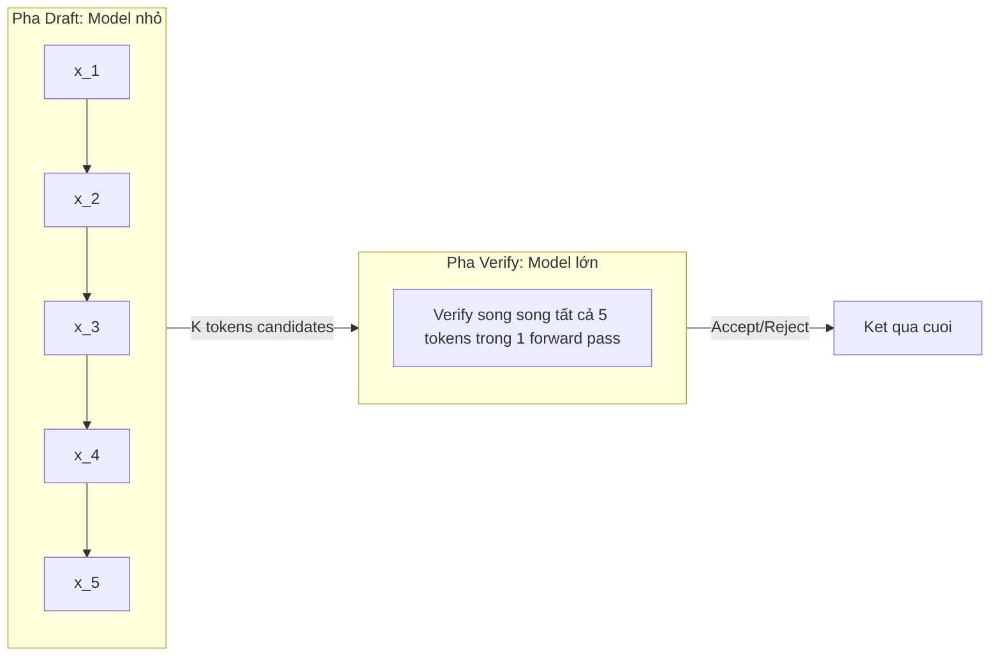

# Case 4: Speculative Decoding - Draft Model + Target Model

## Phần 1. Bối cảnh

LLM inference bị bottleneck bởi memory bandwidth, đặc biệt ở giai đoạn decode (sinh từng token một). Speculative Decoding là kỹ thuật dùng một mô hình nhỏ (draft model) sinh nhanh nhiều token, rồi dùng mô hình lớn (target model) verify song song tất cả cùng lúc, đạt tốc độ 2-3x mà không thay đổi chất lượng output.

---

## Phần 2. Nguyên lý hoạt động

### Thuật toán cốt lõi



1. **Draft Phase**: mô hình nhỏ (ví dụ Llama 160M) sinh K token candidates: $x_1, x_2, \ldots, x_K$.
2. **Verify Phase**: mô hình lớn (ví dụ Llama 70B) thực hiện **1 forward pass duy nhất** trên toàn bộ chuỗi $[x_1, \ldots, x_K]$ để tính xác suất $p_{target}(x_i | x_{\lt i})$.
3. **Accept/Reject**: so sánh xác suất draft và target, accept lần lượt từng token, dừng ở token đầu tiên bị reject. Vì forward pass của target trên $K$ token cũng cho ra phân phối ở vị trí kế tiếp, mỗi vòng luôn sinh được ít nhất 1 token và tối đa $K + 1$ token.

### Xác suất chấp nhận

Token $x_i$ được chấp nhận với xác suất:

$$\alpha_i = \min\left(1, \frac{p_{target}(x_i | x_{\lt i})}{p_{draft}(x_i | x_{\lt i})}\right)$$

Nếu $p_{target} \geq p_{draft}$, token luôn được chấp nhận ($\alpha = 1$). Nếu token bị reject, một token mới được lấy mẫu từ phân phối phần dư $\text{norm}\left(\max(0, p_{target} - p_{draft})\right)$. Chính bước lấy mẫu phần dư này bảo đảm phân phối output **trùng khớp chính xác** với việc lấy mẫu từ target model (Leviathan et al., 2023; Chen et al., 2023). Với greedy decoding ($T = 0$), quy tắc rút gọn thành: chấp nhận khi token draft trùng argmax của target.

### Kỳ vọng số token accept

$$\mathbb{E}[\text{accepted}] = \sum_{i=1}^{K} \prod_{j=1}^{i} \alpha_j$$

Nếu giả định mỗi token được chấp nhận độc lập với cùng xác suất $\alpha$, số token sinh ra mỗi vòng (kể cả token do target bổ sung) có kỳ vọng:

$$\mathbb{E}[\text{tokens/vòng}] = \sum_{i=0}^{K} \alpha^i = \frac{1 - \alpha^{K+1}}{1 - \alpha}$$

Ví dụ $\alpha = 0.8$, $K = 8$: $\mathbb{E} = (1 - 0.8^9)/0.2 \approx 4.33$ token mỗi vòng. Speedup thực tế thấp hơn con số này vì còn chi phí chạy draft model $K$ lần và chi phí verify $K + 1$ token; khi $K \to \infty$, $\mathbb{E}$ chỉ tiến tới $1/(1 - \alpha) = 5$, nên tăng $K$ quá lớn không có lợi.

---

## Phần 3. Triển khai trong llama.cpp

### Cấu hình

```bash
# Công cụ demo có in thống kê acceptance (examples/speculative-simple)
./build/bin/llama-speculative-simple \
    -m llama-3.1-8b-instruct-q4_k_m.gguf \
    -md llama-3.2-1b-instruct-q8_0.gguf \
    --spec-type draft-simple \
    --spec-draft-n-max 16 \
    -p "Explain quantum entanglement:" \
    -n 200 --temp 0 -ngl 99 -ngld 99

# Triển khai thực tế: llama-server với cùng các cờ
./build/bin/llama-server \
    -m llama-3.1-8b-instruct-q4_k_m.gguf \
    -md llama-3.2-1b-instruct-q8_0.gguf \
    --spec-type draft-simple --spec-draft-n-max 16 -ngl 99 -ngld 99
```

| Flag | Ý nghĩa |
|:---|:---|
| `-m` | Target model (lớn, chính xác) |
| `-md`, `--spec-draft-model` | Draft model (nhỏ, nhanh) |
| `--spec-type draft-simple` | Chọn speculative decoding với draft model độc lập |
| `--spec-draft-n-max K` | Số token draft tối đa mỗi vòng (mặc định 3) |
| `--spec-draft-n-min N` | Số token draft tối thiểu để chạy verify (mặc định 0) |
| `-ngld N` | Số layer của draft model offload lên GPU |

Lưu ý: các cờ cũ `--draft`, `--draft-max`, `--draft-min` đã bị gỡ; dùng chúng sẽ nhận thông báo lỗi gợi ý cờ `--spec-draft-*` mới. Upstream còn hỗ trợ các biến thể khác qua `--spec-type`: `draft-eagle3`, `draft-mtp`, `draft-dflash`, `draft-dspark` (xem `docs/speculative.md`).

### Draft model tương thích

Draft model **phải** dùng cùng vocabulary và tokenizer với target model:

- Llama 3.1 8B + Llama 3.2 1B: cùng tokenizer Llama 3 (vocab 128256).
- Qwen2.5 72B + Qwen2.5 0.5B: cùng vocabulary.
- Llama + Qwen: không dùng được vì vocab khác nhau. `common/speculative.cpp` kiểm tra vocab type, token BOS/EOS và độ khớp vocab, rồi từ chối hoặc cảnh báo nếu không tương thích.

---

## Phần 4. Phân tích hiệu năng thực tế

### Thí nghiệm minh họa: Llama 3.1 8B + Llama 3.2 1B

Bảng dưới là số liệu minh họa để phân tích xu hướng; speedup thực tế phụ thuộc mạnh vào phần cứng, nhiệt độ sampling và loại văn bản. `llama-speculative-simple` và metric `llamacpp:spec_decode_num_accepted_tokens_total` của `llama-server` cho phép đo acceptance thật.

| Cấu hình | Tokens/sec | Speedup | Acceptance Rate |
|:---|:---|:---|:---|
| Baseline (chỉ 8B) | 25 t/s | 1.0x | - |
| Speculative K=8 | 55 t/s | 2.2x | ~78% |
| Speculative K=16 | 62 t/s | 2.5x | ~72% |
| Speculative K=32 | 58 t/s | 2.3x | ~61% |

Nhận xét:
- K quá nhỏ: không khai thác đủ parallelism của verify phase.
- K quá lớn: draft model sinh nhiều token sai, acceptance rate giảm, lãng phí compute.
- **Sweet spot**: phụ thuộc cặp model; với cặp 8B/1B trên GPU thường nằm trong khoảng 8 đến 16, nên quét `--spec-draft-n-max` thay vì cố định.

### Yếu tố ảnh hưởng acceptance rate

1. **Độ tương đồng kiến trúc**: cùng architecture family cho acceptance cao hơn.
2. **Kích thước ratio**: draft/target ratio 1:10 đến 1:50 cho kết quả tốt.
3. **Nhiệt độ sampling**: temperature cao làm draft diverge nhiều hơn, giảm acceptance.
4. **Domain**: code generation có acceptance cao hơn creative writing (do predictable hơn).

---

## Phần 5. Speculative Decoding không cần draft model (n-gram)

Khi không có draft model phù hợp, llama.cpp hỗ trợ các biến thể **n-gram**: draft được lấy từ chính lịch sử token (prompt và phần đã sinh). Nếu n-gram hiện tại đã xuất hiện trước đó, các token theo sau nó được đề xuất làm draft. Lưu ý đây **không** phải kỹ thuật dùng early layers của target làm draft (kiểu LayerSkip); llama.cpp không cài đặt cách đó.

```bash
./build/bin/llama-server \
    -m llama-3.1-70b-instruct-q4_k_m.gguf \
    --spec-type ngram-mod \
    --spec-ngram-mod-n-match 24 --spec-ngram-mod-n-min 48 --spec-ngram-mod-n-max 64
```

Các lựa chọn khác gồm `ngram-simple`, `ngram-map-k`, `ngram-map-k4v` và `ngram-cache` (dùng file cache tĩnh/động `-lcs`/`-lcd`, cũng có trong ví dụ `llama-lookup`). Phù hợp khi:
- Không có draft model tương thích.
- Bộ nhớ không đủ tải 2 model cùng lúc.
- Text có tính lặp cao (code, templates).

---

## Phần 6. Kết luận

Speculative Decoding là kỹ thuật tăng tốc inference **lossless** về mặt phân phối: với rejection sampling đúng chuẩn, output có cùng phân phối với target model. (Trên thực tế, việc verify theo batch có thể làm thay đổi thứ tự cộng số thực, nên chuỗi greedy đôi khi khác bản không speculative ở mức bit, nhưng không làm giảm chất lượng.) Chìa khóa nằm ở việc chọn draft model phù hợp (cùng vocab, tỷ lệ size hợp lý) và tinh chỉnh K. Speedup 2-3x là khả thi cho nhiều cặp model mà không cần thay đổi phần cứng.
