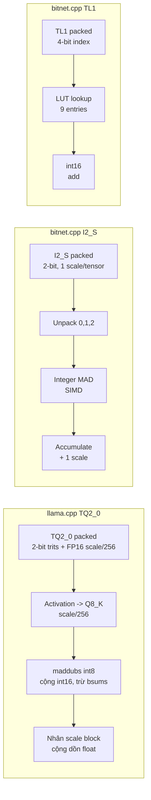

# Case Study 6: So sánh bitnet.cpp và llama.cpp cho Ternary LLM

Case study này so sánh hai framework khi chạy ternary model, phân tích sự khác biệt về định dạng, kernel, độ tái lập (exact match) và use case phù hợp, đồng thời đưa ra quy trình tự benchmark có thể lặp lại.

---

## Phần 1. Bối cảnh

Giả sử cần deploy một ternary model trên laptop Apple Silicon hoặc x86 để chạy inference tại edge. Có hai lựa chọn:
1. **llama.cpp upstream**: dùng kiểu ternary `TQ1_0` (1.6875 bpw) hoặc `TQ2_0` (2.0625 bpw).
2. **bitnet.cpp**: dùng kernel chuyên biệt `I2_S` (2 bpw), `TL1` (ARM, 2 bpw) hoặc `TL2` (x86, 1.67 bpw).

Một hiểu lầm phổ biến là "cả hai đọc cùng một file GGUF". Thực tế, **container** giống nhau nhưng **kiểu tensor** khác nhau: `I2_S`/`TL1`/`TL2` chỉ có trong fork llama.cpp của bitnet.cpp (`3rdparty/llama.cpp`), không có trong `enum ggml_type` của upstream. Vì vậy:
- `ggml-model-i2_s.gguf` chỉ chạy trên bitnet.cpp.
- Muốn chạy bằng upstream, phải convert riêng sang `TQ1_0`/`TQ2_0` từ checkpoint Hugging Face.

Ngoài ra, phạm vi kiến trúc khác nhau: BitNet-b1.58-2B-4T (squared ReLU, tên tensor `attn_sub_norm`/`ffn_sub_norm`) được bitnet.cpp hỗ trợ chính thức, còn đồ thị BitNet của upstream (`src/models/bitnet.cpp`, FFN dạng `LLM_FFN_SILU`) khớp với các checkpoint kiểu `1bitLLM/bitnet_b1_58-large`. Do đó, model dùng chung cho so sánh công bằng là **bitnet_b1_58-large (0.7B)**, cũng chính là model mà paper dùng cho thí nghiệm lossless.

---

## Phần 2. Số liệu đã công bố (arXiv:2410.16144)

### 2.1. Performance

Các con số dưới đây so bitnet.cpp với **llama.cpp FP16** (không phải với TQ1_0/TQ2_0), trên model dummy theo kích thước, chế độ không giới hạn thread:

| Model | Apple M2 Ultra | Intel i7-13700H |
|:---|:---|:---|
| 700M | 114.47 -> 194.38 tok/s (1.70x) | 30.73 -> 119.08 tok/s (3.88x) |
| 7B | 15.61 -> 52.36 tok/s (3.35x) | 3.30 -> 18.75 tok/s (5.68x) |
| 70B | 1.71 -> 8.67 tok/s (5.07x) | FP16 không chạy được; bitnet.cpp 2.44 tok/s |

### 2.2. Exact Match với FP32 reference (Bảng 7)

1,000 prompt WildChat, model 700M, tối đa 100 token, một mẫu chỉ đạt khi **mọi token** trùng với output của FP32 kernel:

| Framework | Kernel | Tỷ lệ mẫu trùng khớp tuyệt đối |
|:---|:---|:---|
| llama.cpp | TQ1_0 | **1.4%** |
| llama.cpp | TQ2_0 | **1.4%** |
| bitnet.cpp | I2_S | **100%** |
| bitnet.cpp | TL1 | **100%** |
| bitnet.cpp | TL2 | **100%** |

### 2.3. Energy (J/token, Bảng 6)

| Model | Apple M2 Ultra: llama.cpp FP16 -> bitnet.cpp | Intel i7-13700H: llama.cpp FP16 -> bitnet.cpp |
|:---|:---|:---|
| 700M | 0.314 -> 0.140 (giảm 55.4%) | 1.367 -> 0.384 (giảm 71.9%) |
| 7B | 3.013 -> 1.068 (giảm 64.6%) | 11.305 -> 2.017 (giảm 82.2%) |
| 70B | 28.02 -> 8.42 (giảm 70.0%) | không có baseline |

Paper không công bố tốc độ hay năng lượng của TQ1_0/TQ2_0. Báo cáo kỹ thuật arXiv:2502.11880 nhận xét TQ1_0 chậm hơn TQ2_0 (vì giải mã 5 trit/byte tốn kém hơn), còn TQ2_0 dùng 2 bit để giữ alignment.

---

## Phần 3. Tự benchmark: quy trình lặp lại được

```bash
# A. bitnet.cpp (I2_S)
git clone --recursive https://github.com/microsoft/BitNet.git && cd BitNet
pip install -r requirements.txt
python setup_env.py --hf-repo 1bitLLM/bitnet_b1_58-large -q i2_s
python utils/e2e_benchmark.py -m models/bitnet_b1_58-large/ggml-model-i2_s.gguf -p 128 -n 256 -t 4
cd ..

# B. llama.cpp upstream (TQ2_0 và TQ1_0)
cd llama.cpp
huggingface-cli download 1bitLLM/bitnet_b1_58-large --local-dir bitnet-large
python convert_hf_to_gguf.py bitnet-large --outtype f16 --outfile bitnet-large-f16.gguf
./build/bin/llama-quantize bitnet-large-f16.gguf bitnet-large-tq2_0.gguf TQ2_0
./build/bin/llama-quantize bitnet-large-f16.gguf bitnet-large-tq1_0.gguf TQ1_0
./build/bin/llama-bench -m bitnet-large-f16.gguf,bitnet-large-tq2_0.gguf,bitnet-large-tq1_0.gguf \
    -p 128 -n 256 -t 4 -ngl 0
```

Ghi chú phương pháp:
- Cố định số thread (`-t`), tắt GPU offload (`-ngl 0`) trên Apple Silicon để so CPU với CPU.
- `e2e_benchmark.py` của bitnet.cpp gọi `llama-bench` của fork, nên hai bảng kết quả có cùng định dạng (pp128, tg256).
- Kiểm tra chất lượng bằng `llama-perplexity` trên cùng một file dữ liệu cho cả hai phía; perplexity phản ánh chất lượng ngôn ngữ, còn exact match (Phần 2.2) phản ánh tính tái lập.

Một ước lượng định tính trước khi đo: ở pha decode, số byte đọc cho mỗi token tỷ lệ với bpw, nên trần tốc độ của TL2 (1.67 bpw), TQ1_0 (1.69), I2_S (2.0) và TQ2_0 (2.06) gần nhau; khác biệt thực đo chủ yếu đến từ chi phí giải mã và mức độ tối ưu SIMD của từng kernel, cộng với phần embedding/output vẫn ở F16 hoặc Q6_K.

---

## Phần 4. Phân tích

### 4.1. Tại sao llama.cpp TQ chỉ đạt 1.4% exact match?

Không phải vì "dequantize về float". Kernel `ggml_vec_dot_tq2_0_q8_K` (`ggml/src/ggml-cpu/arch/x86/quants.c`) tính trực tiếp trên trits:

```
trits {0,1,2} x activation int8 (Q8_K) -> maddubs, cộng int16 -> trừ bsums -> nhân scale block
```

Kết quả số nguyên trong mỗi block là chính xác. Nguồn sai khác là **sơ đồ scale**: activation dùng `Q8_K` (một scale cho mỗi 256 phần tử) thay vì per-token absmax như lúc train, và weight scale được lưu FP16 cho mỗi block. Các khác biệt làm tròn nhỏ này đủ để đổi một token argmax ở đâu đó trong 100 token, khiến chuỗi tách nhánh.

bitnet.cpp tái hiện đúng sơ đồ W1.58A8 của lúc train:
```
ternary weights + INT8 activations (scale như lúc train) -> MAD hoặc LUT -> accumulate -> 1 scale/tensor
```

### 4.2. Kernel Architecture So sánh



### 4.3. Khi nào dùng framework nào?

| Scenario | Framework | Lý do |
|:---|:---|:---|
| Ternary model, cần tái lập bit-exact với reference | **bitnet.cpp** | 100% exact match trong thí nghiệm của paper |
| BitNet-b1.58-2B-4T trên CPU | **bitnet.cpp** | Hỗ trợ chính thức kiến trúc 2B4T, có GGUF I2_S phát hành sẵn |
| Ternary model kiểu 1bitLLM, prototype nhanh | llama.cpp | Có sẵn TQ1_0/TQ2_0, không cần clang 18 hay sinh mã kernel |
| Non-ternary model (FP16, Q4, Q8, I-quants) | **llama.cpp** | Hơn 30 quant types; bitnet.cpp không nhắm tới |
| Model 1-bit/ternary dạng Bonsai (`Q1_0`, `Q2_0`) | **llama.cpp** | Kiểu mới có trong upstream; xem [Bài 11](../lesson_11_bonsai_model_family) |
| GPU inference | llama.cpp | Backend CUDA/Metal/Vulkan đầy đủ; bitnet.cpp có kernel GPU riêng (05/2025) chạy qua pipeline Python trong thư mục `gpu/` |
| Edge device, tối ưu energy | **bitnet.cpp** | Giảm 55.4% đến 82.2% năng lượng so với llama.cpp FP16 |
| Multi-model serving | llama.cpp | `llama-server` với router mode, nhiều kiến trúc |

---

## Phần 5. Compatibility

### 5.1. Model Format

Cả hai đều dùng **GGUF** làm container, nhưng tập `ggml_type` khác nhau. GGUF chứa `TQ1_0`/`TQ2_0` có thể chạy trên upstream (và nhiều khả năng trên fork, vì fork giữ các kiểu của upstream tại thời điểm fork); GGUF chứa `I2_S`/`TL1`/`TL2` chỉ chạy trên bitnet.cpp.

### 5.2. Build Requirements

| Yêu cầu | llama.cpp | bitnet.cpp |
|:---|:---|:---|
| Compiler | GCC/Clang/MSVC | **Clang >= 18** |
| Dependencies | CMake (OpenSSL tùy chọn cho tải model qua HTTPS) | Python >= 3.10, CMake >= 3.22, Clang >= 18, conda khuyến nghị |
| Build complexity | `cmake -B build && cmake --build build` | `setup_env.py`: cài gguf-py của fork, sinh mã kernel, build, convert model |

### 5.3. Shared Foundation

bitnet.cpp dùng một fork llama.cpp làm submodule (`3rdparty/llama.cpp`), chia sẻ:
- GGML tensor library
- GGUF reader/writer
- Tokenizer, sampling, text generation
- Các binary `llama-cli`, `llama-quantize`, `llama-bench` (phiên bản của fork; `run_inference.py` và `e2e_benchmark.py` là lớp bọc Python quanh chúng)

Vì fork không đồng bộ liên tục với upstream, các cờ dòng lệnh của `llama-cli` trong bitnet.cpp có thể khác bản upstream hiện tại (ví dụ `-cnv` vẫn được dùng trong `run_inference.py`).

---

## Phần 6. Kết luận

**bitnet.cpp** là lựa chọn tối ưu khi:
- Model là **native ternary** (train với QAT/STE, không phải FP16 bị lượng tử hóa sau)
- Cần **tái lập bit-exact** so với FP32 reference
- Ưu tiên **energy efficiency** trên edge devices

**llama.cpp** vẫn là lựa chọn đúng khi:
- Model không phải ternary (Q4_K_M, Q8_0, IQ4_NL...) hoặc dùng các kiểu bit thấp mới như `Q1_0`/`Q2_0`
- Cần GPU offload đầy đủ
- Cần flexibility với nhiều model architectures và tính năng server

Cả hai framework bổ sung cho nhau trong ecosystem LLM inference.

---

## Tham khảo

- Microsoft BitNet: https://github.com/microsoft/BitNet
- llama.cpp: https://github.com/ggml-org/llama.cpp
- Wang et al., "1-bit AI Infra: Part 1.1, Fast and Lossless BitNet b1.58 Inference on CPUs", arXiv:2410.16144.
- "Bitnet.cpp: Efficient Edge Inference for Ternary LLMs", arXiv:2502.11880.
- llama.cpp PR #7931 (BitNet model support), PR #8151 (TQ1_0/TQ2_0).
