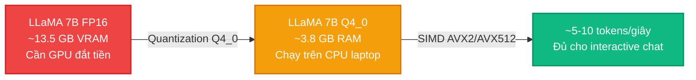
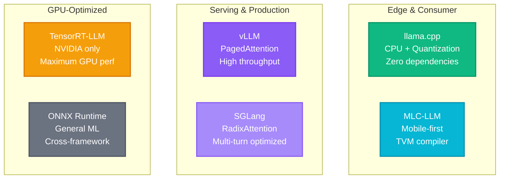
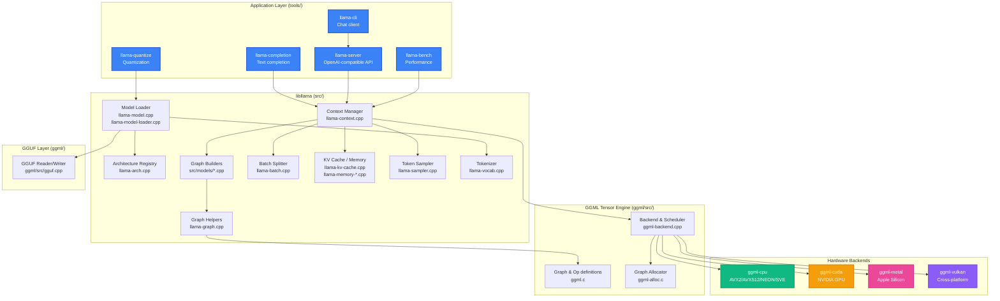

# Bài 0: llama.cpp và Cuộc cách mạng Inference trên CPU

Trước khi đi sâu vào kiến trúc kỹ thuật, chúng ta cần hiểu rõ **tại sao llama.cpp ra đời** và nó giải quyết bài toán hệ thống nào mà các framework trước đó không làm được. Bài học này sẽ đặt nền móng cho toàn bộ chuỗi bài giảng bằng cách phân tích động lực, bối cảnh và vị trí của llama.cpp trong landscape inference LLM hiện đại.

---

## 1. Bối cảnh: Nghịch lý Phần cứng trong LLM Inference

Vào đầu năm 2023, khi Meta công bố mô hình LLaMA (7B, 13B, 33B, 65B), cộng đồng nghiên cứu đối mặt với một nghịch lý:

- Mô hình 7B ở độ chính xác FP16 chiếm **14 GB VRAM**, vừa đủ cho GPU consumer (RTX 3090 có 24 GB).
- Nhưng mô hình 13B cần **26 GB VRAM**, vượt quá dung lượng GPU consumer phổ biến.
- Mô hình 65B cần **130 GB VRAM**, đòi hỏi nhiều GPU A100 đắt tiền.

Trong khi đó, inference (suy luận) khác hoàn toàn với training (huấn luyện):

- **Training** yêu cầu lưu optimizer states, gradients, activations, tổng chi phí bộ nhớ gấp 4-6 lần trọng số mô hình. GPU là bắt buộc.
- **Inference** chỉ cần trọng số mô hình + KV Cache, chi phí bộ nhớ thấp hơn nhiều. Về lý thuyết, CPU với RAM lớn hoàn toàn có thể đảm nhiệm.

Nhưng các framework inference phổ biến lúc bấy giờ (HuggingFace Transformers, ONNX Runtime, TensorRT) đều thiết kế quanh GPU, bỏ qua tiềm năng khổng lồ của CPU hiện đại với AVX2/AVX512 và bộ nhớ RAM lên tới 128-256 GB.

---

## 2. llama.cpp ra đời: Tháng 3/2023

Vào ngày 10 tháng 3 năm 2023, **Georgi Gerganov**, một lập trình viên người Bulgaria, công bố dự án `llama.cpp` trên GitHub. Mục tiêu ban đầu rất đơn giản: **chạy mô hình LLaMA 7B trên MacBook bằng CPU thuần túy**.

### 2.1. Triết lý thiết kế cốt lõi

Gerganov áp dụng ba nguyên tắc thiết kế then chốt:

1. **Zero dependencies**: Toàn bộ thư viện viết bằng C/C++ thuần, không phụ thuộc vào PyTorch, TensorFlow hay bất kỳ framework ML nào. Điều này cho phép biên dịch trên mọi nền tảng từ macOS, Linux, Windows đến Android, iOS.

2. **Quantization làm vũ khí chính**: Thay vì chạy FP16 (16 bit/trọng số), llama.cpp nén trọng số xuống khoảng 4 bit. Định dạng Q4_0 thực chất tốn **4.5 bit/trọng số** (18 byte cho mỗi block 32 trọng số: 2 byte scale FP16 cộng 16 byte giá trị 4-bit), tức giảm bộ nhớ khoảng $16 / 4.5 \approx 3.6$ lần chứ không phải đúng 4 lần. Mô hình LLaMA 7B (6.7 tỷ tham số) từ khoảng 13.5 GB xuống còn khoảng **3.8 GB**, chạy được trên laptop 8 GB RAM.

3. **SIMD optimization tối đa**: Tận dụng các tập lệnh vector của CPU (AVX2 xử lý 8 số FP32 cùng lúc, AVX512 xử lý 16 số) để tăng tốc tính toán matrix multiplication, vốn là bottleneck của inference.

### 2.2. Tại sao CPU có thể inference LLM?

Đây là câu hỏi quan trọng nhất. Câu trả lời nằm ở **memory bandwidth bottleneck** (nghẽn cổ chai băng thông bộ nhớ):

LLM inference, đặc biệt là giai đoạn decode (sinh token từng cái một), là bài toán **memory-bound**, không phải compute-bound. Với mỗi token mới, hệ thống cần:

1. Đọc toàn bộ trọng số mô hình từ bộ nhớ (RAM hoặc VRAM).
2. Thực hiện matrix-vector multiplication (vì batch size = 1 khi decode).
3. Kết quả là một vector logits, rồi sample ra token tiếp theo.

Tốc độ bị giới hạn bởi **băng thông bộ nhớ**, không phải số phép tính FLOPS:

$$\text{Tokens/giây} \approx \frac{\text{Băng thông bộ nhớ (GB/s)}}{\text{Kích thước mô hình (GB)}}$$

| Platform | Băng thông bộ nhớ (đỉnh lý thuyết) | LLaMA 7B FP16 (~13.5 GB) | LLaMA 7B Q4_0 (~3.8 GB) |
|:---|:---|:---|:---|
| DDR4-3200, 1 kênh (CPU) | ~25 GB/s | ~1.9 tok/s | ~6.7 tok/s |
| DDR5-6400, 1 kênh (CPU) | ~51 GB/s | ~3.8 tok/s | ~13.5 tok/s |
| Apple M2 (Unified) | ~100 GB/s | ~7.4 tok/s | ~26 tok/s |
| RTX 3090 (VRAM) | ~936 GB/s | ~69 tok/s | ~246 tok/s |

Đọc bảng trên như một **cận trên** (upper bound): công thức giả định mỗi byte trọng số được đọc đúng một lần cho mỗi token và băng thông đạt mức đỉnh. Trên thực tế, hệ thống thường chỉ đạt khoảng 50-80% băng thông đỉnh, và phải đọc thêm KV Cache, nên tốc độ thực đo thấp hơn. Dù vậy, kết luận định tính vẫn đứng vững: CPU với DDR5 có thể đạt khoảng **10 tokens/giây** cho mô hình 7B Q4_0, đủ cho trải nghiệm chat tương tác (con người đọc khoảng 5-7 tokens/giây). Apple Silicon với unified memory bandwidth 100+ GB/s đạt mức cao hơn đáng kể. Một máy desktop với DDR5 hai kênh sẽ có băng thông gấp đôi dòng một kênh trong bảng.

---

## 3. Tổng quan LLM Inference Landscape (2023-2026)

Để hiểu vị trí của llama.cpp, chúng ta cần so sánh nó với các framework inference khác:

### 3.1. Bốn trường phái Inference

### 3.2. So sánh chi tiết

| Tiêu chí | llama.cpp | vLLM | TensorRT-LLM | ONNX Runtime |
|:---|:---|:---|:---|:---|
| **Phần cứng** | CPU + GPU đa nền | GPU (NVIDIA, AMD) | NVIDIA only | CPU + GPU |
| **Ngôn ngữ** | C/C++ | Python + CUDA C++ | C++ + Python | C++ + Python |
| **Dependencies** | Zero | PyTorch, CUDA, Ray | CUDA, TensorRT | ONNX, Protobuf |
| **Quantization** | 35 `ggml_type` đang hoạt động, 36 preset `llama_ftype` (từ Q1_0, IQ1_S đến Q8_0, MXFP4, NVFP4) | AWQ, GPTQ, FP8 | FP8, INT4, INT8 | INT8, FP16 |
| **Mục tiêu** | Single-user, edge | Multi-user serving | Maximum NVIDIA perf | General ML inference |
| **Throughput** | Thấp-trung bình | Rất cao (batching) | Rất cao | Trung bình |
| **Latency** | Thấp (single request) | Trung bình (batch) | Rất thấp | Trung bình |
| **Dung lượng** | ~50 MB binary | ~2 GB (PyTorch) | ~5 GB (CUDA+TRT) | ~500 MB |

### 3.3. Khi nào nên dùng llama.cpp?

llama.cpp tỏa sáng trong các tình huống sau:

1. **Edge deployment**: Chạy LLM trên Raspberry Pi, điện thoại Android/iOS, laptop không có GPU rời.
2. **Privacy-first inference**: Toàn bộ inference chạy local, không cần gửi data lên cloud.
3. **Rapid prototyping**: Tải và chạy mô hình mới trong vài phút, không cần setup phức tạp.
4. **Resource-constrained environments**: Docker container nhỏ, embedded systems, CI/CD pipelines.
5. **Apple Silicon**: Tận dụng unified memory và Metal GPU backend để đạt hiệu năng cao trên Mac.
6. **Quantization research**: Thử nghiệm các phương pháp quantization mới với codebase C minh bạch.

---

## 4. Kiến trúc tổng quan của llama.cpp

Trước khi đi sâu vào từng thành phần, hãy nhìn bức tranh tổng thể:

Kiến trúc này được tổ chức thành **bốn tầng trừu tượng**:

1. **Application Layer** (`tools/`): Các công cụ đầu cuối. Lưu ý hai thay đổi quan trọng so với giai đoạn 2023: chương trình `main` cũ đã đổi tên thành `llama-cli` (từ giữa 2024, mọi binary đều mang tiền tố `llama-`), và hiện nay `llama-cli` là một **chat client** được build bằng cách link thư viện `llama-server-impl` (xem `tools/cli/CMakeLists.txt`), trong khi chế độ sinh văn bản "cổ điển" của `main` được giữ lại ở `llama-completion` (`tools/completion/`). Các công cụ khác: `llama-bench`, `llama-perplexity`, `llama-quantize`, `llama-imatrix`, `llama-gguf-split`, `llama-mtmd-cli` (đa phương thức).
2. **libllama** (`src/`): Tầng điều phối chính, quản lý mô hình, context inference, chia batch, sampling, KV Cache và xây dựng computation graph. Trong mã nguồn hiện tại, mỗi kiến trúc mô hình nằm trong một file riêng dưới `src/models/` (ví dụ `src/models/llama.cpp` định nghĩa `llama_model_llama` với ba phương thức `load_arch_hparams`, `load_arch_tensors`, `build_arch_graph`), thay vì một file `llama-model.cpp` khổng lồ như trước.
3. **GGUF Layer**: Đọc/ghi file GGUF (`ggml/src/gguf.cpp`, API công khai trong `ggml/include/gguf.h`), sau đó `llama-model-loader.cpp` ánh xạ metadata và tensor sang cấu trúc của libllama.
4. **GGML Tensor Engine**: Tầng thấp nhất. `ggml.c` định nghĩa tensor, op và đồ thị (không chứa kernel CPU nữa); kernel CPU nằm trong backend riêng `ggml/src/ggml-cpu/` (với mã SIMD theo kiến trúc trong `ggml/src/ggml-cpu/arch/x86/`, `arch/arm/`, ...); `ggml-backend.cpp` chứa scheduler `ggml_backend_sched` phân chia graph cho nhiều backend.

---

## 5. Evolution: Từ GGML đến GGUF

Lịch sử llama.cpp gắn liền với sự tiến hóa của định dạng mô hình:

| Giai đoạn | Định dạng (magic) | Đặc điểm |
|:---|:---|:---|
| Tháng 3/2023 | GGML không version (`ggml`) | Định dạng đầu tiên: hyperparameters là một struct `int32` cố định, không có metadata mở rộng |
| Tháng 3/2023 | GGMF v1 (`ggmf`) | Thêm trường version vào header |
| Tháng 3-5/2023 | GGJT v1, v2, v3 (`ggjt`) | Tensor data được căn lề để `mmap` trực tiếp; v2 và v3 phản ánh các lần thay đổi bố cục block Q4/Q5/Q8, làm file cũ mất tương thích |
| Tháng 8/2023 | **GGUF v1** (`GGUF`) | Định dạng mới hoàn toàn: metadata key-value có kiểu, căn lề 32 byte mặc định |
| Cuối 8/2023 | GGUF v2 | Các trường đếm và độ dài chuỗi chuyển từ 32-bit sang 64-bit |
| Tháng 10/2023 | GGUF v3 | Hỗ trợ file big-endian; đây vẫn là phiên bản hiện tại (`GGUF_VERSION 3` trong `ggml/include/gguf.h`) |

Một điểm hay bị hiểu nhầm: việc bổ sung quant type mới (K-quants, I-quants, TQ1_0/TQ2_0, MXFP4, NVFP4, Q1_0, Q2_0) **không** làm tăng version GGUF. Version chỉ mô tả cú pháp nhị phân của container; còn danh sách kiểu dữ liệu là enum `ggml_type`, được lưu dưới dạng `int32` trong tensor info. Vì vậy một bản llama.cpp cũ mở file chứa quant type mới vẫn hiểu đúng header v3, nhưng sẽ dừng ở bước kiểm tra tensor info với lỗi "invalid ggml type" (phép kiểm tra `info.t.type >= GGML_TYPE_COUNT` trong `gguf_init_from_reader` của `ggml/src/gguf.cpp`). Lỗi phát sinh do enum, không phải do version. Hiện tại `gguf.cpp` từ chối GGUF v1 nhưng vẫn đọc được v2 và v3. Script `convert_llama_ggml_to_gguf.py` trong repo vẫn nhận diện ba định dạng cũ qua enum `GGMLFormat` (GGML, GGMF, GGJT).

Bài học tiếp theo sẽ đi sâu vào GGML (Bài 1) và GGUF (Bài 2) để hiểu rõ cấu trúc dữ liệu nền tảng mà llama.cpp xây dựng lên trên.

---

## 💡 Đúc kết Bài 0

llama.cpp không phải là framework inference nhanh nhất hay mạnh nhất. Nhưng nó là framework **dân chủ hóa** inference LLM, biến việc chạy mô hình 7B-13B từ yêu cầu GPU đắt tiền thành khả năng chạy trên laptop thông thường. Sự kết hợp giữa quantization thông minh, SIMD optimization tối đa, và zero dependencies tạo nên một công cụ độc nhất trong landscape inference hiện đại.

Trong các bài tiếp theo, chúng ta sẽ đi từ dưới lên: bắt đầu từ thư viện tensor GGML (Bài 1), định dạng GGUF (Bài 2), rồi đến giải thuật quantization (Bài 3) trước khi phân tích inference engine hoàn chỉnh (Bài 4).
