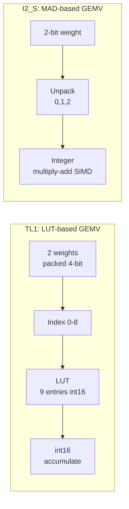
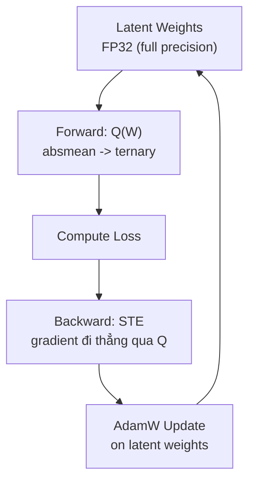

# Bài 10: BitNet b1.58 & bitnet.cpp - Inference cho LLM Ternary

Trong khi llama.cpp giải quyết bài toán inference cho LLM chủ yếu bằng post-training quantization (PTQ), một hướng tiếp cận hoàn toàn khác xuất hiện: **huấn luyện model ngay từ đầu với trọng số ternary** $\{-1, 0, +1\}$. BitNet b1.58 (Microsoft, 2024) cho thấy rằng, khi cùng cấu hình và cùng số token huấn luyện (100B token RedPajama trong bài báo gốc), một model 1.58-bit bắt đầu **ngang bằng** LLaMA FP16 về perplexity và end-task accuracy **từ kích thước 3B trở lên**; ở 700M và 1.3B vẫn còn một khoảng cách nhỏ. bitnet.cpp là framework inference C++ tối ưu riêng cho loại model này, xây dựng trên nền llama.cpp/GGML.

---

## Phần 1. Tại sao cần 1-bit LLM?

### 1.1. Memory Bandwidth Bottleneck

Như đã phân tích ở [Bài 0](lesson_0_cpp_inference_revolution), ở pha decode (sinh từng token), inference LLM bị giới hạn bởi **memory bandwidth** chứ không phải compute: toàn bộ weight matrix phải được đọc từ RAM chỉ để thực hiện một phép nhân vector-matrix (GEMV).

llama.cpp giảm lượng dữ liệu cần đọc bằng quantization (Q4_K_M, Q8_0...). Trên CPU, weight **không** được giải nén ra một ma trận float đầy đủ: activation được lượng tử hóa sang `Q8_0`/`Q8_K`, sau đó hàm `vec_dot` của từng kiểu (ví dụ `ggml_vec_dot_q4_K_q8_K`) tính tích vô hướng số nguyên theo block, rồi nhân với các scale float của block. Dù vậy, chi phí còn lại vẫn đáng kể: phép nhân-cộng int8 (multiply-accumulate), cộng thêm phép nhân float cho **mỗi block** 32 hoặc 256 phần tử.

### 1.2. BitNet b1.58: Ternary Weights

BitNet b1.58 (Ma et al., arXiv:2402.17764) đề xuất một giải pháp triệt để hơn: train model với trọng số chỉ nằm trong tập $\{-1, 0, +1\}$, activation 8-bit (sơ đồ W1.58A8).

**Tại sao 1.58 bit?** Với 3 giá trị khả dĩ, lượng thông tin tối thiểu để mã hóa một weight (khi ba giá trị đồng xác suất) là:

$$\log_2(3) \approx 1.585 \text{ bits}$$

Do đó "1.58-bit" là giới hạn lý thuyết của một trọng số ternary, không phải 1-bit hay 2-bit. Mọi định dạng lưu trữ thực tế (Phần 3) đều tốn nhiều hơn con số này một chút.

### 1.3. So sánh Paradigm: PTQ vs QAT

| Đặc điểm | llama.cpp (PTQ điển hình) | BitNet b1.58 (QAT, train từ đầu) |
|:---|:---|:---|
| **Khi nào quantize?** | Sau khi train xong | Trong quá trình train (forward pass) |
| **Weight values** | 2 đến 256 mức tùy quant type | Chỉ $\{-1, 0, +1\}$ |
| **Training cost** | Không cần train lại | Pretraining đầy đủ (tốn GPU) |
| **Quality** | Giảm nhẹ so với FP16 | Ngang FP16 từ cỡ 3B (cùng số token) |
| **Inference compute** | Integer multiply-accumulate + scale float per-block | Về nguyên lý chỉ cần cộng/trừ |
| **Scale** | Một scale (hoặc nhiều) cho mỗi block 32/256 phần tử | Một scale cho cả tensor weight, một scale cho mỗi token activation |

---

## Phần 2. BitLinear Layer: Kiến trúc cốt lõi

BitLinear là layer thay thế `nn.Linear` trong Transformer chuẩn. Nó thực hiện ba bước.

### 2.1. Weight Quantization: Absmean

Trọng số latent FP32 được quantize thành ternary bằng **absmean scaling** (phương trình 1 đến 3 trong arXiv:2402.17764):

$$\gamma = \frac{1}{nm} \sum_{i,j} \lvert W_{ij} \rvert$$

$$\widetilde{W} = \text{RoundClip}\!\left(\frac{W}{\gamma + \epsilon}, -1, 1\right), \quad \text{RoundClip}(x, a, b) = \max(a, \min(b, \text{round}(x)))$$

Trong đó $W \in \mathbb{R}^{n \times m}$ là ma trận weight, $\gamma$ là trung bình trị tuyệt đối trên **toàn bộ tensor** (một scale duy nhất cho mỗi ma trận), $\epsilon$ là hằng số nhỏ chống chia cho 0. Chia cho giá trị trung bình tuyệt đối rồi làm tròn đưa phần lớn weight về $\{-1, 0, +1\}$. Đây **không phải** `sign(W)` đơn giản: các weight có $\lvert W_{ij} \rvert < \gamma/2$ bị đưa về 0, tạo ra khả năng "lọc đặc trưng" (feature filtering) mà BitNet 1-bit nguyên thủy không có.

Converter của llama.cpp tái hiện đúng công thức này trong `BitnetModel.weight_quant()` (file `conversion/bitnet.py`): `scale = weight.abs().mean().clamp(min=1e-5)`, rồi `(weight * iscale).round().clamp(-1, 1) / iscale`.

### 2.2. Activation Quantization: Per-token INT8 (absmax)

Input activation được quantize về INT8 theo **từng token**:

$$\eta_t = \max_i \lvert x_{t,i} \rvert, \qquad \hat{x}_{t,i} = \text{Clip}\!\left(\text{round}\!\left(\frac{x_{t,i} \cdot Q_b}{\eta_t}\right), -Q_b, Q_b - 1\right)$$

với $Q_b = 2^{b-1} = 128$ cho $b = 8$ bit; nhiều bản cài đặt thực tế dùng hệ số 127 để có miền đối xứng $[-127, 127]$. Điểm cần nhớ: $\eta_t$ là **một scale cho cả vector activation của token $t$**, không phải một scale cho mỗi block 32 hay 256 phần tử như `Q8_0`/`Q8_K` của llama.cpp. Chi tiết này sẽ quay lại ở Phần 5.3.

### 2.3. Addition-Only Matrix Multiplication

Vì weight chỉ có $\{-1, 0, +1\}$, phép nhân weight với activation trở thành:

| Weight value | Operation | Cost |
|:---|:---|:---|
| **+1** | Cộng activation vào accumulator | 1 addition |
| **-1** | Trừ activation khỏi accumulator | 1 subtraction |
| **0** | Bỏ qua | 0 operations |

**Kết quả về nguyên lý**: GEMV (General Matrix-Vector multiply) không cần phép nhân nào, chỉ còn cộng/trừ số nguyên. Theo mô hình năng lượng mà bài báo sử dụng, phần năng lượng số học của phép nhân ma trận giảm khoảng **71.4 lần** trên chip 7nm. Trên CPU thật, các kernel SIMD vẫn có thể dùng lệnh multiply-add số nguyên (ví dụ `_mm256_maddubs_epi16`) vì đó là cách nhanh nhất để cộng có dấu trên phần cứng hiện có; con số tiết kiệm năng lượng đo được end-to-end trên CPU (55.4% đến 82.2%, Phần 5.4) là kết quả của bitnet.cpp so với llama.cpp FP16, không phải của riêng việc "bỏ phép nhân".

### 2.4. Xử lý Scale: per-tensor thay vì per-block

Sau khi tính tích số nguyên $y_t = \hat{W} \hat{x}_t$, cần khôi phục thang đo thực:

$$y^{\text{fp}}_t = y_t \cdot \frac{\gamma \cdot \eta_t}{Q_b}$$

Bản chất của công thức nằm ở chỗ: $\gamma$ là **hằng số của tensor** (biết trước khi inference), $\eta_t$ là **hằng số của token** (tính một lần cho mỗi vector input). Do đó toàn bộ việc khôi phục scale chỉ tốn **một phép nhân vô hướng cho mỗi phần tử output**, tức $O(m)$ phép nhân so với $O(mk)$ phép cộng của GEMV. So với llama.cpp, nơi mỗi block 32 hoặc 256 phần tử có scale riêng phải nhân vào tổng riêng phần, đây là chi phí gần như bằng 0.

Có thể gộp (fold) $\gamma$ vào tham số khác hay không? Chỉ trong một số vị trí và phải chứng minh cụ thể:
- Nếu output của BitLinear đi **thẳng** vào một RMSNorm, hằng số dương $c$ bị triệt tiêu vì $\text{RMSNorm}(c \cdot y) = \text{RMSNorm}(y)$ (bỏ qua $\epsilon$); trường hợp này $\gamma$ không cần áp dụng.
- Với $W_Q$ và $W_K$, tích $\gamma_Q \gamma_K$ có thể gộp vào hệ số $1/\sqrt{d}$ của softmax attention.
- Với $W_O$ và $W_{\text{down}}$, output được cộng vào residual stream, nên $\gamma$ **phải** được nhân vào; không có RMSNorm nào phía sau "hấp thụ" được nó.

Trong llama.cpp, kiến trúc `LLM_ARCH_BITNET` (file `src/models/bitnet.cpp`) giữ các scale này dưới dạng tensor 1 phần tử tùy chọn (`wq_s`, `wk_s`, `wv_s`, `wo_s`, `ffn_up_s`, `ffn_gate_s`, `ffn_down_s`) và áp dụng chúng bằng một `ggml_mul` ngay sau phép nhân ma trận trong `build_lora_mm()` (file `src/llama-graph.cpp`). bitnet.cpp lưu scale của I2_S ở cuối dữ liệu tensor và nhân vào kết quả trong chính kernel `ggml_vec_dot_i2_i8_s`.

---

## Phần 3. bitnet.cpp Kernel Library

bitnet.cpp (repository `microsoft/BitNet`) cung cấp ba kernel family cho CPU, mỗi loại tối ưu cho một trade-off khác nhau. Mã nguồn chính nằm ở `src/ggml-bitnet-mad.cpp` (MAD-based, I2_S) và `src/ggml-bitnet-lut.cpp` (LUT-based, TL1/TL2); kernel LUT được **sinh mã** theo shape của từng model bằng `utils/codegen_tl1.py` và `utils/codegen_tl2.py`, ghi ra `include/bitnet-lut-kernels.h` và `include/kernel_config.ini`. Thư mục `preset_kernels/` chứa sẵn header đã tinh chỉnh cho `bitnet_b1_58-large`, `bitnet_b1_58-3B` và `Llama3-8B-1.58-100B-tokens` (dùng với cờ `--use-pretuned` của `setup_env.py`).

### 3.1. I2_S: MAD-based Kernel (2 bits/weight)

**Nguyên lý**: pack mỗi weight ternary thành 2 bit, tại runtime unpack về miền số nguyên rồi thực hiện multiply-accumulate (MAD) với activation int8. Mã hóa theo Bảng 1 của arXiv:2410.16144:

```c
// src/ggml-bitnet-mad.cpp
#if defined(__AVX__) || defined(__AVX2__) || defined(__AVX512F__) || defined(__SSSE3__)
#define QK_I2_S 128   // x86: 128 weights mỗi nhóm đóng gói
#elif defined(__ARM_NEON)
#define QK_I2_S 64    // ARM: 64 weights mỗi nhóm đóng gói
#endif

// quantize_i2_s(): 0 -> weight = -1, 1 -> weight = 0, 2 -> weight = +1
// mỗi byte chứa 4 weights (2 bits each)
// một scale float duy nhất cho cả tensor được ghi sau phần dữ liệu đóng gói
```

Về dung lượng: $n$ weights chiếm $n/4$ byte, cộng một scale float32 cho **toàn tensor** (cùng 32 byte đệm cho alignment). Vì vậy I2_S có đúng 2.0 bpw, khác với các kiểu block của GGML luôn mang một scale FP16 cho mỗi block. Lưu ý: hàm `quantize_i2_s()` giả định tensor đầu vào **đã là ternary nhân scale** (đầu ra của converter BitNet); nó chỉ đọc dấu và kiểm tra phần tử bằng 0, không phải một thuật toán PTQ tổng quát.

Các biến thể kernel hiện có: `ggml_vec_dot_i2_i8_s_1x1`, `_1x4_32W`, `_1xN`, `_Nx1`, được điều phối bởi `ggml_vec_dot_i2_i8_s`.

**Ưu điểm**: SIMD-friendly, compiler sinh được chuỗi lệnh pipeline hiệu quả; paper khuyến nghị dùng I2_S khi có đủ thread.
**Hỗ trợ**: x86 (AVX2, AVX-512) và ARM (NEON, có nhánh riêng cho `__ARM_FEATURE_DOTPROD`).

### 3.2. TL1: LUT-based Kernel (2 bits/weight)

**Nguyên lý**: pack mỗi **2 weights** thành một **4-bit index** (vì $3^2 = 9 \le 16$). Với mỗi cặp activation, tiền tính 9 tổng riêng phần có thể có vào **Lookup Table (LUT)** int16; GEMV trở thành **tra bảng + cộng int16**.



**Ưu điểm**: không cần phép nhân trong vòng lặp chính, chỉ tra bảng và cộng; paper khuyến nghị TL1 khi số thread hạn chế và model lớn.
**Hỗ trợ**: ARM (`setup_env.py` chỉ cho phép `-q tl1` trên `arm64`).

### 3.3. TL2: LUT-based Kernel (1.67 bits/weight)

**Nguyên lý**: nén mỗi **3 weights** thành **1 bit dấu + 4-bit index** (Bảng 3 của arXiv:2410.16144). Có $3^3 = 27$ tổ hợp; nhờ tính đối xứng $\text{LUT}(-w) = -\text{LUT}(w)$, 26 tổ hợp khác 0 chia thành 13 cặp đối nhau, cộng với tổ hợp 0, nên chỉ cần **14 entry** đánh chỉ số bằng 4 bit, còn bit thứ 5 quyết định đảo dấu.

```
3 weights -> 27 tổ hợp -> 1 sign bit + 4-bit index (14 entries)
Compression: 3 x 2 = 6 bits -> 5 bits, tức 5/3 = 1.67 bpw
Model size giảm 1/6 so với TL1
```

**Ưu điểm**: compression cao nhất, phù hợp khi memory bandwidth hoặc dung lượng là bottleneck.
**Hỗ trợ**: x86 (AVX2; `setup_env.py` chỉ cho phép `-q tl2` trên `x86_64`).

### 3.4. Kernel Selection Matrix (theo README của bitnet.cpp)

| Model | Params | CPU | I2_S | TL1 | TL2 |
|:---|:---|:---|:---|:---|:---|
| BitNet-b1.58-2B-4T | 2.4B | x86 | Có | Không | Có |
| BitNet-b1.58-2B-4T | 2.4B | ARM | Có | Có | Không |
| BitNet-embedding-0.6B / 270M | 0.6B / 270M | x86 | Có | Không | Không |
| bitnet_b1_58-large | 0.7B | x86 | Có | Không | Có |
| bitnet_b1_58-large | 0.7B | ARM | Có | Có | Không |
| bitnet_b1_58-3B | 3.3B | x86 | Không | Không | Có |
| bitnet_b1_58-3B | 3.3B | ARM | Không | Có | Không |
| Llama3-8B-1.58-100B-tokens | 8.0B | x86 | Có | Không | Có |
| Llama3-8B-1.58-100B-tokens | 8.0B | ARM | Có | Có | Không |
| Falcon3 (1.58bit) family | 1B-10B | x86 / ARM | Có | ARM | x86 |
| Falcon-E family | 1B-3B | x86 / ARM | Có | ARM | x86 |

Một chi tiết thực tế cần biết: ở phiên bản hiện tại của `setup_env.py`, bước compile truyền `-DBITNET_ARM_TL1=OFF` (arm64) hoặc `-DBITNET_X86_TL2=OFF` (x86_64) cho CMake, nên đường I2_S là đường mặc định được bảo trì tích cực nhất; muốn dùng TL1/TL2 cần kiểm tra lại cấu hình build.

### 3.5. Tiling & Parallelism (cập nhật 01/2026)

Bản cập nhật "BitNet CPU Inference Optimization" (tài liệu `src/README.md` trong repository) bổ sung:
- **Weight Parallel**: xử lý nhiều hàng/cột weight trong một lần gọi kernel.
- **Activation Parallel**: xây trên weight parallel, chia sẻ (amortize) chi phí unpack I2_S cho nhiều phần tử activation; đây là chế độ mặc định (`#define ACT_PARALLEL`).
- **GEMM/GEMV I2_S gốc** tích hợp vào đồ thị tính toán của llama.cpp, cùng tùy chọn lượng tử hóa embedding sang Q6_K.

Cấu hình nằm trong `include/gemm-config.h`; với x86 ở chế độ activation parallel:

```c
#define ROW_BLOCK_SIZE 4
#define COL_BLOCK_SIZE 128
#define PARALLEL_SIZE 4
```

ARM có bộ giá trị riêng (ví dụ 8/256/8 khi có `__ARM_FEATURE_DOTPROD`). Tác giả báo cáo thêm **1.15x đến 2.1x** tốc độ so với bản cài đặt ban đầu; công cụ `utils/tune_gemm_config.py` hỗ trợ dò cấu hình cho máy cụ thể.

---

## Phần 4. QAT với Straight-Through Estimator (STE)

### 4.1. Tại sao PTQ không đủ?

Áp absmean ternary lên một model FP16 **đã train xong** (PTQ) phá hủy chất lượng: model không được tối ưu để chịu sai số lượng tử ở mức 3 giá trị. BitNet train từ đầu với ràng buộc lượng tử trong forward pass, nên model **học cách sống** với việc weight bị kẹp về $\{-1, 0, +1\}$.

llama.cpp có hai kiểu ternary là `TQ1_0` (1.6875 bpw) và `TQ2_0` (2.0625 bpw). Cần hiểu đúng vai trò của chúng: đây là **định dạng lưu trữ** cho model **vốn đã ternary** (BitNet b1.58, TriLM), không phải một phương pháp PTQ biến model FP16 bất kỳ thành ternary. Hàm `quantize_row_tq1_0_ref()` chỉ lấy amax của block làm scale rồi làm tròn `x / amax`; với một model BitNet (mọi weight là $\pm\gamma$ hoặc 0) phép này là chính xác, còn với một model FP16 thông thường nó cho kết quả vô dụng.

Con số "1.4%" thường được trích dẫn **không phải** là độ chính xác của model; ý nghĩa thật của nó được phân tích ở Phần 5.3.

### 4.2. Training Procedure



1. **Latent weights**: model duy trì trọng số FP32 đầy đủ trong suốt quá trình train.
2. **Forward pass**: quantize latent sang ternary qua absmean; activation quantize per-token int8.
3. **Backward pass**: dùng STE (Straight-Through Estimator). Dạng phổ biến nhất trong các bản cài đặt BitNet là STE thuần, coi $Q$ như hàm đồng nhất:
   $$\frac{\partial L}{\partial W} \approx \frac{\partial L}{\partial \widetilde{W}}$$
   (trong code thường viết `w + (quant(w) - w).detach()`). Một biến thể có cắt gradient ngoài vùng clip, $\frac{\partial L}{\partial W} \approx \frac{\partial L}{\partial \widetilde{W}} \cdot \mathbf{1}_{\lvert W/\gamma \rvert \le 1}$, sẽ được phân tích ở [Theory 7](theory_deep_dive/theory_7_ternary_quantization).
4. **Optimizer**: AdamW cập nhật latent FP32 weights; theo báo cáo 2B4T, model 1-bit chịu được learning rate cao hơn model full precision.

### 4.3. Kiến trúc và kỹ thuật ổn định

Cần phân biệt hai thế hệ:
- **BitNet b1.58 gốc (2402.17764)** dùng các thành phần kiểu LLaMA: RMSNorm, **SwiGLU**, RoPE, bỏ toàn bộ bias.
- **BitNet b1.58 2B4T (2504.12285)** thêm **subLN**: một lớp norm bổ sung đặt ngay trước projection đầu ra của attention và trước `down_proj` của FFN (trong GGUF là `attn_sub_norm` và `ffn_sub_norm`); thay SwiGLU bằng **squared ReLU** $\text{ReLU}(x)^2$ (`"hidden_act": "relu2"` trong `config.json`); vẫn bỏ bias; dùng tokenizer LLaMA 3 (vocab 128256); learning rate và weight decay hai giai đoạn.

---

## Phần 5. So sánh bitnet.cpp vs llama.cpp

### 5.1. Chung nền tảng GGUF/GGML

bitnet.cpp được xây dựng **trực tiếp trên llama.cpp** (Microsoft ghi nhận rõ trong README và paper):
- Dùng một fork llama.cpp làm submodule `3rdparty/llama.cpp`, tức **GGML** làm tensor library và **GGUF** làm container format.
- Chung tokenizer, sampling, các binary `llama-cli`, `llama-quantize`, `llama-bench` (bản trong fork).
- Upstream llama.cpp hỗ trợ kiến trúc BitNet (`LLM_ARCH_BITNET`) từ PR #7931 (06/2024); hai kiểu ternary `TQ1_0`/`TQ2_0` được bổ sung ở PR #8151 (09/2024).

**Khác biệt quan trọng về định dạng**: các kiểu `I2_S`, `TL1`, `TL2` chỉ tồn tại trong fork của bitnet.cpp. Upstream llama.cpp (enum `ggml_type`) **không** có chúng, nên file `ggml-model-i2_s.gguf` không nạp được bằng llama.cpp gốc. Ngược lại, muốn chạy BitNet bằng upstream, cần tự convert sang `TQ1_0`/`TQ2_0` (Phần 6.3). Gần đây upstream còn có thêm hai kiểu bit thấp `Q1_0` (nhị phân, nhóm 128, 1.125 bpw) và `Q2_0` (2 bit, nhóm 64, 2.25 bpw), được đóng góp cho họ model Bonsai của PrismML; xem [Bài 11](lesson_11_bonsai_model_family).

### 5.2. Khác biệt về Kernel Approach

| Đặc điểm | llama.cpp (TQ1_0/TQ2_0) | bitnet.cpp (I2_S/TL1/TL2) |
|:---|:---|:---|
| **Target** | General-purpose (hơn 30 quant types) | Chuyên biệt cho ternary LLM |
| **Kernel ternary** | `ggml_vec_dot_tq1_0_q8_K`, `ggml_vec_dot_tq2_0_q8_K`: tích số nguyên trực tiếp trên trits, không dequantize | MAD (I2_S) hoặc LUT (TL1/TL2) tối ưu riêng theo shape |
| **Scale của weight** | FP16, một scale mỗi block 256 | FP32, một scale cho cả tensor (I2_S) |
| **Activation** | `Q8_K`: int8 với scale float cho mỗi block 256 | int8 theo đúng sơ đồ lượng tử của lúc train |
| **Exact match với FP32 reference** (Bảng 7, 2410.16144) | 1.4% số mẫu | 100% số mẫu |
| **Compiler** | GCC/Clang/MSVC | **Clang >= 18** |
| **Speedup (so với llama.cpp FP16)** | Baseline | 1.37x đến 5.07x (ARM), 2.37x đến 6.17x (x86) |
| **Energy** | Baseline | Giảm 55.4% đến 70.0% (ARM), 71.9% đến 82.2% (x86) |

### 5.3. Con số 1.4% thực sự đo cái gì?

Bảng 7 của arXiv:2410.16144 được xây dựng như sau: chọn ngẫu nhiên 1,000 prompt từ WildChat, dùng model `bitnet_b1_58-large` (700M), sinh tối đa 100 token, và so **từng token** với output của một FP32 kernel tham chiếu. Một mẫu chỉ được tính là "lossless" nếu **toàn bộ chuỗi** trùng khớp tuyệt đối. Kết quả: TQ1_0 và TQ2_0 đều đạt 1.4% số mẫu trùng khớp, còn I2_S, TL1, TL2 đạt 100%.

Vậy đây là **tỷ lệ tái lập bit-exact**, không phải task accuracy, và nguyên nhân **không phải** vì llama.cpp "dequantize về float". Đọc mã nguồn `ggml/src/ggml-cpu/arch/x86/quants.c`:
- `ggml_vec_dot_tq2_0_q8_K` nạp các trit dưới dạng $\{0, 1, 2\}$, nhân với activation int8 bằng `_mm256_maddubs_epi16`, cộng dồn trong int16, rồi trừ `bsums` (tổng activation của block) để dịch về $\{-1, 0, +1\}$. Toàn bộ là số học nguyên, chính xác tuyệt đối trong phạm vi block.
- Nguồn sai khác nằm ở **sơ đồ lượng tử hóa**: activation bị lượng tử sang `Q8_K` với **một scale cho mỗi 256 phần tử** (`quantize_row_q8_K`), trong khi model được train với **một scale cho mỗi token**; weight scale được lưu FP16 cho mỗi block thay vì một FP32 cho cả tensor.
- Các sai khác làm tròn nhỏ này làm logits lệch đi một lượng rất nhỏ; với greedy decoding, chỉ cần một token argmax khác ở bất kỳ vị trí nào trong 100 token là cả chuỗi tách nhánh. Vì vậy tỷ lệ trùng khớp toàn chuỗi rơi xuống 1.4% dù chất lượng ngôn ngữ (perplexity) có thể gần như không đổi.

bitnet.cpp tái hiện đúng sơ đồ W1.58A8 của lúc train nên output khớp bit với reference trong mọi mẫu đã thử.

### 5.4. Performance Numbers (arXiv:2410.16144, Bảng 4 và Bảng 6)

Thiết lập: Apple M2 Ultra (64GB) và Intel Core i7-13700H (14 core, 20 thread, 64GB); baseline là **llama.cpp FP16**; các model là cấu hình dummy theo kích thước, đo ở chế độ không giới hạn thread.

**Inference Speed (tokens/sec)**:

| Model Size | Apple M2 Ultra (llama.cpp -> bitnet.cpp) | Intel i7-13700H (llama.cpp -> bitnet.cpp) |
|:---|:---|:---|
| 700M | 114.47 -> 194.38 (1.70x) | 30.73 -> 119.08 (3.88x) |
| 7B | 15.61 -> 52.36 (3.35x) | 3.30 -> 18.75 (5.68x) |
| 13B | 8.79 -> 33.78 (3.84x) | 1.78 -> 10.99 (6.17x) |
| 70B | 1.71 -> 8.67 (5.07x) | không chạy được FP16 -> 2.44 |
| 100B | không chạy được FP16 -> 6.58 | không chạy được FP16 -> 1.70 |

Với 100B, chỉ Apple M2 Ultra đạt tốc độ "đọc của con người" (5 đến 7 token/s). Ở chế độ giới hạn 2 thread (Bảng 5), speedup trên x86 đạt tới 6.46x (model 7B).

**Energy Consumption (J/token)**:

| Model | Apple M2 Ultra | Intel i7-13700H |
|:---|:---|:---|
| 700M | 0.314 -> 0.140 (giảm 55.4%) | 1.367 -> 0.384 (giảm 71.9%) |
| 7B | 3.013 -> 1.068 (giảm 64.6%) | 11.305 -> 2.017 (giảm 82.2%) |
| 70B | 28.02 -> 8.42 (giảm 70.0%) | không có baseline -> 17.33 |

---

## Phần 6. Thực hành: Chạy BitNet Models

### 6.1. Supported Models

| Model | Parameters | Ghi chú |
|:---|:---|:---|
| `microsoft/BitNet-b1.58-2B-4T` | 2.4B | Model chính thức, 4T token, license MIT; có bản `-gguf` (I2_S) và `-bf16` (master weights) |
| `microsoft/BitNet-embedding-0.6B`, `-270M` | 0.6B / 270M | Embedding model 1-bit (07/2026), I2_S trên x86 |
| `1bitLLM/bitnet_b1_58-large` | 0.7B | Community, dùng trong đánh giá lossless của paper |
| `1bitLLM/bitnet_b1_58-3B` | 3.3B | Community |
| `HF1BitLLM/Llama3-8B-1.58-100B-tokens` | 8.0B | Llama 3 fine-tune về 1.58-bit |
| `tiiuae/Falcon3-*-1.58bit` | 1B-10B | Falcon3 family |
| `tiiuae/Falcon-E-*` | 1B-3B | Falcon-Edge family |

### 6.2. Build và Chạy bằng bitnet.cpp

```bash
# Clone (cần --recursive để lấy submodule 3rdparty/llama.cpp)
git clone --recursive https://github.com/microsoft/BitNet.git
cd BitNet

# Yêu cầu: python >= 3.10, cmake >= 3.22, clang >= 18
conda create -n bitnet-cpp python=3.10 && conda activate bitnet-cpp
pip install -r requirements.txt

# Tải GGUF I2_S chính thức rồi build kernel + binary
huggingface-cli download microsoft/BitNet-b1.58-2B-4T-gguf \
    --local-dir models/BitNet-b1.58-2B-4T
python setup_env.py -md models/BitNet-b1.58-2B-4T -q i2_s

# Chạy inference (chế độ hội thoại, -p là system prompt khi có -cnv)
python run_inference.py -m models/BitNet-b1.58-2B-4T/ggml-model-i2_s.gguf \
    -p "You are a helpful assistant" -cnv

# Benchmark end-to-end
python utils/e2e_benchmark.py -m models/BitNet-b1.58-2B-4T/ggml-model-i2_s.gguf \
    -p 512 -n 128 -t 4
```

`setup_env.py` nhận các cờ `--hf-repo/-hr`, `--model-dir/-md`, `--log-dir/-ld`, `--quant-type/-q` (`i2_s` hoặc `tl1` trên arm64, `i2_s` hoặc `tl2` trên x86_64), `--quant-embd` và `--use-pretuned/-p`. Script lần lượt cài `gguf-py` của fork, sinh mã kernel, build bằng clang, rồi convert/quantize model nếu file GGUF chưa có. `run_inference.py` thực chất gọi `build/bin/llama-cli` của fork.

### 6.3. Chạy BitNet bằng upstream llama.cpp (TQ1_0/TQ2_0)

```bash
# Trong thư mục llama.cpp upstream (đã build theo Lab 1)
huggingface-cli download 1bitLLM/bitnet_b1_58-large --local-dir bitnet-large
python convert_hf_to_gguf.py bitnet-large --outtype tq2_0 --outfile bitnet-large-tq2_0.gguf

# Hoặc convert sang f16 trước rồi dùng llama-quantize với kiểu TQ1_0 / TQ2_0
# Model base (không có chat template): dùng llama-completion ở chế độ không hội thoại
./build/bin/llama-completion -m bitnet-large-tq2_0.gguf -p "The capital of France is" -n 64 -no-cnv
```

Converter áp `BitnetModel.weight_quant()` lên các tensor Q/K/V/O/gate/up/down rồi đóng gói thành TQ2_0. Trên CPU, đường này dùng `ggml_vec_dot_tq2_0_q8_K`; TQ2_0 thường nhanh hơn TQ1_0 vì 2 bit/trit giữ alignment tốt hơn, đổi lại tốn thêm 0.375 bpw. Ngoài CPU, upstream có kernel TQ2_0 cho Metal và Vulkan.

**Lưu ý về phạm vi hỗ trợ của upstream**: đồ thị `src/models/bitnet.cpp` dựng FFN bằng `LLM_FFN_SILU` (gated, kiểu SwiGLU), và `gguf-py/gguf/tensor_mapping.py` chỉ ánh xạ tên sub-norm của checkpoint 1bitLLM (`self_attn.inner_attn_ln`, `mlp.ffn_layernorm`). Điều này khớp với các model kiểu `bitnet_b1_58-large`/`-3B`. BitNet-b1.58-2B-4T dùng squared ReLU và tên tensor khác, nên tại thời điểm viết bài, đường chạy được kiểm chứng cho model này là bitnet.cpp.

### 6.4. Memory Footprint (BitNet-b1.58-2B-4T)

Model có 30 layer, hidden 2560, FFN 6912, vocab 128256 và **tied embedding**. Phần non-embedding có khoảng $2.08 \times 10^9$ tham số; embedding có $128256 \times 2560 \approx 3.28 \times 10^8$ tham số.

| Thành phần | Memory |
|:---|:---|
| Toàn bộ model ở BF16/FP16 ($\approx 2.41 \times 10^9 \times 2$ byte) | ~4.8 GB |
| Non-embedding ở 1.58 bpw (con số "0.4 GB" của báo cáo 2B4T) | ~0.41 GB |
| Non-embedding ở I2_S (2 bpw) | ~0.52 GB |
| File `ggml-model-i2_s.gguf` chính thức (I2_S + embedding F16) | ~1.19 GB |

Đọc bảng này theo nghĩa thực tế: với model nhỏ và vocab lớn, embedding FP16 (khoảng 0.66 GB) chiếm hơn một nửa file. Đó là lý do bitnet.cpp bổ sung tùy chọn lượng tử hóa embedding (Q6_K qua `llama-quantize --token-embedding-type`).

---

## Tóm tắt

| Điểm chính | Chi tiết |
|:---|:---|
| **BitNet b1.58** | Ternary weights $\{-1, 0, +1\}$, activation int8 per-token, train từ đầu bằng QAT + STE |
| **BitLinear** | Absmean weight quant (một scale/tensor) + absmax activation quant (một scale/token) |
| **Scale** | Chỉ một phép nhân vô hướng cho mỗi phần tử output, không có scale per-block |
| **3 kernel families** | I2_S (MAD, 2 bpw), TL1 (LUT, 2 bpw, ARM), TL2 (LUT, 1.67 bpw, x86) |
| **vs llama.cpp FP16** | 1.37x đến 6.17x nhanh hơn, giảm 55.4% đến 82.2% năng lượng, chỉ cho ternary model |
| **vs llama.cpp TQ1_0/TQ2_0** | Cả hai tính trực tiếp trên trits; khác biệt nằm ở sơ đồ scale, dẫn tới 1.4% so với 100% exact match |
| **Nền tảng** | Fork của llama.cpp/GGML/GGUF, nhưng I2_S/TL1/TL2 không có trong upstream |

---

## Tham khảo

- Ma et al., "The Era of 1-bit LLMs: All Large Language Models are in 1.58 Bits", arXiv:2402.17764, 02/2024.
- Wang et al., "1-bit AI Infra: Part 1.1, Fast and Lossless BitNet b1.58 Inference on CPUs", arXiv:2410.16144, 10/2024.
- "Bitnet.cpp: Efficient Edge Inference for Ternary LLMs", arXiv:2502.11880, 02/2025.
- Ma et al., "BitNet b1.58 2B4T Technical Report", arXiv:2504.12285, 04/2025.
- Microsoft BitNet repository: https://github.com/microsoft/BitNet
