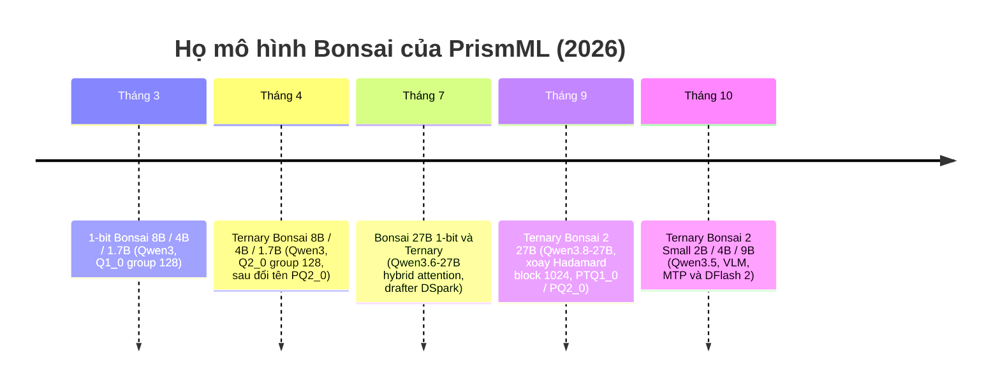

# Bài 11: Họ mô hình Bonsai của PrismML: 1-bit, Ternary và Bonsai 2

Ở [Bài 10](lesson_10_bitnet_cpp) chúng ta đã thấy con đường của BitNet b1.58: huấn luyện một mạng từ đầu (pretraining from scratch) trực tiếp trong miền ternary $\{-1, 0, +1\}$. Con đường đó đúng về mặt nguyên lý nhưng cực kỳ đắt: mỗi mô hình mới cần một lần pretraining trọn vẹn, và mô hình BitNet công khai lớn nhất hiện vẫn chỉ ở cỡ 2B tham số.

Năm 2026, PrismML (công ty mô tả phương pháp của mình là dựa trên tài sản trí tuệ độc quyền từ Caltech) công bố họ mô hình **Bonsai**, đi theo hướng ngược lại: bắt đầu từ một mô hình đã được pretrain sẵn (Qwen3, Qwen3.5, Qwen3.6, Qwen3.8) rồi đưa nó về biểu diễn **nhị phân** (1-bit, $\{-1, +1\}$) hoặc **ternary** (1.58-bit, $\{-1, 0, +1\}$), giữ nguyên kiến trúc. Để chạy được các mô hình này, PrismML phải mở rộng llama.cpp bằng các kiểu GGUF mới (`Q1_0`, `Q2_0`, `PQ2_0`, `PTQ1_0`) và một runtime xoay Hadamard phía activation.

Bài này phân tích **cái gì** đã được phát hành, **vì sao** từng quyết định thiết kế lại hợp lý dưới góc nhìn hệ thống, và **cái gì là đã kiểm chứng được** từ mã nguồn so với cái gì chỉ là số liệu do nhà sản xuất công bố. Hai bài tiếp theo đi sâu vào engine ([Bài 12](lesson_12_prism_llama_cpp_fork)) và toán học của các định dạng ([Theory 9](theory_deep_dive/theory_9_bonsai_gguf_formats), [Theory 10](theory_deep_dive/theory_10_hadamard_folding)).

:::note Về nguồn số liệu
Mọi thông số định dạng (kích thước block, số byte, type id, metadata key) trong bài đều được đối chiếu với mã nguồn llama.cpp upstream (commit `06230cb`, 23/10/2026) và fork `PrismML-Eng/llama.cpp` (nhánh `prism`, tag `prism-b10787-73bfe6c`). Các con số benchmark chất lượng và throughput là **số do PrismML công bố** trong model card và whitepaper (thư mục `Bonsai-demo`), chưa được tác giả giáo trình đo lại độc lập.
:::

---

## Phần 1: Bài toán gốc: decode bị chặn bởi băng thông bộ nhớ

Ở pha decode (sinh từng token, batch 1), mỗi token mới đòi hỏi đọc gần như **toàn bộ** trọng số từ bộ nhớ, trong khi số phép tính trên mỗi byte rất thấp. Gọi $M$ là số byte trọng số phải đọc mỗi bước và $BW$ là băng thông bộ nhớ hiệu dụng, giới hạn trên của tốc độ decode là:

$$\text{tok/s} \;\lesssim\; \frac{BW}{M}, \qquad M \approx N_{\text{params}} \cdot \frac{b}{8}$$

trong đó $N_{\text{params}}$ là số tham số và $b$ là số bit trung bình trên mỗi trọng số (bits per weight, bpw).

Đọc công thức này theo nghĩa thực tế: giảm $b$ từ 16 xuống 1.125 thì $M$ giảm khoảng $14.2$ lần, nên trần decode tăng tương ứng, **miễn là** hệ thống vẫn còn bị chặn bởi băng thông. Chúng ta sẽ thấy ở Phần 5 rằng giả thiết "vẫn bị chặn bởi băng thông" không còn đúng trên GPU datacenter khi bpw quá thấp.

**Ví dụ kiểm chứng bằng số liệu công bố.** Bonsai 2 27B (gói `PQ2_0`, 7.25 GB) đạt 27.7 tok/s trên MacBook M5 Pro. Lượng trọng số di chuyển mỗi giây:

$$27.7 \times 7.25 \text{ GB} \approx 201 \text{ GB/s}$$

Con số này khớp với băng thông bộ nhớ thống nhất của dòng chip đó, nghĩa là decode trên laptop thực sự là bài toán băng thông. Ngược lại, 1-bit Bonsai 8B (1.15 GB) đạt 368 tok/s trên RTX 4090, tức chỉ khoảng $368 \times 1.15 \approx 423$ GB/s, chưa tới một nửa băng thông GDDR6X (khoảng 1 TB/s) của card. Ở chế độ FP16 (59 tok/s $\times$ 16.4 GB $\approx$ 967 GB/s) card gần chạm trần băng thông. Kết luận: khi trọng số đủ nhỏ, nút thắt chuyển sang chi phí giải nén bit, khởi chạy kernel và đồng bộ.

---

## Phần 2: Dòng thời gian và phân loại họ Bonsai

Có thể chia họ mô hình thành hai thế hệ theo một tiêu chí kỹ thuật duy nhất: **trọng số có được lưu trong một cơ sở xoay (rotated basis) hay không**.

| Thế hệ | Mô hình | Base model | Trọng số | Định dạng GGUF | Xoay Hadamard |
|:---|:---|:---|:---|:---|:---|
| Bonsai 1 | 1-bit Bonsai 1.7B / 4B / 8B | Qwen3 dense | $\{-1,+1\}$, scale FP16 mỗi 128 | `Q1_0` (g128) | Không |
| Bonsai 1 | Ternary Bonsai 1.7B / 4B / 8B | Qwen3 dense | $\{-1,0,+1\}$, scale FP16 mỗi 128 | `PQ2_0`, `Q2_0` (g64) | Không |
| Bonsai 1 (27B) | 1-bit Bonsai 27B, Ternary Bonsai 27B | Qwen3.6-27B hybrid | như trên | `Q1_0`, `PQ2_0`, `Q2_0` (g64) | Không |
| Bonsai 2 | Ternary Bonsai 2 27B | Qwen3.8-27B hybrid | $\{-1,0,+1\}$, g128, cơ sở xoay | `PTQ1_0`, `PQ2_0` | Có, block 1024 |
| Bonsai 2 Small | Ternary Bonsai 2 2B / 4B / 9B | Qwen3.5 hybrid, có vision | như trên | `PTQ1_0`, `PQ2_0`, `Q2_0` | Có, block 512 (2B, 4B) và 4096 (9B) |

Hai điểm cần khắc sâu:

1. **Cả hai thế hệ đều dùng group 128 với một scale FP16 duy nhất mỗi nhóm**, không có zero-point, không có super-block như K-quants. Đây là lý do PrismML cần định dạng riêng: các kiểu ternary có sẵn của ggml (`TQ1_0`, `TQ2_0`) dùng block 256, không biểu diễn được hai scale khác nhau của hai nhóm 128 liền kề (chứng minh định lượng ở [Theory 9](theory_deep_dive/theory_9_bonsai_gguf_formats)).
2. **Bonsai 2 không chỉ là "Bonsai 1 với base model mới"**. Nó thay đổi hợp đồng (contract) giữa file GGUF và runtime: trọng số được lưu là $W = W_0 R^{-1}$ (với $W_0$ là trọng số gốc, $R$ là một phép xoay trực giao) và runtime bắt buộc phải áp dụng phép biến đổi $R$ lên activation trước mỗi phép nhân ma trận. Một runtime không hiểu hợp đồng này vẫn nạp được file `Q2_0` nhưng sinh ra văn bản vô nghĩa.

---

## Phần 3: Bonsai thế hệ 1: 1-bit và Ternary

### 3.1. 1-bit Bonsai 8B

Thông số chính (model card `prism-ml/Bonsai-8B-gguf` và whitepaper tháng 3/2026):

| Hạng mục | Giá trị |
|:---|:---|
| Kiến trúc | Qwen3-8B dense: GQA 32 query / 8 KV heads, SwiGLU, RoPE, RMSNorm, 36 block |
| Tham số | 8.19B (khoảng 6.95B không tính embedding) |
| Context | 65,536 token |
| Phạm vi 1-bit | Embedding, mọi projection attention, mọi projection MLP, LM head |
| Giữ precision cao | Trọng số normalization và scale (không đáng kể về băng thông) |
| Định dạng | GGUF `Q1_0` group 128 |
| Kích thước | 1.15 GB (so với 16.38 GB FP16) |

Mỗi trọng số được tái tạo bằng:

$$w_i = s_g \cdot (2 b_i - 1), \qquad b_i \in \{0, 1\}$$

với $s_g$ là scale FP16 của nhóm $g$ gồm 128 trọng số. Chi phí lưu trữ hiệu dụng:

$$b_{\text{eff}} = 1 + \frac{16}{128} = 1.125 \text{ bpw}$$

Một chi tiết hệ thống đáng chú ý trong whitepaper: bản MLX của cùng mô hình tốn **1.25 bpw** chứ không phải 1.125, vì kernel MLX bắt buộc mỗi nhóm có cả scale và bias ($w = s_{\text{mlx}} b + b_{\text{mlx}}$). PrismML phải đặt $s_{\text{mlx}} = 2 s_g$ và $b_{\text{mlx}} = -s_g$, tức tốn thêm 16 bit mỗi nhóm cho một bias hoàn toàn dư thừa. Bài học: **định dạng lưu trữ bị ràng buộc bởi kernel**, và chính kernel quyết định bpw thực tế.

### 3.2. Ternary Bonsai 8B / 4B / 1.7B

Cùng kiến trúc Qwen3, nhưng mỗi trọng số nhận giá trị $\{-1, 0, +1\}$:

$$w_i = s_g \cdot t_i, \qquad t_i \in \{-1, 0, +1\}$$

PrismML đóng gói mỗi trit vào một khe 2 bit (mã $q = t + 1 \in \{0,1,2\}$, mã $3$ bỏ trống), nên một nhóm 128 tốn $2 + 32 = 34$ byte, tức $2.125$ bpw. Bản 8B nặng 2.18 GB, đạt trung bình 75.5 trên bộ 6 benchmark của PrismML, so với 70.5 của bản 1-bit và 79.3 của Qwen3-8B FP16.

Câu chuyện định dạng ở đây khá rối và là một case study hay về **wire format** (định dạng trên đĩa):

- Ban đầu, fork của PrismML lưu định dạng group 128 này dưới type id `42` với tên `Q2_0`.
- Sau đó mainline llama.cpp chuẩn hóa `Q2_0` (id `42`) là **group 64** (18 byte mỗi 64 trọng số, 2.25 bpw).
- Fork buộc phải tách định dạng group 128 sang một id riêng: `PQ2_0` (id `142`), và đọc id `42` theo nghĩa group 64 của mainline.

Hệ quả là các repo Hugging Face cũ của Ternary Bonsai chứa đến ba file cho mỗi mô hình (`*-Q2_0.gguf` legacy group 128, `*-Q2_0_g64.gguf` và `*-PQ2_0.gguf`). File legacy và file `PQ2_0` có cùng kích thước đến từng byte (ví dụ 2,182,184,672 byte cho bản 8B), vì nội dung giống hệt nhau, chỉ khác type id trong header tensor. Cơ chế fork phát hiện file legacy được phân tích ở [Bài 12](lesson_12_prism_llama_cpp_fork).

### 3.3. Bonsai 27B (tháng 7/2026): mở rộng sang hybrid attention

Bonsai 27B dựa trên Qwen3.6-27B, một kiến trúc **hybrid attention**: khoảng 75% số tầng là linear attention dạng Gated DeltaNet (GDN, trạng thái hồi quy kích thước cố định), 25% còn lại là full attention có KV Cache. Với 64 block, chỉ 16 tầng full attention cần KV Cache, nên context 262K token trở nên khả thi trên thiết bị.

| Biến thể | bpw thực | Kích thước | Điểm trung bình (thinking, 15 benchmark) | So với FP16 |
|:---|:---:|:---:|:---:|:---:|
| Qwen3.6-27B FP16 | 16.0 | 54 GB | 85.07 | 100% |
| Qwen3.6-27B Q4_K_XL | 5.2 | 17.6 GB | 84.99 | 99.9% |
| Qwen3.6-27B IQ2_XXS | 2.8 | 9.4 GB | 72.73 | 85.5% |
| Ternary Bonsai 27B | 1.71 | 5.9 GB | 80.49 | 94.6% |
| 1-bit Bonsai 27B | 1.125 | 3.9 GB | 76.11 | 89.5% |

Hai quan sát quan trọng từ bảng của PrismML:

1. **Nhãn "2-bit" của các quant truyền thống không trung thực về bpw**: `IQ2_XXS` của mô hình này thực tế là 2.8 bpw vì các tensor nhạy cảm được giữ ở precision cao hơn. Bonsai tuyên bố bpw thực khớp với tên gọi.
2. **Sự sụp đổ chất lượng của PTQ dưới 4 bit là chọn lọc**: theo PrismML, `IQ2_XXS` vẫn đạt 88.93 trên MMLU-Redux nhưng rơi xuống 57.5 trên AIME26 và 56.4 trên LiveCodeBench. Các tác vụ đòi hỏi chuỗi suy luận dài hỏng trước, trong khi độ trôi chảy bề mặt vẫn giữ. Đây là lý do đánh giá bằng perplexity ([Theory 5](theory_deep_dive/theory_5_perplexity_evaluation)) không đủ để kết luận về một quant dưới 3 bit.

Bonsai 27B cũng là bản đầu tiên đi kèm một drafter **DSpark** (6 tầng transformer block-parallel, lấy hidden state từ 5 tầng cách đều của mô hình đích) cho speculative decoding, đạt 1.37x trên H100 theo công bố.

---

## Phần 4: Bonsai 2: cơ sở xoay Hadamard

### 4.1. Ý tưởng cốt lõi

Bonsai 2 lưu trọng số ternary trong một **cơ sở xoay**. Theo whitepaper Bonsai 2 27B, với mỗi tầng tuyến tính:

$$f(x) = W (R x), \qquad R = \frac{1}{\sqrt{n}} H_n S$$

trong đó $H_n$ là ma trận Walsh-Hadamard kích thước $n \times n$ (dạng Sylvester), $S$ là ma trận đường chéo cố định gồm các dấu $\pm 1$, và $W$ là ma trận ternary được lưu trong bộ nhớ. $R$ trực giao ($R^\top R = I$), nên về mặt toán học không có thông tin nào bị mất: mô hình gốc $W_0$ được viết lại thành $W_0 = W R$, và chính $W$ (trọng số trong cơ sở xoay) mới là thứ được ternary hóa.

Bản chất của công thức nằm ở việc: phép xoay Hadamard "trải đều" năng lượng của các giá trị ngoại lai (outlier) ra toàn bộ block, làm phân phối trọng số gần Gauss hơn. Một bộ lượng tử hóa đều với rất ít mức (3 mức) chịu thiệt hại lớn nhất khi phân phối có đuôi dày, nên xoay trước khi ternary hóa giảm sai số đáng kể. Ý tưởng này có nguồn gốc từ QuIP#, QuaRot và SpinQuant (whitepaper trích dẫn SpinQuant, arXiv:2405.16406), nhưng Bonsai dùng một phép xoay **cố định** (không học) và gộp (fold) nó vào trọng số.

**Thí nghiệm minh họa** (mã nguồn đầy đủ trong [Lab 6](experiments_deep_dive/exp_6_prism_codecs_lab)): lượng tử hóa ternary tối ưu theo bình phương tối thiểu, group 128, ma trận $256 \times 2048$, block xoay 512:

| Phân phối trọng số | Kurtosis trước, sau xoay | Sai số tương đối trước xoay | Sau xoay |
|:---|:---:|:---:|:---:|
| Gauss | 3.02, 3.00 | 0.4335 | 0.4323 |
| Student-t bậc 3 (đuôi dày) | 330.6, 3.63 | 0.5596 | 0.4216 |

Với phân phối vốn đã Gauss, phép xoay gần như vô tác dụng. Với phân phối đuôi dày (giống trọng số LLM thật hơn), sai số giảm khoảng 25%. Lưu ý đây là sai số của lượng tử hóa sau huấn luyện thuần túy; mô hình Bonsai còn trải qua một quy trình huấn luyện riêng (PrismML mô tả là dựa trên "proprietary Caltech IP" và không công bố chi tiết), nên con số cuối cùng tốt hơn nhiều.

### 4.2. Ternary Bonsai 2 27B

| Hạng mục | Giá trị (whitepaper Bonsai 2 27B, tháng 9/2026) |
|:---|:---|
| Base model | Qwen3.8-27B, hybrid attention (khoảng 75% linear, 25% full), 64 block |
| Tham số | 24.35B backbone + 2.54B embedding/LM head + 0.47B vision tower |
| Cơ sở trọng số | Xoay Hadamard theo block 1024, dấu $\pm 1$ cố định |
| Tensor giữ precision cao | 26.2M tham số (0.0976%): `in_proj_a`, `in_proj_b`, `conv1d`, `A_log`, `dt_bias`, norm của GDN và mọi RMSNorm |
| Đóng gói | `PTQ1_0` 1.75 bpw (5.93 GB), `PQ2_0` 2.125 bpw (7.25 GB) |
| Chất lượng | 83.9 trung bình trên 20 benchmark thinking, 98.2% của Qwen3.8-27B FP16 |

Quyết định giữ **đường trạng thái hồi quy** của các tầng GDN ở precision cao (bản Bonsai 27B trước đó ternary hóa cả phần này) là một lựa chọn kỹ thuật có lý do sâu: các tham số `A_log`, `dt_bias`, `in_proj_a`, `in_proj_b` điều khiển hệ số quên và tốc độ cập nhật của trạng thái $S_t$ trong phương trình delta rule. Sai số ở đây không bị "pha loãng" như sai số trong một phép nhân ma trận lớn, mà được **tích lũy theo thời gian** qua hàng nghìn bước hồi quy. Chi phí chỉ là 52 MB ở BF16, đẩy bpw tổng từ 1.71 lên 1.72.

### 4.3. Ternary Bonsai 2 Small: 2B, 4B, 9B

Ba mô hình vision-language dựa trên Qwen3.5 (whitepaper tháng 10/2026):

| Mô hình | Hidden | Block xoay | `PTQ1_0` | `PQ2_0` | `Q2_0` (g64) | BF16 gốc (phần ngôn ngữ) |
|:---|:---:|:---:|:---:|:---:|:---:|:---:|
| 2B | 2048 | 512 | 429 MB | 517 MB | 547 MB | 3.76 GB |
| 4B | 2560 | 512 | 950 MB | 1.15 GB | 1.21 GB | 8.41 GB |
| 9B | 4096 | 4096 | 2.00 GB | 2.42 GB | 2.56 GB | 17.91 GB |

Một số điểm kỹ thuật:

- Kiến trúc Qwen3.5 cỡ nhỏ có tỷ lệ 3 tầng linear attention : 1 tầng full attention (bản 9B: 24 GDN + 8 full attention), context 262,144 token.
- Bản 4B và 9B có số value head của GDN gấp đôi số key head ($n_v = 2 n_k$). Điều này tạo ra một vấn đề thứ tự head giữa quy ước của Hugging Face và của GGUF mà runtime Hadamard phải xử lý (metadata `prism.hadamard.gdn_v_grouped`, xem [Theory 10](theory_deep_dive/theory_10_hadamard_folding)).
- Vision tower không ternary hóa, phát hành riêng dưới dạng `mmproj` (BF16 hoặc Q8_0).
- Speculative decoding: bản 4B và 9B có file chứa sẵn đầu **MTP** (multi-token prediction) và một drafter **DFlash 2** riêng; bản 2B chỉ dùng prompt lookup.

Theo bảng 6 của whitepaper, bản 9B đạt trung bình 77.02 so với 80.96 của Qwen3.5-9B BF16 trên 19 benchmark; tổn thất tập trung ở các benchmark nặng kiến thức (GPQA Diamond giảm 12.6 điểm) và phân tích tài liệu (OmniDocBench giảm khoảng 15 điểm ở mọi kích thước), trong khi toán, code và instruction following gần như giữ nguyên.

---

## Phần 5: Phân tích hệ thống: khi nào bit ít hơn không còn nhanh hơn

Bảng throughput của Bonsai 2 27B (số liệu PrismML, `llama-bench` batch 1) cho thấy một hiện tượng phản trực giác:

| GPU | `PQ2_0` tg128 | `PTQ1_0` tg128 | Gói nhanh hơn ở decode |
|:---|:---:|:---:|:---:|
| RTX 4090 | 90.9 | 96.7 | `PTQ1_0` |
| L40S | 74.6 | 82.8 | `PTQ1_0` |
| L4 (72 W) | 29.7 | 32.1 | `PTQ1_0` |
| H100 SXM | 103.2 | 77.3 | `PQ2_0` |
| A100 SXM | 74.0 | 54.6 | `PQ2_0` |
| RTX 5090 | 142.5 | 134.4 | `PQ2_0` |

`PTQ1_0` nhỏ hơn `PQ2_0` khoảng 17.6% (28 so với 34 byte mỗi nhóm 128), nên trên lý thuyết băng thông nó phải luôn nhanh hơn. Thực tế nó chỉ thắng trên các GPU có tỷ lệ băng thông trên sức tính toán thấp (Ada, L4). Lý do nằm ở chi phí giải nén:

- `PQ2_0`: tách một mã 2 bit chỉ cần một phép dịch và một phép AND.
- `PTQ1_0`: mỗi byte chứa 5 trit mã hóa cơ số 3; tách từng trit cần một phép nhân với 3 và lấy byte cao (xem chứng minh ở [Theory 9](theory_deep_dive/theory_9_bonsai_gguf_formats)). Số lệnh số nguyên trên mỗi trọng số tăng lên đáng kể.

Dùng mô hình roofline: thời gian một bước decode xấp xỉ $t \approx \max(M / BW,\; C / P) + t_{\text{launch}}$ với $C$ là số lệnh cần thực hiện, $P$ là throughput lệnh và $t_{\text{launch}}$ là chi phí khởi chạy kernel và đồng bộ. Trên H100 (HBM3 khoảng 3.35 TB/s), $M/BW$ của 7.25 GB chỉ khoảng 2.2 ms, trong khi một bước đo được khoảng 9.7 ms: decode đã bị chặn bởi $C/P$ và $t_{\text{launch}}$, nên giảm $M$ không giúp gì mà tăng $C$ lại có hại. PrismML ghi nhận điều tương tự ở Bonsai 27B: trên H100 bản 1-bit (104.8 tok/s) và bản ternary (98 tok/s) gần như hội tụ dù chênh nhau khoảng 1.9 lần về số byte.

**Checklist chọn gói theo phần cứng** (rút ra từ phân tích trên và bảng chọn gói của PrismML):

- Laptop Apple Silicon, GPU Ada, L4, iGPU: decode bị chặn bởi băng thông, ưu tiên `PTQ1_0` nếu backend có kernel tối ưu; trên Metal, PrismML hiện đo và khuyến nghị `PQ2_0`.
- H100, A100, Blackwell: ưu tiên `PQ2_0`, giải nén rẻ hơn.
- Prompt processing (pp512) luôn nghiêng về `PQ2_0` vì pha này bị chặn bởi tính toán.
- Cần chạy trên llama.cpp mainline hoặc backend chưa có kernel fork: dùng `Q2_0` group 64 (lớn hơn khoảng 6%).
- Bộ nhớ cực kỳ hạn chế (điện thoại, GPU 8 GB): `PTQ1_0`.

---

## Phần 6: Những ngộ nhận cần tránh

1. **"Bonsai là BitNet."** Không. BitNet pretrain từ đầu trong miền ternary và dùng absmean scale theo tensor; Bonsai chuyển đổi một mô hình đã pretrain, dùng scale FP16 theo nhóm 128 và (ở Bonsai 2) một cơ sở xoay Hadamard.
2. **"Tự quantize một mô hình bất kỳ sang `PQ2_0` hoặc `PTQ1_0` sẽ được một Bonsai."** Không. `llama-quantize` trong fork có liệt kê hai kiểu này, nhưng bộ lượng tử tham chiếu chỉ là absmax rồi làm tròn (`quantize_row_pq2_0_ref`), không có imatrix, không có xoay. Với trọng số Gauss, sai số tương đối khoảng 0.78 (đo ở [Lab 6](experiments_deep_dive/exp_6_prism_codecs_lab)), mô hình sinh ra rác. PrismML liệt kê điều này trong `KNOWN_ISSUES.md` (issue #242). Các kiểu này chỉ "lossless" khi đầu vào **đã là** ternary chính xác ở group 128.
3. **"File F16 của Bonsai 2 là mô hình gốc chưa lượng tử."** Không. Đó là trọng số ternary trong cơ sở xoay, lưu ở F16. Nạp vào runtime không hiểu metadata `prism.hadamard.*` sẽ cho ra văn bản vô nghĩa.
4. **"bpw càng thấp càng nhanh."** Chỉ đúng khi decode bị chặn bởi băng thông (Phần 5).

---

## Phần 7: Tóm tắt

| Khía cạnh | Bonsai 1 (1-bit) | Bonsai 1 (ternary) | Bonsai 2 |
|:---|:---|:---|:---|
| Giá trị trọng số | $\{-1,+1\}$ | $\{-1,0,+1\}$ | $\{-1,0,+1\}$ trong cơ sở xoay |
| Nhóm scale | 128, FP16 | 128, FP16 | 128, FP16 |
| GGUF | `Q1_0` | `PQ2_0`, `Q2_0` g64 | `PTQ1_0`, `PQ2_0`, `Q2_0` g64 |
| bpw đóng gói | 1.125 | 2.125 (2.25 với g64) | 1.75 / 2.125 (2.25 với g64) |
| Runtime cần thêm | Kernel 1-bit | Kernel 2-bit | Kernel + biến đổi Hadamard activation |
| Chạy trên mainline | Có (`Q1_0`) | Có (`Q2_0` g64) | Có với `Q2_0` g64, nhờ runtime Hadamard đã vào mainline |

Ở bài tiếp theo, chúng ta mổ xẻ fork `PrismML-Eng/llama.cpp`: nó khác mainline ở đâu, những gì đã được đưa ngược vào mainline, và cách nó thực thi hợp đồng Hadamard.
