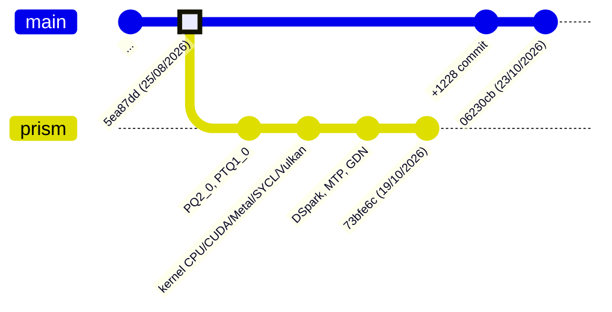

# Bài 12: Prism llama.cpp: fork của PrismML khác llama.cpp mainline thế nào

Một định dạng lượng tử mới chỉ có giá trị khi có kernel chạy được trên **mọi** backend mà người dùng quan tâm: CPU x86 (SSE, AVX2, AVX-VNNI, AVX-512), ARM (NEON, dotprod, i8mm), CUDA (từ Pascal đến Blackwell), HIP, Metal, Vulkan, SYCL. Đưa một kiểu dữ liệu mới vào mainline llama.cpp đòi hỏi review qua nhiều maintainer backend, nên PrismML duy trì một fork riêng, `PrismML-Eng/llama.cpp`, làm nơi phát triển và phát hành nhanh, đồng thời đẩy dần các phần ổn định về mainline.

Bài này trả lời ba câu hỏi bằng bằng chứng từ mã nguồn:

1. Fork được tổ chức thế nào và lệch khỏi mainline bao xa?
2. Những gì đã được đưa vào mainline, những gì vẫn chỉ có trong fork?
3. Các cơ chế đặc thù của fork (phát hiện định dạng legacy, mean-centering K cache, rollback trạng thái hồi quy khi speculative decoding) hoạt động thế nào?

:::note Phiên bản được phân tích
Mainline: `ggml-org/llama.cpp` commit `06230cb` (23/10/2026). Fork: nhánh `prism`, commit `73bfe6c` (19/10/2026), tag `prism-b10787-73bfe6c`. Các con số về số commit và số file được tính bằng `git merge-base`, `git rev-list --count` và `git diff --stat` giữa hai commit này.
:::

---

## Phần 1: Cấu trúc nhánh và quan hệ với mainline

### 1.1. Các nhánh chính

| Nhánh / tag | Vai trò |
|:---|:---|
| `prism` | Nhánh mặc định, dòng chính đang phát triển (README gọi là "developed as `prism-v7`") |
| `prism-v7` | Dòng phát triển hiện tại, theo sát mainline |
| `prism-v5` (release `prism-b9601`) | Dòng đóng băng, là dòng duy nhất còn đọc được file `Q2_0` legacy group 128 |
| `prism-v6` | Ảnh chụp giữa chừng của đợt migration, README cảnh báo không build từ nhánh này |
| `master` | Bản sao mainline (trùng với điểm merge-base bên dưới) |
| `cuda/*`, `perf/*`, `fix/*`, `feat/*` | Nhánh tính năng, phần lớn đã hoặc sẽ merge vào `prism` qua PR |

README của fork có hai cảnh báo vận hành quan trọng: không trộn thư viện `ggml-*` của fork với một bản llama.cpp gốc (ABI và bảng `type_traits` khác nhau vì có thêm type id), và coi repo `Bonsai-demo` là nguồn sự thật về binary và cờ chạy cho từng phần cứng.

### 1.2. Khoảng cách với mainline



Đo trên hai commit nói trên:

- Điểm merge-base là commit mainline `5ea87dd` ngày 25/08/2026.
- Fork có **171 commit** không có trong mainline; mainline có **1228 commit** chưa vào fork. Một nhánh `merge/upstream-20261011` cho thấy đợt đồng bộ tiếp theo đang được chuẩn bị.
- `git diff --stat` giữa merge-base và fork: **281 file, khoảng 40.4 nghìn dòng thêm, 1.5 nghìn dòng xóa**. Phần lớn là kernel (dòng thêm vào: SYCL khoảng 9.3 nghìn, CUDA khoảng 5.9 nghìn, CPU khoảng 3.3 nghìn, Metal khoảng 2.5 nghìn, Vulkan khoảng 1.1 nghìn), graph mô hình (`src/models/` khoảng 2 nghìn), speculative decoding (`common/speculative.cpp` khoảng 1.5 nghìn) và test.

Hệ quả thực tế: fork **cũ hơn mainline khoảng hai tháng** ở mọi phần không liên quan đến Bonsai (model mới, sửa lỗi server, tối ưu backend chung). Ví dụ đếm số file backend tham chiếu `GGML_TYPE_Q2_0`: Vulkan của mainline có 5 file, của fork chỉ có 1, vì mainline đã có thêm kernel Vulkan cho `Q2_0` sau ngày rẽ nhánh. Nếu mô hình bạn chạy không phải Bonsai, mainline thường là lựa chọn đúng.

---

## Phần 2: Những gì đã vào mainline

Đây là điểm dễ bị hiểu nhầm nhất: rất nhiều thứ "của Prism" **đã có trong mainline**. Kiểm tra trực tiếp trong mã nguồn mainline `06230cb`:

| Thành phần | Bằng chứng trong mainline |
|:---|:---|
| Kiểu `Q1_0` (1-bit, group 128, 18 byte) | `GGML_TYPE_Q1_0 = 41` trong `ggml/include/ggml.h`; `block_q1_0` trong `ggml/src/ggml-common.h`; `LLAMA_FTYPE_MOSTLY_Q1_0 = 40` |
| Kiểu `Q2_0` (2-bit, **group 64**, 18 byte) | `GGML_TYPE_Q2_0 = 42`, `QK2_0 = 64`; `LLAMA_FTYPE_MOSTLY_Q2_0 = 41` |
| Kernel `Q1_0`, `Q2_0` | CPU, CUDA, Metal, Vulkan, SYCL, WebGPU (OpenCL có `Q1_0`) |
| Metadata `prism.hadamard.*` | 11 key trong `gguf-py/gguf/constants.py` (`version`, `tied_output`, `block_size`, `transform`, `axis`, `sign_mode`, `sign_widths`, `sign_values`, `weight_names`, `inverse_weight_names`, `gdn_v_grouped`) và enum `LLM_KV_PRISM_HADAMARD_*` trong `src/llama-arch.h` |
| Runtime fold Hadamard | `llama_model_base::load_hparams_hadamard`, `load_tensors_hadamard` (`src/llama-model.cpp`); `llm_graph_context::build_hadamard_input` (`src/llama-graph.cpp`) |
| Hint FWHT cho backend | `GGML_HINT_SRC0_IS_HADAMARD` trong `ggml.h`, được CPU, CUDA (`fwht.cu`), Metal, Vulkan, SYCL, BLAS và Hexagon nhận diện |
| Converter Hadamard | `ModelBase.add_hadamard_metadata` đọc `hadamard_packing.json` (`conversion/base.py`) |
| Speculative MTP, DFlash, DSpark | `--spec-type draft-mtp`, `draft-dflash`, `draft-dspark` trong `common/speculative.cpp` |

Vì vậy model card của Bonsai 2 Small ghi rõ: mainline chạy được file `Q2_0` (nhờ runtime Hadamard), nhưng từ chối `PQ2_0` và `PTQ1_0` vì không biết hai type id này.

---

## Phần 3: Những gì chỉ có trong fork

### 3.1. Tầng định dạng (ggml)

| Kiểu | ggml type id | ftype id | Block | Byte / block | bpw | Ghi chú |
|:---|:---:|:---:|:---:|:---:|:---:|:---|
| `PQ2_0` | 142 | 141 (và 142 cho file cũ) | 128 | 34 | 2.125 | Cùng codec 2 bit với `Q2_0`, một scale mỗi 128 |
| `PTQ1_0` | 143 | 143 | 128 | 28 | 1.75 | Đóng gói trit cơ số 3 như `TQ1_0`, scale mỗi 128 |

Lưu ý sự lệch giữa **ggml type id** (định danh của một tensor trong file GGUF) và **ftype** (`llama_ftype`, nhãn của cả file, dùng bởi `llama-quantize`). Với `PQ2_0`, ftype `141` được chọn để khớp các file đã phát hành, còn `LLAMA_FTYPE_MOSTLY_PQ2_0_LEGACY = 142` là giá trị trước khi đổi tên vẫn xuất hiện trong một số file (định nghĩa trong `include/llama.h` của fork). Đây là lỗi nhầm lẫn thường gặp khi đọc metadata bằng tay.

Vì sao không sửa `TQ1_0` hay `Q2_0` cho khớp group 128? Thông điệp commit thêm `PTQ1_0` (#148) nêu nguyên tắc: `TQ1_0` là một **wire format**; đổi độ rộng block của nó sẽ đọc sai âm thầm mọi file `TQ1_0` đã tồn tại. Một type id mới là cách duy nhất để hai định dạng cùng tồn tại.

### 3.2. Tầng kernel

| Backend | Bổ sung chính trong fork (theo thư mục và commit) |
|:---|:---|
| CPU x86 | `vec_dot` `PQ2_0` cho SSE2/SSSE3, AVX2, AVX-VNNI, AVX-512 VNNI; GEMM tile 8 hàng activation; repack GEMV/GEMM cho `Q1_0` (`ggml/src/ggml-cpu/arch/x86/`) |
| CPU ARM | NEON `vec_dot` cho `PQ2_0`, NEON + i8mm cho `PTQ1_0` (2 hàng mỗi lần khi có `__ARM_FEATURE_MATMUL_INT8`), repack Q1_0 |
| CUDA | `mmvq-pq2_0.cuh`, `mmvq-ptq1_0.cuh` (mat-vec chuyên biệt theo số cột và thế hệ GPU), MMQ tile loader cho `PQ2_0` và `PTQ1_0`, đường Hopper wgmma cho `Q1_0`/`PQ2_0` (`mmq-hopper-q1.cu`), FWHT gộp với lượng tử activation Q8_1 (`quantize.cu`), FWHT block-per-row cho độ rộng từ 512, kernel GDN verify cho speculative, gộp MoE reduce (`moe-reduce.cu`) |
| HIP | Dùng chung mã CUDA, thêm nhánh `__builtin_amdgcn_perm` cho trích trit, warp 64 cho FWHT |
| Metal | FWHT threadgroup cho mọi độ rộng, gộp SwiGLU vào FWHT có dấu, mat-vec `PTQ1_0` và `PQ2_0` tính bằng float chính xác |
| Vulkan | Shader `dequant_pq2_0`, `dequant_ptq1_0`, `mul_mat_vec(q)_ptq1_0`, hỗ trợ GPU không có DP4A |
| SYCL | Đường XMX/DPAS cho Intel Arc (thư mục `ternsycl/`), decode attention riêng (`fattn-dec.cpp`) |

### 3.3. Tầng mô hình và runtime (src/, common/, tools/)

- `src/models/qwen35.cpp`: đường decode "ring" cho GDN qua `gated_delta_net_rows`, áp dụng nghịch đảo Hadamard cho embedding của đầu MTP, thu hẹp tầng cuối về các hàng output cần thiết.
- `src/models/dspark.cpp`: graph của drafter DSpark (mainline có enum `draft-dspark` và tensor DSpark nhưng không có tệp model này).
- Hỗ trợ `-sm tensor` (tensor parallel) cho qwen35 có fold Hadamard.
- Rollback trạng thái GDN bằng replay, chuỗi draft MTP trong một graph (Phần 5).
- `common/kv-mean-center.cpp` và `tools/kv-mean-center/`: mean-centering K cache (Phần 4).
- `tools/mtp-export/`: xuất đầu MTP; `gguf-py/gguf/scripts/gguf_dspark_to_dflash.py`: chuyển drafter DSpark cũ sang định dạng DFlash.
- Server: `--reasoning-effort-allow`, `--reasoning-effort-fallback`, `--reasoning-max-tokens-floor` (#321).

---

## Phần 4: Cơ chế đặc thù 1: phát hiện file `Q2_0` legacy

**Bài toán.** File Ternary Bonsai cũ lưu tensor group 128 với type id 42. Mainline và fork mới đọc id 42 là group 64. Với một hàng $n$ phần tử, kích thước theo hai cách hiểu là:

$$\text{size}_{g64} = \frac{n}{64} \cdot 18 = 0.28125\,n \text{ byte}, \qquad \text{size}_{g128} = \frac{n}{128} \cdot 34 = 0.265625\,n \text{ byte}$$

Hai giá trị khác nhau, nên offset của tensor kế tiếp trong vùng dữ liệu GGUF sẽ không khớp. Loader GGUF luôn kiểm tra `ti.offset` của mỗi tensor bằng tổng kích thước đã đệm (padded) của các tensor trước đó.

**Giải pháp của fork** (`ggml/src/gguf.cpp`, hàm đọc file): song song với tổng kích thước thật `ctx->size`, loader tích lũy thêm `size_if_legacy_q2`, là tổng kích thước **nếu** mọi tensor `Q2_0` được hiểu theo layout `PQ2_0`:

```c
// trích từ ggml/src/gguf.cpp (fork), rút gọn
if (ti.t.type == GGML_TYPE_Q2_0) {
    has_q2_0 = true;
    const size_t nrows = ggml_nrows(&ti.t);
    const size_t nbytes_legacy = ggml_row_size(GGML_TYPE_PQ2_0, ti.t.ne[0]) * nrows;
    size_if_legacy_q2 += GGML_PAD(nbytes_legacy, ctx->alignment);
} else {
    size_if_legacy_q2 += padded_size;
}
// khi offset không khớp:
if (has_q2_0 && ti.offset == size_if_legacy_q2) {
    // "this file matches the legacy Prism Q2_0 layout (group size 128 stored as ggml type id 42)"
}
```

Đây là một kỹ thuật chẩn đoán đẹp: không cần thêm metadata, chỉ dùng tính nhất quán của offset để phân biệt hai giả thuyết layout. Khi gặp lỗi offset, nếu offset quan sát được khớp đúng giả thuyết legacy, loader in thông báo chỉ người dùng tải file `PQ2_0` hoặc `_g64`.

---

## Phần 5: Cơ chế đặc thù 2: mean-centering K cache cho `Q4_0`

**Bài toán.** `Q4_0` là bộ lượng tử đối xứng: $x \approx d \cdot q$, không có zero-point. Nếu một kênh $c$ của vector key có trung bình $\bar{k}_c \neq 0$ qua các token, một phần dải động của 4 bit bị lãng phí để mã hóa hằng số đó.

**Giải pháp** (`docs/kv-mean-center.md`, `common/kv-mean-center.cpp`): đo trước $\bar{k}$ cho từng cặp (kv-head, kênh) trên một corpus hiệu chuẩn, rồi lưu $k_i - \bar{k}$ thay cho $k_i$ lúc ghi vào cache.

**Chứng minh tính đúng.** Với một query $q$ cố định và các key $k_0, \dots, k_n$ trong cùng một head:

$$q^\top k_i = q^\top (k_i - \bar{k}) + q^\top \bar{k}$$

Số hạng $q^\top \bar{k}$ không phụ thuộc $i$, tức là một hằng số cộng vào mọi logit trong cùng hàng. Softmax bất biến với phép tịnh tiến hằng số:

$$\operatorname{softmax}(z + c\mathbf{1})_i = \frac{e^{z_i + c}}{\sum_j e^{z_j + c}} = \frac{e^{z_i}}{\sum_j e^{z_j}} = \operatorname{softmax}(z)_i$$

nên trọng số attention không đổi trong số học chính xác. Chi phí runtime là một phép trừ lúc ghi cache. Lợi ích duy nhất là giảm sai số lượng tử của K. Lưu ý: tài liệu của fork nói rõ chưa công bố số đo cải thiện trên mô hình thật, và tính năng chỉ áp dụng cho `-ctk q4_0`.

```bash
./llama-kv-mean-center -m model.gguf -f calibration.txt -o kv-mean-center.gguf
./llama-cli -m model.gguf -ctk q4_0 --kv-mean-center kv-mean-center.gguf -p "..."
```

---

## Phần 6: Cơ chế đặc thù 3: speculative decoding trên mô hình hybrid

### 6.1. Vì sao hybrid attention làm khó speculative decoding

Speculative decoding (xem [Case 4](case_studies/case_4_speculative_decoding)) cho mô hình đích kiểm tra $K$ token nháp trong một lần forward, rồi **loại bỏ** các token bị từ chối. Với full attention, loại bỏ là việc rẻ: xóa các ô KV tương ứng (`seq_rm` trên `llama_kv_cache`).

Với tầng GDN, trạng thái là một ma trận $S_t \in \mathbb{R}^{d_k \times d_v}$ cập nhật theo delta rule có cổng:

$$S_t = \alpha_t \left(I - \beta_t k_t k_t^\top\right) S_{t-1} + \beta_t k_t v_t^\top$$

Sau khi đã xử lý $K$ token nháp, $S$ đã bị ghi đè; không có phép "trừ" nào lấy lại $S_{t}$ từ $S_{t+K}$ một cách rẻ và ổn định số học. Có ba chiến lược:

1. **Checkpoint**: lưu bản sao $S$ trước mỗi vòng verify (tốn bộ nhớ: mỗi tầng GDN một ma trận cho mỗi sequence).
2. **Lưu trạng thái theo từng bước** trong lúc verify rồi chọn đúng bước được chấp nhận (tốn bộ nhớ tỷ lệ $K$).
3. **Replay**: giữ checkpoint trước vòng verify, rồi chạy lại chỉ các token đã được chấp nhận để dựng lại $S$.

Fork port chiến lược replay (commit #358 "GDN rollback by replay, one-graph MTP draft chain") cùng một kernel CUDA "staged GDN verification" (#369, opt-in), và đặt độ sâu draft MTP mặc định là 2 trên CUDA (#354). Lý do độ sâu nhỏ là tối ưu: với mô hình mà một bước decode đã rất rẻ (trọng số 1.75 bit), chi phí verify và rollback chiếm tỷ trọng lớn, nên $K$ lớn nhanh chóng hết lợi.

### 6.2. Các loại drafter dùng với Bonsai

| Drafter | Cách hoạt động | Mô hình Bonsai |
|:---|:---|:---|
| MTP (`draft-mtp`) | Một tầng dự đoán token kế tiếp gắn vào chính mô hình đích, chia sẻ embedding và LM head | Bonsai 2 Small 4B, 9B (file `*-PQ2_0-MTP-Q8_0.gguf`) |
| DFlash 2 (`draft-dflash`) | Drafter khối (block diffusion) sinh nhiều token song song, điều kiện trên hidden state của đích | Bonsai 2 Small 4B, 9B |
| DSpark (`draft-dspark`) | Drafter bán tự hồi quy 6 tầng, xác minh theo lịch độ tin cậy | Bonsai 27B, Ternary Bonsai 27B |
| Prompt lookup / n-gram | Không có mạng; tra chuỗi lặp trong prompt | Mọi kích thước |

Một chi tiết tinh tế liên quan đến Hadamard: drafter "mượn" embedding và LM head của mô hình đích, mà các tensor này đang nằm trong cơ sở xoay. Fork phải áp dụng đúng phép biến đổi Hadamard của mô hình đích cho các tensor mượn (commit "dflash: apply the target's Hadamard transforms to borrowed embeddings and head"), nếu không drafter sẽ dự đoán sai hoàn toàn và tỷ lệ chấp nhận về gần 0.

---

## Phần 7: Bảng quyết định: dùng mainline hay fork

| Tình huống | Khuyến nghị | Lý do |
|:---|:---|:---|
| Chạy 1-bit Bonsai (`Q1_0`) | Mainline hoặc fork | `Q1_0` đã có kernel ở mainline; fork có thêm tối ưu Hopper và repack |
| Chạy Ternary Bonsai thế hệ 1 | Mainline với file `_g64`, hoặc fork với `PQ2_0` | `PQ2_0` nhỏ hơn khoảng 6% nhưng chỉ fork hiểu |
| Chạy Bonsai 2 với `Q2_0` | Mainline bản gần đây | Runtime Hadamard đã vào mainline; bản cũ sinh rác không báo lỗi |
| Chạy Bonsai 2 với `PQ2_0` / `PTQ1_0` | Bắt buộc fork | Type id 142, 143 không có ở mainline |
| Cần MTP, DFlash 2 của Bonsai, KV mean-center | Fork | Các tối ưu và file drafter được kiểm thử trên fork |
| Mô hình không phải Bonsai | Mainline | Fork chậm hơn khoảng hai tháng ở phần chung |

**Checklist build fork** (tổng hợp từ README fork và `KNOWN_ISSUES.md` của Bonsai 2 27B):

```bash
git clone https://github.com/PrismML-Eng/llama.cpp && cd llama.cpp
# CUDA: chỉ định kiến trúc nếu CMake không tự phát hiện (89 = RTX 40, 120a-real = RTX 5090)
cmake -B build -DGGML_CUDA=ON -DCMAKE_CUDA_ARCHITECTURES=89
# KV cache lượng tử với flash attention: danh sách cặp K-V được biên dịch nằm trong GGML_CUDA_FA_QUANTS
# (mặc định "q4_0-q4_0;q8_0-q8_0;f16-f16;bf16-bf16"), hoặc bật tất cả bằng -DGGML_CUDA_FA_ALL_QUANTS=ON
cmake --build build -j
./build/bin/llama-cli -m Ternary-Bonsai-2-9B-PQ2_0.gguf -ngl 99 -fa on -p "Xin chào"
```

- Không chép `libggml*.so` của fork sang một bản mainline hay ngược lại.
- Kiểm tra log nạp mô hình: nếu "CPU model buffer size" lên tới vài GB trong khi mọi tầng được báo là offload, backend GPU đang không có kernel cho kiểu đó và đã rơi về CPU (lỗi từng gặp với `PQ2_0` trên Vulkan).
- Với mô hình thinking, đặt `-n` đủ lớn (từ 8192 trở lên); giới hạn nhỏ cắt ngang phần suy luận và trả về câu trả lời rỗng.

Phần toán học của các định dạng và của runtime Hadamard được trình bày chặt chẽ ở [Theory 9](theory_deep_dive/theory_9_bonsai_gguf_formats) và [Theory 10](theory_deep_dive/theory_10_hadamard_folding).
