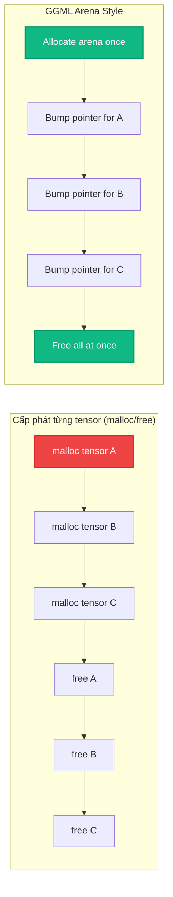
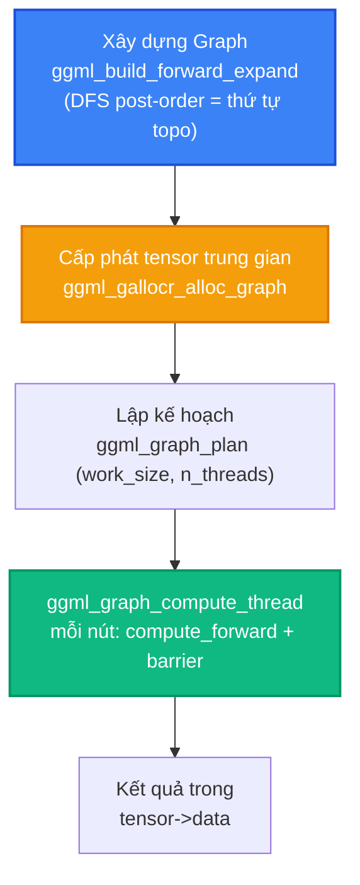

# Bài 1: GGML - Thư viện Tensor bằng C không phụ thuộc

Trước khi llama.cpp có thể inference bất kỳ mô hình nào, nó cần một nền tảng tính toán tensor. Nền tảng đó là **GGML**, một thư viện tensor viết bằng C (lõi) và C++ (các backend), không phụ thuộc bất kỳ framework ML nào. Trong bài học này, chúng ta sẽ đi sâu vào kiến trúc nội tại của GGML, từ cấu trúc tensor, hệ thống bộ nhớ arena, computation graph, bộ cấp phát graph, đến cách kernel CPU thực sự nhân ma trận quantized bằng SIMD.

---

## 1. GGML là gì?

GGML (tên ghép từ chữ cái đầu của Georgi Gerganov và "Machine Learning") là thư viện tensor tối giản được thiết kế với triết lý:

- **Zero dependencies**: Không cần PyTorch, TensorFlow; BLAS và CUDA chỉ là tùy chọn. Biên dịch được bằng C/C++ compiler chuẩn qua CMake.
- **API gọn trong vài header**: API lõi nằm trong `ggml/include/ggml.h` (khoảng 3000 dòng ở thời điểm hiện tại), bổ sung bởi `ggml-alloc.h` (cấp phát), `ggml-backend.h` (backend và scheduler), `ggml-cpu.h` (thực thi trên CPU) và `gguf.h` (định dạng file).
- **Inference-first**: Tối ưu cho forward pass. GGML có automatic differentiation và module tối ưu `ggml-opt.cpp`, nhưng mục tiêu chính không phải là training framework.
- **Hardware-portable**: Chạy trên x86 (AVX2/AVX512/AMX), ARM (NEON/SVE), RISC-V, PowerPC, s390x, WebAssembly, và mở rộng qua backend system đến CUDA, HIP, Metal, Vulkan, SYCL, OpenCL, CANN, WebGPU...

GGML ban đầu là project riêng của Gerganov, được sử dụng trong `whisper.cpp` (speech recognition) trước khi trở thành nền tảng cho `llama.cpp`. Hiện tại, GGML thuộc tổ chức `ggml-org` trên GitHub; repo llama.cpp chứa một bản đồng bộ của nó trong thư mục `ggml/`.

### 1.1. Bản đồ mã nguồn GGML hiện nay

Một thay đổi cấu trúc quan trọng (2024-2025) là **tách CPU thành một backend như mọi backend khác**. Trước đây, `ggml.c` vừa định nghĩa đồ thị vừa chứa toàn bộ kernel CPU. Hiện nay:

| File / thư mục | Vai trò |
|:---|:---|
| `ggml/src/ggml.c` | Định nghĩa tensor, op, xây dựng graph, bảng `type_traits` (tên, `blck_size`, `type_size` của từng kiểu) |
| `ggml/src/ggml-common.h` | Định nghĩa struct block của mọi quant type (`block_q4_0`, `block_q4_K`, ...) và các bảng tra (grid I-quants) |
| `ggml/src/ggml-quants.c` | Hàm quantize/dequantize tham chiếu (`quantize_row_q4_0_ref`, `dequantize_row_q4_K`, ...) |
| `ggml/src/ggml-alloc.c` | Bộ cấp phát tensor `ggml_tallocr` và bộ cấp phát graph `ggml_gallocr` |
| `ggml/src/ggml-backend.cpp` | Giao diện backend, buffer, và scheduler `ggml_backend_sched` |
| `ggml/src/ggml-cpu/` | Backend CPU: `ggml-cpu.c` (threadpool, vòng lặp graph, `mul_mat`), `ops.cpp` (các op như `flash_attn_ext`, `rope`), `quants.c` (dot product generic), `repack.cpp` (đổi bố cục Q4_0 lúc runtime) |
| `ggml/src/ggml-cpu/arch/<arch>/quants.c` | Kernel SIMD theo kiến trúc (`x86`, `arm`, `riscv`, `powerpc`, `loongarch`, `s390`, `wasm`) |
| `ggml/src/ggml-cuda/`, `ggml-metal/`, `ggml-vulkan/`, ... | Các backend phần cứng khác |

---

## 2. Cấu trúc ggml_tensor

Đơn vị cơ bản nhất trong GGML là **tensor**, được biểu diễn bằng cấu trúc `ggml_tensor` (định nghĩa trong `ggml/include/ggml.h`):

```c
struct ggml_tensor {
    enum ggml_type type;                        // Kiểu dữ liệu (F32, F16, Q4_0, ...)

    struct ggml_backend_buffer * buffer;        // Backend buffer chứa data (CPU RAM, VRAM, ...)

    int64_t ne[GGML_MAX_DIMS];                 // Số phần tử mỗi chiều (GGML_MAX_DIMS = 4)
    size_t  nb[GGML_MAX_DIMS];                 // Stride tính bằng bytes:
                                                // nb[0] = ggml_type_size(type)
                                                // nb[1] = nb[0] * (ne[0] / ggml_blck_size(type)) + padding
                                                // nb[i] = nb[i-1] * ne[i-1]

    enum ggml_op op;                           // Operation tạo ra tensor này (GGML_OP_NONE nếu là leaf)

    int32_t op_params[GGML_MAX_OP_PARAMS / sizeof(int32_t)]; // Tham số op (GGML_MAX_OP_PARAMS = 64 bytes)

    int32_t flags;                              // GGML_TENSOR_FLAG_INPUT/OUTPUT/PARAM/LOSS/COMPUTE

    struct ggml_tensor * src[GGML_MAX_SRC];    // Tensor nguồn (GGML_MAX_SRC = 10)

    struct ggml_tensor * view_src;             // Tensor gốc (nếu là view)
    size_t               view_offs;            // Offset của view trong tensor gốc

    void * data;                               // Con trỏ đến dữ liệu thực
    char name[GGML_MAX_NAME];                  // Tên tensor (GGML_MAX_NAME mặc định 64)
    void * extra;                              // Dữ liệu phụ của backend (ví dụ ggml-cuda)

    char padding[8];                           // Đệm để sizeof(ggml_tensor) chia hết cho GGML_MEM_ALIGN
};
```

Hai chi tiết thiết kế đáng chú ý:

- Một tensor **vừa là dữ liệu vừa là nút đồ thị**: trường `op` và `src[]` mô tả "tensor này được tính từ đâu". Không có cấu trúc "node" riêng.
- `data` và `buffer` tách biệt với metadata. Trong llama.cpp hiện đại, metadata tensor nằm trong một `ggml_context` khởi tạo với `no_alloc = true`, còn dữ liệu thực nằm trong một `ggml_backend_buffer` (RAM, VRAM, hoặc vùng `mmap` của file GGUF).

### 2.1. Hệ thống chiều (Dimensions)

GGML hỗ trợ tối đa **4 chiều** (`GGML_MAX_DIMS = 4`). Quy ước của GGML ngược với PyTorch: `ne[0]` là chiều **liên tục nhất** trong bộ nhớ (chiều "hàng"). Ví dụ trong Llama-3-8B:

| Tensor | `ne[0]` | `ne[1]` | `ne[2]` | `ne[3]` |
|:---|:---|:---|:---|:---|
| `token_embd.weight` | 4096 (`n_embd`) | 128256 (`n_vocab`) | 1 | 1 |
| `blk.i.attn_q.weight` | 4096 (đầu vào) | 4096 (đầu ra) | 1 | 1 |
| Hidden state của một ubatch | 4096 | `n_tokens` | 1 | 1 |
| Q sau reshape | 128 (`head_dim`) | 32 (`n_head`) | `n_tokens` | 1 |
| Expert weights MoE (`ffn_up_exps`) | `n_embd` | `n_ff` | `n_expert` | 1 |

Vì `ggml_mul_mat(ctx, a, b)` tính tích vô hướng giữa các **hàng** của `a` và các hàng của `b` (cả hai dọc theo `ne[0]`), trọng số `W` được lưu với `ne[0]` là chiều đầu vào. Đây chính là lý do kernel quantized có thể đọc từng block liên tục của một hàng trọng số.

### 2.2. Stride trong bytes (nb)

Mảng `nb[]` (number of bytes) định nghĩa **stride** của tensor, cho biết cần nhảy bao nhiêu byte để di chuyển một vị trí theo từng chiều:

- `nb[0] = ggml_type_size(type)`: Với kiểu thường là kích thước một phần tử (F32 = 4, F16 = 2). Với kiểu quantized, đây là kích thước **một block** (Q4_0: 18 bytes cho 32 phần tử).
- `nb[1] = nb[0] * (ne[0] / ggml_blck_size(type))`: Bytes cho một hàng. Đây chính là công thức `gguf.cpp` dùng khi đọc tensor info; do đó `ne[0]` của tensor quantized **bắt buộc** chia hết cho block size (nếu không, `gguf.cpp` báo lỗi "not a multiple of block size").
- `nb[i] = nb[i-1] * ne[i-1]`: Bytes cho chiều cao hơn (tích lũy).

Ví dụ tensor Q4_0 shape `[4096, 4096]`: `nb[0] = 18`, `nb[1] = 18 * 4096/32 = 2304`, `nb[2] = 2304 * 4096 = 9,437,184` bytes (đúng bằng 9 MiB, tức 4.5 bit/trọng số).

> **Lưu ý**: Số hạng `padding` trong comment của `ggml.h` không xuất hiện ở tensor contiguous thông thường. Nó chỉ phát sinh khi một tensor là **view** vào tensor lớn hơn (ví dụ một lát của KV Cache), khi đó `nb[1]` được kế thừa từ tensor gốc và lớn hơn kích thước hàng của view.

Công thức stride này cho phép GGML biểu diễn cả **contiguous tensors** (dữ liệu liên tục) và **view/permute/transpose** (hoán vị chiều) chỉ bằng cách đổi `ne`, `nb` và `view_offs`, không cần sao chép dữ liệu.

---

## 3. Hệ thống kiểu dữ liệu `ggml_type`

Ở commit hiện tại, `enum ggml_type` có `GGML_TYPE_COUNT = 43`, trong đó **8 slot đã bị loại bỏ** (giá trị 4, 5 của Q4_2/Q4_3 thời 2023; 31-33 của Q4_0_4_4/4_8/8_8; 36-38 của IQ4_NL_4_4/4_8/8_8). Vậy còn **35 kiểu hoạt động**. Các slot đã xóa vẫn được giữ chỗ (comment trong `ggml.h`) vì giá trị enum được ghi thẳng vào file GGUF; tái sử dụng số cũ sẽ khiến file cũ bị đọc sai.

Tại sao các kiểu `Q4_0_4_4`, `Q4_0_8_8`... bị xóa? Chúng không phải là kiểu quantization mới mà chỉ là **bố cục interleave** của Q4_0 cho kernel GEMM trên ARM/x86. Đưa bố cục phụ thuộc phần cứng vào file là thiết kế tồi (một file chỉ chạy nhanh trên một loại CPU), nên chúng được thay bằng cơ chế **runtime repack** trong `ggml/src/ggml-cpu/repack.cpp`: file vẫn lưu Q4_0 chuẩn, backend CPU tự đổi bố cục khi nạp (comment trong `include/llama.h`: "removed from gguf files, use Q4_0 and runtime repack").

Bảng dưới đây tính bpw (bits per weight) trực tiếp từ `sizeof(block_*)` trong `ggml/src/ggml-common.h`: $\text{bpw} = 8 \cdot \text{type\_size} / \text{blck\_size}$.

### 3.1. Nhóm Floating Point và Integer

| Enum (giá trị) | Bits/phần tử | Mô tả |
|:---|:---|:---|
| `GGML_TYPE_F32` (0) | 32 | Single precision, dùng cho norm weights, activations |
| `GGML_TYPE_F16` (1) | 16 | Half precision, chuẩn cho weight storage và KV Cache mặc định |
| `GGML_TYPE_BF16` (30) | 16 | Brain Float 16, cùng dải mũ với F32 |
| `GGML_TYPE_F64` (28) | 64 | Double precision, hiếm khi dùng |
| `GGML_TYPE_I8` / `I16` / `I32` / `I64` (24-27) | 8/16/32/64 | Số nguyên (positions, indices, token ids) |

### 3.2. Nhóm Block Quantization cơ bản ("legacy quants")

| Enum (giá trị) | Block | Bytes/block | bpw | Cấu trúc |
|:---|:---|:---|:---|:---|
| `GGML_TYPE_Q1_0` (41) | 128 | 18 | 1.125 | `d` (F16) + 128 bit dấu; giá trị là $\pm d$, với $d$ là trung bình $\lvert x \rvert$ |
| `GGML_TYPE_Q2_0` (42) | 64 | 18 | 2.25 | `d` (F16) + 64 mã 2-bit; giá trị $(q - 1) \cdot d$, $q \in [0, 3]$ |
| `GGML_TYPE_Q4_0` (2) | 32 | 18 | 4.50 | `d` (F16) + 32 x 4-bit, giá trị $(q - 8) \cdot d$ |
| `GGML_TYPE_Q4_1` (3) | 32 | 20 | 5.00 | `d`, `m` (F16) + 32 x 4-bit, giá trị $q \cdot d + m$ |
| `GGML_TYPE_Q5_0` (6) | 32 | 22 | 5.50 | `d` + `qh[4]` (bit thứ 5) + 32 x 4-bit |
| `GGML_TYPE_Q5_1` (7) | 32 | 24 | 6.00 | `d`, `m` + `qh[4]` + 32 x 4-bit |
| `GGML_TYPE_Q8_0` (8) | 32 | 34 | 8.50 | `d` (F16) + 32 x int8 |
| `GGML_TYPE_Q8_1` (9) | 32 | 36 | 9.00 | `d`, `s` (F16) + 32 x int8; `s` lưu tổng có scale, dùng làm kiểu activation cho Q4_1/Q5_1 |

Lưu ý các con số 5.0, 6.0, 9.0: phiên bản trước của bài viết ghi 4.75/5.75/8.75, sai vì quên rằng mỗi trường F16 tốn 16 bit trên 32 phần tử, tức 0.5 bpw, và các kiểu "_1" có hai trường như vậy.

### 3.3. Nhóm K-quants (Super-blocks 256 phần tử, `QK_K = 256`)

| Enum (giá trị) | Bytes/block | bpw | Mô tả |
|:---|:---|:---|:---|
| `GGML_TYPE_Q2_K` (10) | 84 | 2.625 | 16 sub-block x 16, scale và min 4-bit, $x = a \cdot q + b$ |
| `GGML_TYPE_Q3_K` (11) | 110 | 3.4375 | 16 sub-block x 16, scale 6-bit, $x = a \cdot q$ |
| `GGML_TYPE_Q4_K` (12) | 144 | 4.50 | 8 sub-block x 32, scale và min 6-bit |
| `GGML_TYPE_Q5_K` (13) | 176 | 5.50 | 8 sub-block x 32, scale và min 6-bit, thêm bit cao `qh` |
| `GGML_TYPE_Q6_K` (14) | 210 | 6.5625 | 16 sub-block x 16, scale int8 |
| `GGML_TYPE_Q8_K` (15) | 292 | 9.125 | `float d` + 256 x int8 + `bsums[16]`; **chỉ dùng làm kiểu trung gian** cho activation khi nhân với K-quants, không dùng để lưu trọng số |

### 3.4. Nhóm I-quants (codebook/lattice, thường đi kèm importance matrix)

| Enum (giá trị) | Block | Bytes | bpw | Mô tả |
|:---|:---|:---|:---|:---|
| `GGML_TYPE_IQ1_S` (19) | 256 | 50 | 1.5625 | Grid `iq1s_grid`, bắt buộc imatrix |
| `GGML_TYPE_IQ1_M` (29) | 256 | 56 | 1.75 | Biến thể 1-bit với scale 3-bit theo block |
| `GGML_TYPE_IQ2_XXS` (16) | 256 | 66 | 2.0625 | Mỗi nhóm 8 trọng số là một chỉ số vào `iq2xxs_grid` (256 điểm, ý tưởng lưới lấy cảm hứng từ E8 lattice của QuIP#) cộng bit dấu, bắt buộc imatrix |
| `GGML_TYPE_IQ2_XS` (17) | 256 | 74 | 2.3125 | `iq2xs_grid` (512 điểm), bắt buộc imatrix |
| `GGML_TYPE_IQ2_S` (22) | 256 | 82 | 2.5625 | `iq2s_grid` (1024 điểm) |
| `GGML_TYPE_IQ3_XXS` (18) | 256 | 98 | 3.0625 | `iq3xxs_grid` (256 điểm, nhóm 4) |
| `GGML_TYPE_IQ3_S` (21) | 256 | 110 | 3.4375 | `iq3s_grid` (512 điểm) |
| `GGML_TYPE_IQ4_NL` (20) | 32 | 18 | 4.50 | 16 mức phi tuyến cố định `kvalues_iq4nl` |
| `GGML_TYPE_IQ4_XS` (23) | 256 | 136 | 4.25 | Cùng 16 mức của IQ4_NL, nhưng gom 8 sub-block 32 vào super-block 256: mỗi sub-block có scale 6-bit (`scales_l`, `scales_h`), chỉ một `d` F16 |

Danh sách kiểu bắt buộc imatrix lấy từ `ggml_quantize_requires_imatrix()` trong `ggml.c`: chỉ IQ2_XXS, IQ2_XS, IQ1_S.

### 3.5. Nhóm Ternary Quantization (TQ)

| Enum (giá trị) | Bytes/block 256 | bpw | Mô tả |
|:---|:---|:---|:---|
| `GGML_TYPE_TQ1_0` (34) | 54 | 1.6875 | Gói 5 giá trị ternary vào 1 byte (vì $3^5 = 243 < 256$), cộng `d` F16 |
| `GGML_TYPE_TQ2_0` (35) | 66 | 2.0625 | 2 bit cho mỗi giá trị ternary, giải nén đơn giản hơn nên nhanh hơn TQ1_0 |

Hai kiểu này chỉ có ý nghĩa với mô hình **được huấn luyện ternary** (BitNet b1.58, TriLM), xem Bài 10.

### 3.6. Nhóm FP4 microscaling (mới nhất)

| Enum (giá trị) | Block | Bytes | bpw | Mô tả |
|:---|:---|:---|:---|:---|
| `GGML_TYPE_MXFP4` (39) | 32 | 17 | 4.25 | Chuẩn OCP Microscaling: 32 giá trị E2M1 (4-bit float) dùng chung một scale **E8M0** (chỉ có mũ, 1 byte). Dùng cho gpt-oss qua ftype `MXFP4_MOE` |
| `GGML_TYPE_NVFP4` (40) | 64 | 36 | 4.50 | Định dạng của NVIDIA: 4 sub-block x 16 giá trị E2M1, mỗi sub-block một scale **UE4M3** (1 byte) |

Cả hai dùng chung bảng `kvalues_fp4` (các giá trị E2M1 nhân đôi: 0, 1, 2, 3, 4, 6, 8, 12 và dấu âm). Sự khác biệt bản chất: E8M0 chỉ biểu diễn được lũy thừa của 2, nên scale của MXFP4 "thô"; UE4M3 có 3 bit mantissa và block nhỏ hơn (16), nên NVFP4 bám phân phối tốt hơn với chi phí thêm 0.25 bpw.

---

## 4. Arena-based Memory Allocation

Khác với PyTorch (dùng caching allocator cấp phát cho từng tensor), GGML sử dụng **arena allocation** cho metadata và (tùy chọn) dữ liệu tensor:

### 4.1. Nguyên lý Arena Allocation

```c
// Khởi tạo: cấp phát một block bộ nhớ lớn duy nhất
struct ggml_init_params params = {
    .mem_size   = 256 * 1024 * 1024,  // 256 MB arena
    .mem_buffer = NULL,                // GGML tự malloc
    .no_alloc   = false,               // false: data của tensor cũng nằm trong arena
};

struct ggml_context * ctx = ggml_init(params);

// Tạo tensor: cấp phát từ arena (cực nhanh, không syscall)
struct ggml_tensor * a = ggml_new_tensor_2d(ctx, GGML_TYPE_F32, 4096, 4096);  // 64 MB
struct ggml_tensor * b = ggml_new_tensor_2d(ctx, GGML_TYPE_F32, 4096, 4096);  // 64 MB
struct ggml_tensor * c = ggml_mul_mat(ctx, a, b);  // Chỉ tạo nút đồ thị (64 MB cho kết quả), CHƯA tính

// Giải phóng: free toàn bộ arena một lần
ggml_free(ctx);
```

Bên trong, `struct ggml_context` (trong `ggml.c`) chỉ giữ `mem_buffer`, `mem_size`, cờ `no_alloc` và một danh sách liên kết `ggml_object` (`objects_begin`, `objects_end`). Hàm `ggml_new_object()` luôn đặt object mới ngay sau object cuối, kích thước được làm tròn lên bội số `GGML_MEM_ALIGN` bằng macro `GGML_PAD(x, n)`. Đó chính là một **bump allocator**: không có `free` riêng lẻ, chỉ `ggml_reset()` hoặc `ggml_free()` cả context.

Một điều quan trọng cần hiểu đúng: `ggml_mul_mat()` và mọi hàm op khác **không tính toán gì**. Chúng chỉ tạo một tensor mới với `op = GGML_OP_MUL_MAT` và `src[0] = a`, `src[1] = b`. Tính toán chỉ xảy ra khi graph được thực thi (Phần 5).

### 4.2. Tại sao Arena Allocation tối ưu cho LLM Inference?



Lợi ích của arena allocation:

1. **Tốc độ**: Cấp phát tensor chỉ là phép cộng pointer (bump allocator), không có syscall hay tìm kiếm free list.
2. **Không memory fragmentation** trong arena: tensor nằm liên tiếp trong một block.
3. **Giải phóng đơn giản**: Một lệnh `ggml_free()` giải phóng toàn bộ, khó rò rỉ bộ nhớ.
4. **Kích thước biết trước**: Đồ thị của một forward pass có số nút bị chặn trên, nên arena metadata có thể tính chính xác. Ví dụ `llm_graph_result` trong `src/llama-graph.cpp` cấp `buf_compute_meta` với kích thước `ggml_tensor_overhead()*max_nodes + ggml_graph_overhead_custom(max_nodes, false)`, trong đó `max_nodes` lấy từ `llama_context::graph_max_nodes()`.

### 4.3. Arena trong llama.cpp hiện đại: chỉ chứa metadata

Mô hình "một arena chứa cả data" ở ví dụ trên phù hợp cho bài tập nhỏ, nhưng không phù hợp khi dữ liệu nằm trên GPU hoặc được `mmap` từ file. Vì vậy llama.cpp dùng hai lớp:

- `ggml_context` với `no_alloc = true`: chỉ chứa struct `ggml_tensor` (metadata), vài trăm KB.
- `ggml_backend_buffer`: chứa dữ liệu thực. Trọng số được đặt vào buffer bằng `ggml_backend_alloc_ctx_tensors()` (hoặc trỏ thẳng vào vùng `mmap`), còn tensor trung gian của forward pass do **graph allocator** cấp phát (Phần 7).

Đồng thời, llama.cpp **không** tạo lại bộ nhớ cho mỗi request. Buffer tính toán được "reserve" một lần cho đồ thị worst-case khi tạo context, và từ các phiên bản gần đây, nếu topology của đồ thị không đổi giữa hai ubatch liên tiếp, `llama_context::process_ubatch()` còn **tái sử dụng nguyên đồ thị** (`res->can_reuse(gparams)`) mà không cần build lại.

---

## 5. Computation Graph (ggml_cgraph)

GGML sử dụng **computation graph** (đồ thị tính toán) để biểu diễn và thực thi chuỗi phép tính.

### 5.1. Xây dựng Graph

Mỗi phép tính tensor (`ggml_add`, `ggml_mul_mat`, `ggml_soft_max`, ...) tạo ra một tensor mới mang thông tin op. Graph được "thu gom" bằng `ggml_build_forward_expand()`:

```c
// Xây dựng hàm f(x) = softmax(W * x + b)
struct ggml_tensor * x = ggml_new_tensor_2d(ctx, GGML_TYPE_F32, 4096, 1);
struct ggml_tensor * W = ggml_new_tensor_2d(ctx, GGML_TYPE_F32, 4096, 4096);
struct ggml_tensor * b = ggml_new_tensor_1d(ctx, GGML_TYPE_F32, 4096);

struct ggml_tensor * wx  = ggml_mul_mat(ctx, W, x);    // Matrix multiplication
struct ggml_tensor * wxb = ggml_add(ctx, wx, b);       // Bias addition
struct ggml_tensor * out = ggml_soft_max(ctx, wxb);    // Softmax

// Đóng gói thành computation graph (mặc định tối đa GGML_DEFAULT_GRAPH_SIZE = 2048 nút)
struct ggml_cgraph * gf = ggml_new_graph(ctx);
ggml_build_forward_expand(gf, out);
```

Bên trong, `ggml_build_forward_expand()` gọi `ggml_visit_parents_graph()`: một **DFS hậu thứ tự** (post-order) từ `out` ngược về các `src[]`, dùng hash set `visited_hash_set` để không thăm lại. Nút nào có `op == GGML_OP_NONE` (trọng số, input) được đưa vào mảng `leafs`, nút còn lại vào mảng `nodes`. Vì là hậu thứ tự, mảng `nodes` **đã là một thứ tự topo** ngay khi build: mọi nút đứng sau tất cả các nút nó phụ thuộc. Không có bước "topological sort" riêng lúc thực thi.

Cấu trúc `ggml_cgraph` (khai báo trong `ggml/src/ggml-impl.h`) gồm `size`, `n_nodes`, `n_leafs`, các mảng `nodes`, `leafs`, `grads`, `grad_accs`, mảng `use_counts`, `visited_hash_set` và `order`.

### 5.2. Thực thi Graph trên CPU

```c
// Cách đơn giản nhất (API trong ggml/include/ggml-cpu.h)
ggml_graph_compute_with_ctx(ctx, gf, n_threads);

// Tương đương với hai bước tường minh:
struct ggml_cplan plan = ggml_graph_plan(gf, n_threads, /*threadpool=*/ NULL);
plan.work_data = malloc(plan.work_size);   // work buffer dùng chung cho các thread
ggml_graph_compute(gf, &plan);
```

Hai bước này làm những việc sau:

1. **`ggml_graph_plan()`**: Duyệt các nút, xác định số task cho mỗi op và tính `work_size` lớn nhất cần cho buffer tạm. Ví dụ với `mul_mat` mà trọng số là Q4_0, work buffer cần đủ chỗ để chứa activation `src1` sau khi được **quantize sang Q8_0**.
2. **`ggml_graph_compute()`**: Đánh thức threadpool. Mỗi thread chạy `ggml_graph_compute_thread()` trong `ggml/src/ggml-cpu/ggml-cpu.c`, với vòng lặp cốt lõi:

```c
// Rút gọn từ ggml_graph_compute_thread()
for (int node_n = 0; node_n < cgraph->n_nodes; node_n++) {
    struct ggml_tensor * node = cgraph->nodes[node_n];
    if (ggml_op_is_empty(node->op)) continue;          // bỏ qua VIEW, RESHAPE, PERMUTE...
    int n_fused = ggml_cpu_try_fuse_ops(cgraph, node_n, &params, cplan);
    if (n_fused > 0) node_n += n_fused;                // vài op liền nhau được gộp
    else             ggml_compute_forward(&params, node);  // mỗi thread tự lấy phần việc theo ith/nth
    if (node_n + 1 < cgraph->n_nodes) ggml_barrier(threadpool);  // đồng bộ trước nút kế tiếp
}
```

Mô hình song song hóa ở đây là **song song trong từng op, tuần tự giữa các op**: mọi thread cùng xử lý một nút, mỗi thread nhận phần việc theo chỉ số `params->ith` trên tổng `params->nth` (ví dụ chia các hàng của ma trận trọng số), rồi gặp nhau ở `ggml_barrier()`. Lưu ý: bước này **không** làm memory planning; cấp phát tensor trung gian là việc của graph allocator, diễn ra trước đó.



Khi có nhiều backend (CPU + GPU), llama.cpp không gọi trực tiếp các hàm trên mà dùng `ggml_backend_sched`: scheduler chia graph thành các "split" theo backend chứa trọng số, chèn thao tác copy giữa các backend và gọi `ggml_backend_sched_graph_compute_async()` (Bài 6).

---

## 6. SIMD Optimization: kernel CPU thực sự nhân ma trận quantized như thế nào

**SIMD** (Single Instruction, Multiple Data) là tập lệnh cho phép CPU xử lý nhiều số trong một lệnh. GGML tận dụng SIMD tối đa cho các phép tính tensor.

### 6.1. Các tập lệnh SIMD được hỗ trợ

| Kiến trúc | Tập lệnh | Vector width | Số FP32 mỗi thanh ghi | Sử dụng cho |
|:---|:---|:---|:---|:---|
| x86 | SSE/AVX | 128/256-bit | 4/8 | CPU cũ |
| x86 | **AVX2** (+FMA) | 256-bit | 8 | Desktop/laptop hiện đại |
| x86 | **AVX512**, AVX512-VNNI, AVX-VNNI | 512/256-bit | 16/8 | Server Xeon, AMD Zen 4/5 |
| x86 | **AMX** | tile 1 KB | (int8/bf16 tile) | Xeon Sapphire Rapids trở lên (`ggml/src/ggml-cpu/amx/`) |
| ARM | **NEON** (+dotprod, i8mm) | 128-bit | 4 | Raspberry Pi, điện thoại, Apple Silicon |
| ARM | **SVE/SVE2** | scalable | thay đổi | ARM server (Graviton3+) |

### 6.2. Sự thật quan trọng: CPU không dequantize trọng số về FP32

Một hình dung phổ biến (và sai) là: "đọc block Q4_0, giải nén về FP32, rồi nhân float với activation". Nếu làm vậy, mỗi trọng số phải đi qua một phép chuyển int sang float và một phép nhân float, lãng phí cả băng thông thanh ghi lẫn throughput.

GGML làm ngược lại: **quantize activation sang 8-bit**, rồi tính **tích vô hướng số nguyên**. Mỗi kiểu trọng số khai báo một `vec_dot_type` trong bảng `type_traits_cpu` (file `ggml/src/ggml-cpu/ggml-cpu.c`):

| Kiểu trọng số | `vec_dot_type` (kiểu của activation) | Hàm dot |
|:---|:---|:---|
| Q4_0, Q5_0, Q8_0, IQ4_NL, MXFP4, NVFP4, Q1_0, Q2_0 | Q8_0 | ví dụ `ggml_vec_dot_q4_0_q8_0` |
| Q4_1, Q5_1 | Q8_1 | `ggml_vec_dot_q4_1_q8_1` |
| Mọi K-quant, I-quant 256, TQ1_0, TQ2_0 | Q8_K | ví dụ `ggml_vec_dot_q4_K_q8_K` |
| F16 / BF16 | F16 / BF16 | `ggml_vec_dot_f16`, `ggml_vec_dot_bf16` |

Đó là lý do Q8_K tồn tại: nó không bao giờ được ghi xuống file, chỉ là định dạng trung gian cho activation, có thêm `bsums` (tổng từng nhóm 16) để xử lý phần "min" của các kiểu affine một cách rẻ.

Pseudocode của `ggml_compute_forward_mul_mat()` (trong `ggml-cpu.c`) khi `src0` là trọng số quantized:

```text
1. Thử llamafile_sgemm(...) (ggml/src/ggml-cpu/llamafile/sgemm.cpp); nếu kernel tile này hỗ trợ cặp kiểu, xong.
2. Nếu src1 (activation, F32) khác vec_dot_type:
       mỗi thread quantize một phần các hàng của src1 sang vec_dot_type vào params->wdata
       (from_float = quantize_row_q8_0 hoặc quantize_row_q8_K), rồi barrier.
3. Chia ma trận kết quả thành các chunk (hàng của src0 x cột của src1),
   các thread lấy chunk qua bộ đếm nguyên tử, với mỗi phần tử:
       dst[i, j] = vec_dot(ne00, row_i(src0), row_j(wdata))
```

### 6.3. Đọc kernel AVX2 `ggml_vec_dot_q4_0_q8_0`

Kernel thật nằm trong `ggml/src/ggml-cpu/arch/x86/quants.c` (bản generic, không SIMD, là `ggml_vec_dot_q4_0_q8_0_generic` trong `ggml-cpu/quants.c`). Nhánh `__AVX2__` rút gọn:

```c
__m256 acc = _mm256_setzero_ps();
for (int ib = 0; ib < nb; ++ib) {                      // nb = n / 32 block
    // Scale kết hợp của hai block: d_w * d_a
    const __m256 d = _mm256_set1_ps(GGML_CPU_FP16_TO_FP32(x[ib].d) * GGML_CPU_FP16_TO_FP32(y[ib].d));

    // 16 byte nibble -> 32 byte, mỗi byte trong [0, 15]
    __m256i qx = bytes_from_nibbles_32(x[ib].qs);
    qx = _mm256_sub_epi8(qx, _mm256_set1_epi8(8));     // dịch về [-8, 7]

    __m256i qy = _mm256_loadu_si256((const __m256i *) y[ib].qs);  // 32 int8 activation (load KHÔNG căn lề)

    // 32 tích int8 x int8, cộng dồn thành 8 tổng int32 rồi đổi sang float
    const __m256 q = mul_sum_i8_pairs_float(qx, qy);

    acc = _mm256_fmadd_ps(d, q, acc);                  // acc += d * q
}
*s = hsum_float_8(acc);
```

Đọc kernel này theo nghĩa toán học: với block $b$, tích vô hướng là

$$\sum_{j=0}^{31} (d^w_b q^w_{bj}) (d^a_b q^a_{bj}) = d^w_b d^a_b \sum_{j=0}^{31} q^w_{bj} q^a_{bj}$$

Bản chất của công thức nằm ở việc tách **phần số nguyên** (tổng 32 tích int8, tính bằng cặp `_mm256_maddubs_epi16` và `_mm256_madd_epi16`; khi có AVX512-VNNI hoặc AVX-VNNI thì gộp thành một lệnh `dpbusd`, và với AVX-VNNI-INT8 là `_mm256_dpbssd_epi32`) khỏi **phần scale** (một phép nhân float cho cả block). Mỗi block 32 trọng số chỉ tốn một FMA float. Lưu ý thêm: kernel dùng `_mm256_loadu_si256` (load không căn lề), vì block Q4_0 dài 18 byte nên các block bên trong một hàng không thể cùng nằm trên biên 32 byte; căn lề 32 byte của GGUF chỉ đảm bảo **đầu mỗi tensor** được căn lề (Bài 2).

---

## 7. Graph Allocator (`ggml_gallocr`)

Khi computation graph có nhiều intermediate tensors (attention scores, FFN activations, ...), giữ tất cả đến cuối forward pass là lãng phí: một tensor chỉ cần sống đến khi nút cuối cùng dùng nó chạy xong. API cấp phát cũ `ggml_allocr_*` đã bị **xóa**; `ggml/include/ggml-alloc.h` hiện cung cấp hai lớp:

- `ggml_tallocr`: bộ cấp phát tuyến tính trên một `ggml_backend_buffer` (`ggml_tallocr_new`, `ggml_tallocr_alloc`), dùng cho trọng số.
- `ggml_gallocr`: bộ cấp phát **theo đồ thị**, tái sử dụng bộ nhớ của tensor đã chết.

```c
// Ví dụ sử dụng (theo comment trong ggml-alloc.h)
ggml_gallocr_t galloc = ggml_gallocr_new(ggml_backend_cpu_buffer_type());

// Tùy chọn: reserve buffer theo đồ thị worst-case để tránh cấp phát lại
ggml_gallocr_reserve(galloc, build_graph(max_batch));

// Cấp phát cho đồ thị thực
struct ggml_cgraph * graph = build_graph(batch);
ggml_gallocr_alloc_graph(galloc, graph);

printf("compute buffer size: %zu bytes\n", ggml_gallocr_get_buffer_size(galloc, 0));
ggml_backend_graph_compute(backend, graph);
```

Thuật toán trong `ggml_gallocr_alloc_graph_impl()` (`ggml/src/ggml-alloc.c`) có thể tóm tắt:

```text
1. Đếm cho mỗi tensor: n_children (số nút dùng nó làm src) và n_views (số view trỏ vào nó).
2. Duyệt nodes theo thứ tự topo. Với mỗi node:
   a. ggml_gallocr_allocate_node(node):
        nếu ggml_op_can_inplace(node->op) và có parent chỉ còn đúng 1 người dùng (node này),
        không phải view, cùng kích thước -> dùng lại luôn vùng nhớ của parent (in-place);
        ngược lại -> ggml_dyn_tallocr_alloc(): tìm free block "best fit" (khối trống nhỏ nhất đủ chứa).
   b. Với mỗi parent: n_children -= 1; nếu về 0 và không phải output -> ggml_gallocr_free_node(parent),
      trả vùng nhớ về danh sách free block (gộp với khối kề nếu có).
3. Tensor đánh dấu ggml_set_input() được cấp phát trước, không chồng lấn;
   tensor ggml_set_output() không bao giờ bị giải phóng hay ghi đè.
```

Chiến lược này giúp peak memory chỉ bằng "chiều rộng" lớn nhất của đồ thị chứ không phải tổng mọi tensor trung gian. Trong llama.cpp, kích thước compute buffer in ra khi khởi tạo context (dòng log "compute buffer size") chính là kết quả của bước reserve này trên đồ thị worst-case với `n_ubatch` token.

---

## 💡 Đúc kết Bài 1

GGML là nền tảng kiến trúc cho phép llama.cpp đạt hiệu năng cao trên CPU:

1. **Arena allocation** cho metadata, cộng **backend buffer** cho dữ liệu, loại bỏ overhead cấp phát từng tensor.
2. **Computation graph** được xây bằng DFS hậu thứ tự nên đã có sẵn thứ tự topo; **graph allocator** tái sử dụng bộ nhớ của tensor đã chết; **threadpool** song song hóa bên trong từng op.
3. **SIMD optimization** dựa trên ý tưởng quantize activation sang 8-bit và tính dot product số nguyên, thay vì dequantize trọng số về float.
4. **35 kiểu dữ liệu hoạt động** (trên tổng `GGML_TYPE_COUNT = 43` slot) cung cấp bộ công cụ quantization phong phú, từ Q1_0 (1.125 bpw) đến Q8_0, cùng các định dạng FP4 mới (MXFP4, NVFP4).

Trong bài tiếp theo, chúng ta sẽ tìm hiểu cách GGML đóng gói tất cả tensor và metadata vào định dạng file GGUF, cầu nối giữa model weights và inference engine.
