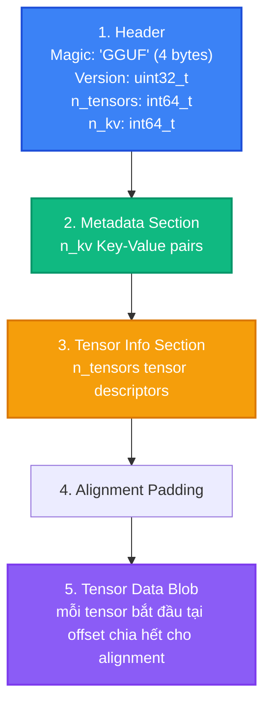

# Bài 2: Định dạng GGUF - Cấu trúc nhị phân và Thiết kế

Nếu GGML là "bộ não tính toán" của llama.cpp, thì **GGUF** là "bộ xương lưu trữ", định dạng file nhị phân chứa toàn bộ trọng số mô hình và metadata cần thiết để inference. Trong bài này, chúng ta sẽ giải phẫu cấu trúc file GGUF, hiểu tại sao nó được thiết kế như vậy, xem llama.cpp thực sự nạp file vào bộ nhớ ra sao, và học cách lập trình đọc/ghi GGUF bằng Python và C.

---

## 1. Tại sao cần GGUF?

Trước GGUF, llama.cpp dùng một họ định dạng "GGML file" (magic `ggml`, `ggmf`, rồi `ggjt` v1 đến v3). Các định dạng này có những hạn chế mang tính cấu trúc:

- **Hyperparameters là một struct cố định** gồm các trường `int32` (`n_vocab`, `n_embd`, `n_head`, `n_layer`, ...). Thêm một kiến trúc mới (Falcon, MPT, ...) với tham số mới đồng nghĩa với việc phá vỡ định dạng.
- **Không có metadata mở rộng**: không lưu được tokenizer type, merges BPE, chat template, RoPE scaling, ...
- **Có version nhưng không có tương thích tiến**: GGJT có trường version, nhưng mỗi lần bố cục block quantization thay đổi (GGJT v2, v3 trong tháng 5/2023), file cũ trở nên vô dụng.

**GGUF** (ra mắt tháng 8/2023) giải quyết các vấn đề trên bằng thiết kế **self-describing**: mọi tham số là một cặp key-value có kiểu, reader bỏ qua được key nó không biết, và kiến trúc mô hình được xác định bằng chuỗi `general.architecture` thay vì bằng bố cục struct. Việc chia một mô hình lớn thành nhiều file được giải quyết ở tầng llama.cpp bằng metadata `split.no`, `split.count`, `split.tensors.count` và quy ước tên `<prefix>-00001-of-00003.gguf` (hàm `llama_split_path()` trong `src/llama.cpp`, công cụ `llama-gguf-split`).

---

## 2. Cấu trúc file GGUF

Theo documentation ở đầu file `ggml/include/gguf.h`, một file GGUF có cấu trúc như sau:



Ba quy tắc mã hóa chung (cũng ghi trong `gguf.h`): chuỗi được lưu là `uint64` độ dài theo sau là các byte, **không** có null terminator; mọi enum được lưu dưới dạng `int32`; mọi giá trị bool được lưu dưới dạng `int8`. Toàn bộ là little-endian trên máy little-endian (GGUF v3 cho phép file big-endian cho các nền tảng như s390x).

### 2.1. Header (24 bytes cố định)

```
Offset  Size   Field          Value
0       4      Magic          "GGUF" (đọc như uint32 little-endian: 0x46554747)
4       4      Version        3 (uint32_t, GGUF_VERSION hiện tại)
8       8      n_tensors      Số lượng tensor trong file (int64_t)
16      8      n_kv           Số lượng metadata key-value pairs (int64_t)
```

Khi đọc, `gguf.cpp` từ chối version 0 và version 1 ("GGUFv1 is no longer supported"), từ chối version lớn hơn `GGUF_VERSION`, và có một mẹo nhận diện sai endianness: nếu 16 bit thấp của version bằng 0 (ví dụ đọc số 3 của file big-endian trên máy little-endian sẽ thành `0x03000000`), nó báo lỗi "is there a mismatch between the host and model endianness?".

### 2.2. Metadata Section (Key-Value Pairs)

Sau header là `n_kv` cặp key-value, mỗi cặp có cấu trúc:

```
Field          Size          Mô tả
key_len        uint64_t      Độ dài key string (không có null terminator)
key            key_len bytes Key string (UTF-8)
value_type     int32_t       Kiểu giá trị (enum gguf_type)
value          variable      Nếu ARRAY: int32 kiểu phần tử + uint64 số phần tử + các phần tử
                             Ngược lại: biểu diễn nhị phân của giá trị
```

Hệ thống `gguf_type` hỗ trợ 13 kiểu dữ liệu (`GGUF_TYPE_COUNT = 13`):

| Enum | Giá trị | Kiểu | Kích thước |
|:---|:---|:---|:---|
| `GGUF_TYPE_UINT8` | 0 | Unsigned 8-bit | 1 byte |
| `GGUF_TYPE_INT8` | 1 | Signed 8-bit | 1 byte |
| `GGUF_TYPE_UINT16` | 2 | Unsigned 16-bit | 2 bytes |
| `GGUF_TYPE_INT16` | 3 | Signed 16-bit | 2 bytes |
| `GGUF_TYPE_UINT32` | 4 | Unsigned 32-bit | 4 bytes |
| `GGUF_TYPE_INT32` | 5 | Signed 32-bit | 4 bytes |
| `GGUF_TYPE_FLOAT32` | 6 | Float 32-bit | 4 bytes |
| `GGUF_TYPE_BOOL` | 7 | Boolean (lưu như int8) | 1 byte |
| `GGUF_TYPE_STRING` | 8 | String (uint64_t len + data) | Variable |
| `GGUF_TYPE_ARRAY` | 9 | Array (type + count + elements) | Variable |
| `GGUF_TYPE_UINT64` | 10 | Unsigned 64-bit | 8 bytes |
| `GGUF_TYPE_INT64` | 11 | Signed 64-bit | 8 bytes |
| `GGUF_TYPE_FLOAT64` | 12 | Double 64-bit | 8 bytes |

### 2.3. Các metadata keys phổ biến

Một file GGUF cho mô hình Llama-3-8B quantize Q4_K_M thường chứa (tên key định nghĩa trong `src/llama-arch.cpp` và `gguf-py/gguf/constants.py`):

```
general.architecture                    = "llama"          (STRING)
general.name                            = "Llama-3-8B"     (STRING)
general.file_type                       = 15               (UINT32, llama_ftype: LLAMA_FTYPE_MOSTLY_Q4_K_M)
general.quantization_version            = 2                (UINT32, GGML_QNT_VERSION)
llama.context_length                    = 8192             (UINT32)
llama.embedding_length                  = 4096             (UINT32)
llama.block_count                       = 32               (UINT32)
llama.feed_forward_length               = 14336            (UINT32)
llama.attention.head_count              = 32               (UINT32)
llama.attention.head_count_kv           = 8                (UINT32, cho GQA)
llama.attention.layer_norm_rms_epsilon  = 1e-05            (FLOAT32)
llama.rope.freq_base                    = 500000.0         (FLOAT32)
tokenizer.ggml.model                    = "gpt2"           (STRING, BPE kiểu GPT-2)
tokenizer.ggml.tokens                   = ["!", ...]       (ARRAY of STRING)
tokenizer.ggml.token_type               = [1, 1, ...]      (ARRAY of INT32)
tokenizer.ggml.merges                   = ["Ġ Ġ", ...]     (ARRAY of STRING)
tokenizer.chat_template                 = ""      (STRING, Jinja2 template)
```

Hai điểm cần hiểu chính xác:

- Tiền tố `llama.` không cố định: nó là giá trị của `general.architecture`. Với Qwen3 các key là `qwen3.context_length`, ... Đây là cơ chế khiến một file "tự mô tả" kiến trúc của nó.
- `general.file_type` là một giá trị **`llama_ftype`** (preset quantization ở mức cả file, enum trong `include/llama.h`), **không** phải `ggml_type`. Q4_K_M có `llama_ftype = 15`, trong khi `GGML_TYPE_Q4_K = 12`. Một file Q4_K_M chứa tensor thuộc nhiều `ggml_type` khác nhau (Q4_K, Q6_K, F32 cho norm), như ta sẽ thấy ở Bài 3.

### 2.4. Tensor Info Section

Sau metadata, file chứa `n_tensors` tensor descriptors, mỗi descriptor:

```
Field          Size             Mô tả
name_len       uint64_t         Độ dài tên tensor
name           name_len bytes   Tên tensor (ví dụ: "blk.0.attn_q.weight"), tối đa GGML_MAX_NAME - 1
n_dims         uint32_t         Số chiều (1 đến GGML_MAX_DIMS = 4)
dims           n_dims * int64_t Kích thước mỗi chiều, theo thứ tự ne[0], ne[1], ...
type           int32_t          Kiểu ggml_type (F32=0, F16=1, Q4_0=2, ..., Q4_K=12, ...)
offset         uint64_t         Offset tính từ ĐẦU tensor data blob (không phải đầu file)
```

Khi đọc tensor info, `gguf_init_from_reader()` thực hiện một loạt kiểm tra phòng thủ: tên không trùng, `n_dims` không vượt `GGML_MAX_DIMS`, kiểu nằm trong `[0, GGML_TYPE_COUNT)`, `ne[0]` chia hết cho `ggml_blck_size(type)`, tổng byte không tràn `SIZE_MAX`. Sau đó nó tính luôn stride: `nb[0] = type_size`, `nb[1] = nb[0] * (ne[0] / blck_size)`, `nb[j] = nb[j-1] * ne[j-1]`.

### 2.5. Alignment Padding

Có **hai** chỗ cần padding, cả hai dùng cùng giá trị alignment $A$ (mặc định `GGUF_DEFAULT_ALIGNMENT = 32`):

1. Sau tensor info, file được pad đến bội số của $A$ để bắt đầu data blob.
2. Bên trong data blob, mỗi tensor chiếm `GGML_PAD(ggml_nbytes(t), A)` byte, nên tensor kế tiếp cũng bắt đầu tại bội số của $A$.

$$\text{padding}(o) = (A - (o \bmod A)) \bmod A, \qquad \text{GGML\_PAD}(x, A) = (x + A - 1)\ \&\ \lnot(A - 1)$$

Đọc công thức này theo nghĩa thực tế: `padding` là số byte cần thêm để đưa offset $o$ lên bội số gần nhất của $A$; dạng bitwise `GGML_PAD` chỉ đúng khi $A$ là lũy thừa của 2. Vì vậy `gguf.cpp` kiểm tra key `general.alignment`: nếu có, nó **phải** có kiểu `UINT32` và là lũy thừa của 2, nếu không file bị từ chối.

Một hệ quả ít được nhắc đến: offset của tensor không phải "tùy ý". Khi đọc, `gguf.cpp` yêu cầu offset của tensor thứ $i$ **đúng bằng** tổng kích thước đã pad của các tensor trước nó (lỗi "tensor ... has offset ..., expected ..."). Nói cách khác, data blob là một chuỗi tensor liền nhau theo đúng thứ tự trong tensor info, không có lỗ hổng.

### 2.6. Tensor Data Blob

Phần cuối cùng là **tensor data blob**, một khối binary liên tục chứa tất cả trọng số đã quantize, mỗi tensor là chuỗi block liên tiếp theo đúng bố cục `block_*` trong `ggml-common.h` (Bài 1). Hàm `gguf_get_data_offset()` trả về vị trí bắt đầu blob trong file; vị trí tuyệt đối của tensor $i$ là `data_offset + gguf_get_tensor_offset(ctx, i)`.

---

## 3. 32-byte Alignment: Tại sao quan trọng, và giới hạn của nó

Con số 32 xuất phát từ độ rộng thanh ghi **AVX2** (256-bit = 32 bytes). Lý do sâu hơn là kết hợp với **`mmap`**:

- `mmap` luôn ánh xạ file từ một biên trang (4 KiB hoặc lớn hơn), nên địa chỉ ảo của byte thứ $k$ trong file có cùng số dư modulo 32 với $k$.
- Vì mọi tensor bắt đầu tại offset là bội số của 32, con trỏ `tensor->data` trỏ thẳng vào vùng `mmap` cũng **căn lề 32 byte**, mà không cần sao chép.

Tuy nhiên cần hiểu đúng giới hạn: alignment chỉ đảm bảo **đầu mỗi tensor** và đầu mỗi hàng khi kích thước hàng là bội của 32. Nó **không** đảm bảo từng block quantization được căn lề. Ví dụ block Q4_0 dài 18 byte, block thứ hai của một hàng bắt đầu tại offset 18. Do đó các kernel trong `ggml/src/ggml-cpu/arch/x86/quants.c` dùng load không căn lề (`_mm256_loadu_si256`). Trên CPU x86 từ Haswell trở đi, load không căn lề không vượt qua biên cache line có cùng chi phí với load căn lề, nên lợi ích chính của alignment là: (a) không có load nào vô tình vắt qua hai cache line ở đầu tensor; (b) các backend GPU và các đường copy (`memcpy`, DMA) có thể dùng địa chỉ căn lề; (c) cho phép trỏ thẳng vào `mmap` an toàn với các yêu cầu căn lề của buffer backend (ví dụ `TENSOR_ALIGNMENT = 32` trong `ggml/src/ggml-impl.h`).

---

## 4. llama.cpp nạp một file GGUF như thế nào

Đây là phần nối GGUF với inference engine. Pipeline trong `src/llama-model-loader.cpp`:

```text
1. gguf_init_from_file(fname, { .no_alloc = true, .ctx = &ctx_meta })
     -> đọc header, metadata, tensor info; tạo một ggml_context CHỈ chứa metadata tensor
        (tensor->data = NULL). Không đọc data blob.
2. Nếu có split.count > 1: lặp lại cho từng file <prefix>-0000k-of-0000n.gguf.
3. llama_model_<arch>::load_arch_hparams(ml) đọc các key "<arch>.*"
   (ví dụ src/models/llama.cpp đọc LLM_KV_ATTENTION_LAYERNORM_RMS_EPS).
4. llama_model_<arch>::load_arch_tensors(ml) gọi create_tensor(tn(LLM_TENSOR_ATTN_Q, "weight", i), {n_embd, ...})
     -> đối chiếu tên và shape với tensor info trong file; quyết định tensor thuộc backend nào
        (CPU hay GPU, theo n_gpu_layers và tensor_buft_overrides).
5. load_all_data():
     - Tensor trên CPU + load_mode có mmap: ggml_backend_tensor_alloc(buf_mmap, cur, mapping->addr() + offs)
       -> zero-copy, tensor->data trỏ thẳng vào vùng mmap; OS chỉ đọc trang khi chạm tới.
     - Tensor trên GPU: đọc từ mapping hoặc file, rồi ggml_backend_tensor_set(_async) để upload.
```

Bước 5 giải thích một hiện tượng quen thuộc: với `mmap`, `llama-cli` "nạp" mô hình 5 GB gần như tức thì, và RAM của tiến trình chỉ tăng dần khi các trang được chạm lần đầu. Ở API hiện tại, chế độ nạp được chọn qua `llama_model_params::load_mode` (enum `llama_load_mode`: `AUTO`, `NONE`, `MMAP`, `MLOCK`, `MMAP_MLOCK`, `DIRECT_IO`), thay cho cặp cờ `use_mmap`/`use_mlock` của các phiên bản cũ.

---

## 5. Lập trình với GGUF trong Python

llama.cpp cung cấp thư viện Python `gguf` (mã nguồn tại `gguf-py/gguf/`, cài bằng `pip install gguf`) để đọc và ghi file GGUF.

### 5.1. Đọc file GGUF

```python
from gguf import GGUFReader

reader = GGUFReader("model.gguf")

# Đọc metadata: ReaderField.contents() giải mã giá trị (số, chuỗi, mảng)
for field in reader.fields.values():
    if field.name.startswith("tokenizer.ggml."):
        continue  # bỏ qua các mảng rất dài
    print(f"{field.name}: {field.contents()}")

# Đọc tensor info: ReaderTensor có name, tensor_type, shape, n_elements, n_bytes, data_offset, data
for tensor in reader.tensors:
    print(f"{tensor.name}: shape={list(tensor.shape)}, type={tensor.tensor_type.name}, offset={tensor.data_offset}")
```

### 5.2. Ghi file GGUF

```python
from gguf import GGUFWriter
import numpy as np

writer = GGUFWriter("output.gguf", arch="llama")   # tự ghi general.architecture = "llama"

# Thêm metadata
writer.add_name("My Custom Model")
writer.add_context_length(4096)                    # -> llama.context_length
writer.add_uint32("llama.embedding_length", 4096)
writer.add_uint32("llama.block_count", 32)

# Thêm tensor (FP16)
weight = np.random.randn(4096, 4096).astype(np.float16)
writer.add_tensor("blk.0.attn_q.weight", weight)

# Ghi file: header -> KV -> tensor info + data
writer.write_header_to_file()
writer.write_kv_data_to_file()
writer.write_tensors_to_file()
writer.close()
```

Lưu ý quy ước shape: mảng NumPy shape `(4096, 4096)` theo thứ tự row-major, khi ghi vào GGUF sẽ thành `ne[0] = 4096` (số cột, chiều liên tục) và `ne[1] = 4096` (số hàng). Writer đảo thứ tự chiều cho bạn.

### 5.3. Đọc GGUF thuần bằng struct module

Để hiểu sâu hơn, chúng ta có thể đọc GGUF từ đầu mà không dùng thư viện:

```python
import struct

def read_gguf_header(filepath):
    """Đọc và parse header của file GGUF"""
    with open(filepath, 'rb') as f:
        # Đọc magic (4 bytes)
        magic = f.read(4)
        assert magic == b'GGUF', f"Not a GGUF file: {magic}"

        # Đọc version (uint32_t, little-endian)
        version = struct.unpack('<I', f.read(4))[0]
        print(f"GGUF Version: {version}")

        # Đọc số lượng tensors (int64_t)
        n_tensors = struct.unpack('<q', f.read(8))[0]
        print(f"Number of tensors: {n_tensors}")

        # Đọc số lượng KV pairs (int64_t)
        n_kv = struct.unpack('<q', f.read(8))[0]
        print(f"Number of KV pairs: {n_kv}")

        return version, n_tensors, n_kv

# Sử dụng
version, n_tensors, n_kv = read_gguf_header("llama-3-8b-q4_k_m.gguf")
```

---

## 6. Lập trình với GGUF trong C

Trong mã nguồn llama.cpp, GGUF được đọc qua API trong `ggml/include/gguf.h` (cài đặt ở `ggml/src/gguf.cpp`):

```c
#include "gguf.h"
#include "ggml.h"

// Đọc file GGUF
struct ggml_context * ctx = NULL;
struct gguf_init_params params = {
    .no_alloc = false,   // false: đọc luôn data blob vào ggml_context mới tạo
    .ctx      = &ctx,    // nếu khác NULL: tạo ggml_context chứa các tensor
};

struct gguf_context * gguf_ctx = gguf_init_from_file("model.gguf", params);

// Đọc metadata (các hàm trả về int64_t cho số lượng và chỉ số)
const int64_t n_kv = gguf_get_n_kv(gguf_ctx);
for (int64_t i = 0; i < n_kv; i++) {
    const char * key = gguf_get_key(gguf_ctx, i);
    enum gguf_type type = gguf_get_kv_type(gguf_ctx, i);
    if (type == GGUF_TYPE_STRING) {
        printf("%s = %s\n", key, gguf_get_val_str(gguf_ctx, i));
    }
}

// Tìm một key cụ thể
const int64_t idx = gguf_find_key(gguf_ctx, "general.architecture");  // -1 nếu không có

// Đọc tensor info
const int64_t n_tensors = gguf_get_n_tensors(gguf_ctx);
for (int64_t i = 0; i < n_tensors; i++) {
    const char * name = gguf_get_tensor_name(gguf_ctx, i);
    enum ggml_type type = gguf_get_tensor_type(gguf_ctx, i);
    printf("Tensor %lld: %s (type=%s, offset=%zu)\n", (long long) i, name,
           ggml_type_name(type), gguf_get_tensor_offset(gguf_ctx, i));
}

// Giải phóng
gguf_free(gguf_ctx);
ggml_free(ctx);
```

Ngoài `gguf_init_from_file`, API hiện còn có `gguf_init_from_file_ptr` (từ `FILE *`), `gguf_init_from_buffer` (từ vùng nhớ) và `gguf_init_from_callback` (đọc qua callback, hữu ích cho nguồn dữ liệu không phải file). Tất cả cùng đi qua một bộ parser `gguf_init_from_reader()`.

---

## 7. Version History và Compatibility

| Version | Thời điểm | Thay đổi chính |
|:---|:---|:---|
| GGUF v1 | 8/2023 | Phiên bản đầu; các trường đếm và độ dài chuỗi là 32-bit |
| GGUF v2 | cuối 8/2023 | Chuyển `n_tensors`, `n_kv`, độ dài chuỗi, độ dài mảng sang 64-bit để hỗ trợ file và mảng rất lớn |
| GGUF v3 | 10/2023 | Hỗ trợ file big-endian; bố cục còn lại không đổi |

llama.cpp hiện tại **từ chối GGUF v1** nhưng vẫn đọc được v2 và v3; mọi file ghi mới đều là v3. Các kiểu quantization mới (I-quants 2024, TQ1_0/TQ2_0, MXFP4, NVFP4, Q1_0, Q2_0) **không** gắn với version GGUF: chúng chỉ là giá trị mới của enum `ggml_type`. Thay đổi về bố cục block được theo dõi riêng bởi `general.quantization_version` (giá trị `GGML_QNT_VERSION = 2` trong `ggml.h`).

---

## 💡 Đúc kết Bài 2

GGUF là một định dạng file được thiết kế **kỹ lưỡng** cho mục đích inference LLM:

1. **Extensible metadata** có kiểu cho phép lưu mọi thông tin từ architecture config đến tokenizer và chat template; tiền tố key theo `general.architecture` khiến file tự mô tả.
2. **Alignment 32 byte** cho đầu mỗi tensor, kết hợp với `mmap`, cho phép nạp zero-copy; nhưng nó không căn lề từng block bên trong tensor.
3. **Self-contained**: Một file GGUF chứa đủ mọi thứ cần thiết để inference (có thể chia nhiều file qua `split.*`).
4. **Kiểm tra phòng thủ** trong `gguf.cpp` (kiểu, shape, offset liền mạch, alignment là lũy thừa của 2) giúp phát hiện file hỏng hoặc độc hại sớm.

Trong bài tiếp theo, chúng ta sẽ đi sâu vào các giải thuật quantization mà GGUF lưu trữ, hiểu toán học đằng sau việc nén trọng số từ 16-bit xuống 4-bit mà vẫn giữ chất lượng.
