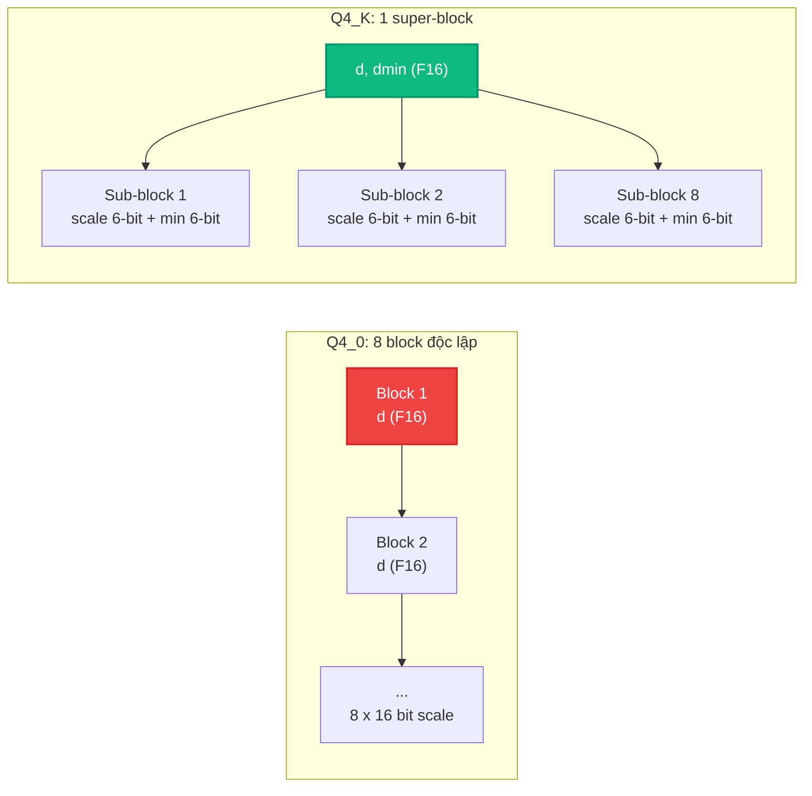

# Bài 3: Giải thuật Quantization - Từ Lý thuyết đến Hiện thực

**Quantization** (lượng tử hóa) là kỹ thuật cốt lõi giúp llama.cpp chạy được mô hình lớn trên phần cứng giới hạn. Bằng cách giảm độ chính xác của trọng số từ 16-bit xuống khoảng 4-bit hoặc thấp hơn, ta giảm 3-4 lần bộ nhớ và tăng tốc inference trên CPU. Nhưng quantization không đơn giản là "làm tròn số", mà là một bài toán tối ưu hóa giữa **kích thước**, **tốc độ** và **chất lượng**. Bài này đọc trực tiếp các struct trong `ggml/src/ggml-common.h`, các hàm tham chiếu trong `ggml/src/ggml-quants.c` và logic chọn kiểu tensor trong `src/llama-quant.cpp`.

---

## 1. Tại sao cần Quantization? Phân tích Memory Bandwidth Bottleneck

Như đã phân tích ở Bài 0, LLM inference (đặc biệt giai đoạn decode) là **memory-bound**: tốc độ bị giới hạn bởi băng thông bộ nhớ, không phải FLOPS.

Xét mô hình Llama-3-8B với khoảng 8.03 tỷ tham số. Cột kích thước dưới đây lấy từ bảng tham chiếu trong `tools/quantize/quantize.cpp` (đơn vị GiB, đổi sang GB), bpw hiệu dụng được suy ra bằng $\text{bpw} = 8 \cdot \text{bytes} / N_{\text{params}}$:

| Preset | bpw hiệu dụng | Kích thước | Cận trên tốc độ trên 50 GB/s |
|:---|:---|:---|:---|
| F32 | 32 | ~32.1 GB | ~1.6 tok/s |
| F16 | 16 | ~16.1 GB | ~3.1 tok/s |
| Q8_0 | ~8.5 | 7.96 GiB (~8.55 GB) | ~5.8 tok/s |
| Q6_K | ~6.6 | 6.14 GiB (~6.59 GB) | ~7.6 tok/s |
| Q5_K_M | ~5.7 | 5.33 GiB (~5.72 GB) | ~8.7 tok/s |
| **Q4_K_M** | **~4.9** | **4.58 GiB (~4.92 GB)** | **~10.2 tok/s** |
| Q4_0 | ~4.6 | 4.34 GiB (~4.66 GB) | ~10.7 tok/s |
| Q3_K_M | ~4.0 | 3.74 GiB (~4.02 GB) | ~12.4 tok/s |
| Q2_K | ~3.2 | 2.96 GiB (~3.18 GB) | ~15.7 tok/s |

Hai quan sát quan trọng:

- bpw hiệu dụng của một **preset** luôn lớn hơn bpw của kiểu block cùng tên. Q2_K là kiểu block 2.625 bpw, nhưng preset Q2_K cho cả file đạt khoảng 3.2 bpw vì nhiều tensor nhạy cảm được nâng lên Q3_K, Q4_K, và tensor `output.weight` thường là Q6_K. Q4_0 (kiểu block 4.5 bpw) cũng thành khoảng 4.6 bpw cả file vì cùng lý do.
- Cột tốc độ là cận trên lý thuyết theo công thức:

$$\text{Throughput (tok/s)} \lesssim \frac{\text{Memory Bandwidth (GB/s)}}{\text{Model Size (GB)}}$$

Quantization giảm mẫu số, tăng throughput. Câu hỏi là: **nén bao nhiêu mà chất lượng vẫn chấp nhận được?**

---

## 2. Block Quantization cơ bản

### 2.1. Q4_0: 4-bit Symmetric Quantization

Đây là phương pháp đơn giản nhất. Mỗi block 32 giá trị (`QK4_0 = 32`) được nén thành:

- **1 scale** `d` (F16, 2 bytes)
- **32 giá trị 4-bit** (16 bytes, mỗi byte chứa 2 giá trị)

Tổng: 18 bytes cho 32 giá trị = **4.5 bits/trọng số**.

**Công thức Quantize** (đúng như `quantize_row_q4_0_ref` trong `ggml-quants.c`): gọi $x_{\max}$ là phần tử có **trị tuyệt đối lớn nhất, giữ nguyên dấu**. Khi đó

$$d = \frac{x_{\max}}{-8}, \qquad q_i = \min\left(15, \left\lfloor \frac{x_i}{d} + 8.5 \right\rfloor\right) \in [0, 15]$$

**Công thức Dequantize:**
$$\hat{x}_i = (q_i - 8) \cdot d$$

Bản chất của công thức nằm ở một mẹo nhỏ: dải số nguyên 4-bit có dấu là $[-8, 7]$, bất đối xứng. Nếu chọn $d = \max \lvert x \rvert / 7$ (cách "sách giáo khoa"), mức $-8$ bị bỏ phí. Bằng cách chia cho $-8$ và giữ dấu của phần tử lớn nhất, phần tử cực trị luôn được ánh xạ **chính xác** vào mức $-8$ (tức $\hat{x} = x_{\max}$, không có sai số), và ta dùng đủ 16 mức. Phép $+8.5$ rồi cắt phần nguyên tương đương làm tròn đến gần nhất sau khi dịch về dải không âm.

Struct (trong `ggml/src/ggml-common.h`) và hàm dequantize (trong `ggml/src/ggml-quants.c`):

```c
#define QK4_0 32
typedef struct {
    ggml_half d;           // delta (scale, F16)
    uint8_t qs[QK4_0 / 2]; // nibbles / quants: 32 giá trị 4-bit
} block_q4_0;
static_assert(sizeof(block_q4_0) == sizeof(ggml_half) + QK4_0 / 2, "wrong q4_0 block size/padding");

void dequantize_row_q4_0(const block_q4_0 * GGML_RESTRICT x, float * GGML_RESTRICT y, int64_t k) {
    static const int qk = QK4_0;
    const int nb = k / qk;
    for (int i = 0; i < nb; i++) {
        const float d = GGML_FP16_TO_FP32(x[i].d);
        for (int j = 0; j < qk/2; ++j) {
            const int x0 = (x[i].qs[j] & 0x0F) - 8;   // nibble thấp: phần tử j
            const int x1 = (x[i].qs[j] >>   4) - 8;   // nibble cao: phần tử j + 16
            y[i*qk + j + 0   ] = x0*d;
            y[i*qk + j + qk/2] = x1*d;
        }
    }
}
```

Chú ý bố cục: byte $j$ chứa phần tử $j$ (nibble thấp) và phần tử $j + 16$ (nibble cao), **không** phải hai phần tử kề nhau. Bố cục này cho phép kernel SIMD tách 32 giá trị bằng một phép AND và một phép shift trên cả thanh ghi (hàm `bytes_from_nibbles_32` ở Bài 1).

### 2.2. Q5_0 và Q8_0

Tương tự Q4_0 nhưng với nhiều bit hơn:

| Loại | Bits/weight | Block size | Cấu trúc | Giá trị lượng tử |
|:---|:---|:---|:---|:---|
| Q4_0 | 4.50 | 32 | `d` + `qs[16]` | 4-bit, dịch về $[-8, 7]$ |
| Q5_0 | 5.50 | 32 | `d` + `qh[4]` (bit thứ 5 của 32 giá trị) + `qs[16]` | 5-bit, dịch về $[-16, 15]$ |
| Q8_0 | 8.50 | 32 | `d` + `qs[32]` (int8) | 8-bit, $d = \max\lvert x \rvert / 127$ |

Q8_0 có hai vai trò. Nó là một kiểu **lưu trọng số** gần như không mất mát (Llama-3-8B: chỉ +0.0026 PPL theo bảng trong `quantize.cpp`). Đồng thời nó là **kiểu activation trung gian** (`vec_dot_type`) trên CPU: khi nhân với trọng số Q4_0, Q5_0, Q8_0, IQ4_NL, MXFP4, NVFP4..., backend CPU quantize vector activation sang Q8_0 ngay lúc chạy rồi tính dot product số nguyên (Bài 1, Phần 6). Với K-quants, kiểu activation tương ứng là Q8_K.

### 2.3. Q4_1 và Q5_1: Asymmetric Quantization

Thêm một trường **minimum** `m` vào block, cho phép biểu diễn chính xác hơn khi phân phối trọng số trong block không đối xứng quanh 0:

$$d = \frac{x_{\max} - x_{\min}}{15}, \quad m = x_{\min}, \quad \hat{x}_i = q_i \cdot d + m, \quad q_i \in [0, 15]$$

Đổi lại, block tăng thêm 2 bytes: Q4_1 là 20 bytes / 32 = **5.0 bpw**, Q5_1 là 24 bytes / 32 = **6.0 bpw** (không phải 4.75 và 5.75 như đôi khi bị ghi nhầm: mỗi trường F16 trên block 32 tốn đúng 0.5 bpw). Đây là cái giá đắt cho một lợi ích nhỏ, và chính điều này thúc đẩy sự ra đời của K-quants.

### 2.4. Q1_0 và Q2_0: hai kiểu cực thấp mới nhất

Hai kiểu mới nhất trong enum (`GGML_TYPE_Q1_0 = 41`, `GGML_TYPE_Q2_0 = 42`) đi theo tinh thần đơn giản của Q4_0 nhưng với block lớn hơn để giảm overhead của scale:

| Loại | Block | Bytes | bpw | Quantize (`quantize_row_q1_0_ref`, `quantize_row_q2_0_ref`) | Dequantize |
|:---|:---|:---|:---|:---|:---|
| Q1_0 | 128 | 18 | 1.125 | $d = \frac{1}{128}\sum_i \lvert x_i \rvert$, bit $= [x_i \geq 0]$ | $\hat{x}_i = \pm d$ |
| Q2_0 | 64 | 18 | 2.25 | $d = \max_i \lvert x_i \rvert$, $q_i = \text{clamp}(\text{round}(x_i/d) + 1, 0, 3)$ | $\hat{x}_i = (q_i - 1)\, d$ |

Tại sao Q1_0 chọn scale là **trung bình trị tuyệt đối** chứ không phải max? Đây là một bài toán tối ưu nhỏ đáng chứng minh. Với $s_i = \text{sign}(x_i)$ cố định, ta cực tiểu sai số bình phương theo $d$:

$$\min_d \sum_{i=1}^{n} (x_i - d\, s_i)^2 \;\Rightarrow\; \frac{\partial}{\partial d} = -2 \sum_i s_i (x_i - d\, s_i) = 0 \;\Rightarrow\; d^{\ast} = \frac{\sum_i s_i x_i}{\sum_i s_i^2} = \frac{1}{n} \sum_i \lvert x_i \rvert$$

Vậy trung bình trị tuyệt đối chính là scale tối ưu theo MSE cho lượng tử hóa dấu. Đây cũng là scale mà BitNet dùng (`absmean`). Với Q2_0, mã `11` (giá trị $+2d$) không bao giờ được bộ quantize tham chiếu sinh ra (vì $\lvert x_i \rvert / d \leq 1$), nên thực chất nó hoạt động như một lưới ternary $\lbrace -d, 0, +d \rbrace$ với block 64, rẻ hơn TQ2_0 (2.0625 bpw trên block 256) về độ chi tiết của scale. Hai kiểu này chủ yếu hữu ích cho mô hình được huấn luyện hoặc tinh chỉnh để chịu được bit thấp, không phải cho PTQ mô hình FP16 thông thường. Trong `llama-quantize`, chúng có preset riêng `Q1_0` ("1.125 bpw") và `Q2_0` ("2.25 bpw quantization (group 64)").

---

## 3. K-quants: Super-block Quantization

K-quants (giới thiệu bởi Iwan Kawrakow, tháng 6/2023) là bước đột phá về chất lượng. Thay vì mỗi block 32 giá trị có scale F16 riêng, K-quants gom nhiều sub-block thành **super-block** 256 giá trị (`QK_K = 256`), và **lượng tử hóa luôn cả các scale** của sub-block bằng 6 bit, chỉ giữ một hoặc hai số F16 cho cả super-block.

### 3.1. Q4_K: Super-block Structure

Struct thật trong `ggml/src/ggml-common.h`:

```c
typedef struct {
    union {
        struct {
            ggml_half d;    // super-block scale for quantized scales
            ggml_half dmin; // super-block scale for quantized mins
        };
        ggml_half2 dm;
    };
    uint8_t scales[K_SCALE_SIZE]; // K_SCALE_SIZE = 12: 8 scale + 8 min, mỗi cái 6 bit
    uint8_t qs[QK_K/2];           // 256 giá trị 4-bit (128 bytes)
} block_q4_K;
```

Tổng: 2 + 2 + 12 + 128 = **144 bytes** cho 256 giá trị = **4.50 bits/trọng số**.

Mảng `scales[12]` chứa 16 số 6-bit (8 scale, 8 min) = 96 bit = 12 bytes. Cách đóng gói được giải mã bởi `get_scale_min_k4()` trong `ggml-quants.c`:

```c
static inline void get_scale_min_k4(int j, const uint8_t * q, uint8_t * d, uint8_t * m) {
    if (j < 4) {   // sub-block 0..3: 6 bit thấp của byte j (scale) và byte j+4 (min)
        *d = q[j] & 63; *m = q[j + 4] & 63;
    } else {       // sub-block 4..7: 4 bit từ byte j+4, 2 bit cao mượn từ byte j-4 (scale) / j (min)
        *d = (q[j+4] & 0xF) | ((q[j-4] >> 6) << 4);
        *m = (q[j+4] >>  4) | ((q[j-0] >> 6) << 4);
    }
}
```

Nghĩa là: 8 byte đầu chứa 6 bit thấp của scale/min của 4 sub-block đầu, 2 bit cao của mỗi byte này được "tận dụng" để chứa 2 bit cao cho 4 sub-block sau, và 4 byte cuối chứa 4 bit thấp còn lại. Không có cách chia đơn giản "6 byte scale, 6 byte min".

Công thức dequantize (`dequantize_row_q4_K`), với sub-block $j \in [0, 8)$ gồm 32 phần tử:

$$\hat{x}_{j,l} = (d \cdot s_j)\, q_{j,l} - (d_{\min} \cdot m_j), \qquad s_j, m_j \in [0, 63], \; q_{j,l} \in [0, 15]$$

### 3.2. Tại sao K-quants tốt hơn Basic Quants?



So sánh trên cùng 256 trọng số:

| | Q4_0 | Q4_1 | Q4_K |
|:---|:---|:---|:---|
| Metadata | 8 x `d` F16 = 128 bit | 8 x (`d`, `m`) F16 = 256 bit | `d`, `dmin` F16 + 16 x 6 bit = 128 bit |
| Mô hình sai số | đối xứng | affine (có min) | affine (có min) |
| bpw | 4.5 | 5.0 | 4.5 |

Bản chất của lợi thế nằm ở dòng cuối: **Q4_K có độ linh hoạt affine của Q4_1 với chi phí của Q4_0**. Scale của sub-block không cần độ chính xác F16; 6 bit tương đối so với scale chung là đủ, vì sai số của scale chỉ gây sai số nhân tỷ lệ nhỏ trên cả sub-block.

Thứ hai, scale của K-quants **không** được tính bằng công thức đóng như Q4_0 mà bằng tìm kiếm có trọng số. Trong `quantize_row_q4_K_impl()`, với mỗi sub-block 32 phần tử, hàm `make_qkx3_quants()` thử nhiều giá trị scale/min lân cận và chọn cặp cực tiểu sai số **có trọng số**:

$$\min_{s, m} \sum_{l} w_l \left( x_l - (s\, q_l - m) \right)^2$$

với $w_l = \bar{\sigma} + \lvert x_l \rvert$ khi không có imatrix, hoặc $w_l = \text{imatrix}_l \cdot \sqrt{\sigma^2 + x_l^2}$ khi có imatrix ($\sigma^2$ là trung bình $x^2$ của super-block). Sau đó 8 scale và 8 min lại được lượng tử hóa 6 bit bằng `make_qp_quants()`.

### 3.3. Q4_K_S vs Q4_K_M: preset là một "chính sách", không phải một kiểu

`Q4_K_S` và `Q4_K_M` đều dùng **cùng một kiểu block** `GGML_TYPE_Q4_K`. Khác biệt nằm ở chính sách chọn kiểu cho từng tensor trong `llama_tensor_get_type_impl()` (`src/llama-quant.cpp`). Hàm then chốt là:

```c
auto use_more_bits = [](int i_layer, int n_layers) -> bool {
    return i_layer < n_layers/8 || i_layer >= 7*n_layers/8 || (i_layer - n_layers/8)%3 == 2;
};
```

Nghĩa là: 1/8 số layer đầu, 1/8 số layer cuối, và cứ 3 layer ở giữa thì một layer, được "thưởng" thêm bit. Với Llama-3-8B (32 layer), đó là layer 0-3, 28-31 và 6, 9, 12, ..., 27.

| Tensor | Q4_K_S | Q4_K_M |
|:---|:---|:---|
| `output.weight` | Q6_K | Q6_K |
| `attn_v.weight` | Q5_K cho 4 layer đầu, còn lại Q4_K | **Q6_K** nếu `use_more_bits`, còn lại Q4_K |
| `ffn_down.weight` | Q5_K cho 1/8 layer đầu, còn lại Q4_K | **Q6_K** nếu `use_more_bits`, còn lại Q4_K |
| `attn_qkv` (tensor gộp) | Q4_K | Q5_K |
| Tensor còn lại (`attn_q`, `attn_k`, `attn_output`, `ffn_gate`, `ffn_up`) | Q4_K | Q4_K |
| Norm (1D) | F32 | F32 |
| Kết quả Llama-3-8B | 4.37 GiB, +0.2689 PPL | 4.58 GiB, +0.1754 PPL |

Vậy hiểu đúng là: Q4_K_M **không** giữ attention ở FP16. Nó tăng bit có chọn lọc cho `attn_v` và `ffn_down`, hai tensor mà thực nghiệm của tác giả K-quants cho thấy nhạy nhất, và tập trung vào layer đầu và cuối. Với mô hình có 8 expert (Mixtral), `attn_v` và `attn_k` còn được nâng lên Q8_0 vì chúng chiếm tỷ lệ rất nhỏ trong tổng kích thước.

---

## 4. I-quants và Importance Matrix

I-quants (đầu năm 2024, cũng do Iwan Kawrakow) đi theo một hướng khác hẳn: thay vì lưu từng giá trị bằng số nguyên tuyến tính, chúng lưu **chỉ số vào một codebook** (grid) gồm các vector nhiều chiều được thiết kế sẵn. Song song với đó là công cụ **importance matrix** (imatrix). Đây là hai khái niệm độc lập, thường bị gộp làm một:

- **I-quant** là một *định dạng lưu trữ* (codebook/lattice hoặc bảng phi tuyến).
- **imatrix** là *thông tin hiệu chỉnh* dùng để đặt trọng số cho hàm sai số khi chọn scale và mã. Nó dùng được cho **mọi** kiểu (Q4_K, Q5_K, Q4_0 cũng nhận imatrix qua tham số `quant_weights`), và chỉ **bắt buộc** với IQ2_XXS, IQ2_XS, IQ1_S (`ggml_quantize_requires_imatrix()` trong `ggml.c`).

### 4.1. Importance matrix tính gì?

Xét một layer tuyến tính $y = W x$. Sai số đầu ra do lượng tử hóa hàng $w$ của $W$ là $\Delta y = (w - \hat{w})^{\top} x$. Lấy kỳ vọng trên dữ liệu hiệu chỉnh:

$$\mathbb{E}\left[(\Delta y)^2\right] = (w - \hat{w})^{\top}\, \mathbb{E}[x x^{\top}]\, (w - \hat{w}) \approx \sum_{j} \mathbb{E}[x_j^2]\, (w_j - \hat{w}_j)^2$$

Bước xấp xỉ cuối giữ lại **đường chéo** của ma trận hiệp phương sai activation. Bản chất của công thức nằm ở chỗ: một cột $j$ của $W$ mà activation đầu vào $x_j$ thường lớn thì sai số trên cột đó bị khuếch đại nhiều hơn. `llama-imatrix` (`tools/imatrix/imatrix.cpp`) tính đúng đại lượng này: với mỗi tensor trọng số, nó cộng dồn `acc[j] += x[j] * x[j]` trên các token của dữ liệu hiệu chỉnh. Kết quả mặc định được lưu thành `imatrix.gguf` (định dạng GGUF; định dạng `.dat` cũ vẫn chọn được qua `--output-format dat`).

Đây không phải là "phân bổ nhiều bit hơn cho trọng số quan trọng". Mọi trọng số trong một tensor vẫn có cùng số bit; imatrix chỉ thay đổi **cách chọn scale và mã** sao cho sai số dồn vào những cột ít quan trọng.

### 4.2. Codebook (grid) thay vì số nguyên tuyến tính

Lấy IQ2_XXS (2.0625 bpw) làm ví dụ. Mỗi nhóm 8 trọng số được biểu diễn bằng một chỉ số 8-bit vào `iq2xxs_grid` (256 vector, mỗi vector 8 thành phần với độ lớn nhỏ, khai báo trong `ggml-common.h`), cộng 7 bit dấu (bit dấu thứ 8 được suy ra từ tính chẵn lẻ), cộng scale 4-bit cho mỗi nhóm 32. Grid **cố định** trong mã nguồn, không học từ dữ liệu của mô hình.

```text
# Pseudocode quantize một nhóm 8 trọng số (ý tưởng của quantize_row_iq2_xxs_impl)
signs  = sign(x[0:8]); a = |x[0:8]|                 # tách dấu, làm việc với trị tuyệt đối
best = argmin over g in iq2xxs_grid of sum_l w_l * (a_l - s * g_l)^2   # w_l từ imatrix
code = (best_index, packed_signs)                    # 8 bit chỉ số + 7 bit dấu
# dequantize: x_hat = s * iq2xxs_grid[best_index] * signs
```

Tại sao lưu vector nhiều chiều lại hiệu quả? Với 2 bit/trọng số độc lập, 8 trọng số có $4^8 = 65536$ tổ hợp, nhưng phần lớn tổ hợp này hiếm khi xuất hiện với phân phối trọng số dạng chuông. Một codebook 256 điểm được chọn khéo trong không gian 8 chiều "phủ" vùng xác suất cao tốt hơn lưới tích Descartes, nên với cùng số bit, sai số trung bình nhỏ hơn. Đây là lý do I-quants vượt K-quants ở dải 2-3 bpw.

### 4.3. IQ4_NL: lượng tử hóa phi tuyến

IQ4_NL (block 32, 4.5 bpw) không dùng grid nhiều chiều mà dùng 16 mức **không đều** cố định:

```c
// ggml-common.h
GGML_TABLE_BEGIN(int8_t, kvalues_iq4nl, 16)
    -127, -104, -83, -65, -49, -35, -22, -10, 1, 13, 25, 38, 53, 69, 89, 113,
GGML_TABLE_END()
```

Các mức dày ở gần 0 và thưa ở hai đuôi, phù hợp với phân phối trọng số dạng chuông: đây chính là tinh thần của lượng tử hóa Lloyd-Max (Theory 1). IQ4_XS dùng cùng bảng nhưng gom thành super-block 256 với scale 6-bit cho từng sub-block, đạt 4.25 bpw.

### 4.4. Các biến thể I-quant

| Loại | bpw (kiểu block) | Codebook | Ghi chú |
|:---|:---|:---|:---|
| IQ1_S | 1.5625 | `iq1s_grid` | Bắt buộc imatrix |
| IQ1_M | 1.75 | `iq1s_grid` + scale 3-bit | |
| IQ2_XXS | 2.0625 | `iq2xxs_grid` (256) | Bắt buộc imatrix |
| IQ2_XS | 2.3125 | `iq2xs_grid` (512) | Bắt buộc imatrix |
| IQ2_S | 2.5625 | `iq2s_grid` (1024) | |
| IQ3_XXS | 3.0625 | `iq3xxs_grid` (256, nhóm 4) | |
| IQ3_S | 3.4375 | `iq3s_grid` (512, nhóm 4) | |
| IQ4_NL | 4.50 | `kvalues_iq4nl` (16 mức) | Block 32 |
| IQ4_XS | 4.25 | `kvalues_iq4nl` | Super-block 256 |

Ngoài ra `llama-quantize` có các preset hỗn hợp chỉ tồn tại ở mức `llama_ftype` như IQ2_M (~2.7 bpw), IQ3_XS (~3.3 bpw), IQ3_M (~3.66 bpw).

---

## 5. TQ-quants: Ternary Quantization

TQ1_0 và TQ2_0 lưu trọng số **ternary** (3 giá trị: $-1, 0, +1$, nhân với scale `d` F16 của mỗi block 256):

| Loại | Bytes / 256 | bpw | Cách đóng gói |
|:---|:---|:---|:---|
| TQ1_0 | 54 | 1.6875 | 5 giá trị trên 1 byte (vì $3^5 = 243 < 256$): `qs[48]` chứa 240 giá trị, `qh[4]` chứa 16 giá trị còn lại (4 giá trị/byte) |
| TQ2_0 | 66 | 2.0625 | 2 bit/giá trị, giải nén bằng shift/mask, nhanh hơn TQ1_0 |

Giới hạn thông tin của ternary là $\log_2 3 \approx 1.585$ bit; TQ1_0 với 1.6 bit/giá trị cho phần payload đã rất sát giới hạn này. Ternary weights đặc biệt hiệu quả vì nhân với $-1, 0, +1$ chỉ cần phép cộng/trừ. Tuy nhiên chúng chỉ phù hợp với mô hình được **huấn luyện** ternary như BitNet b1.58 (Bài 10); áp TQ lên mô hình FP16 thông thường sẽ phá hủy chất lượng.

---

## 6. FP4 microscaling: MXFP4 và NVFP4

Thế hệ phần cứng mới (NVIDIA Blackwell, các chuẩn OCP) hỗ trợ trực tiếp số thực 4-bit E2M1, khiến hai kiểu mới được đưa vào GGML:

| Kiểu | Block | Scale | bpw | Quantize (`ggml-quants.c`) |
|:---|:---|:---|:---|:---|
| MXFP4 | 32 | 1 byte **E8M0** (chỉ mũ) | 4.25 | `e = floor(log2(amax)) - 2 + 127`, rồi mỗi giá trị chọn mã E2M1 gần nhất (`best_index_mxfp4`) |
| NVFP4 | 64 = 4 x 16 | 4 byte **UE4M3**, một cho mỗi sub-block 16 | 4.50 | scale $= \text{amax}/6$ (vì 6 là giá trị E2M1 lớn nhất), làm tròn sang UE4M3 |

Lý do MXFP4 trở nên quan trọng: các mô hình gpt-oss được phát hành với trọng số expert ở MXFP4. Preset `MXFP4_MOE` trong `llama-quant.cpp` giữ nguyên MXFP4 cho tensor expert 3D và đặt Q8_0 cho các tensor còn lại. Trên CPU, cả hai kiểu nhân với activation Q8_0 (`ggml_vec_dot_mxfp4_q8_0`, `ggml_vec_dot_nvfp4_q8_0`).

---

## 7. Toán học Quantization Error

### 7.1. Mean Squared Error (MSE)

Với uniform quantization step $\Delta$ và giả thiết sai số phân phối đều trong $[-\Delta/2, \Delta/2]$:

$$MSE = \frac{\Delta^2}{12}$$

### 7.2. Signal-to-Quantization-Noise Ratio (SQNR)

$$SQNR \approx 6.02 \cdot b + 1.76 \text{ dB}$$

Trong đó $b$ là **số bit của mã lượng tử** (số mức là $2^b$), và hằng số 1.76 dB đúng cho tín hiệu hình sin phủ toàn dải. Mỗi bit thêm vào tăng SQNR thêm khoảng 6 dB, tức giảm MSE khoảng 4 lần.

Một lỗi thường gặp là thay $b$ bằng bpw hiệu dụng (ví dụ 4.5 cho Q4_K). Phần 0.5 bpw là chi phí scale/min, nó **không** tạo thêm mức lượng tử; tác dụng của nó là làm dải động của mỗi block hẹp lại (scale "bám" sát dữ liệu cục bộ hơn), và lợi ích đó không được mô tả bởi công thức trên. Bảng đúng theo công thức là:

| Quant | Bit của mã ($b$) | SQNR lý thuyết |
|:---|:---|:---|
| Q8_0 | 8 | 49.9 dB |
| Q6_K | 6 | 37.9 dB |
| Q5_K | 5 | 31.9 dB |
| Q4_K | 4 | 25.8 dB |
| Q3_K | 3 | 19.8 dB |
| Q2_K | 2 | 13.8 dB |

Với trọng số mạng nơ-ron (phân phối gần Gaussian, có outlier), SQNR thực đo khác các con số này; giá trị của bảng nằm ở **độ dốc** khoảng 6 dB/bit, không phải ở giá trị tuyệt đối. Xem Theory 1 để có phân tích đầy đủ.

### 7.3. Perplexity Degradation

Bảng dưới đây lấy nguyên từ mô tả preset trong `tools/quantize/quantize.cpp` (đo trên Llama-3-8B, độ tăng PPL so với bản gốc):

| Preset | Kích thước | Δ PPL |
|:---|:---|:---|
| Q8_0 | 7.96 GiB | +0.0026 |
| Q6_K | 6.14 GiB | +0.0217 |
| Q5_K_M | 5.33 GiB | +0.0569 |
| Q5_K_S | 5.21 GiB | +0.1049 |
| Q4_K_M | 4.58 GiB | +0.1754 |
| Q4_K_S | 4.37 GiB | +0.2689 |
| Q4_0 | 4.34 GiB | +0.4685 |
| Q3_K_M | 3.74 GiB | +0.6569 |
| Q3_K_S | 3.41 GiB | +1.6321 |
| Q2_K | 2.96 GiB | +3.5199 |

Hai bài học định lượng: (1) **Q4_K_M** thường được coi là sweet spot, giảm khoảng 69% kích thước so với F16 (4.92 GB so với 16.1 GB) với độ tăng PPL chỉ +0.175; (2) ở cùng kích thước xấp xỉ 4.35 GiB, Q4_K_S (+0.27) tốt hơn hẳn Q4_0 (+0.47), minh họa trực tiếp lợi ích của super-block affine ở Phần 3.2. Dưới 3 bpw, chất lượng sụp nhanh nếu không có imatrix và I-quants.

---

## 8. Quy trình Quantization trong llama.cpp

```bash
# Bước 1: Convert HuggingFace model sang GGUF (F16 hoặc BF16)
python convert_hf_to_gguf.py /path/to/model --outtype f16 --outfile model-f16.gguf

# Bước 2: Quantize từ F16 xuống Q4_K_M (binary nằm trong build/bin/)
./build/bin/llama-quantize model-f16.gguf model-q4_k_m.gguf Q4_K_M

# Bước 2 (nâng cao): tính importance matrix rồi quantize I-quant
./build/bin/llama-imatrix -m model-f16.gguf -f calibration_data.txt -o imatrix.gguf
./build/bin/llama-quantize --imatrix imatrix.gguf model-f16.gguf model-iq4_xs.gguf IQ4_XS

# Xem trước kích thước và kiểu từng tensor mà không ghi file
./build/bin/llama-quantize --dry-run model-f16.gguf Q4_K_M
```

Ở mã nguồn hiện tại, `convert_hf_to_gguf.py` chỉ còn là entry point mỏng; logic chuyển đổi của từng họ mô hình được tách vào thư mục `conversion/` (ví dụ `conversion/llama.py`, `conversion/gemma.py`, lớp cơ sở trong `conversion/base.py`). Bên trong `llama-quantize`, hàm `llama_model_quantize_impl()` (`src/llama-quant.cpp`) duyệt từng tensor, gọi `llama_tensor_get_type_impl()` để chọn kiểu (Phần 3.3), rồi gọi `ggml_quantize_chunk()` (`ggml.c`) trên nhiều thread; imatrix (nếu có) được truyền xuống dưới dạng mảng `quant_weights`. Metadata `quantize.imatrix.file`, `quantize.imatrix.dataset`, `quantize.imatrix.entries_count`, `quantize.imatrix.chunks_count` được ghi vào file kết quả để truy vết.

---

## 9. GGML Quantization trong bối cảnh rộng hơn: GPTQ, AWQ, QAT

Hệ thống quantization của llama.cpp không tồn tại trong chân không. Có 3 trường phái quantization chính khác mà bạn sẽ gặp trong thực tế:

| Phương pháp | Tác giả | Loại | Hardware điển hình | Calibration? | Điểm mạnh |
|:---|:---|:---|:---|:---|:---|
| **GPTQ** | Frantar et al., ICLR 2023 | PTQ (Hessian, bù sai số theo cột) | GPU CUDA | Có | Chất lượng tốt ở 3-4 bit, kernel GPU nhanh |
| **AWQ** | Lin et al., MLSys 2024 | PTQ (activation-aware scaling) | GPU CUDA | Có (ít dữ liệu) | Nhanh, chất lượng tốt ở 4 bit |
| **QAT/LSQ** | Esser et al., ICLR 2020 | Training-based | Any | Full dataset | Chất lượng cao nhất, đắt nhất |
| **GGML** | Gerganov, Kawrakow et al. | PTQ (block-based, tìm scale có trọng số) | CPU SIMD + mọi backend GGML | Tùy chọn (imatrix); bắt buộc chỉ với IQ1_S, IQ2_XXS, IQ2_XS | Không cần GPU để quantize, single file GGUF |

Đáng chú ý là imatrix của llama.cpp và AWQ cùng dựa trên một quan sát: độ quan trọng của một cột trọng số tỷ lệ với độ lớn activation đi vào nó ($\mathbb{E}[x_j^2]$). GPTQ đi xa hơn khi dùng toàn bộ ma trận $\mathbb{E}[x x^{\top}]$ (không chỉ đường chéo) để bù sai số sang các cột chưa lượng tử.

### So sánh chất lượng: cần cẩn trọng về phương pháp đo

Rất khó so sánh "PPL của GPTQ" với "PPL của Q4_K_M" lấy từ các nguồn khác nhau, vì các con số phụ thuộc mạnh vào độ dài context (các paper GPTQ/AWQ thường đo ở 2048 token, `llama-perplexity` mặc định 512), cách chia chunk (llama.cpp chỉ chấm điểm nửa sau của mỗi chunk), tokenizer và tập dữ liệu. So sánh đáng tin cậy phải chạy cùng một công cụ trên cùng văn bản; với llama.cpp, cách tốt nhất là đo **KL divergence** so với mô hình gốc bằng `llama-perplexity --kl-divergence-base` / `--kl-divergence` (Theory 5). Ở mức định tính, các preset GGML khoảng 4.5-4.9 bpw (Q4_K_M, IQ4_XS với imatrix) cho chất lượng cùng cỡ với GPTQ/AWQ 4-bit group 128 (cũng khoảng 4.15-4.25 bpw khi tính cả scale và zero-point).

### Compatibility

Checkpoint GPTQ/AWQ không chạy trực tiếp trong llama.cpp vì khác format (Safetensors với tensor packed so với GGUF), khác quantization scheme (per-group 128 theo cột so với block 32/256 theo hàng) và khác kernel. Tuy nhiên bộ chuyển đổi hiện có hàm `dequant_model()` trong `conversion/base.py` có thể **giải lượng tử** một số checkpoint đã quantize (`quant_method` là `gptq`, `fp8`, `compressed-tensors`, `bitnet`) về số thực trước khi ghi GGUF, rồi bạn quantize lại bằng `llama-quantize`. Dù vậy, cách cho chất lượng tốt nhất vẫn là bắt đầu từ trọng số gốc BF16/F16.

> **Phân tích chi tiết**: Xem [Theory 6: Cảnh giác Quantization](theory_deep_dive/theory_6_quantization_landscape.md) để đi sâu vào thuật toán Hessian của GPTQ, activation-aware scaling của AWQ, và Straight-Through Estimator của QAT.

---

## 💡 Đúc kết Bài 3

Hệ thống quantization của llama.cpp gồm 35 kiểu `ggml_type` hoạt động và 36 preset `llama_ftype`, trải qua nhiều thế hệ:

1. **Basic Quants** (Q4_0 đến Q8_0, cùng Q1_0 và Q2_0 mới): đơn giản, nhanh, công thức đóng.
2. **K-quants** (Q2_K đến Q6_K): super-block 256 với scale/min 6-bit, cho mô hình sai số affine với chi phí của mô hình đối xứng; preset `_S`/`_M`/`_L` là chính sách chọn kiểu theo tensor và layer.
3. **I-quants** (IQ1 đến IQ4): codebook nhiều chiều và mức phi tuyến, kết hợp importance matrix (đường chéo của $\mathbb{E}[x x^{\top}]$) để đặt trọng số cho sai số.
4. **Ternary và FP4** (TQ1_0, TQ2_0, MXFP4, NVFP4): phục vụ mô hình huấn luyện ternary và mô hình phát hành sẵn ở định dạng 4-bit float.

Q4_K_M vẫn là lựa chọn mặc định cho hầu hết use cases, cân bằng tốt giữa kích thước, tốc độ và chất lượng; khi cần xuống dưới 4 bpw, hãy dùng imatrix và I-quants.
