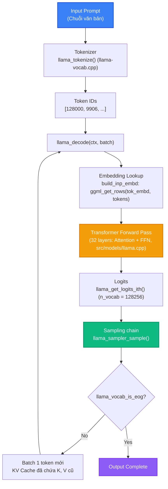

# Bài 4: Kiến trúc Inference Engine của llama.cpp

Sau khi hiểu GGML (Bài 1), GGUF (Bài 2) và Quantization (Bài 3), chúng ta đã có đủ nền tảng để đi sâu vào **inference engine** của llama.cpp (thư viện `libllama`, mã nguồn trong `src/`). Bài này phân tích toàn bộ pipeline từ khi nhận input prompt đến khi sinh ra output token, bao gồm context management, đường đi bên trong `llama_decode()`, hệ thống memory/KV Cache, sampling và batch processing.

---

## 1. Tổng quan Inference Pipeline



Lưu ý một nhầm lẫn phổ biến: `llama_get_embeddings()` **không** phải bước tra embedding đầu vào. Nó trả về embedding **đầu ra** (hidden state cuối, dùng cho mô hình embedding khi `embeddings = true`). Bước tra embedding đầu vào nằm bên trong đồ thị, ở `llm_graph_context::build_inp_embd()` (`src/llama-graph.cpp`), là một phép `ggml_get_rows` trên tensor `token_embd.weight`.

Inference diễn ra qua hai giai đoạn:

1. **Prefill (Prompt Processing)**: Xử lý toàn bộ prompt cùng lúc, ghi K, V của tất cả prompt tokens vào KV Cache. Giai đoạn này có nhiều token mỗi lần nhân ma trận nên **compute-bound**.
2. **Decode (Token Generation)**: Sinh từng token một, mỗi step chỉ tính toán cho 1 token mới. Mỗi trọng số được đọc một lần cho một token nên **memory-bound**.

---

## 2. Context Creation (llama_context)

`llama_context` là đối tượng trung tâm quản lý trạng thái inference. Được tạo từ `llama_model` và `llama_context_params`:

```c
llama_backend_init();

// n_gpu_layers thuộc llama_model_params, KHÔNG phải llama_context_params
struct llama_model_params mparams = llama_model_default_params();
mparams.n_gpu_layers = 99;        // số layer đặt lên GPU; giá trị âm = tất cả (mặc định là -1)

struct llama_model * model = llama_model_load_from_file("model.gguf", mparams);
const struct llama_vocab * vocab = llama_model_get_vocab(model);

struct llama_context_params cparams = llama_context_default_params();
cparams.n_ctx      = 4096;            // context window (mặc định 512; 0 = lấy từ mô hình)
cparams.n_batch    = 2048;            // batch logic tối đa cho một lần llama_decode (mặc định 2048)
cparams.n_ubatch   = 512;             // batch vật lý (micro-batch) mỗi lần chạy graph (mặc định 512)
cparams.n_threads  = 8;               // CPU threads cho decode
cparams.n_threads_batch = 8;          // CPU threads cho prefill
cparams.type_k     = GGML_TYPE_F16;   // kiểu KV Cache cho K (mặc định F16)
cparams.type_v     = GGML_TYPE_F16;   // kiểu KV Cache cho V (mặc định F16)
cparams.flash_attn_type = LLAMA_FLASH_ATTN_TYPE_AUTO;  // mặc định AUTO

struct llama_context * ctx = llama_init_from_model(model, cparams);
```

> **Lưu ý về API**: `llama_load_model_from_file()` và `llama_new_context_with_model()` đã bị đánh dấu `DEPRECATED` trong `include/llama.h`; dùng `llama_model_load_from_file()` và `llama_init_from_model()`. `n_gpu_layers` nằm trong `llama_model_params` vì việc đặt trọng số lên GPU được quyết định lúc nạp mô hình; `llama_context_params` chỉ chứa tham số runtime.

Sự khác biệt giữa `n_batch` và `n_ubatch` rất quan trọng cho hiệu năng: `n_batch` là số token tối đa bạn được phép đưa vào một lần `llama_decode()`, còn `n_ubatch` là số token mỗi lần đồ thị thực sự được chạy. Một batch prefill 2048 token sẽ được cắt thành 4 ubatch 512 token. Compute buffer (Bài 1, Phần 7) được reserve theo `n_ubatch`, nên tăng `n_ubatch` tăng tốc prefill trên GPU nhưng tốn thêm bộ nhớ.

`llama_context` quản lý:
- **Memory module** (`llama_memory_i`): KV Cache hoặc recurrent state (Phần 4).
- **Scheduler** `ggml_backend_sched` và compute buffers cho intermediate tensors.
- **Threadpool** CPU cho parallel computation.
- **Output buffers**: logits và embeddings của các token được yêu cầu output.

---

## 3. Bên trong `llama_decode()`

Đây là phần sâu nhất của engine. Hàm C `llama_decode()` chuyển đến `llama_context::decode()` trong `src/llama-context.cpp`. Pseudocode đã rút gọn:

```text
int llama_context::decode(batch):
    1. balloc->init(batch, ...)              # llama_batch_allocr (llama-batch.cpp): kiểm tra token, tự điền
                                             # pos / seq_id nếu NULL, xác định token nào cần output
    2. mctx = memory->init_batch(*balloc, n_ubatch, embd_all)
           # bộ nhớ (ví dụ llama_kv_cache) cắt batch thành các ubatch
           # (split_simple / split_equal / split_seq) và kiểm tra trước rằng có đủ ô trống
           # (find_slot). Nếu không đủ: trả về 1 ("could not find a KV slot").
    3. do {
           ubatch = mctx->get_ubatch()
           res = process_ubatch(ubatch, LLM_GRAPH_TYPE_DECODER, mctx, status)
           copy logits/embeddings của các token output vào buffer của context
       } while (mctx->next())

llm_graph_result * llama_context::process_ubatch(ubatch, gtype, mctx, ret):
    a. mctx->apply()                         # ghi nhận vị trí các ô KV mà ubatch này sẽ chiếm
    b. gparams = graph_params(res, ubatch, mctx, gtype)
       if (graph cũ còn dùng được: res->can_reuse(gparams))   # cùng topology -> không build lại
           n_reused++
       else
           ggml_backend_sched_reset(sched)
           gf = model.build_graph(gparams)                     # gọi graph builder của kiến trúc
           ggml_backend_sched_alloc_graph(sched, gf)           # graph allocator cấp phát tensor trung gian
    c. res->set_inputs(&ubatch)              # ghi token ids, positions, KQ mask, chỉ số ô KV vào input tensors
    d. graph_compute(gf, ubatch.n_tokens > 1)
           -> ggml_backend_sched_graph_compute_async(sched, gf)   # chạy trên CPU/GPU
```

Ba ý quan trọng rút ra từ đoạn mã này:

1. **Đồ thị là dữ liệu, không phải mã**: mỗi ubatch đi qua cùng một quy trình "build graph, cấp phát, điền input, chạy". Toàn bộ sự khác biệt giữa các kiến trúc nằm ở `model.build_graph()`.
2. **Graph reuse**: trong decode, mọi step đều có 1 token và cùng topology, nên từ step thứ hai trở đi đồ thị được dùng lại, chỉ có dữ liệu input (`set_inputs`) thay đổi. Điều này loại bỏ chi phí build graph khỏi đường nóng (có thể tắt bằng biến môi trường `LLAMA_GRAPH_REUSE_DISABLE`).
3. **Mã trả về**: `llama_decode()` trả về 0 khi thành công, 1 khi không tìm được ô KV, 2 khi bị abort, -1 khi batch không hợp lệ (comment trong `include/llama.h`).

---

## 4. KV Cache và hệ thống Memory

**KV Cache** lưu trữ key và value vectors của tất cả previous tokens để tránh tính toán lại.

### 4.1. Tại sao cần KV Cache?

Trong self-attention, mỗi token mới cần attention scores với **tất cả** previous tokens:

$$\text{Attention}(Q, K, V) = \text{softmax}\left(\frac{QK^T}{\sqrt{d_k}}\right)V$$

Xét việc sinh $n$ token, chiều ẩn $d$. **Không có KV Cache**, ở step $t$ ta chạy lại forward cho cả $t$ token: phép chiếu QKV tốn $O(t d^2)$ và attention tốn $O(t^2 d)$, cộng dồn qua $n$ step là $O(n^2 d^2 + n^3 d)$. **Có KV Cache**, step $t$ chỉ chiếu 1 token, $O(d^2)$, và attention của 1 query với $t$ key, $O(t d)$, tổng cộng $O(n d^2 + n^2 d)$. Bản chất của công thức nằm ở việc KV Cache hạ **một bậc** của cả hai số hạng, đổi lại bằng bộ nhớ tăng tuyến tính theo $n$.

### 4.2. Bộ nhớ KV Cache

$$\text{KV Cache Size} = 2 \times n_{\text{layers}} \times n_{\text{kv\_heads}} \times d_{\text{head}} \times n_{\text{ctx}} \times \text{sizeof(type)}$$

Ví dụ Llama-3-8B (GQA, 32 layers, 8 KV heads, head dim 128): mỗi token tốn $2 \times 32 \times 8 \times 128 \times 2 = 131{,}072$ byte = 128 KiB ở F16. Với kiểu quantized, sizeof(type) là bpw/8 (Q8_0: 8.5/8 = 1.0625 byte; Q4_0: 4.5/8 = 0.5625 byte):

| KV Type | Context 4K | Context 8K | Context 32K |
|:---|:---|:---|:---|
| F16 | 0.50 GiB | 1.0 GiB | 4.0 GiB |
| Q8_0 | 0.27 GiB | 0.53 GiB | 2.13 GiB |
| Q4_0 | 0.14 GiB | 0.28 GiB | 1.13 GiB |

(Phiên bản trước của bảng ghi 1.0 GB cho 4K ở F16; con số đó gấp đôi giá trị đúng.)

### 4.3. Trừu tượng hóa Memory: không chỉ có KV Cache

Từ 2025, llama.cpp thay khái niệm "KV cache" bằng một interface tổng quát `llama_memory_i` (`src/llama-memory.h`), vì nhiều kiến trúc mới không chỉ có attention. Interface này định nghĩa `init_batch()`, `init_full()` (mô phỏng cache đầy để reserve buffer worst-case), `init_update()` (shift, copy), và các thao tác theo sequence `seq_rm`, `seq_cp`, `seq_keep`, `seq_add`, `seq_div`, `seq_pos_min`, `seq_pos_max`. `llama_model::create_memory()` (`src/llama-model.cpp`) chọn cài đặt theo kiến trúc:

| Lớp | File | Dùng cho |
|:---|:---|:---|
| `llama_kv_cache` | `llama-kv-cache.cpp` | Transformer chuẩn (Llama, Qwen, Mistral...) |
| `llama_kv_cache_iswa` | `llama-kv-cache-iswa.cpp` | Mô hình xen kẽ sliding-window và full attention (Gemma 2/3, Cohere2, gpt-oss...): giữ **hai** `llama_kv_cache`, `kv_base` và `kv_swa` |
| `llama_memory_recurrent` | `llama-memory-recurrent.cpp` | Mô hình recurrent/SSM (Mamba, RWKV): lưu state cố định cho mỗi sequence thay vì K, V theo token |
| `llama_memory_hybrid`, `llama_memory_hybrid_iswa` | `llama-memory-hybrid*.cpp` | Mô hình lai attention + recurrent (Jamba, Falcon-H1, Nemotron-H, Qwen3-Next, Granite hybrid...) |
| `llama_kv_cache_dsa`, `llama_kv_cache_msa`, `llama_kv_cache_dsv4`, `llama_memory_hybrid_idx` | các file `llama-kv-cache-*.cpp` | Các biến thể sparse attention của những kiến trúc cụ thể (DeepSeek, GLM, MiniMax...) |
| không có memory | | Encoder như BERT: `create_memory()` trả về `nullptr` |

Ở tầng API công khai, mọi thao tác đi qua `llama_get_memory(ctx)` rồi `llama_memory_clear()`, `llama_memory_seq_rm()`, ... (thay cho họ hàm `llama_kv_cache_*` / `llama_kv_self_*` cũ).

### 4.4. Bên trong `llama_kv_cache`

```text
llama_kv_cache
  layers[]: kv_layer { il, k, v, k_stream[], v_stream[] }   # mỗi layer một cặp tensor K, V
        k: tensor ne = [n_embd_k_gqa, kv_size, n_stream], kiểu type_k
        v: tương tự (có thể lưu chuyển vị khi không dùng flash attention)
  v_cells: llama_kv_cells cho mỗi stream
        pos[i]  : vị trí token đang ở ô i (-1 nếu trống)
        seq[i]  : std::bitset<LLAMA_MAX_SEQ> các sequence dùng chung ô i (LLAMA_MAX_SEQ = 256)
        seq_pos : với mỗi sequence, tập (pos, ô) để tra seq_pos_min / seq_pos_max nhanh
  v_heads: vị trí bắt đầu tìm ô trống (ring buffer), chỉ để tăng tốc find_slot()
```

Luồng một ubatch qua cache:

1. `find_slot(ubatch)` tìm `n_tokens` ô trống (từ `head`), `apply_ubatch()` ghi `pos`, `seq` cho các ô đó.
2. Trong đồ thị, `cpy_k()` / `cpy_v()` ghi K, V mới bằng **`ggml_set_rows(k, k_cur, k_idxs)`**: `k_idxs` là tensor input chứa chỉ số các ô vừa tìm được. Nhờ vậy các ô không cần liền nhau.
3. `get_k()` / `get_v()` trả về một **view** (`ggml_view_4d`) lên `n_kv` ô đầu tiên đang được dùng, và một **KQ mask** (input của đồ thị) đặt $-\infty$ cho các cặp (query, ô) không hợp lệ: ô trống, ô thuộc sequence khác, ô ở vị trí tương lai (causal), hoặc ô nằm ngoài cửa sổ trượt.

Cách thiết kế "ô + mask" này là chìa khóa của **continuous batching** trong `llama-server`: nhiều sequence độc lập chia nhau một cache, mỗi request chỉ thấy các ô mang `seq_id` của mình.

### 4.5. Sliding Window Attention

Một số mô hình (Gemma 2/3, Cohere2, gpt-oss, ...) xen kẽ layer **sliding window attention** (SWA), chỉ attend đến $W$ tokens gần nhất (`n_swa` trong `llama_hparams`), với layer full attention. Quy tắc mask nằm ở `llama_hparams::is_masked_swa()`: với `LLAMA_SWA_TYPE_STANDARD`, cặp (vị trí key $p_0$, vị trí query $p_1$) bị che khi $p_1 - p_0 \geq W$; ngoài ra còn kiểu `CHUNKED` (Llama 4) và `SYMMETRIC`.

`llama_kv_cache_iswa` cấp phát cache SWA nhỏ hơn cache chính:

$$\text{size}_{\text{swa}} = \text{PAD}_{256}\Big(\min\big(\text{size}_{\text{base}},\; n_{\text{swa}} \cdot n_{\text{seq}} + n_{\text{ubatch}}\big)\Big)$$

(với $n_{\text{seq}} = n_{\text{seq\_max}}$ khi dùng cache unified, ngược lại là 1). Nếu bật `swa_full` (cờ `--swa-full`), cache SWA có kích thước đầy đủ: tốn bộ nhớ hơn nhưng cho phép quay lui và tái sử dụng prefix tùy ý. Lưu ý: struct mặc định của thư viện (`llama_context_default_params`) đặt `swa_full = true`, còn các công cụ trong `common/` mặc định `false`.

Lưu ý: SWA chỉ được bật khi graph builder của kiến trúc đặt `hparams.swa_type` khác `LLAMA_SWA_TYPE_NONE` (ví dụ `src/models/gemma2.cpp`, `openai-moe.cpp`; `llama4.cpp` dùng `LLAMA_SWA_TYPE_CHUNKED`). Các builder `llama`, `qwen2`, `mistral3` không đặt SWA, nên chẳng hạn Mistral 7B v0.1 (cấu hình gốc có sliding window 4096, nhưng được chuyển sang GGUF dưới kiến trúc `llama`) chạy như full attention.

---

## 5. Token Sampling

Sau khi model output logits (một vector `n_vocab` phần tử), ta cần **sample** ra token tiếp theo. API sampler nằm trong `include/llama.h`, cài đặt trong `src/llama-sampler.cpp`.

### 5.1. Temperature

$$P(x_i) = \frac{\exp(z_i / T)}{\sum_j \exp(z_j / T)}$$

với $z_i$ là logit của token $i$.

- $T = 1.0$: Phân phối gốc (softmax chuẩn).
- $T < 1.0$: Sắc hơn, thiên về token có xác suất cao (greedy khi $T \to 0$).
- $T > 1.0$: Phẳng hơn, đa dạng hơn.

```c
llama_sampler_chain_add(chain, llama_sampler_init_temp(0.8f));
```

### 5.2. Top-K Sampling

Chỉ giữ lại $K$ tokens có logit cao nhất, loại phần còn lại:

```c
llama_sampler_chain_add(chain, llama_sampler_init_top_k(40));
```

### 5.3. Top-P (Nucleus) Sampling

Giữ lại tập tokens nhỏ nhất có tổng xác suất $\geq p$ (tham số thứ hai `min_keep` là số token tối thiểu luôn giữ lại):

```c
llama_sampler_chain_add(chain, llama_sampler_init_top_p(0.95f, 1));
```

### 5.4. Min-P Sampling

Phương pháp mới hơn (2023-2024), giữ tokens có $P(x_i) \geq p \cdot P_{\max}$. Ưu điểm so với Top-P là ngưỡng tự co giãn: khi mô hình tự tin ($P_{\max}$ lớn) thì cắt mạnh, khi phân vân thì giữ nhiều ứng viên.

```c
llama_sampler_chain_add(chain, llama_sampler_init_min_p(0.05f, 1));
```

### 5.5. Sampling Chain

llama.cpp kết hợp nhiều samplers thành một chuỗi. Mỗi sampler biến đổi mảng `llama_token_data_array` (lọc, sắp xếp, đổi logit), và sampler **cuối cùng** phải là một sampler "chọn" (`dist`, `greedy`, hoặc `mirostat`):

```c
struct llama_sampler_chain_params sparams = llama_sampler_chain_default_params();
struct llama_sampler * chain = llama_sampler_chain_init(sparams);

// penalties nhận n_vocab làm tham số đầu tiên (API hiện tại có 5 tham số)
llama_sampler_chain_add(chain, llama_sampler_init_penalties(llama_vocab_n_tokens(vocab),
                                                           /*penalty_last_n*/ 64,
                                                           /*penalty_repeat*/ 1.1f,
                                                           /*penalty_freq*/   0.0f,
                                                           /*penalty_present*/0.0f));
llama_sampler_chain_add(chain, llama_sampler_init_top_k(40));
llama_sampler_chain_add(chain, llama_sampler_init_top_p(0.95f, 1));
llama_sampler_chain_add(chain, llama_sampler_init_min_p(0.05f, 1));
llama_sampler_chain_add(chain, llama_sampler_init_temp(0.8f));
llama_sampler_chain_add(chain, llama_sampler_init_dist(LLAMA_DEFAULT_SEED));  // 0xFFFFFFFF = seed ngẫu nhiên
```

Các công cụ như `llama-cli`, `llama-server` không tự viết chuỗi này mà dùng `common_sampler` (`common/sampling.cpp`). Thứ tự mặc định trong `common_params_sampling::samplers` (`common/common.h`) là:

```text
penalties -> dry -> top_n_sigma -> top_k -> typical_p -> top_p -> min_p -> xtc -> temperature -> dist
```

với giá trị mặc định `top_k = 40`, `top_p = 0.95`, `min_p = 0.05`, `temp = 0.80`, `penalty_last_n = 64`, `penalty_repeat = 1.00` (tức tắt). Mỗi sampler có giá trị trung hòa (ví dụ `top_p = 1.0`, `typical_p = 1.0`, `xtc_probability = 0`) sẽ không có tác dụng. Đặt temperature ở cuối chuỗi là một lựa chọn có chủ ý: các bộ lọc cắt đuôi dựa trên phân phối gốc, rồi temperature chỉ định hình lại phần còn lại.

---

## 6. Batch Processing

llama.cpp hỗ trợ xử lý nhiều tokens (và nhiều sequence) cùng lúc qua `llama_batch`:

```c
typedef struct llama_batch {
    int32_t n_tokens;
    llama_token  *  token;    // token ids (dùng khi embd == NULL)
    float        *  embd;     // hoặc embedding đầu vào trực tiếp
    llama_pos    *  pos;      // vị trí; NULL = tự theo dõi
    int32_t      *  n_seq_id; // số sequence của từng token
    llama_seq_id ** seq_id;   // các sequence id của từng token; NULL = sequence 0
    int8_t       *  logits;   // 1 = cần output logits cho token này; NULL = chỉ token cuối
} llama_batch;
```

```c
// Prefill: đưa toàn bộ prompt vào một batch, chỉ yêu cầu logits ở token cuối
struct llama_batch batch = llama_batch_init(n_prompt, /*embd*/ 0, /*n_seq_max*/ 1);
for (int i = 0; i < n_prompt; i++) {
    batch.token[i]     = prompt_tokens[i];
    batch.pos[i]       = i;
    batch.n_seq_id[i]  = 1;
    batch.seq_id[i][0] = 0;
    batch.logits[i]    = (i == n_prompt - 1);
}
batch.n_tokens = n_prompt;
if (llama_decode(ctx, batch) != 0) { /* xử lý lỗi */ }
llama_batch_free(batch);

// Decode: từng token một
llama_token new_token = llama_sampler_sample(chain, ctx, -1);   // -1 = logits của token output cuối
while (!llama_vocab_is_eog(vocab, new_token) && n_generated < max_tokens) {
    // ... in token ra bằng llama_token_to_piece ...
    struct llama_batch single = llama_batch_get_one(&new_token, 1);  // pos tự động
    if (llama_decode(ctx, single) != 0) break;
    new_token = llama_sampler_sample(chain, ctx, -1);
    n_generated++;
}
```

`llama_batch_get_one()` là hàm tiện lợi cho một sequence duy nhất (comment trong `llama.h` khuyến nghị tránh dùng ở mã mới); với nhiều sequence song song, hãy tự điền `seq_id` như trên. Không tồn tại hàm `llama_batch_get_init()`.

---

## 7. Graph Building

Mỗi kiến trúc mô hình có **file riêng trong `src/models/`** (ví dụ `src/models/llama.cpp`, `qwen3.cpp`, `gemma3.cpp`, `phi3.cpp`, `mamba.cpp`; hiện có hơn 160 file), được khai báo trong `src/models/models.h`. Mỗi kiến trúc là một lớp con của `llama_model_base` với ba phương thức:

- `load_arch_hparams(ml)`: đọc các key metadata riêng (ví dụ `LLM_KV_ATTENTION_LAYERNORM_RMS_EPS`), xác định `LLM_TYPE_8B`, ...
- `load_arch_tensors(ml)`: khai báo từng tensor với tên và shape (`create_tensor(tn(LLM_TENSOR_FFN_GATE, "weight", i), {n_embd, n_ff}, 0)`).
- `build_arch_graph(params)`: trả về một `llm_graph_context` có constructor dựng đồ thị forward.

Các helper chung nằm trong `llm_graph_context` (`src/llama-graph.h`, `src/llama-graph.cpp`). Đồ thị Llama, rút gọn từ `src/models/llama.cpp`:

```cpp
inpL = build_inp_embd(model.tok_embd);              // ggml_get_rows
inp_pos  = build_inp_pos();                         // input: vị trí token
inp_attn = build_attn_inp_kv();                     // input: KQ mask + chỉ số ô KV

for (int il = 0; il < n_layer; ++il) {
    inpSA = inpL;
    cur = build_norm(inpL, model.layers[il].attn_norm, NULL, LLM_NORM_RMS, il);   // 1. RMSNorm

    auto [Qcur, Kcur, Vcur] = build_qkv(model.layers[il], cur, n_embd_head, n_head, n_head_kv, il);  // 2. QKV
    Qcur = ggml_rope_ext(ctx0, Qcur, inp_pos, rope_factors, n_rot, rope_type, ...);  // 3. RoPE
    Kcur = ggml_rope_ext(ctx0, Kcur, inp_pos, rope_factors, n_rot, rope_type, ...);

    cur = build_attn(inp_attn, model.layers[il].wo, model.layers[il].wo_b, ...,
                     Qcur, Kcur, Vcur, ..., kq_scale, il);  // 4-6. ghi KV, attention, output projection

    if (il == n_layer - 1 && inp_out_ids) {             // chỉ giữ hàng của token cần output
        cur   = ggml_get_rows(ctx0, cur,   inp_out_ids);
        inpSA = ggml_get_rows(ctx0, inpSA, inp_out_ids);
    }
    ffn_inp = ggml_add(ctx0, cur, inpSA);                                        // 7. residual
    cur = build_norm(ffn_inp, model.layers[il].ffn_norm, NULL, LLM_NORM_RMS, il); // 8. RMSNorm
    cur = build_ffn(cur, ffn_up, ..., ffn_gate, ..., ffn_down, ...,
                    NULL, LLM_FFN_SILU, LLM_FFN_PAR, il);                       // 9. SwiGLU FFN
    inpL = ggml_add(ctx0, cur, ffn_inp);                                         // 10. residual
}
cur = build_norm(inpL, model.output_norm, NULL, LLM_NORM_RMS, -1);
cur = build_lora_mm(model.output, cur, model.output_s);                          // logits
```

Hai chi tiết đáng học:

- **`build_attn()`** gói gọn bước 4-6: gọi `cpy_k`/`cpy_v` của memory để ghi K, V mới (`ggml_set_rows`), lấy view K, V của cache, rồi gọi `build_attn_mha()`. Hàm này hoán vị Q, K, V (`ggml_permute(..., 0, 2, 1, 3)`) và chọn một trong hai đường: nếu flash attention bật thì một op hợp nhất `ggml_flash_attn_ext()`; nếu không thì chuỗi `ggml_mul_mat` (KQ), `ggml_soft_max_ext` (có mask và scale), `ggml_mul_mat` (KQV).
- **`inp_out_ids`**: ở layer cuối, đồ thị chỉ giữ lại các hàng của token cần output (thường chỉ 1 token cuối của prompt). Nhờ vậy phép nhân với `output.weight` (4096 x 128256, rất lớn) không phải tính cho mọi token của prefill.

---

## 💡 Đúc kết Bài 4

Inference engine của llama.cpp được thiết kế theo nguyên tắc **tách biệt trách nhiệm**:

1. **llama_context** điều phối: chia batch thành ubatch, xây (hoặc tái sử dụng) đồ thị, cấp phát qua `ggml_backend_sched`, chạy, rồi gom logits.
2. **Memory module** (`llama_kv_cache`, `llama_kv_cache_iswa`, `llama_memory_recurrent`, `llama_memory_hybrid`, ...) trừu tượng hóa trạng thái giữa các step; KV Cache hạ một bậc độ phức tạp của sinh văn bản, đổi lại bộ nhớ tuyến tính theo context.
3. **Sampling chain** cung cấp khả năng kiểm soát output linh hoạt, với thứ tự mặc định được định nghĩa trong `common/common.h`.
4. **Graph builder** theo từng kiến trúc trong `src/models/` trừu tượng hóa model architecture thành computation graph GGML thống nhất.

Bài tiếp theo sẽ phân tích quy trình porting một model architecture từ PyTorch sang llama.cpp.
