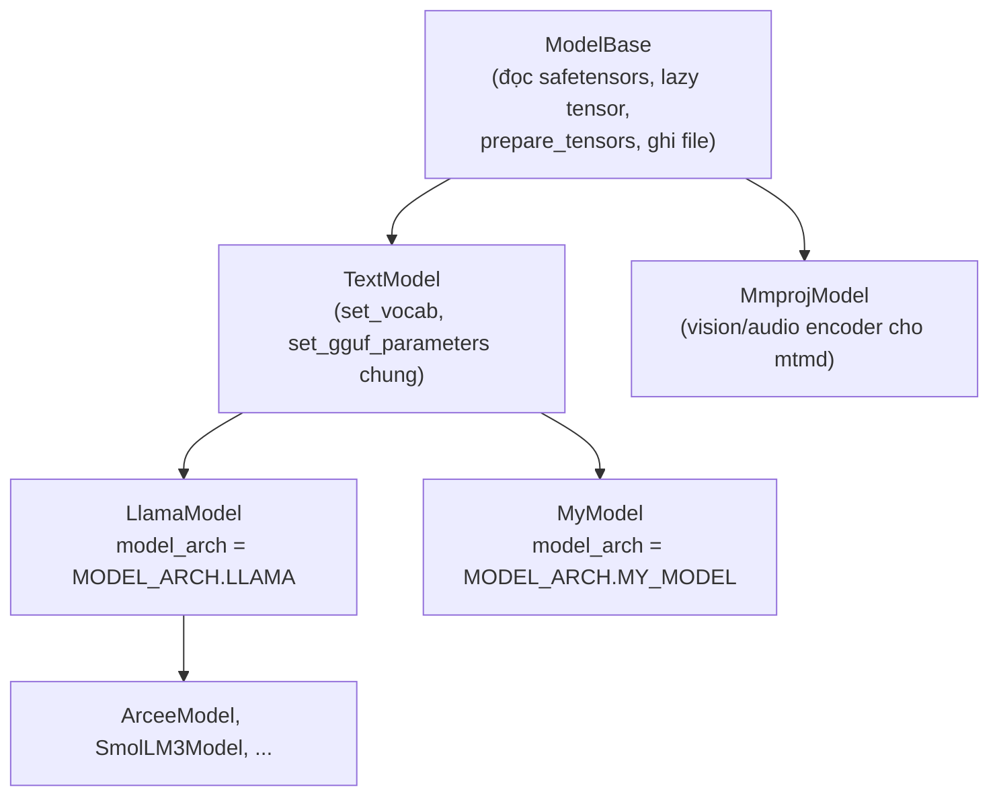
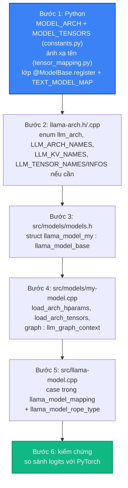

# Bài 5: Porting Model PyTorch sang GGUF

Một trong những câu hỏi phổ biến nhất từ cộng đồng llama.cpp là: **"Làm sao để chạy mô hình mới của tôi trên llama.cpp?"**. Câu trả lời ngắn là: phải viết hai nửa của cùng một bản hợp đồng. Nửa thứ nhất là Python (bộ chuyển đổi `convert_hf_to_gguf.py` cùng thư viện `gguf-py`), có nhiệm vụ đọc checkpoint HuggingFace và ghi ra file GGUF. Nửa thứ hai là C++ (`libllama`), có nhiệm vụ đọc lại chính file đó, dựng computation graph và chạy inference. Bản hợp đồng giữa hai nửa gồm ba thứ: **chuỗi kiến trúc** (`general.architecture`), **tên các khóa metadata** (ví dụ `llama.block_count`) và **tên cùng shape của từng tensor** (ví dụ `blk.0.attn_q.weight`). Chỉ cần một bên lệch một ký tự, model sẽ không load được.

Bài này phân tích cả hai nửa dựa trên mã nguồn hiện tại của llama.cpp, rồi đi qua quy trình từng bước để thêm một kiến trúc mới.

---

## Phần 1: Bức tranh tổng thể

```mermaid
graph LR
    subgraph PY["Phía Python (chuyển đổi, chạy một lần)"]
        HF["Checkpoint HF\nconfig.json + safetensors"] --> CLS["Lớp model trong conversion/*.py\n@ModelBase.register(...)"]
        CLS --> MAP["gguf-py: TensorNameMap\n(tensor_mapping.py + constants.py)"]
        MAP --> W["GGUFWriter\nghi KV + tensor info + data"]
    end
    W --> G["File GGUF\n(bản hợp đồng)"]
    subgraph CPP["Phía C++ (runtime, mỗi lần load)"]
        G --> L["llama_model_loader\nđọc KV, tensor info, mmap"]
        L --> M["llama_model_xxx\nload_arch_hparams / load_arch_tensors"]
        M --> GR["build_arch_graph\nllm_graph_context -> ggml_cgraph"]
    end

    style G fill:#f59e0b,stroke:#d97706,stroke-width:2px,color:#fff
    style CLS fill:#3b82f6,stroke:#1d4ed8,stroke-width:2px,color:#fff
    style GR fill:#10b981,stroke:#059669,stroke-width:2px,color:#fff
```



Hiện tại `src/llama-arch.h` khai báo hơn 160 giá trị trong `enum llm_arch` (từ `LLM_ARCH_LLAMA`, `LLM_ARCH_QWEN3`, `LLM_ARCH_GEMMA4`, `LLM_ARCH_DEEPSEEK4` cho tới các kiến trúc lai SSM như `LLM_ARCH_MAMBA2`, `LLM_ARCH_QWEN3NEXT` và các draft model cho speculative decoding như `LLM_ARCH_EAGLE3`, `LLM_ARCH_DFLASH`). Mỗi giá trị enum phải có một chuỗi tên tương ứng trong map `LLM_ARCH_NAMES` (`src/llama-arch.cpp`), và chuỗi này phải trùng tuyệt đối với `MODEL_ARCH_NAMES` trong `gguf-py/gguf/constants.py`.

---

## Phần 2: Phía Python: package `conversion/` và cơ chế registry

### 2.1. Vì sao `convert_hf_to_gguf.py` trở nên "mỏng"

Trước đây toàn bộ logic chuyển đổi nằm trong một file `convert_hf_to_gguf.py` dài hàng chục nghìn dòng, mỗi lần chạy phải import mọi lớp của mọi kiến trúc. Mã nguồn hiện tại đã tách logic ra package `conversion/`: `convert_hf_to_gguf.py` chỉ còn khoảng 300 dòng (parse đối số, chọn lớp model, gọi ghi file), còn mỗi họ kiến trúc nằm trong một module riêng như `conversion/llama.py`, `conversion/qwen.py`, `conversion/gemma.py`, `conversion/deepseek.py`. Các lớp nền nằm trong `conversion/base.py`.

Lợi ích không chỉ là gọn gàng. `conversion/__init__.py` giữ một bảng tra `TEXT_MODEL_MAP` (và `MMPROJ_MODEL_MAP` cho phần vision/audio encoder) ánh xạ **tên lớp HF** sang **tên module**, ví dụ `"LlamaForCausalLM": "llama"`. Hàm `get_model_class()` chỉ import đúng module cần thiết:

```python
# conversion/__init__.py (rút gọn)
def get_model_class(name: str, mmproj: bool = False) -> Type[ModelBase]:
    relevant_map = MMPROJ_MODEL_MAP if mmproj else TEXT_MODEL_MAP
    if name not in relevant_map:
        raise NotImplementedError(f"Architecture {name!r} not supported!")
    module_name = relevant_map[name]
    __import__(f"conversion.{module_name}")          # chạy các decorator @ModelBase.register
    model_type = ModelType.MMPROJ if mmproj else ModelType.TEXT
    return ModelBase._model_classes[model_type][name]
```

Đọc đoạn mã này theo đúng thứ tự thực thi: tên lớp HF lấy từ trường `architectures` của `config.json`; module tương ứng được import; việc import kích hoạt các decorator, và decorator ghi lớp Python vào từ điển `ModelBase._model_classes`. Như vậy khi thêm kiến trúc mới, ngoài việc viết lớp, **phải thêm một dòng vào `TEXT_MODEL_MAP`**, nếu không bộ chuyển đổi sẽ báo `Architecture ... not supported!` dù lớp đã được viết đúng.

### 2.2. Decorator `@ModelBase.register`

```python
# conversion/base.py
@classmethod
def register(cls, *names: str) -> Callable[[AnyModel], AnyModel]:
    assert names

    def func(modelcls: AnyModel) -> AnyModel:
        model_type = ModelType.MMPROJ if modelcls.model_arch == gguf.MODEL_ARCH.MMPROJ else ModelType.TEXT
        for name in names:
            cls._model_classes[model_type][name] = modelcls
        return modelcls
    return func
```

Một lớp có thể đăng ký nhiều tên HF. Ví dụ `LlamaModel` trong `conversion/llama.py` đăng ký đồng thời `LlamaForCausalLM`, `MistralForCausalLM`, `MixtralForCausalLM`, `LlavaForConditionalGeneration`, và cả các checkpoint EAGLE-3 như `LlamaForCausalLMEagle3`. Decorator thứ hai `@ModelBase.example("user/model")` không làm gì ở runtime; nó chỉ khai báo repo HF dùng để kiểm thử tự động.

### 2.3. Cây kế thừa và các hook cần override



| Hook | Lớp định nghĩa | Vai trò |
|:---|:---|:---|
| `set_vocab()` | `TextModel` | Ghi tokenizer (BPE, SentencePiece, ...) vào các khóa `tokenizer.ggml.*` |
| `set_gguf_parameters()` | `TextModel` (bản ở `ModelBase` chỉ ném `NotImplementedError`) | Ghi hyperparameter: block count, head count, RoPE, norm eps |
| `modify_tensors(data_torch, name, bid)` | `ModelBase` | Đổi tên (gọi `map_tensor_name`), biến đổi, gộp hoặc tách tensor; trả về iterable các cặp (tên GGUF, tensor) |
| `generate_extra_tensors()` | `ModelBase` | Sinh tensor không có trong checkpoint, ví dụ `rope_freqs` của Llama 3 |
| `filter_tensors(...)` | `ModelBase`, `TextModel` | Loại bỏ tensor không dùng |
| `tensor_force_quant(...)` | `ModelBase` | Ép kiểu lưu cho một tensor cụ thể |

Bản mặc định của `ModelBase.modify_tensors` đã làm nhiều việc: tra tên qua `map_tensor_name()`, và nếu người dùng bật `--fuse-qkv` hoặc `--fuse-gate-up-exps` thì gom Q, K, V thành `attn_qkv` hoặc gom gate/up của expert thành một tensor. Lớp con thường chỉ cần xử lý phần đặc thù rồi gọi `super().modify_tensors(...)`.

Một lớp tối thiểu cho kiến trúc mới có dạng:

```python
# conversion/my_model.py
from .base import ModelBase, TextModel, gguf

@ModelBase.register("MyModelForCausalLM")
@ModelBase.example("my-org/my-model-tiny")
class MyModel(TextModel):
    model_arch = gguf.MODEL_ARCH.MY_MODEL

    def set_gguf_parameters(self):
        super().set_gguf_parameters()   # block_count, context_length, n_embd, n_head, ... đã được ghi
        # chỉ ghi thêm khóa đặc thù của kiến trúc
        if (v := self.hparams.get("my_special_scale")) is not None:
            self.gguf_writer.add_float32(f"{self.gguf_writer.arch}.my_special_scale", v)

    def modify_tensors(self, data_torch, name, bid):
        # ví dụ: bỏ một buffer không cần cho inference
        if name.endswith(".rotary_emb.inv_freq"):
            return []
        return super().modify_tensors(data_torch, name, bid)
```

Và trong `conversion/__init__.py` thêm `"MyModelForCausalLM": "my_model"` vào `TEXT_MODEL_MAP`.

---

## Phần 3: Ánh xạ tên tensor: `constants.py` và `tensor_mapping.py`

### 3.1. Ba bảng trong `gguf-py/gguf/constants.py`

1. `MODEL_ARCH` (IntEnum) và `MODEL_ARCH_NAMES`: định danh kiến trúc và chuỗi tên ghi vào `general.architecture`.
2. `MODEL_TENSOR` (IntEnum) và `TENSOR_NAMES`: định danh "vai trò" của tensor và tên GGUF chuẩn, ví dụ `MODEL_TENSOR.ATTN_Q: "blk.{bid}.attn_q"`.
3. `MODEL_TENSORS: dict[MODEL_ARCH, list[MODEL_TENSOR]]`: danh sách các vai trò mà mỗi kiến trúc được phép có.

### 3.2. `TensorNameMap`: từ tên HF sang tên GGUF

`gguf-py/gguf/tensor_mapping.py` định nghĩa lớp `TensorNameMap` với hai bảng chính: `mappings_cfg` cho tensor không thuộc block (embedding, output) và `block_mappings_cfg` cho tensor lặp lại theo layer, nơi `{bid}` là chỉ số block. Bảng thứ ba `arch_block_mappings_cfg` cho phép một kiến trúc ghi đè ánh xạ chung. Constructor duyệt các bảng này, **chỉ giữ những vai trò có trong `MODEL_TENSORS[arch]`**, và với mỗi `bid` trong `range(n_blocks)` sinh ra một từ điển phẳng:

$$\text{mapping}: \text{tên HF (đã thay } bid\text{)} \longmapsto (\text{MODEL\_TENSOR}, \text{tên GGUF})$$

Khi tra cứu, `get_type_and_name(key, try_suffixes=(".weight", ".bias"))` thử khớp nguyên tên trước, nếu không được thì cắt hậu tố `.weight`/`.bias`, tra phần thân, rồi gắn lại hậu tố. Đó là lý do bảng ánh xạ chỉ lưu `"model.layers.{bid}.self_attn.q_proj"` mà vẫn phục vụ được cả weight lẫn bias.

| HuggingFace (PyTorch) | GGUF (llama.cpp) | Vai trò `MODEL_TENSOR` |
|:---|:---|:---|
| `model.embed_tokens.weight` | `token_embd.weight` | `TOKEN_EMBD` |
| `model.layers.0.self_attn.q_proj.weight` | `blk.0.attn_q.weight` | `ATTN_Q` |
| `model.layers.0.self_attn.k_proj.weight` | `blk.0.attn_k.weight` | `ATTN_K` |
| `model.layers.0.self_attn.v_proj.weight` | `blk.0.attn_v.weight` | `ATTN_V` |
| `model.layers.0.self_attn.o_proj.weight` | `blk.0.attn_output.weight` | `ATTN_OUT` |
| `model.layers.0.mlp.gate_proj.weight` | `blk.0.ffn_gate.weight` | `FFN_GATE` |
| `model.layers.0.mlp.up_proj.weight` | `blk.0.ffn_up.weight` | `FFN_UP` |
| `model.layers.0.mlp.down_proj.weight` | `blk.0.ffn_down.weight` | `FFN_DOWN` |
| `model.layers.0.input_layernorm.weight` | `blk.0.attn_norm.weight` | `ATTN_NORM` |
| `model.layers.0.post_attention_layernorm.weight` | `blk.0.ffn_norm.weight` | `FFN_NORM` |
| `model.norm.weight` | `output_norm.weight` | `OUTPUT_NORM` |
| `lm_head.weight` | `output.weight` | `OUTPUT` |

Ở phía C++, `src/llama-arch.cpp` có bảng đối xứng `LLM_TENSOR_NAMES`. Lưu ý: bảng này hiện là một map **phẳng** `llm_tensor -> chuỗi định dạng` (ví dụ `{ LLM_TENSOR_ATTN_Q, "blk.%d.attn_q" }`), dùng chung cho mọi kiến trúc, chứ không còn là map lồng theo từng kiến trúc như các phiên bản cũ. Helper `LLM_TN` ghép tên: `tn(LLM_TENSOR_ATTN_NORM, "weight", 3)` cho ra `"blk.3.attn_norm.weight"`. Việc kiểm tra "kiến trúc này có tensor nào" giờ nằm ở chỗ tensor nào được `create_tensor(...)` trong hàm load của từng model (Phần 6).

---

## Phần 4: Shape và layout: vì sao **không** cần transpose

Một ngộ nhận rất phổ biến là "PyTorch lưu `[out, in]` nên khi convert phải transpose". Mã nguồn hiện tại không làm điều đó với các ma trận linear thông thường. Lý do nằm ở quy ước đánh số chiều của GGML.

Trong GGML, `ne[0]` là chiều **liên tục nhất** trong bộ nhớ (chiều thay đổi nhanh nhất), ngược với quy ước của NumPy/PyTorch, nơi chiều cuối cùng mới liên tục nhất. Gọi $W \in \mathbb{R}^{N_{out} \times N_{in}}$ là trọng số `nn.Linear` lưu row-major. Phần tử $W_{ij}$ nằm ở offset:

$$\text{off}_{\text{torch}}(i, j) = i \cdot N_{in} + j$$

Nếu ta khai báo cùng vùng nhớ đó là tensor GGML với `ne = [N_in, N_out]` và stride $nb_0 = s$, $nb_1 = N_{in} \cdot s$ ($s$ là số byte mỗi phần tử), thì phần tử có chỉ số GGML $(j, i)$ nằm ở (tính theo đơn vị phần tử):

$$\text{off}_{\text{ggml}}(j, i) = j + i \cdot N_{in}$$

Hai công thức trùng nhau. Bản chất của công thức nằm ở việc **đảo thứ tự liệt kê chiều chứ không di chuyển byte nào**. `GGUFWriter.write_ti_data_to_file()` trong `gguf-py/gguf/gguf_writer.py` thực hiện đúng phép đảo này khi ghi tensor info:

```python
for j in range(n_dims):
    ti_data += self._pack("Q", ti.shape[n_dims - 1 - j])   # shape numpy được ghi ngược
```

Ở phía C++, `llama_model_llama::load_arch_tensors()` (`src/models/llama.cpp`) khai báo shape theo quy ước GGML, ví dụ `create_tensor(tn(LLM_TENSOR_FFN_GATE, "weight", i), {n_embd, n_ff}, 0)`: `ne[0] = n_embd` là chiều đầu vào. Phép `ggml_mul_mat(ctx, W, x)` tính tích vô hướng dọc theo `ne[0]` của cả hai toán hạng, nên mỗi hàng của $W$ (một neuron đầu ra) là một dải byte liên tục. Đây chính là layout lý tưởng cho kernel `vec_dot` dạng block quantization: một block 32 phần tử của Q4_0 luôn nằm gọn trong một hàng.

Áp dụng cho GQA của Llama-3-8B (32 query head, 8 KV head, head dim 128, $n_{embd} = 4096$):

```
PyTorch (numpy shape, [out, in]):
  q_proj: [4096, 4096]      (32 heads x 128)
  k_proj: [1024, 4096]      (8 heads x 128)
  v_proj: [1024, 4096]

GGUF (GGML ne, [in, out]), cùng thứ tự byte:
  blk.N.attn_q.weight: ne = [4096, 4096]
  blk.N.attn_k.weight: ne = [4096, 1024]
  blk.N.attn_v.weight: ne = [4096, 1024]
```

Tài liệu `docs/development/HOWTO-add-model.md` của llama.cpp nhắc đúng điểm này: "The dimensions in ggml are typically in the reverse order of the pytorch dimensions". Transpose thật sự chỉ xuất hiện khi checkpoint gốc lưu ma trận theo chiều ngược với `nn.Linear` (ví dụ một số tensor của Qwen3-Next trong `conversion/qwen.py` gọi `.permute(1, 0)`), tức là một trường hợp đặc thù, không phải quy tắc chung.

---

## Phần 5: Hoán vị Q/K cho RoPE: biến đổi thực sự quan trọng

Thứ mà bộ chuyển đổi Llama **có** làm là hoán vị hàng của `q_proj` và `k_proj`. Trong `conversion/llama.py`:

```python
@staticmethod
def permute(weights: Tensor, n_head: int, n_head_kv: int | None):
    if n_head_kv is not None and n_head != n_head_kv:
        n_head = n_head_kv
    return (weights.reshape(n_head, 2, weights.shape[0] // n_head // 2, *weights.shape[1:])
            .swapaxes(1, 2)
            .reshape(weights.shape))

# trong LlamaModel.modify_tensors, khi undo_permute = True:
#   q_proj: permute(data, n_head, n_head)
#   k_proj: permute(data, n_head, n_kv_head)
```

**Căng thẳng gốc rễ**: RoPE xoay từng cặp chiều $(x_a, x_b)$ của mỗi head một góc $\theta_k \cdot p$ ($p$ là vị trí token). Có hai quy ước chọn cặp:

- **NORM** (kiểu GPT-J, checkpoint gốc của Meta): cặp là hai chiều kề nhau $(2k, 2k+1)$.
- **NEOX** (kiểu `rotate_half` của HuggingFace): cặp là $(k, k + d/2)$ với $d$ là head dim.

Khi Meta chuyển checkpoint Llama sang định dạng HF, họ hoán vị hàng của $W_Q, W_K$ để code `rotate_half` cho kết quả đúng. Trong khi đó `llama_model_rope_type()` (`src/llama-model.cpp`) trả về `LLAMA_ROPE_TYPE_NORM` cho `LLM_ARCH_LLAMA`. Bộ chuyển đổi vì vậy phải **đảo ngược** hoán vị của HF.

Đọc phép `reshape(n_head, 2, d/2, N_in).swapaxes(1, 2)` theo chỉ số: trong một head, hàng HF có chỉ số $r_{HF} = s \cdot \frac{d}{2} + k$ với $s \in \{0, 1\}$, $k \in [0, d/2)$. Sau `swapaxes`, hàng đó chuyển tới chỉ số

$$r_{GGUF} = 2k + s$$

Vậy cặp $(k, k + d/2)$ của quy ước NEOX trở thành cặp kề nhau $(2k, 2k+1)$ của quy ước NORM, và tích $q^\top k$ sau RoPE được bảo toàn. Với K, số head dùng là `n_head_kv` (8 với Llama-3-8B) vì `k_proj` chỉ có $8 \times 128$ hàng. Các kiến trúc mà llama.cpp chạy bằng RoPE NEOX (ví dụ `LLM_ARCH_QWEN2`, `LLM_ARCH_QWEN3`, `LLM_ARCH_PHI3`) thì không cần hoán vị; một số lớp con của `LlamaModel` cũng tắt nó bằng `undo_permute = False` (ví dụ `Llama4Model`, `ApertusModel`). Đây là lỗi kinh điển khi port: quên hoặc làm thừa bước hoán vị thì model vẫn load, vẫn sinh token, nhưng perplexity tăng vọt vì vị trí bị mã hóa sai.

---

## Phần 6: Phía C++: thêm kiến trúc vào `libllama`

Cấu trúc mã C++ cũng đã thay đổi lớn: thay vì một hàm `build_xxx()` khổng lồ trong `llama-model.cpp`, mỗi kiến trúc giờ là **một struct kế thừa `llama_model_base`**, khai báo trong `src/models/models.h` và cài đặt trong `src/models/<tên>.cpp` (hiện có hơn 160 file như vậy).



### Bước 2: Enum và tên kiến trúc

```cpp
// src/llama-arch.h
enum llm_arch {
    // ...
    LLM_ARCH_MY_MODEL,
    LLM_ARCH_UNKNOWN,
};

// src/llama-arch.cpp
static const std::map<llm_arch, const char *> LLM_ARCH_NAMES = {
    // ...
    { LLM_ARCH_MY_MODEL, "my_model" },   // phải trùng MODEL_ARCH_NAMES bên gguf-py
};
```

Nếu kiến trúc cần khóa metadata hoặc vai trò tensor mới, thêm vào `LLM_KV_NAMES`, `LLM_TENSOR_NAMES` và `LLM_TENSOR_INFOS` (bảng sau cho biết tensor thuộc lớp input, repeating hay output, và op nào dùng nó, để loader chọn buffer type phù hợp).

### Bước 3 và 4: Struct model và graph

```cpp
// src/models/models.h
struct llama_model_my_model : public llama_model_base {
    llama_model_my_model(const struct llama_model_params & params) : llama_model_base(params) {}
    void load_arch_hparams(llama_model_loader & ml) override;
    void load_arch_tensors(llama_model_loader & ml) override;

    struct graph : public llm_graph_context {
        graph(const llama_model & model, const llm_graph_params & params);
    };

    std::unique_ptr<llm_graph_context> build_arch_graph(const llm_graph_params & params) const override;
};
```

Các hyperparameter chung (`block_count`, `embedding_length`, `feed_forward_length`, `attention.head_count`, `attention.head_count_kv`, RoPE...) đã được `llama_model_base::load_hparams()` đọc trước, rồi hàm này mới gọi `load_arch_hparams(ml)`. Vì vậy hàm đặc thù chỉ đọc những gì riêng của kiến trúc. Ví dụ thật từ `src/models/llama.cpp` (rút gọn):

```cpp
void llama_model_llama::load_arch_hparams(llama_model_loader & ml) {
    ml.get_key(LLM_KV_ATTENTION_LAYERNORM_RMS_EPS, hparams.f_norm_rms_eps);
    switch (hparams.n_layer()) {
        case 32: type = LLM_TYPE_8B; break;   // logic thật phức tạp hơn
        default: type = LLM_TYPE_UNKNOWN;
    }
}

void llama_model_llama::load_arch_tensors(llama_model_loader &) {
    LLAMA_LOAD_LOCALS;
    tok_embd    = create_tensor(tn(LLM_TENSOR_TOKEN_EMBD,  "weight"), {n_embd, n_vocab}, 0);
    output_norm = create_tensor(tn(LLM_TENSOR_OUTPUT_NORM, "weight"), {n_embd}, 0);
    output      = create_tensor(tn(LLM_TENSOR_OUTPUT,      "weight"), {n_embd, n_vocab}, TENSOR_NOT_REQUIRED);
    if (output == NULL) {   // tied embedding: dùng lại token_embd
        output = create_tensor(tn(LLM_TENSOR_TOKEN_EMBD, "weight"), {n_embd, n_vocab}, TENSOR_DUPLICATED);
    }
    for (int i = 0; i < n_layer; ++i) {
        auto & layer = layers[i];
        layer.attn_norm = create_tensor(tn(LLM_TENSOR_ATTN_NORM, "weight", i), {n_embd}, 0);
        create_tensor_qkv(layer, i, n_embd, n_embd_head_k * n_head, n_embd_k_gqa, n_embd_v_gqa, 0);
        layer.wo       = create_tensor(tn(LLM_TENSOR_ATTN_OUT, "weight", i), {n_embd_head_k * n_head, n_embd}, 0);
        layer.ffn_norm = create_tensor(tn(LLM_TENSOR_FFN_NORM, "weight", i), {n_embd}, 0);
        layer.ffn_gate = create_tensor(tn(LLM_TENSOR_FFN_GATE, "weight", i), {n_embd,   n_ff}, 0);
        layer.ffn_down = create_tensor(tn(LLM_TENSOR_FFN_DOWN, "weight", i), {  n_ff, n_embd}, 0);
        layer.ffn_up   = create_tensor(tn(LLM_TENSOR_FFN_UP,   "weight", i), {n_embd,   n_ff}, 0);
    }
}
```

`create_tensor` vừa kiểm tra tensor có tồn tại trong file với đúng shape hay không, vừa quyết định nó nằm trên buffer type nào (CPU, CUDA0, ...) theo số layer offload. Cờ `TENSOR_NOT_REQUIRED` cho phép tensor vắng mặt; `TENSOR_DUPLICATED` đánh dấu tensor dùng chung.

Graph được dựng trong constructor của struct lồng `graph`, dùng các helper của `llm_graph_context` (`src/llama-graph.h`): `build_inp_embd`, `build_inp_pos`, `build_attn_inp_kv`, `build_norm`, `build_qkv`, `build_attn`, `build_ffn`, `build_moe_ffn`. Khung của `llama_model_llama::graph` (rút gọn từ `src/models/llama.cpp`):

```cpp
inpL = build_inp_embd(model.tok_embd);
ggml_tensor * inp_pos  = build_inp_pos();
auto        * inp_attn = build_attn_inp_kv();         // gắn với KV cache
ggml_tensor * inp_out_ids = build_inp_out_ids();      // chỉ giữ hàng cần logits

for (int il = 0; il < n_layer; ++il) {
    ggml_tensor * inpSA = inpL;
    cur = build_norm(inpL, model.layers[il].attn_norm, NULL, LLM_NORM_RMS, il);

    auto [Qcur, Kcur, Vcur] = build_qkv(model.layers[il], cur, n_embd_head, n_head, n_head_kv, il);
    Qcur = ggml_rope_ext(ctx0, Qcur, inp_pos, rope_factors, n_rot, rope_type, n_ctx_orig,
                         freq_base, freq_scale, ext_factor, attn_factor, beta_fast, beta_slow);
    Kcur = ggml_rope_ext(ctx0, Kcur, inp_pos, rope_factors, n_rot, rope_type, n_ctx_orig,
                         freq_base, freq_scale, ext_factor, attn_factor, beta_fast, beta_slow);
    cur = build_attn(inp_attn, model.layers[il].wo, model.layers[il].wo_b, model.layers[il].wo_s,
                     Qcur, Kcur, Vcur, nullptr, nullptr, nullptr, kq_scale, il);

    if (il == n_layer - 1 && inp_out_ids) {            // layer cuối: bỏ các hàng không cần logits
        cur   = ggml_get_rows(ctx0, cur,   inp_out_ids);
        inpSA = ggml_get_rows(ctx0, inpSA, inp_out_ids);
    }
    ggml_tensor * ffn_inp = ggml_add(ctx0, cur, inpSA);           // residual 1

    cur = build_norm(ffn_inp, model.layers[il].ffn_norm, NULL, LLM_NORM_RMS, il);
    cur = build_ffn(cur, /* up, gate, down ... */ LLM_FFN_SILU, LLM_FFN_PAR, il);
    cur = ggml_add(ctx0, cur, ffn_inp);                            // residual 2
    inpL = cur;
}
cur = build_norm(inpL, model.output_norm, NULL, LLM_NORM_RMS, -1);
cur = build_lora_mm(model.output, cur, model.output_s);           // LM head
```

Hai chi tiết đáng chú ý: `build_attn` che giấu toàn bộ việc ghi K/V vào cache, chọn flash attention hay softmax tường minh, và áp mask; còn mẹo `inp_out_ids` ở layer cuối giúp prefill một prompt dài không phải tính FFN và LM head cho mọi token, chỉ cho token cần logits.

### Bước 5: Đăng ký trong `llama_model_mapping`

```cpp
// src/llama-model.cpp
static llama_model * llama_model_mapping(llm_arch arch, const llama_model_params & params) {
    switch (arch) {
        // ...
        case LLM_ARCH_LLAMA:
            return new llama_model_llama(params);
        case LLM_ARCH_MY_MODEL:
            return new llama_model_my_model(params);
        // ...
    }
}
```

Nếu model có RoPE, thêm case vào `llama_model_rope_type()` cùng file, chọn đúng `LLAMA_ROPE_TYPE_NORM` hoặc `LLAMA_ROPE_TYPE_NEOX` (hoặc MROPE cho model đa phương thức), nhất quán với quyết định hoán vị ở Phần 5.

---

## Phần 7: Pipeline chuyển đổi end-to-end

```bash
# Bước 1: tải model (hoặc truyền repo id kèm --remote để đọc trực tiếp từ HF)
git lfs install
git clone https://huggingface.co/org/my-model

# Bước 2: convert. --outtype mặc định là "auto": heuristic trong ModelBase nhìn dtype của tensor 2D đầu tiên,
#         gặp bfloat16 thì chọn bf16, gặp float16 thì chọn f16
#         các lựa chọn: f32, f16, bf16, q8_0, tq1_0, tq2_0, auto
python convert_hf_to_gguf.py my-model/ --outfile my-model-bf16.gguf

# (Model đa phương thức) xuất riêng encoder cho libmtmd
python convert_hf_to_gguf.py my-model/ --mmproj --outfile mmproj-my-model.gguf

# Bước 3: quantize (tools/quantize)
./build/bin/llama-quantize my-model-bf16.gguf my-model-q4_k_m.gguf Q4_K_M

# Bước 4: chạy thử
./build/bin/llama-completion -m my-model-q4_k_m.gguf -p "Hello, world!" -n 50   # completion thô, không chat template
./build/bin/llama-cli        -m my-model-q4_k_m.gguf                              # giao diện chat
```

Một vài cờ đáng biết của `convert_hf_to_gguf.py`: `--print-supported-models` in danh sách lớp HF đã đăng ký; `--dry-run` chạy toàn bộ ánh xạ mà không ghi file (rất hữu ích để phát hiện lỗi `Can not map tensor`); `--split-max-size` chia file lớn; `--target-model-dir` dùng khi convert draft model EAGLE-3 cần mượn tokenizer của model đích.

**Checkpoint đã được quantize sẵn.** Trong `ModelBase` (`conversion/base.py`), bộ chuyển đổi đọc `quantization_config` của `config.json` và xử lý theo `quant_method`: các checkpoint `fp8`, `gptq`, `bitnet` và `compressed-tensors` (dạng int pack-quantized) được **dequantize** về float trước khi ghi; còn MXFP4 và NVFP4 được đóng gói lại (repack) trực tiếp sang `block_mxfp4`/`block_nvfp4` của GGML mà không mất thông tin. Phương thức không được hỗ trợ sẽ dừng với `NotImplementedError("Quant method is not yet supported: ...")`.

---

## Phần 8: Kiểm chứng: so sánh logits với PyTorch

Một model "chạy được" chưa chắc đã "đúng". Thư mục `examples/model-conversion/` của llama.cpp cung cấp quy trình chuẩn: `scripts/causal/run-org-model.py` chạy model gốc bằng transformers và lưu logits, `scripts/causal/run-converted-model.sh` chạy bản GGUF, và `scripts/causal/compare-logits.py` so sánh hai bộ logits. Để định lượng sai lệch phân phối thay vì chỉ nhìn top-1, dùng KL divergence:

$$D_{KL}(P \,\|\, Q) = \sum_{v \in V} P(v) \log \frac{P(v)}{Q(v)}$$

với $P$ là phân phối softmax của model tham chiếu (ví dụ bản BF16) và $Q$ của model cần kiểm (bản convert hoặc bản quantize) tại cùng một vị trí token. `llama-perplexity` hỗ trợ trực tiếp: chạy với `--kl-divergence-base FILE` trên model tham chiếu để lưu logits, rồi chạy `--kl-divergence` với `--kl-divergence-base FILE` trên model cần kiểm. Một bản convert đúng ở cùng độ chính xác phải cho $D_{KL}$ xấp xỉ 0 và top-1 trùng khớp gần như tuyệt đối; nếu quên hoán vị RoPE ở Phần 5, $D_{KL}$ sẽ lớn bất thường ngay từ các token đầu. Khi cần soi từng op trong graph, `llama-eval-callback` (`examples/eval-callback/`) in giá trị của mọi tensor trung gian.

---

## Phần 9: Checklist thêm model mới

| Bước | File | Hành động |
|:---|:---|:---|
| 1 | `gguf-py/gguf/constants.py` | Thêm `MODEL_ARCH.MY_MODEL`, tên trong `MODEL_ARCH_NAMES`, danh sách `MODEL_TENSORS` |
| 2 | `gguf-py/gguf/tensor_mapping.py` | Thêm tên HF còn thiếu vào `mappings_cfg` / `block_mappings_cfg` (ưu tiên tái dùng vai trò sẵn có) |
| 3 | `conversion/<module>.py`, `conversion/__init__.py` | Lớp `@ModelBase.register(...)` kế thừa `TextModel`; thêm dòng vào `TEXT_MODEL_MAP` |
| 4 | `src/llama-arch.h`, `src/llama-arch.cpp` | `LLM_ARCH_MY_MODEL`, `LLM_ARCH_NAMES`, và KV/tensor mới nếu cần |
| 5 | `src/models/models.h`, `src/models/my-model.cpp` | Struct kế thừa `llama_model_base`: `load_arch_hparams`, `load_arch_tensors`, `build_arch_graph` |
| 6 | `src/llama-model.cpp` | Case trong `llama_model_mapping` và `llama_model_rope_type` |
| 7 | `tools/mtmd/` (tùy chọn) | Lớp `MmprojModel` + encoder trong `clip.cpp` nếu model đa phương thức |
| 8 | Kiểm chứng | So sánh logits, đo KLD, chạy thử `llama-cli`, `llama-server`, `llama-quantize`, `llama-imatrix` |

---

## 💡 Đúc kết Bài 5

Porting model sang llama.cpp không phải là "viết lại model" mà là **ký một bản hợp đồng hai phía** thông qua GGUF:

1. **Phía Python** (`conversion/` + `gguf-py`): lớp `@ModelBase.register` ánh xạ tên tensor qua `TensorNameMap`, ghi hyperparameter, và áp các biến đổi thật sự cần thiết như hoán vị Q/K cho RoPE. Shape được ghi đảo chiều nhưng byte giữ nguyên, nên không có transpose.
2. **Phía C++** (`src/models/` + `llama-arch`): struct kế thừa `llama_model_base` đọc hyperparameter đặc thù, khai báo tensor bằng `create_tensor` theo quy ước `ne` của GGML, và dựng graph bằng các helper của `llm_graph_context`.
3. **Kiểm chứng**: so sánh logits và KL divergence với model gốc trước khi tin vào kết quả.
