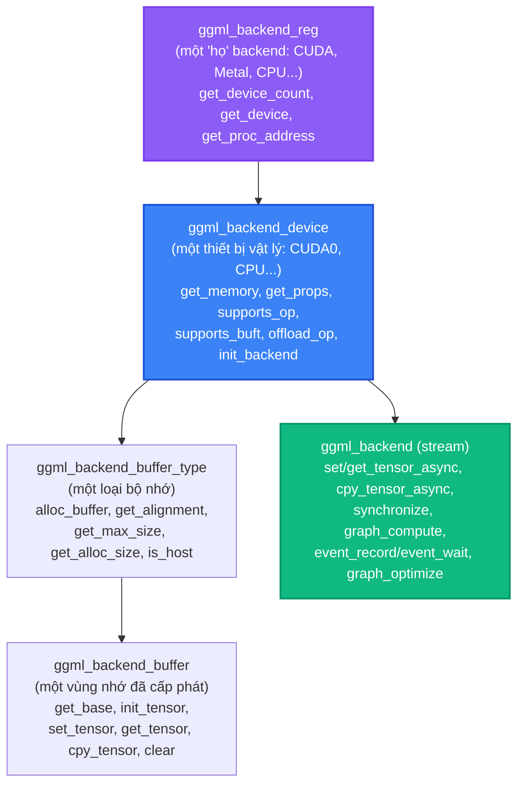
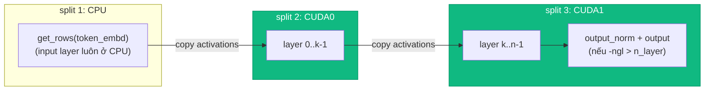
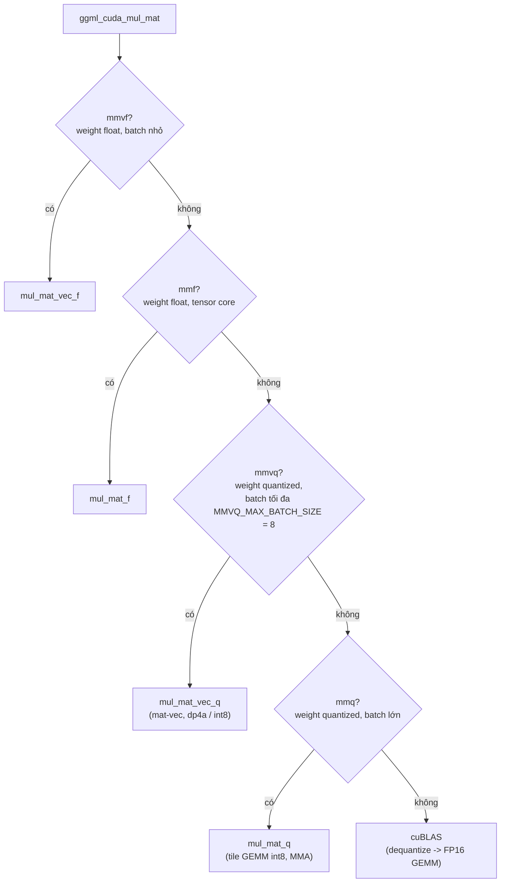

# Bài 6: Hardware Backends - CPU, CUDA, Metal, Vulkan

Sức mạnh thực sự của llama.cpp nằm ở khả năng chạy trên **rất nhiều loại phần cứng**, từ CPU laptop đến GPU datacenter, từ Apple Silicon đến DSP của điện thoại. Căng thẳng kỹ thuật ở đây rất cụ thể: cùng một computation graph GGML (một danh sách node `ggml_tensor` với `op` và `src[]`) phải được thực thi trên các thiết bị có bộ nhớ riêng, ngôn ngữ kernel riêng, và mức hỗ trợ op khác nhau, trong khi mã mô hình (Bài 5) không được biết gì về phần cứng. Lớp **ggml-backend** giải quyết bài toán này bằng một hệ thống vtable nhiều tầng, một registry thiết bị, và một bộ lập lịch (`ggml_backend_sched`) tự động cắt graph thành các phần chạy trên từng backend.

---

## Phần 1: Mô hình đối tượng của ggml-backend

File `ggml/src/ggml-backend-impl.h` định nghĩa năm loại đối tượng, mỗi loại là một struct chứa vtable (`iface`) và con trỏ `context` riêng của backend. Phiên bản giao diện hiện tại là `GGML_BACKEND_API_VERSION 3`.



Trích các vtable chính (rút gọn, giữ nguyên chữ ký):

```c
// ggml/src/ggml-backend-impl.h
struct ggml_backend_buffer_type_i {
    const char *          (*get_name)      (ggml_backend_buffer_type_t buft);
    ggml_backend_buffer_t (*alloc_buffer)  (ggml_backend_buffer_type_t buft, size_t size);
    size_t                (*get_alignment) (ggml_backend_buffer_type_t buft);
    size_t                (*get_max_size)  (ggml_backend_buffer_type_t buft);          // optional
    size_t                (*get_alloc_size)(ggml_backend_buffer_type_t buft, const struct ggml_tensor * tensor); // optional
    bool                  (*is_host)       (ggml_backend_buffer_type_t buft);          // optional
    // ... alloc_buffer_n, get_alloc_size_n
};

struct ggml_backend_i {
    const char * (*get_name)(ggml_backend_t backend);
    void         (*free)(ggml_backend_t backend);
    void (*set_tensor_async)(ggml_backend_t, struct ggml_tensor *, const void *, size_t, size_t);
    void (*get_tensor_async)(ggml_backend_t, const struct ggml_tensor *, void *, size_t, size_t);
    bool (*cpy_tensor_async)(ggml_backend_t src, ggml_backend_t dst, const struct ggml_tensor *, struct ggml_tensor *);
    void (*synchronize)(ggml_backend_t backend);
    enum ggml_status (*graph_compute)(ggml_backend_t backend, struct ggml_cgraph * cgraph);
    void (*event_record)(ggml_backend_t backend, ggml_backend_event_t event);
    void (*event_wait)  (ggml_backend_t backend, ggml_backend_event_t event);
    void (*graph_optimize)(ggml_backend_t backend, struct ggml_cgraph * cgraph,
                           struct ggml_backend_graph_optimize_params * params);
    // ... graph_plan_*, set/get_tensor_2d_async
};

struct ggml_backend_device_i {
    const char * (*get_name)(ggml_backend_dev_t dev);          // "CPU", "CUDA0", ...
    void         (*get_memory)(ggml_backend_dev_t dev, size_t * free, size_t * total);
    ggml_backend_t (*init_backend)(ggml_backend_dev_t dev, const char * params);
    ggml_backend_buffer_type_t (*get_buffer_type)(ggml_backend_dev_t dev);
    ggml_backend_buffer_type_t (*get_host_buffer_type)(ggml_backend_dev_t dev);   // pinned memory
    ggml_backend_buffer_t (*buffer_from_host_ptr)(ggml_backend_dev_t dev, void * ptr, size_t size, size_t max_tensor_size);
    bool (*supports_op)  (ggml_backend_dev_t dev, const struct ggml_tensor * op);
    bool (*supports_buft)(ggml_backend_dev_t dev, ggml_backend_buffer_type_t buft);
    bool (*offload_op)   (ggml_backend_dev_t dev, const struct ggml_tensor * op);
    // ... get_description, get_type, get_props, event_new/free/synchronize
};
```

Ba quyết định thiết kế đáng phân tích:

1. **Tách "thiết bị" khỏi "stream"**. `supports_op` nằm trên device chứ không nằm trên `ggml_backend_i`, vì câu hỏi "phần cứng này có làm được op X không" không phụ thuộc vào stream cụ thể. Một device có thể khởi tạo nhiều backend (stream) song song.
2. **Tách "loại bộ nhớ" khỏi "thiết bị"**. `alloc_buffer` nằm trên `ggml_backend_buffer_type_i`. Một device có thể có nhiều buffer type: buffer VRAM thường, buffer host pinned (`get_host_buffer_type`) để DMA nhanh, buffer "repack" của CPU lưu weight theo layout xen kẽ. Hàm `supports_buft` cho phép scheduler biết một backend có đọc trực tiếp được tensor nằm trong buffer type khác hay không (ví dụ GPU tích hợp đọc được bộ nhớ host).
3. **`buffer_from_host_ptr`** cho phép bọc một vùng nhớ có sẵn, chẳng hạn vùng `mmap` của file GGUF, thành buffer của backend mà không copy. Đây là nền tảng của việc load model gần như tức thời trên Apple Silicon.

---

## Phần 2: Registry và nạp backend động

### 2.1. Đăng ký tĩnh

`ggml/src/ggml-backend-reg.cpp` giữ danh sách các `ggml_backend_reg_t`. Khi build tĩnh, mỗi backend được biên dịch vào sẽ được đăng ký qua các khối `#ifdef GGML_USE_CUDA ... register_backend(ggml_backend_cuda_reg())`. Thứ tự đăng ký đặt các accelerator lên trước, và **CPU luôn được đăng ký cuối cùng**. Thứ tự này quan trọng vì scheduler coi backend cuối là backend có độ ưu tiên thấp nhất và là nơi chạy mọi op mà backend khác không hỗ trợ.

Mã nguồn hiện tại có các backend: CPU, BLAS, CUDA (kèm HIP cho AMD ROCm và MUSA cho Moore Threads, dùng chung mã nguồn `ggml-cuda/`), Metal, Vulkan, SYCL (Intel), OpenCL (tối ưu cho GPU Adreno), WebGPU, Hexagon (DSP/NPU của Qualcomm), CANN (Huawei Ascend), OpenVINO, zDNN (IBM Z), ZenDNN (AMD), RPC (chạy backend trên máy khác qua mạng) và một số backend thử nghiệm khác. Lệnh `--list-devices` của các tool in ra những device thực sự khả dụng.

### 2.2. Nạp động và chấm điểm biến thể CPU

Khi build với `GGML_BACKEND_DL=ON` (cần `BUILD_SHARED_LIBS`), mỗi backend là một thư viện động riêng, và hàm `ggml_backend_load_all()` gọi `ggml_backend_load_best(name, ...)` cho từng họ (`"cuda"`, `"metal"`, `"vulkan"`, ..., cuối cùng là `"cpu"`). Hàm này quét các file có dạng `[lib]ggml-<name>-*.so|.dll` trong thư mục thực thi và thư mục hiện tại, gọi symbol `ggml_backend_score()` của từng file, và chỉ nạp file có điểm cao nhất. Biến môi trường `GGML_BACKEND_PATH` cho phép nạp thêm một backend ngoài cây mã nguồn.

Cơ chế chấm điểm giải quyết một căng thẳng có thật trong phân phối binary: một file `.exe` biên dịch với AVX-512 sẽ crash (illegal instruction) trên CPU không có AVX-512, nhưng biên dịch "an toàn" chỉ với SSE thì lãng phí phần cứng mới. Với `GGML_CPU_ALL_VARIANTS=ON`, `ggml/src/CMakeLists.txt` biên dịch nhiều biến thể của CPU backend, ví dụ trên x86: `x64`, `sse42`, `sandybridge`, `haswell` (AVX2, FMA, F16C, BMI2), `skylakex` (thêm AVX-512), `icelake`, `cascadelake`, `cooperlake`, `zen4`, `alderlake` (AVX-VNNI), `sapphirerapids` (AMX); trên ARM Linux: `armv8.0_1` đến `armv9.2_2` (DOTPROD, SVE, I8MM, SME); trên Apple: `apple_m1`, `apple_m2_m3`, `apple_m4`. Hàm `ggml_backend_cpu_x86_score()` trong `ggml/src/ggml-cpu/arch/x86/cpu-feats.cpp` tính điểm theo dạng:

$$\text{score} = \begin{cases} 0 & \text{nếu biến thể cần một feature mà CPU không có} \\ 1 + \sum_{k \in F_{\text{biến thể}}} 2^{k} & \text{ngược lại} \end{cases}$$

trong đó $F_{\text{biến thể}}$ là tập feature mà biến thể được biên dịch với (mỗi feature, như SSE4.2, AVX, AVX2, AVX-512, AMX, ứng với một bit $k$). Vì mỗi feature mới chiếm một bit cao hơn, biến thể dùng nhiều feature hơn luôn thắng, còn biến thể đòi feature không có sẽ bị loại bằng điểm 0. Đây là runtime dispatch ở cấp **thư viện**, không phải ở cấp từng hàm.

---

## Phần 3: `ggml_backend_sched`: cắt graph giữa nhiều backend

Khi một phần model nằm trên GPU và phần còn lại nằm trên CPU, ai quyết định node nào chạy ở đâu, và khi nào cần copy tensor qua PCIe? Đó là nhiệm vụ của `ggml_backend_sched` (`ggml/src/ggml-backend.cpp`). `llama_context` tạo nó bằng:

```c
ggml_backend_sched_t ggml_backend_sched_new(ggml_backend_t * backends, ggml_backend_buffer_type_t * bufts,
                                            int n_backends, size_t graph_size, bool parallel, bool op_offload);
```

với danh sách backend xếp theo độ ưu tiên giảm dần (CPU cuối). Giới hạn biên dịch: `GGML_SCHED_MAX_BACKENDS = 16`, `GGML_SCHED_MAX_SPLIT_INPUTS = 30`. Hàm `ggml_backend_sched_split_graph` chạy sáu lượt, được chú thích rõ trong mã nguồn:

| Lượt | Tên trong mã nguồn | Ý nghĩa |
|:---|:---|:---|
| 1 | assign backends to ops with pre-allocated inputs | Node có input là weight nằm trong buffer của backend nào thì gán cho backend đó; input của graph gán cho CPU |
| 2 | expand current backend assignments | Lan gán GPU lên trên và xuống dưới các node kề nhau, bỏ qua CPU; nhờ vậy CPU chỉ được dùng khi weight nằm ở CPU |
| 3 | upgrade nodes to higher prio backends with compatible buffer types | Đẩy node lên backend ưu tiên cao hơn nếu buffer type tương thích |
| 4 | assign backends to remaining src from dst and view_src | Gán nốt các tensor còn lại theo tensor đích hoặc tensor gốc của view |
| 5 | split graph, find tensors that need to be copied | Cắt graph thành các *split* liên tiếp cùng backend; tạo bản sao cho input nằm ở backend khác |
| 6 | collect all input tensors into graph_inputs | Gom các input để copy trước khi chạy từng split |

**Op offload.** Ở lượt 1, nếu weight của một node nằm ở host (CPU) và `op_offload` bật, scheduler hỏi các backend ưu tiên cao hơn qua `ggml_backend_offload_op()`. Backend CUDA trả lời "có" khi batch của op đủ lớn: `ggml_backend_cuda_device_offload_op` so `get_op_batch_size(op)` với ngưỡng mặc định 32 (đổi được qua biến môi trường `GGML_OP_OFFLOAD_MIN_BATCH`). Lý do định lượng: khi prefill $B$ token với ma trận weight $W$ có kích thước $|W|$ byte, chi phí copy weight qua PCIe là $|W| / BW_{\text{PCIe}}$, trong khi số FLOP là $2B \cdot N_{in} N_{out}$. Với $B$ đủ lớn, GPU tính nhanh hơn CPU đủ để bù thời gian copy; với decode ($B = 1$) thì không. Cờ `--no-op-offload` tắt cơ chế này.



---

## Phần 4: CPU Backend

CPU backend (`ggml/src/ggml-cpu/`) là backend tham chiếu, chạy mọi op, và được tối ưu cho x86, ARM, RISC-V, PowerPC, LoongArch, s390x và WASM (thư mục `arch/`).

### 4.1. Bảng `type_traits_cpu` và dot product lượng tử hóa

Matmul giữa weight lượng tử hóa và activation không dequantize weight ra FP32. Thay vào đó, `ggml-cpu.c` giữ bảng `type_traits_cpu[]`, mỗi kiểu khai báo hàm dot product và **kiểu mà activation phải được quantize sang trước**:

```c
// ggml/src/ggml-cpu/ggml-cpu.c
[GGML_TYPE_Q4_0] = {
    .from_float   = quantize_row_q4_0,
    .vec_dot      = ggml_vec_dot_q4_0_q8_0,
    .vec_dot_type = GGML_TYPE_Q8_0,       // activation được quantize sang Q8_0
#if defined (__ARM_FEATURE_MATMUL_INT8)
    .nrows        = 2,                    // i8mm xử lý 2 hàng một lần
#else
    .nrows        = 1,
#endif
},
```

Khi đó tích vô hướng của một block 32 phần tử trở thành phép nhân số nguyên 8-bit cộng dồn, nhân với hai scale:

$$\sum_{j=0}^{31} \hat{w}_j \hat{x}_j = d_w d_x \sum_{j=0}^{31} q^{(w)}_j q^{(x)}_j$$

với $d_w, d_x$ là scale FP16 của block weight và block activation, $q$ là các số nguyên. Tổng bên phải là đúng loại phép tính mà `vpdpbusd` (AVX-VNNI), `vpmaddubsw` (AVX2), `sdot` (ARM DOTPROD) hay `smmla` (ARM I8MM) làm trong một lệnh.

Hàm `ggml_vec_dot_q4_0_q8_0` có một bản cho mỗi kiến trúc trong `ggml/src/ggml-cpu/arch/<arch>/quants.c`, bên trong chọn đường SIMD bằng macro **lúc biên dịch** (`__AVX2__`, `__ARM_NEON`, `__riscv_v`...), và một bản tham chiếu `ggml_vec_dot_q4_0_q8_0_generic` trong `ggml/src/ggml-cpu/quants.c`. Việc chọn tập lệnh lúc chạy được thực hiện ở cấp thư viện (Phần 2.2), không có con trỏ hàm nào bị gán lại khi khởi động.

### 4.2. Thread pool và chia việc theo chunk

`ggml_threadpool` (API `ggml_threadpool_new` trong `ggml/include/ggml-cpu.h`) giữ các worker thread sống qua nhiều lần compute, với tham số polling (`--poll`, mặc định 50) và affinity (`-C/--cpu-mask`). Trong `ggml_compute_forward_mul_mat`, đầu ra $N_0 \times N_1$ được chia thành các chunk kích thước 16 (hoặc 64 khi một chiều bằng 1, tức trường hợp decode):

$$n_{chunk,0} = \left\lceil \frac{N_0}{c} \right\rceil, \quad n_{chunk,1} = \left\lceil \frac{N_1}{c} \right\rceil$$

Thread thứ `ith` bắt đầu ở chunk `ith`, sau đó lấy chunk kế tiếp bằng `atomic_fetch_add` trên `threadpool->current_chunk` (work stealing đơn giản, cân bằng tải khi các core chạy với tốc độ khác nhau, ví dụ P-core và E-core). Nếu $n_{chunk,0} \cdot n_{chunk,1}$ nhỏ hơn $4 \cdot n_{thread}$, hoặc hệ thống là NUMA, kế hoạch bị bỏ và việc được chia đều theo thread dọc chiều lớn hơn, vì đo đạc cho thấy cách này tốt hơn trên NUMA.

### 4.3. Extra buffer types: repack, AMX, KleidiAI

CPU backend có các "extra buffer type": khi load, weight `Q4_0` (và một số kiểu khác) được sắp xếp lại (repack) sang layout xen kẽ nhiều hàng để kernel GEMM đọc được nhiều hàng cùng lúc bằng một lệnh vector (tùy chọn CMake `GGML_CPU_REPACK`, mặc định ON; cờ runtime `--repack` / `--no-repack`). Thư mục `ggml-cpu/amx/` cung cấp kernel Intel AMX, `ggml-cpu/kleidiai/` tích hợp thư viện KleidiAI của Arm. Đây là lý do một file Q4_0 có thể chạy nhanh hơn Q4_K_M trên một số CPU ARM dù bit-width tương đương.

### 4.4. BLAS

Với prompt processing batch lớn, có thể dùng BLAS ngoài: `-DGGML_BLAS=ON -DGGML_BLAS_VENDOR=OpenBLAS` (hoặc Intel10_64lp cho MKL). Trên macOS, `GGML_ACCELERATE` mặc định ON và vendor BLAS mặc định là Apple Accelerate. BLAS là một backend riêng trong registry, không phải một nhánh `if` trong CPU backend.

---

## Phần 5: CUDA Backend

CUDA backend (`ggml/src/ggml-cuda/`, hơn 150 file `.cu`/`.cuh`) hỗ trợ NVIDIA GPU, và qua lớp tương thích còn biên dịch cho AMD (HIP, `ggml/src/ggml-hip/` chỉ chứa CMake) và Moore Threads (MUSA).

### 5.1. Offload layer

```c
// llama_model_params (include/llama.h), tầng thư viện:
params.n_gpu_layers = -1;   // giá trị âm: offload tất cả (n_layer + 1, gồm cả output layer)
params.n_gpu_layers = 20;   // 20 layer cuối lên GPU
params.n_gpu_layers = 0;    // chỉ CPU
```

Lưu ý sự khác biệt giữa tầng thư viện và tầng CLI: trong `common_params`, `-ngl auto` (mặc định, giá trị -1) để cho cơ chế `--fit` (Bài 8) tự chọn số layer, còn `-ngl all` (giá trị -2) ép offload tất cả.

Logic gán thiết bị nằm trong `llama_model_base::load_tensors` (`src/llama-model.cpp`):

$$i_{gpu,start} = \max(n_{layer} + 1 - n_{gpu}, 0)$$

Layer $i$ chỉ lên GPU nếu $i \geq i_{gpu,start}$. Như vậy **các layer cuối được offload trước**, và "layer thứ $n_{layer}$" chính là output layer (`output_norm`, `output`), chỉ lên GPU khi $n_{gpu} > n_{layer}$. Riêng input layer (`token_embd`) luôn nằm ở CPU (`dev_input = cpu_dev`), vì bước `get_rows` chỉ đọc vài hàng của ma trận embedding, không đáng tốn VRAM. Với nhiều GPU, layer được chia theo `--tensor-split` (mặc định tỉ lệ theo bộ nhớ trống).

### 5.2. Chuỗi chọn kernel matmul

`ggml_cuda_mul_mat()` trong `ggml-cuda.cu` chọn kernel theo kiểu dữ liệu, kiến trúc GPU (compute capability) và số cột $n_{11}$ của activation (tức batch):



Decode một chuỗi ($n_{11} = 1$) đi vào `mul_mat_vec_q` (`mmvq.cu`): mỗi warp đọc các block lượng tử hóa của vài hàng weight, nhân với activation đã quantize sang Q8_1, và rút gọn bằng warp shuffle. Prefill đi vào `mul_mat_q` (`mmq.cu`) với cấu hình tile riêng cho từng thế hệ GPU (`mmq-config-ampere.cuh`, `mmq-config-blackwell.cuh`, `mmq-config-rdna3.cuh`, `mmq-config-cdna.cuh`...). Tùy chọn CMake `GGML_CUDA_FORCE_MMQ` / `GGML_CUDA_FORCE_CUBLAS` ép một nhánh. Flash attention có ba họ kernel: `fattn-mma-f16` (tensor core), `fattn-tile` và `fattn-vec` (cho decode). `GGML_CUDA_GRAPHS` cho phép ghi lại toàn bộ chuỗi launch kernel của một bước decode thành CUDA graph và phát lại, loại bỏ overhead launch hàng trăm kernel nhỏ.

### 5.3. Đa GPU: `--split-mode`

| Mode | Cơ chế | Ghi chú |
|:---|:---|:---|
| `none` | Một GPU (`--main-gpu`) | |
| `layer` (mặc định) | Pipeline parallel: mỗi GPU giữ một dải layer liên tiếp và KV cache của chúng | Ít trao đổi giữa GPU, cần nhiều token để tận dụng |
| `row` | Chia weight dense theo hàng | Đã bị tài liệu `docs/multi-gpu.md` đánh dấu deprecated |
| `tensor` | Tensor parallel thử nghiệm: chia cả weight lẫn KV qua một "meta device" (`ggml/src/ggml-backend-meta.cpp`) | Bắt buộc flash attention; chưa hỗ trợ mọi kiến trúc; không dùng chung với `--fit`; dùng NCCL nếu build có `GGML_CUDA_NCCL` |

---

## Phần 6: Metal Backend

Metal backend (`ggml/src/ggml-metal/`) tối ưu cho Apple Silicon. Mã host được chia thành `ggml-metal-device.*`, `ggml-metal-context.*`, `ggml-metal-ops.cpp` và một tầng fusion (`ggml-metal-fusion.cpp`); kernel nằm trong thư mục `kernels/` (`mul_mv.metal`, `mul_mm.metal`, các file `fa_*.metal` cho flash attention theo từng kiểu KV, `rope.metal`, `softmax.metal`...) và được nhúng vào binary lúc build.

### 6.1. Unified memory

Apple Silicon dùng **unified memory**: CPU và GPU cùng truy cập một DRAM. Nhờ `buffer_from_host_ptr`, vùng `mmap` của file GGUF được bọc trực tiếp thành `MTLBuffer` mà không copy. Băng thông bộ nhớ (thông số công bố của Apple): M2 khoảng 100 GB/s, M2 Pro 200 GB/s, M2 Max 400 GB/s, M2 Ultra 800 GB/s. Như Phần 8 sẽ chỉ ra, chính con số này quyết định tốc độ decode.

### 6.2. Kernel mat-vec

```metal
// ggml/src/ggml-metal/kernels/mul_mv.metal
kernel void kernel_mul_mv_q4_0_f32(
        constant ggml_metal_kargs_mul_mv & args,
        device const char * src0,
        device const char * src1,
        device       char * dst,
        threadgroup  char * shmem [[threadgroup(0)]],
        uint3  tgpig[[threadgroup_position_in_grid]],
        ushort tiisg[[thread_index_in_simdgroup]],
        ushort sgitg[[simdgroup_index_in_threadgroup]]) {
    mul_vec_q_n_f32_impl<block_q4_0, N_R0_Q4_0, constant ggml_metal_kargs_mul_mv &>(args, src0, src1, dst, shmem, tgpig, tiisg, sgitg);
}
```

Mỗi simdgroup (32 thread, tương đương warp) xử lý `N_R0_Q4_0 = 4` hàng của weight, và mỗi threadgroup gồm `N_SG_Q4_0 = 2` simdgroup (hằng số trong `ggml-metal-impl.h`); hàng đầu tiên của simdgroup là `(r0 * NSG + sgitg) * nr0`. Mã kernel được template hóa theo kiểu block để dùng chung cho mọi định dạng lượng tử hóa.

---

## Phần 7: Vulkan và các backend khác

Vulkan backend (`ggml/src/ggml-vulkan/`) chạy trên GPU AMD, Intel, NVIDIA, Qualcomm và cả macOS qua MoltenVK. Khoảng 190 shader GLSL trong `vulkan-shaders/` được công cụ `vulkan-shaders-gen.cpp` biên dịch sang SPIR-V lúc build cho từng tổ hợp kiểu dữ liệu. Backend dò extension `VK_KHR_cooperative_matrix` để dùng ma trận hợp tác (tương đương tensor core) khi phần cứng hỗ trợ, và có đường dự phòng cho GPU không có nó.

Các backend khác đáng biết: **SYCL** cho GPU Intel Arc/Data Center; **OpenCL** với kernel tối ưu cho Adreno trên Android/Snapdragon; **Hexagon** chạy trên DSP/NPU Qualcomm; **WebGPU** cho trình duyệt và Dawn; **RPC** biến một máy khác thành một device từ xa (`ggml-rpc-server`), hữu ích để gộp VRAM của nhiều máy.

---

## Phần 8: Ước lượng hiệu năng bằng mô hình roofline

Các bảng benchmark "tok/s trên GPU X" lan truyền trên mạng thường không thể kiểm chứng và lỗi thời nhanh. Một cách suy nghĩ bền vững hơn: khi decode một chuỗi, mỗi token mới đòi đọc **toàn bộ weight** từ bộ nhớ đúng một lần (cộng phần KV cache đã có), trong khi số FLOP chỉ khoảng $2P$ ($P$ là số tham số). Cường độ số học thấp như vậy khiến decode bị chặn bởi băng thông:

$$\text{tok/s}_{\max} \approx \frac{BW}{S_{\text{weights}} + S_{\text{KV}}}$$

Với Llama-3-8B Q4_K_M, `tools/quantize/quantize.cpp` ghi kích thước 4.58 GiB, tức khoảng 4.92 GB. Bỏ qua KV cache (ngữ cảnh ngắn), cận trên lý thuyết:

| Phần cứng | Băng thông công bố | Cận trên decode (tok/s) |
|:---|:---|:---|
| Ryzen 7 5800X, DDR4-3200 hai kênh | 51.2 GB/s | khoảng 10 |
| Apple M2 | 100 GB/s | khoảng 20 |
| Apple M2 Max | 400 GB/s | khoảng 81 |
| RTX 3090 | 936 GB/s | khoảng 190 |
| RX 7900 XTX | 960 GB/s | khoảng 195 |
| RTX 4090 | 1008 GB/s | khoảng 205 |

Đọc bảng này theo nghĩa thực tế: số đo thật thường đạt 60% đến 85% cận trên trên GPU rời và thấp hơn trên CPU (do băng thông thực tế dưới mức công bố và do overhead đồng bộ thread). Bất kỳ con số nào vượt cận trên (ví dụ "25 tok/s trên M2 base" cho model 4.9 GB) gần như chắc chắn sai hoặc dùng model khác. Ngược lại, prefill là bài toán bị chặn bởi compute (cường độ số học tỉ lệ với batch), nên ở đó tensor core, kernel MMQ và `-ub` (Bài 8) mới là yếu tố quyết định. Hãy luôn đo trên máy của mình bằng `llama-bench`.

---

## 💡 Đúc kết Bài 6

Backend abstraction của GGML gồm năm tầng đối tượng (reg, device, buffer type, buffer, backend stream), một registry có khả năng nạp động và chấm điểm biến thể CPU theo feature, và `ggml_backend_sched` tự động cắt graph thành các split, chèn copy và offload các op batch lớn lên GPU. Mã mô hình không hề biết mình chạy trên CUDA, Metal hay Vulkan. Chiến lược **partial offload** (các layer cuối lên GPU trước, embedding luôn ở CPU) và các chế độ chia đa GPU cho phép chạy model lớn hơn VRAM, còn mô hình roofline cho ta cận trên định lượng để đánh giá bất kỳ con số benchmark nào.
