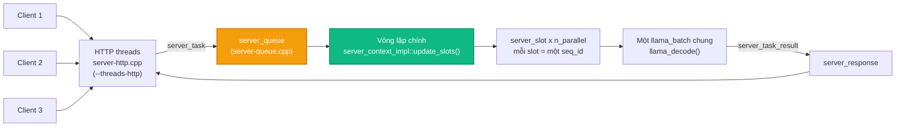

# Bài 7: llama.cpp Server, API và Tích hợp Hệ thống

llama.cpp không chỉ là một CLI tool. `llama-server` là một HTTP server hoàn chỉnh với API tương thích OpenAI và Anthropic, hỗ trợ nhiều request đồng thời bằng continuous batching, embedding và rerank, đầu vào đa phương thức (ảnh, audio), speculative decoding với nhiều loại drafter, ràng buộc output bằng grammar, và cả chế độ **router** quản lý nhiều model trong một tiến trình. Căng thẳng hệ thống ở đây là: một GPU, một KV cache hữu hạn, nhưng nhiều client với prompt dài ngắn khác nhau cùng đòi phản hồi nhanh. Bài này phân tích cách server giải quyết bài toán đó, bám theo mã nguồn trong `tools/server/`.

---

## Phần 1: Khởi động và tham số mặc định

```bash
./build/bin/llama-server \
    -m model-q4_k_m.gguf \
    --host 0.0.0.0 \
    --port 8080 \
    -c 32768 \
    -np 4
```

Một số mặc định quan trọng đã thay đổi so với các phiên bản cũ (kiểm chứng trong `common/common.h` và `common/arg.cpp`):

| Tham số | Mặc định hiện tại | Ý nghĩa |
|:---|:---|:---|
| `-c, --ctx-size` | `0` | Lấy context length lúc huấn luyện của model; cơ chế `--fit` có thể giảm xuống (không dưới `--fit-ctx`, mặc định 4096) nếu thiếu bộ nhớ |
| `-np, --parallel` | `-1` (auto) với server | Khi auto, `tools/server/server.cpp` đặt `n_parallel = 4` **và** `kv_unified = true` |
| `-ngl` | `auto` | Số layer offload do `--fit` quyết định |
| `-fa, --flash-attn` | `auto` | Bật nếu mọi layer chạy được flash attention trên đúng device của nó |
| `-cb, --cont-batching` | bật | Continuous batching |
| `--cache-ram` | 8192 MiB | Bộ nhớ host tối đa cho prompt cache giữa các request |
| `--jinja` | bật với server | Dùng chat template Jinja nhúng trong GGUF |

---

## Phần 2: Các endpoint

Bảng sau liệt kê các route được đăng ký trong `tools/server/server.cpp` (qua `ctx_http.get/post/ws/del`):

| Endpoint | Method | Mô tả |
|:---|:---|:---|
| `/v1/chat/completions`, `/chat/completions` | POST | Chat completion tương thích OpenAI (tool calling, `response_format`, streaming SSE) |
| `/v1/chat/completions/control` | POST | Điều khiển một chat completion đang chạy |
| `/v1/completions` | POST | Text completion định dạng OpenAI |
| `/completion`, `/completions` | POST | Text completion native (nhiều tham số sampling hơn) |
| `/v1/responses`, `/responses` | POST | Responses API của OpenAI |
| `/v1/messages` | POST | Messages API tương thích Anthropic |
| `/v1/messages/count_tokens`, `/v1/chat/completions/input_tokens`, `/v1/responses/input_tokens` | POST | Đếm token đầu vào |
| `/v1/embeddings` | POST | Embedding định dạng OpenAI |
| `/embedding`, `/embeddings` | POST | Embedding native (có thể trả embedding từng token khi `--pooling none`) |
| `/rerank`, `/reranking`, `/v1/rerank`, `/v1/reranking` | POST | Rerank tài liệu theo query (cần model reranker và `--rerank`) |
| `/v1/audio/transcriptions`, `/audio/transcriptions` | POST | Chuyển giọng nói thành văn bản |
| `/v1/realtime` | WebSocket | Transcription thời gian thực theo schema realtime của OpenAI |
| `/tts` | POST | Sinh audio từ văn bản (model TTS) |
| `/infill` | POST | Code infill (FIM) |
| `/tokenize`, `/detokenize` | POST | Truy cập tokenizer |
| `/apply-template` | POST | Áp chat template, trả về prompt dạng chuỗi |
| `/v1/systemone` | POST | API cho "decision model" (trả lời câu hỏi có kiểu trong một forward pass) |
| `/health`, `/v1/health` | GET | Health check (không kiểm API key) |
| `/metrics` | GET | Prometheus metrics |
| `/props` | GET/POST | Đọc/đổi thuộc tính server |
| `/models`, `/v1/models` | GET | Danh sách model |
| `/lora-adapters` | GET/POST | Liệt kê và đổi scale LoRA toàn cục |
| `/slots` | GET | Trạng thái các slot |
| `/slots/:id_slot` | POST | `?action=save`, `restore`, `erase` prompt cache của một slot |
| `/v1/stream`, `/v1/streams/lookup` | GET/POST/DELETE | Streaming có thể nối lại sau khi mất kết nối |
| `/models/load`, `/models/unload`, `/models/sse`, `POST/DELETE /models` | | Chỉ có ở router mode (Phần 5) |

Ví dụ chat completion:

```bash
curl http://localhost:8080/v1/chat/completions \
  -H "Content-Type: application/json" \
  -d '{
    "messages": [
      {"role": "system", "content": "Bạn là trợ lý AI."},
      {"role": "user", "content": "Giải thích quantization là gì?"}
    ],
    "temperature": 0.7,
    "max_tokens": 256,
    "stream": true
  }'
```

Ở chế độ một model, trường `model` bị bỏ qua; ở router mode nó là bắt buộc. Khi server tính được thống kê, response chứa thêm trường `timings` (gồm `prompt_n`, `prompt_per_second`, `predicted_n`, `predicted_per_second`), rất tiện để đo hiệu năng phía client.

---

## Phần 3: Bên trong server: slot, task queue và vòng lặp `update_slots`

### 3.1. Luồng xử lý



Các thread HTTP chỉ parse request, chuyển thành `server_task` và đẩy vào `server_queue`. Một thread duy nhất chạy vòng lặp `server_queue::start_loop`, mỗi vòng gọi `update_slots()` trong `tools/server/server-context.cpp`. Mỗi `server_slot` tương ứng với một sequence id trong KV cache.

### 3.2. Một vòng `update_slots()`

Các chú thích trong mã nguồn cho thấy thứ tự công việc của một vòng:

1. Kiểm tra tất cả slot có rảnh không; nếu có, ngủ chờ task mới.
2. Áp **context shift** nếu một slot sắp tràn context (chỉ khi `--context-shift` được bật; mặc định tắt).
3. Bắt đầu điền batch: với mỗi slot đang sinh, thêm token vừa sample (và các token draft nếu có speculative decoding, xem Phần 7).
4. Sau đó **gộp tiếp các prompt đang chờ**, cắt thành từng đoạn để tổng số token không vượt `n_batch`.
5. Gọi `llama_decode()` theo từng sub-batch, trong lúc đó vẫn nhường cho queue để xử lý các task như `/metrics`.
6. Sample cho từng slot; với speculative decoding thì xác minh draft bằng `common_sampler_sample_and_accept_n`.

Đây chính là **continuous batching**: không có khái niệm "batch tĩnh chờ đủ request"; ở mỗi bước decode, token sinh của các slot đang chạy và các đoạn prompt của slot mới vào được trộn trong cùng một `llama_batch`. Một request đến muộn không phải chờ request khác kết thúc. Các request dùng cấu hình LoRA khác nhau sẽ không được trộn cùng batch.

### 3.3. Unified KV cache

Khi `kv_unified = false`, mỗi sequence có một "stream" KV riêng, và `src/llama-context.cpp` tính context tối đa mỗi sequence là:

$$n_{ctx,seq} = \text{pad}_{256}\left(\frac{n_{ctx}}{n_{seq,max}}\right)$$

Với `-c 32768 -np 4`, mỗi slot có cứng 8192 token, dù ba slot kia đang rảnh. Khi `kv_unified = true` (`-kvu`), tất cả slot dùng chung một bộ đệm KV gồm `n_ctx` ô, nên một slot có thể dùng gần hết 32768 ô nếu các slot khác ít dùng, và các slot chia sẻ prefix (cùng system prompt) có thể dùng chung ô cache. Đổi lại, attention của mỗi sequence phải mask qua một bộ đệm lớn hơn, nên khi các sequence không chia sẻ prefix và đều dài, tắt unified có thể nhanh hơn (đúng như chú thích của trường `kv_unified` trong `include/llama.h`). Đây là lý do mặc định "auto" của server chọn 4 slot cùng unified KV: linh hoạt hơn cho tải hỗn hợp. Cờ `--kv-unified-per-slot N` cho phép đặt giới hạn mỗi slot và để server tự tính `n_ctx = n_parallel * N`.

### 3.4. Tái sử dụng prompt

Server giữ nhiều tầng tái sử dụng: so khớp prefix của prompt mới với nội dung KV của slot (chọn slot theo độ tương đồng `-sps`), `--cache-reuse N` để dịch chuyển KV và tái dùng các đoạn trùng dài ít nhất N token, prompt cache trên RAM host (`--cache-ram`), và **context checkpoint** (`--ctx-checkpoints`, mặc định 32 mỗi slot) dành cho model SWA hoặc recurrent, nơi không thể đơn giản "cắt bớt" KV về một vị trí cũ.

---

## Phần 4: Embedding, rerank và đa phương thức

```bash
# embedding: server
./build/bin/llama-server -m embed-model.gguf --embedding --pooling mean
# embedding: công cụ dòng lệnh
./build/bin/llama-embedding -m embed-model.gguf -p "Câu văn cần embed" --pooling mean
# rerank
./build/bin/llama-server -m reranker.gguf --rerank
```

Các chiến lược pooling được `--pooling` chấp nhận: `none`, `mean`, `cls`, `last`, `rank` (`rank` dùng cho reranker). Với embedding, server ép `n_batch = n_ubatch` vì mọi token của một input phải nằm trong một ubatch để pooling chạy đúng.

**Đa phương thức** được xây trên thư viện `libmtmd` (`tools/mtmd/`). Encoder (vision hoặc audio) nằm trong một file GGUF riêng gọi là *mmproj*, được tạo bằng `convert_hf_to_gguf.py --mmproj`. Khi dùng `-hf user/repo`, server tự tải mmproj nếu repo có (tắt bằng `--no-mmproj`); khi dùng file cục bộ, truyền `-mm mmproj.gguf`. Ảnh hoặc audio gửi qua `image_url`/`input_audio` theo chuẩn OpenAI. Công cụ dòng lệnh tương ứng là `llama-mtmd-cli`.

---

## Phần 5: Router mode: nhiều model trong một server

Khi khởi động `llama-server` **không có `-m`**, `server.cpp` chuyển sang router mode (`is_router_server`). Router không tự load model; nó quản lý các tiến trình con, mỗi tiến trình là một `llama-server` một model, và proxy request tới đúng tiến trình dựa trên trường `"model"` trong body (POST) hoặc tham số `?model=` (GET, WebSocket).

```bash
./build/bin/llama-server --models-dir ./my-gguf-models --models-max 2
```

| Cờ | Mặc định | Ý nghĩa |
|:---|:---|:---|
| `--models-dir PATH` | tắt | Thư mục chứa các file GGUF (nếu không có, router dùng cache model của HF) |
| `--models-preset PATH` | tắt | File INI định nghĩa preset tham số cho từng model |
| `--models-max N` | 4 | Số model được load đồng thời (0 là không giới hạn) |
| `--models-autoload` / `--no-models-autoload` | bật | Tự load model khi có request đầu tiên gọi tới nó |

Các tiến trình con kế thừa tham số dòng lệnh và biến môi trường của router (trừ các tham số router kiểm soát như host, port, API key). Router thêm các endpoint `/models/load`, `/models/unload`, `/models/sse` (sự kiện thời gian thực) và `POST/DELETE /models` (tải về, xóa khỏi cache). Thiết kế đa tiến trình này cách ly lỗi: một model crash không kéo theo các model khác.

---

## Phần 6: LoRA adapter

LoRA trong llama.cpp không cần merge vào weight gốc. API thư viện (`include/llama.h`):

```c
struct llama_adapter_lora * llama_adapter_lora_init(struct llama_model * model, const char * path_lora);
int32_t llama_set_adapters_lora(struct llama_context * ctx,
                                struct llama_adapter_lora ** adapters, size_t n_adapters,
                                float * scales);
void llama_adapter_lora_free(struct llama_adapter_lora * adapter);
```

Adapter gắn với model (bị giải phóng cùng model nếu không free thủ công), còn việc áp adapter với scale nào là thuộc tính của context. Trong graph, mỗi phép nhân weight đi qua `llm_graph_context::build_lora_mm` (`src/llama-graph.cpp`), tính

$$y = W x + \sum_{\ell} s_\ell \, B_\ell (A_\ell x), \qquad s_\ell = \text{scale}_\ell \cdot \frac{\alpha_\ell}{r_\ell}$$

với $A_\ell \in \mathbb{R}^{r \times N_{in}}$, $B_\ell \in \mathbb{R}^{N_{out} \times r}$, $r_\ell$ là rank và $\alpha_\ell$ là `adapter.lora.alpha` lưu trong GGUF của adapter (nếu $\alpha = 0$ thì $s_\ell$ chính là scale người dùng đặt; xem `llama_adapter_lora_weight::get_scale` trong `src/llama-adapter.h`). Vì không gộp $W + sBA$, đổi scale không cần dựng lại weight, và chi phí thêm chỉ là hai matmul hạng thấp: $r(N_{in} + N_{out})$ phép nhân mỗi token, nhỏ hơn nhiều so với $N_{in} N_{out}$ khi $r$ nhỏ. Ở CLI: `--lora FILE` (scale 1.0) hoặc `--lora-scaled FILE:SCALE`. Ở server: `--lora-init-without-apply` load adapter với scale 0, `POST /lora-adapters` đổi scale toàn cục, và trường `lora` trong từng request (`[{"id": 0, "scale": 0.5}]`) đổi scale cho riêng request đó.

---

## Phần 7: Speculative decoding

### 7.1. Ý tưởng và toán học

Decode bị chặn bởi băng thông (Bài 6, Phần 8): xác minh $\gamma + 1$ token trong một lần forward tốn gần như cùng thời gian với 1 token, vì weight chỉ được đọc một lần. Speculative decoding khai thác điều này: một drafter rẻ đề xuất $\gamma$ token, model đích (target) xác minh tất cả trong một batch.

Gọi $\alpha$ là xác suất mỗi token draft được chấp nhận (giả sử độc lập). Số token được tạo ra mỗi lần xác minh (gồm cả token do target tự sample ở vị trí đầu tiên bị từ chối hoặc ở cuối) có kỳ vọng:

$$\mathbb{E}[N] = \sum_{i=0}^{\gamma} \alpha^i = \frac{1 - \alpha^{\gamma+1}}{1 - \alpha}$$

Nếu một bước draft tốn $c$ lần một bước target, tốc độ tăng xấp xỉ:

$$S = \frac{1 - \alpha^{\gamma+1}}{(1 - \alpha)(\gamma c + 1)}$$

Bản chất của công thức nằm ở hai số hạng đối nghịch: tăng $\gamma$ làm tử số bão hòa về $1/(1-\alpha)$ trong khi mẫu số tăng tuyến tính, nên tồn tại $\gamma$ tối ưu. Ví dụ $\alpha = 0.8$, $c = 0.05$, $\gamma = 3$: $\mathbb{E}[N] = (1 - 0.8^4)/0.2 = 2.952$, $S = 2.952/1.15 \approx 2.57$.

### 7.2. Vì sao output không đổi

`llama-server` có hai chế độ xác minh (`--spec-draft-sampling`):

- **`greedy`** (mặc định): drafter lấy argmax. Trong `common_sampler_sample_and_accept_n` (`common/sampling.cpp`), tại mỗi vị trí target **tự sample token của chính nó** bằng sampler đầy đủ; nếu trùng token draft thì chấp nhận và đi tiếp, nếu khác thì giữ token của target và dừng. Mọi token xuất ra đều là mẫu của target, nên phân phối output đúng bằng phân phối của target; draft chỉ quyết định có bao nhiêu vị trí được tính song song.
- **`probabilistic`**: drafter sample từ phân phối $q$, và `common_sampler_sample_and_accept_n_rejection` dùng rejection sampling: chấp nhận token $x$ với xác suất $\min(1, p(x)/q(x))$, nếu từ chối thì sample từ phân phối phần dư chuẩn hóa $\propto \max(0, p - q)$. Đây là thuật toán kinh điển đảm bảo output có phân phối $p$, đồng thời cho $\alpha$ cao hơn khi nhiệt độ lớn. Mã nguồn còn chuẩn hóa lại $p$ khi grammar che bớt token.

### 7.3. Các loại drafter trong `common/speculative.cpp`

Mã nguồn hiện tại không còn chỉ có "draft model". `enum common_speculative_type` (`common/common.h`) và các struct `common_speculative_impl_*` cài đặt:

| `--spec-type` | Drafter | Cần gì |
|:---|:---|:---|
| `draft-simple` | Model nhỏ độc lập cùng vocab | `-md draft.gguf` |
| `draft-eagle3` | EAGLE-3: một layer transformer đọc hidden state của target | GGUF EAGLE-3 (convert với `--target-model-dir`) |
| `draft-mtp` | Multi-token prediction head có sẵn trong model đích (tensor `nextn.*`) | Model có MTP head |
| `draft-dflash` | DFlash: sinh cả block token trong một forward (block diffusion), tiêm hidden state của target | GGUF kiến trúc `dflash` |
| `draft-dspark` | DFlash cộng một Markov head bán tự hồi quy | GGUF `dflash` có tensor `markov_w1` |
| `ngram-simple`, `ngram-map-k`, `ngram-map-k4v` | Tìm n-gram khớp trong lịch sử, đề xuất m-gram theo sau | Không cần model phụ |
| `ngram-mod` | Bảng băm n-gram dùng chung giữa các slot | Không cần model phụ |
| `ngram-cache` | Cache thống kê n-gram 3 tầng (có thể nạp từ file) | Không cần model phụ |

Khi không chỉ định `--spec-type`, `common/arg.cpp` cố suy ra loại từ metadata của draft GGUF (`common_speculative_types_from_gguf`: kiến trúc `dflash` thành `draft-dflash` hoặc `draft-dspark`, có tensor `blk.N.nextn.eh_proj.weight` thành `draft-mtp`) hoặc từ sidecar tải kèm qua `-hfd`. Với một draft model thông thường, hãy chỉ định rõ `--spec-type draft-simple` như các ví dụ chính thức. Có thể kết hợp nhiều loại (ví dụ `--spec-type ngram-mod,draft-simple`); `common_speculative_init` xếp ưu tiên các drafter n-gram trước drafter dùng model.

```bash
# Draft model độc lập
./build/bin/llama-server -m target-8b.gguf -md draft-0.6b.gguf \
    --spec-type draft-simple --spec-draft-n-max 7 -ngld 99

# EAGLE-3
./build/bin/llama-server -m Qwen3-4B.gguf -md Qwen3-4B-eagle3.gguf --spec-type draft-eagle3

# Không cần model phụ: hữu ích khi viết lại code, output lặp lại input
./build/bin/llama-server -m model.gguf --spec-type ngram-mod
```

Tên cờ đã được chuẩn hóa với tiền tố `--spec-`: `--spec-draft-model` (`-md`), `--spec-draft-n-max` (mặc định 3), `--spec-draft-n-min` (mặc định 0), `--spec-draft-p-min` (mặc định 0.0), `--spec-draft-ngl` (`-ngld`). Các cờ cũ `--draft`, `--draft-max`, `--draft-min` vẫn được parse nhưng chỉ để báo lỗi "the argument has been removed" và gợi ý cờ mới. Chương trình minh họa độc lập là `llama-speculative-simple` và `llama-speculative` (`examples/`).

---

## Phần 8: Grammar-constrained generation

llama.cpp hỗ trợ **GBNF** (GGML BNF) để ràng buộc output. Ở mỗi bước sampling, sampler grammar (`llama_sampler_init_grammar` trong `include/llama.h`) đặt logit của mọi token không thể tiếp tục một chuỗi hợp lệ về $-\infty$, nên output luôn thuộc ngôn ngữ của grammar. Mọi ký hiệu được tham chiếu phải được định nghĩa; một grammar JSON tối giản nhưng đầy đủ:

```
root   ::= object
value  ::= object | array | string | number | ("true" | "false" | "null") ws
object ::= "{" ws ( string ":" ws value ( "," ws string ":" ws value )* )? "}" ws
array  ::= "[" ws ( value ( "," ws value )* )? "]" ws
string ::= "\"" ( [^"\\\x7F\x00-\x1F] | "\\" ["\\bfnrt] )* "\"" ws
number ::= "-"? [0-9]+ ("." [0-9]+)? ws
ws     ::= [ \t\n]*
```

```bash
./build/bin/llama-completion -m model.gguf --grammar-file json.gbnf -p "Create a JSON..."
# hoặc dùng JSON Schema, được chuyển thành grammar bởi common/json-schema-to-grammar.cpp
./build/bin/llama-completion -m model.gguf -j '{"type":"object","properties":{"name":{"type":"string"}}}' -p "..."
```

Thư mục `grammars/` của repo có sẵn `json.gbnf`, `json_arr.gbnf`, `list.gbnf`... Ở server, trường `response_format` kiểu `json_schema` và tool calling dùng cùng cơ chế này (grammar "lazy" chỉ kích hoạt khi model bắt đầu một lời gọi tool).

---

## Phần 9: Tích hợp từ Python

Cách tích hợp ít phụ thuộc nhất là gọi HTTP API của `llama-server`, chỉ cần thư viện chuẩn:

```python
import json, urllib.request

req = urllib.request.Request(
    "http://localhost:8080/v1/chat/completions",
    data=json.dumps({
        "messages": [
            {"role": "system", "content": "You are a helpful assistant."},
            {"role": "user", "content": "What is quantization?"},
        ],
        "temperature": 0.7,
        "max_tokens": 256,
    }).encode(),
    headers={"Content-Type": "application/json"},
)
with urllib.request.urlopen(req) as r:
    resp = json.load(r)

print(resp["choices"][0]["message"]["content"])
t = resp.get("timings", {})
print(f"prefill {t.get('prompt_per_second', 0):.1f} tok/s, decode {t.get('predicted_per_second', 0):.1f} tok/s")
```

Vì API tương thích OpenAI, mọi SDK OpenAI đều dùng được bằng cách đặt `base_url="http://localhost:8080/v1"`. Nếu cần nhúng trực tiếp vào tiến trình Python, có binding của bên thứ ba `llama-cpp-python` (dự án riêng, không nằm trong repo llama.cpp, nên phiên bản `libllama` bên trong có thể trễ hơn mainline).

---

## 💡 Đúc kết Bài 7

`llama-server` là một **inference platform** hoàn chỉnh: các thread HTTP chỉ chuyển request thành task, một vòng lặp duy nhất `update_slots()` trộn token sinh và đoạn prompt của nhiều slot vào cùng một `llama_batch` (continuous batching), unified KV cache cho phép các slot chia sẻ một bộ đệm chung, router mode quản lý nhiều model trong các tiến trình cách ly, và speculative decoding với nhiều drafter (draft model, EAGLE-3, MTP, DFlash, n-gram) tăng tốc decode mà vẫn giữ nguyên phân phối output của model đích.
