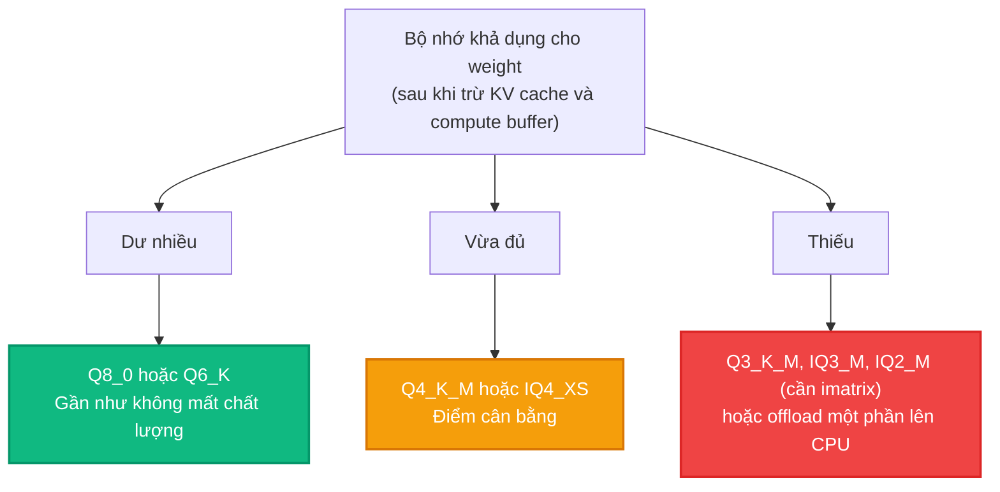

# Bài 8: Performance Tuning và Benchmarking

Sau khi hiểu kiến trúc inference, quantization và backends, bước tiếp theo là **tối ưu hiệu năng**. Điều kiện tiên quyết của mọi tối ưu là biết mình đang bị chặn bởi cái gì. Bài này xây dựng mô hình định lượng cho hai pha của inference, rồi đi qua các công cụ và tham số thực tế của llama.cpp: `llama-bench`, flash attention, lượng tử hóa KV cache, cơ chế `--fit`, offload MoE và context shift.

---

## Phần 1: Hai pha, hai nút thắt

Xét một phép matmul $Y = W X$ với $W \in \mathbb{R}^{N_{out} \times N_{in}}$ lưu ở $b$ bit mỗi trọng số và $X$ gồm $B$ cột (số token trong ubatch). Số phép tính và số byte phải đọc từ bộ nhớ:

$$\text{FLOP} = 2 B N_{in} N_{out}, \qquad \text{Bytes} \approx \frac{b}{8} N_{in} N_{out}$$

(bỏ qua activation vì nhỏ hơn nhiều so với weight khi $B$ nhỏ). Cường độ số học (arithmetic intensity):

$$I = \frac{\text{FLOP}}{\text{Bytes}} = \frac{16 B}{b} \ \text{FLOP/byte}$$

Đọc công thức này theo nghĩa thực tế: với decode một chuỗi ($B = 1$) ở Q4_K ($b = 4.5$), $I \approx 3.6$ FLOP/byte, thấp hơn hàng chục lần so với "điểm gãy" (ridge point, tỉ số giữa FLOP/s đỉnh và băng thông) của mọi GPU hiện đại. Decode vì thế **bị chặn bởi băng thông bộ nhớ**, và tốc độ tối đa xấp xỉ $BW / S_{\text{weights}}$ (Bài 6, Phần 8). Với prefill, $B$ bằng `n_ubatch` (mặc định 512), $I$ tăng tuyến tính theo $B$ và pha này **bị chặn bởi compute**: tensor core, kernel MMQ, kích thước ubatch mới là yếu tố quyết định. Hệ quả: một thay đổi làm tăng tốc prefill (ví dụ tăng `-ub`) có thể không ảnh hưởng gì tới decode, và ngược lại (ví dụ quantize mạnh hơn).

---

## Phần 2: `llama-bench`: đo đúng cách

`llama-bench` nằm trong `tools/llama-bench/`. Mặc định (bảng `cmd_params_defaults` trong `llama-bench.cpp`): `-p 512`, `-n 128`, `-r 5` lần lặp, `-b 2048`, `-ub 512`, `-ngl -1` (tất cả), `-fa auto`, `-ctk/-ctv f16`, output `md`.

```bash
./build/bin/llama-bench -m model-q4_k_m.gguf -p 512 -n 128 -d 0,8192
```

Output mẫu (định dạng theo `tools/llama-bench/README.md`; con số chỉ minh họa):

```
| model                  |     size |  params | backend | ngl |          test |             t/s |
| ---------------------- | -------: | ------: | ------- | --: | ------------: | --------------: |
| qwen2 7B Q4_K - Medium | 4.36 GiB |  7.62 B | CUDA    |  -1 |         pp512 | 7340.20 ± 23.45 |
| qwen2 7B Q4_K - Medium | 4.36 GiB |  7.62 B | CUDA    |  -1 |         tg128 |   120.60 ± 0.59 |
| qwen2 7B Q4_K - Medium | 4.36 GiB |  7.62 B | CUDA    |  -1 |  pp512 @ d512 | 6425.91 ± 18.88 |
| qwen2 7B Q4_K - Medium | 4.36 GiB |  7.62 B | CUDA    |  -1 |  tg128 @ d512 |   116.71 ± 0.60 |
```

- **pp512**: throughput xử lý prompt 512 token (prefill).
- **tg128**: throughput sinh 128 token (decode).
- **@ d512**: chạy test sau khi đã điền sẵn 512 token vào KV cache (`-d`). Đây là cờ quan trọng nhất mà nhiều benchmark bỏ quên: tốc độ ở context rỗng không phản ánh tốc độ ở 32K token, khi việc đọc KV cache trở thành một phần đáng kể của băng thông.

Mọi tham số đều nhận nhiều giá trị (`-ngl 20,30,40`, `-fa 0,1`, `-ctk f16,q8_0`) và `llama-bench` chạy mọi tổ hợp; `-pg 512,128` đo kịch bản prefill rồi decode liên tiếp; `-o json|jsonl|csv|sql` xuất dữ liệu cho phân tích. Phép đo không bao gồm thời gian tokenize và sampling. Với server nhiều slot, dùng thêm `llama-batched-bench` để đo throughput tổng theo số sequence song song.

---

## Phần 3: Flash Attention

### 3.1. Vấn đề bộ nhớ

Không có flash attention, graph phải hiện thực hóa ma trận điểm $KQ$ với kích thước $n_{ubatch} \times n_{kv} \times n_{head}$ phần tử FP32 cho mỗi layer (tái sử dụng buffer giữa các layer). Với $n_{ubatch} = 512$, $n_{kv} = 32768$, $n_{head} = 32$:

$$512 \times 32768 \times 32 \times 4 \ \text{byte} = 2 \ \text{GiB}$$

chỉ riêng cho một tensor trung gian trong compute buffer. `ggml_flash_attn_ext` tính softmax theo từng tile với kỹ thuật online softmax (giữ max và tổng chạy), nên bộ nhớ trung gian chỉ còn $O(n_{ubatch} \cdot d_{head})$ mỗi head thay vì $O(n_{ubatch} \cdot n_{kv})$, đồng thời giảm số lần đọc/ghi bộ nhớ.

### 3.2. Mặc định `auto` và cách nó được quyết định

Cờ hiện tại là `-fa, --flash-attn [on|off|auto]`, mặc định `auto`. Ở tầng C API, trường cũ `bool flash_attn` đã được thay bằng enum:

```c
struct llama_context_params cparams = llama_context_default_params();
cparams.flash_attn_type = LLAMA_FLASH_ATTN_TYPE_ENABLED;   // hoặc _DISABLED, _AUTO
```

Với `auto`, `llama_context::resolve_fused_ops()` (`src/llama-context.cpp`) dựng thử (reserve) một graph, rồi kiểm tra từng node flash attention: nếu scheduler gán node đó cho một device khác với device chứa layer tương ứng (`model.dev_layer(il)`), nghĩa là backend của layer không hỗ trợ op, thì flash attention bị tắt kèm cảnh báo; ngược lại thì bật. Lý do của thiết kế này: flash attention chạy "nhờ" trên CPU trong khi layer nằm trên GPU sẽ gây copy KV qua PCIe ở mọi bước, chậm hơn nhiều so với attention thường.

Hai ràng buộc cứng cần nhớ (cùng file): **V cache lượng tử hóa bắt buộc flash attention** (với `auto` thì tự bật, với `off` thì báo lỗi `quantized V cache requires flash_attn to be enabled`), và `--split-mode tensor` cũng bắt buộc flash attention.

---

## Phần 4: KV Cache: tính toán và lượng tử hóa

### 4.1. Công thức kích thước

$$S_{KV} = 2 \cdot n_{layer} \cdot n_{ctx} \cdot n_{head,kv} \cdot d_{head} \cdot \frac{b_{KV}}{8}$$

Hệ số 2 ứng với K và V; $b_{KV}$ là số bit hiệu dụng mỗi phần tử. Với Llama-3-8B ($n_{layer} = 32$, $n_{head,kv} = 8$ nhờ GQA, $d_{head} = 128$) và $n_{ctx} = 4096$:

$$S_{KV}^{F16} = 2 \cdot 32 \cdot 4096 \cdot 8 \cdot 128 \cdot 2 \ \text{byte} = 512 \ \text{MiB}$$

Q8_0 lưu 34 byte cho 32 phần tử (8.5 bit), Q4_0 lưu 18 byte cho 32 phần tử (4.5 bit):

| KV type (`-ctk`/`-ctv`) | Bit hiệu dụng | Llama-3-8B, 4K ctx | Llama-3-8B, 128K ctx | Tỉ lệ so với F16 |
|:---|:---|:---|:---|:---|
| `f16` (mặc định) | 16 | 512 MiB | 16 GiB | 100% |
| `q8_0` | 8.5 | 272 MiB | 8.5 GiB | 53% |
| `q4_0` | 4.5 | 144 MiB | 4.5 GiB | 28% |

Cột 128K cho thấy vì sao KV cache không miễn phí: ở ngữ cảnh dài, nó vượt xa kích thước weight Q4_K_M (khoảng 4.6 GiB). Một model MHA không có GQA ($n_{head,kv} = n_{head} = 32$) như Llama-2-7B tốn gấp 4 lần: 2 GiB ở 4K.

### 4.2. Chọn kiểu

Các kiểu được `-ctk`/`-ctv` chấp nhận (danh sách `kv_cache_types` trong `common/arg.cpp`): `f32`, `f16`, `bf16`, `q8_0`, `q4_0`, `q4_1`, `iq4_nl`, `q5_0`, `q5_1`. K thường nhạy với lượng tử hóa hơn V, vì sai số trên K đi qua tích $q^\top k$ rồi qua hàm mũ của softmax, trong khi sai số trên V chỉ bị lấy trung bình có trọng số. Cấu hình phổ biến là `-ctk q8_0 -ctv q8_0`, hoặc giữ K ở `q8_0` khi hạ V xuống `q4_0`. Mức suy giảm chất lượng phụ thuộc model, nên hãy đo bằng `llama-perplexity` với `--kl-divergence` (Bài 5, Phần 8) thay vì tin vào một con số chung. Model MLA (DeepSeek) không cho phép K và V khác kiểu.

---

## Phần 5: `--fit`: tự động vừa bộ nhớ

Trước đây người dùng phải dò `-ngl` và `-c` bằng tay cho tới khi hết lỗi out-of-memory. Hiện nay `--fit` **bật mặc định** (`fit_params = true` trong `common/common.h`), và `-ngl` mặc định là `auto`. Hàm `common_fit_params()` (`common/fit.cpp`) chạy trước khi load model thật:

1. **Đo**: load model và context ở chế độ `no_alloc` để lấy dự toán bộ nhớ từng device với tham số mặc định. Nếu đã vừa (chừa biên `--fit-target`, mặc định 1024 MiB mỗi device), không đổi gì.
2. **Giảm context**: nếu người dùng không tự đặt `-c`, giảm `n_ctx` nhưng không dưới `--fit-ctx` (mặc định 4096).
3. **Phân bố layer từ sau ra trước**: với model dense, mỗi device nhận một dải layer liên tiếp; với MoE, ban đầu mọi tensor expert nằm ở RAM hệ thống, chỉ phần dense lên GPU.
4. **MoE**: nếu phần dense đã vừa, chuyển dần các layer "chỉ dense" thành layer đầy đủ (kèm expert) từ trước ra sau cho tới khi các GPU đầy, có thể giữ một phần của một layer để tận dụng VRAM lẻ.

Số layer mỗi device được tìm bằng **phương pháp dây cung (false position, regula falsi)**: giữ một cận dưới (vừa) và một cận trên (không vừa), nội suy tuyến tính bộ nhớ theo số layer để đoán điểm chạm mục tiêu:

$$\Delta n = \left\lfloor \delta \cdot \frac{M_{target} - M_{low}}{M_{high} - M_{low}} \right\rfloor, \quad 1 \le \Delta n \le \delta - 1$$

với $\delta$ là khoảng cách số layer giữa hai cận, $M$ là bộ nhớ dự toán. Phép thử kết quả thay thế cận tương ứng, và dừng khi hai cận chỉ cách nhau một layer. Vì bộ nhớ gần như tuyến tính theo số layer, thường chỉ cần vài lần đo. Kết quả được áp qua `n_gpu_layers`, `tensor_split` và các override buffer type. **Quan trọng**: hàm chỉ sửa những tham số còn ở giá trị mặc định, nên một `-ngl 30` đặt tay sẽ không bị ghi đè. Công cụ `llama-fit-params` (`tools/fit-params/`) in ra bộ cờ CLI tương ứng để tái sử dụng; `-fitp on` in dự toán bộ nhớ.

---

## Phần 6: Offload MoE và override buffer type

Với model Mixture of Experts, mỗi token chỉ kích hoạt $k$ trong $E$ expert, nên lượng byte expert phải đọc mỗi token chỉ bằng khoảng $k/E$ tổng expert. Điều đó khiến chiến lược "attention và phần dense trên GPU, expert trên CPU" rất hiệu quả: phần đọc nhiều mỗi token (attention, shared expert, KV) chạy trên băng thông GPU, phần lớn về dung lượng nhưng đọc thưa (expert) nằm trên RAM.

| Cờ | Cơ chế (`common/arg.cpp`, `common/common.h`) |
|:---|:---|
| `-ot, --override-tensor <regex>=<buft>,...` | Ép tensor có tên khớp regex vào buffer type chỉ định (tên như `CPU`, `CUDA0`) |
| `-cmoe, --cpu-moe` | Thêm override `LLM_FFN_EXPS_REGEX = "\.ffn_(up\|down\|gate\|gate_up)_(ch\|)exps"` vào CPU cho mọi layer |
| `-ncmoe, --n-cpu-moe N` | Giữ expert của **N layer đầu** trên CPU |
| `-ncffn, --n-cpu-ffn N` | Tương tự cho FFN dense của N layer đầu |
| `--moe-cache-mib N` | Cache trên GPU cho các expert đang nằm ở CPU (mặc định 0, tắt) |

Ví dụ, giữ expert của layer 10 đến 19 trên CPU:

```bash
./build/bin/llama-server -m moe-model.gguf -ot "blk\.(1[0-9])\.ffn_.*_exps=CPU"
```

Trong thực tế `--fit` (Phần 5) sinh ra đúng loại override này một cách tự động; các cờ thủ công hữu ích khi cần kiểm soát chính xác hoặc khi tắt `--fit`.

---

## Phần 7: Context shift

Khi số token của một chuỗi chạm `n_ctx`, có hai lựa chọn: dừng, hoặc **context shift**. Cờ hiện tại là `--context-shift` / `--no-context-shift`, **mặc định tắt** (`ctx_shift = false` trong `common/common.h`):

```bash
./build/bin/llama-server -m model.gguf -c 4096 --context-shift
```

Cơ chế trong `update_slots()` (`tools/server/server-context.cpp`): giữ `n_keep` token đầu (tham số `n_keep` của request, cộng thêm token BOS nếu có; thường dùng để bảo toàn system prompt), gọi $n_{left} = n_{tokens} - n_{keep}$ và bỏ $n_{discard} = \lfloor n_{left}/2 \rfloor$ token kế tiếp (`seq_rm`), rồi dịch vị trí của phần còn lại lùi $n_{discard}$ (`seq_add`). Vì K đã được áp RoPE theo vị trí cũ, dịch vị trí đòi hỏi xoay lại K một góc $-n_{discard} \cdot \theta_k$; tính chất nhóm của phép quay $R(\theta_1) R(\theta_2) = R(\theta_1 + \theta_2)$ cho phép làm điều này trực tiếp trên cache mà không cần tính lại. Mặc định bị tắt vì nó âm thầm xóa ngữ cảnh giữa hội thoại, làm thay đổi ngữ nghĩa, và không áp dụng được cho model recurrent hoặc model mà KV không thể dịch đơn giản.

---

## Phần 8: Chọn quant theo phần cứng

`tools/quantize/quantize.cpp` ghi kèm mỗi kiểu kích thước file và mức tăng perplexity đo trên Llama-3-8B:

| Kiểu | Kích thước | Tăng PPL @ Llama-3-8B |
|:---|:---|:---|
| Q8_0 | 7.96 G | +0.0026 |
| Q6_K | 6.14 G | +0.0217 |
| Q5_K_M | 5.33 G | +0.0569 |
| Q4_K_M | 4.58 G | +0.1754 |
| Q4_K_S | 4.37 G | +0.2689 |
| Q4_0 | 4.34 G | +0.4685 |
| Q3_K_M | 3.74 G | +0.6569 |
| Q2_K | 2.96 G | +3.5199 |

Đường cong rõ ràng không tuyến tính: từ Q8_0 xuống Q4_K_M mất khoảng 42% dung lượng mà PPL chỉ tăng 0.17, trong khi từ Q3_K_M xuống Q2_K tiết kiệm thêm 0.8 G nhưng PPL tăng hơn 2.8. Q4_K_M tốt hơn Q4_0 rõ rệt ở cùng dung lượng gần bằng nhau, nhờ scale 6-bit theo sub-block và việc nâng một số tensor nhạy cảm (`attn_v`, `ffn_down`) lên Q6_K.



Hãy nhớ rằng ngân sách bộ nhớ phải trừ KV cache (Phần 4) và compute buffer, không chỉ so kích thước file với VRAM.

---

## Phần 9: Checklist tối ưu

| Kỹ thuật | Lệnh/Cấu hình | Tác dụng |
|:---|:---|:---|
| Load model | `-lm auto` (mặc định: mmap trừ khi device không hỗ trợ); `mlock`, `mmap+mlock`, `dio` | mmap tránh copy và cho phép OS chia sẻ trang; mlock chống swap |
| Fit tự động | `--fit on` (mặc định), `-fitt`, `-fitc` | Tự chọn `-ngl`, `-c`, override MoE |
| Flash attention | `-fa auto` (mặc định) | Giảm compute buffer, cần cho V cache quantized |
| KV cache | `-ctk q8_0 -ctv q8_0` | Giảm 47% bộ nhớ KV |
| Offload MoE | `--n-cpu-moe N`, `-ot` | Đưa expert ra RAM, giữ phần dense trên GPU |
| Thread | `-t` (decode), `-tb` (batch) | Decode thường tốt nhất khi bằng số core vật lý; quá nhiều thread làm tranh chấp băng thông |
| Batch | `-b 2048 -ub 512` (mặc định) | Tăng `-ub` giúp prefill trên GPU, đổi lại compute buffer lớn hơn |
| Op offload | `--op-offload` (mặc định bật) | Prefill trên GPU cả với weight nằm ở CPU khi batch đạt ngưỡng 32 |
| Repack CPU | `--repack` (mặc định bật) | Layout weight xen kẽ cho GEMM trên CPU |
| Unified KV | `-kvu` | Linh hoạt cho nhiều slot chia sẻ prefix |

---

## 💡 Đúc kết Bài 8

Performance tuning trong llama.cpp bắt đầu từ việc phân biệt **prefill bị chặn bởi compute** và **decode bị chặn bởi băng thông**, qua công thức cường độ số học $I = 16B/b$. Từ đó các quyết định trở nên có cơ sở: chọn quant để giảm byte phải đọc, lượng tử hóa KV cache khi ngữ cảnh dài, để flash attention và `--fit` ở chế độ tự động, đưa expert MoE ra CPU, và luôn đo bằng `llama-bench` ở độ sâu context (`-d`) phản ánh đúng tải thực tế.
