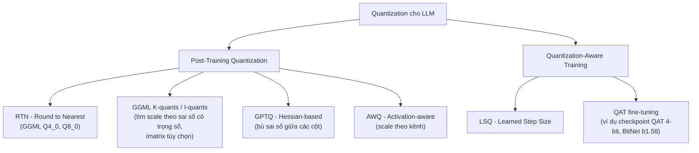

# Theory 6: Cảnh giác Quantization - So sánh GGML, GPTQ, AWQ và QAT

Trong khi Bài 3 đã đi sâu vào hệ thống quantization nội tại của llama.cpp (Q4_0 đến I-quants), thế giới quantization LLM rộng hơn nhiều. Lý thuyết này phân tích 4 trường phái chính: **GGML block quantization** (llama.cpp), **GPTQ** (dựa trên Hessian), **AWQ** (nhận biết activation), và **QAT** (huấn luyện có lượng tử hóa), cùng các định dạng mới như **MXFP4/NVFP4**. Mục tiêu là hiểu mỗi phương pháp đang tối ưu hàm mục tiêu nào, chứ không chỉ học thuộc bảng so sánh.

---

## Phần 1: Tổng quan: PTQ và QAT

| Tiêu chí | PTQ (RTN, GGML, GPTQ, AWQ) | QAT |
|:---|:---|:---|
| **Thời điểm** | Sau khi huấn luyện xong | Trong quá trình huấn luyện hoặc fine-tune |
| **Huấn luyện lại** | Không (hoặc chỉ calibration) | Có (fine-tune với fake quantization) |
| **Thời gian** | Vài phút đến vài giờ | Vài giờ đến hàng nghìn GPU-giờ |
| **Ở 4-bit** | Thường gần FP16 với phương pháp tốt | Gần FP16 |
| **Ở 2-bit** | Suy giảm mạnh, cần imatrix/vector quantization | Khả thi nếu huấn luyện đủ |
| **Chi phí compute** | Thấp | Cao |

---

## Phần 2: GPTQ: lượng tử hóa tối ưu dựa trên Hessian

### 2.1. Nguồn gốc

**Paper**: "GPTQ: Accurate Post-Training Quantization for Generative Pre-trained Transformers", Elias Frantar, Saleh Ashkboos, Torsten Hoefler, Dan Alistarh (IST Austria, ETH Zurich), 2022, ICLR 2023.

GPTQ xuất phát từ **Optimal Brain Quantization (OBQ)**, vốn kế thừa khung **Optimal Brain Surgeon (OBS)** của Hassibi và Stork (1993). Ý tưởng cốt lõi: lượng tử hóa là một **bài toán tối ưu**, không phải phép làm tròn độc lập từng phần tử.

### 2.2. Hàm mục tiêu

GPTQ lượng tử hóa từng layer, giải bài toán tái tạo đầu ra trên dữ liệu calibration $X \in \mathbb{R}^{N_{in} \times n}$ ($n$ là số token):

$$\mathcal{L}(\hat{W}) = \|WX - \hat{W}X\|_F^2 = \sum_{r} (w_r - \hat{w}_r) \, XX^\top (w_r - \hat{w}_r)^\top$$

với $w_r$ là hàng thứ $r$ của $W$. Đặt $H = 2XX^\top$, mỗi hàng là một bài toán bậc hai **chính xác** (không phải xấp xỉ Taylor):

$$\mathcal{L}_r(\hat{w}_r) = \tfrac{1}{2}(w_r - \hat{w}_r) H (w_r - \hat{w}_r)^\top$$

Nhận xét quan trọng: $H$ giống nhau cho mọi hàng, vì nó chỉ phụ thuộc vào input của layer.

### 2.3. Thuật toán

Khi lượng tử hóa phần tử thứ $q$ của một hàng thành $\text{quant}(w_q)$, OBS cho lời giải đóng của cập nhật tối ưu lên các phần tử **chưa** lượng tử hóa $F$:

$$\delta_F = -\frac{w_q - \text{quant}(w_q)}{[H_F^{-1}]_{qq}} \cdot (H_F^{-1})_{:,q}$$

Đọc công thức này theo nghĩa hình học: sai số làm tròn ở cột $q$ được "đẩy" sang các cột còn lại theo hướng mà $H^{-1}$ chỉ ra, tức là các cột có input tương quan với cột $q$ sẽ bù cho sai số đó. Sau mỗi bước, $H_F^{-1}$ được cập nhật bằng một bước khử Gauss để loại hàng/cột $q$, chi phí $O(d^2)$ với $d = N_{in}$.

OBQ chọn thứ tự tham lam riêng cho từng hàng, tổng chi phí $O(N_{out} \cdot N_{in}^3)$, bất khả thi với LLM. GPTQ có ba cải tiến:

1. **Thứ tự cố định cho mọi hàng.** Vì $H$ chung, nếu mọi hàng dùng cùng thứ tự cột thì chuỗi $H_F^{-1}$ cũng chung, chỉ phải tính một lần. Chi phí giảm còn $O(N_{in}^3 + N_{out} N_{in}^2)$. Thực nghiệm cho thấy thứ tự cố định gần như không kém thứ tự tham lam ở mô hình lớn.
2. **Lazy batch update.** Xử lý theo khối 128 cột: cập nhật trong khối trước, rồi mới áp cập nhật dồn lên phần còn lại của ma trận bằng một phép nhân ma trận lớn, tăng cường độ số học trên GPU.
3. **Cholesky reformulation.** Các hàng cần thiết của $H^{-1}$ được tính trước bằng phân rã Cholesky (cùng với damping, cộng một lượng nhỏ vào đường chéo của $H$), tránh tích lũy sai số số học của các bước cập nhật nghịch đảo lặp lại.

### 2.4. Cấu hình và kết quả

| Tham số | Giá trị điển hình |
|:---|:---|
| Granularity | Theo nhóm (group-wise) dọc chiều input |
| Group size | 128 (phổ biến), đôi khi 32 hoặc 64 |
| Bit-width | 4-bit (chính), 3-bit, 2-bit |
| Calibration | Paper gốc dùng 128 đoạn ngẫu nhiên, mỗi đoạn 2048 token, lấy từ C4 |
| Ký hiệu | w4a16g128 = weight 4-bit, activation 16-bit, group 128 |

Kết quả nổi bật của paper: lượng tử hóa OPT-175B và BLOOM-176B trong khoảng 4 GPU-giờ, với perplexity ở 4-bit gần như bằng FP16. Phép tính dung lượng cho thấy vì sao đây là cột mốc: $175 \times 10^9$ tham số ở FP16 cần $350$ GB; ở 4-bit cần khoảng $87.5$ GB (chưa tính scale); ở 3-bit khoảng $65.6$ GB, lần đầu tiên vừa một GPU A100 80 GB.

---

## Phần 3: AWQ: Activation-Aware Weight Quantization

### 3.1. Nguồn gốc

**Paper**: "AWQ: Activation-aware Weight Quantization for LLM Compression and Acceleration", Ji Lin, Jiaming Tang, Haotian Tang và cộng sự (MIT Han Lab), 2023, MLSys 2024.

### 3.2. Insight cốt lõi

Không phải mọi trọng số đều quan trọng như nhau. Một tỉ lệ nhỏ kênh input (cỡ 1%) có activation lớn bất thường, và sai số trên trọng số nhân với các kênh đó bị khuếch đại. Với lượng tử hóa RTN bước $\Delta$:

$$\text{Err}(Q(w) x) = \Delta \cdot \text{RoundErr}\left(\frac{w}{\Delta}\right) \cdot x$$

Nếu nhân một kênh với $s > 1$ rồi chia input tương ứng cho $s$, sai số của kênh đó trở thành $\Delta' \cdot \text{RoundErr}(ws/\Delta') \cdot x/s$. Vì $\text{RoundErr}$ có kỳ vọng gần như không đổi và $\Delta'$ (do absmax của cả nhóm quyết định) thay đổi rất ít khi chỉ một kênh được phóng to, sai số tương đối của kênh quan trọng giảm khoảng $s$ lần.

### 3.3. Thuật toán

1. **Profile activation** trên một tập calibration nhỏ: $s_x = \mathbb{E}_{x \sim X}[|x|]$ theo từng kênh.
2. **Tìm hệ số**: $s = s_x^{\alpha}$, với $\alpha^* \in [0, 1]$ chọn bằng grid search để cực tiểu sai số tái tạo đầu ra của layer.
3. **Biến đổi tương đương**: $y = Q(W \,\text{diag}(s)) \cdot (\text{diag}(s)^{-1} x)$.
4. **Không tốn chi phí runtime**: $\text{diag}(s)^{-1}$ được gộp vào trọng số của norm hoặc linear ngay trước đó.

AWQ không bù sai số giữa các cột như GPTQ, nên ít phụ thuộc vào phân phối của tập calibration hơn.

### 3.4. So sánh AWQ và GPTQ

| Tiêu chí | GPTQ | AWQ |
|:---|:---|:---|
| **Ý tưởng** | Bù sai số bằng thông tin bậc hai ($H^{-1}$) | Phóng to kênh quan trọng trước khi làm tròn |
| **Hàm mục tiêu** | $\|WX - \hat{W}X\|_F^2$ chính xác | Sai số đầu ra, tối ưu trên một tham số $\alpha$ |
| **Độ phức tạp** | Cao (Cholesky, xử lý tuần tự theo cột) | Thấp (grid search một chiều) |
| **Nguy cơ overfit calibration** | Cao hơn | Thấp hơn |
| **Runtime overhead** | Không | Không |

---

## Phần 4: QAT: Quantization-Aware Training

### 4.1. Straight-Through Estimator (STE)

$Q(w) = \Delta \cdot \text{round}(w / \Delta)$ có đạo hàm bằng 0 hầu khắp nơi. STE thay đạo hàm đó bằng:

$$\frac{\partial Q(w)}{\partial w} \approx \begin{cases} 1 & \text{nếu } w \in [w_{min}, w_{max}] \\ 0 & \text{ngược lại} \end{cases}$$

Forward dùng giá trị đã lượng tử hóa; backward cho gradient đi qua như hàm đồng nhất trong vùng hợp lệ. Mô hình vì thế học được phân phối trọng số chịu được lượng tử hóa.

### 4.2. LSQ: Learned Step Size Quantization

**Paper**: Esser và cộng sự, IBM Research, ICLR 2020. LSQ coi bước $\Delta$ là tham số học được:

$$Q(w, \Delta) = \text{clamp}\left(\text{round}\left(\frac{w}{\Delta}\right), -Q_N, Q_P\right) \cdot \Delta$$

với $Q_N = 2^{b-1}$, $Q_P = 2^{b-1} - 1$. Gradient theo $\Delta$ (dùng STE cho round):

$$\frac{\partial Q}{\partial \Delta} = \begin{cases} -Q_N & \text{nếu } w/\Delta \le -Q_N \\ \text{round}(w/\Delta) - w/\Delta & \text{nếu } -Q_N \lt w/\Delta \lt Q_P \\ Q_P & \text{nếu } w/\Delta \ge Q_P \end{cases}$$

Nhánh giữa cho thấy $\Delta$ "cảm nhận" được sai số làm tròn của từng phần tử, điều mà STE thuần túy bỏ qua. LSQ còn nhân gradient của $\Delta$ với hệ số $g = 1/\sqrt{N_W Q_P}$ ($N_W$ là số phần tử) để cân bằng tốc độ học. LSQ+ (Qualcomm, 2020) mở rộng cho lượng tử hóa bất đối xứng, học cả scale và zero-point.

### 4.3. Khi nào dùng QAT?

| Tình huống | Khuyến nghị |
|:---|:---|
| Triển khai nhanh, 4 bit trở lên | PTQ |
| Dưới 3 bit mà vẫn cần chất lượng tốt | QAT (hoặc kiến trúc huấn luyện từ đầu như BitNet) |
| Không có dữ liệu và compute để huấn luyện | PTQ |
| Nhà cung cấp đã phát hành checkpoint QAT | Dùng checkpoint đó, rồi chuyển sang định dạng đích ít mất mát nhất |

Lưu ý thực hành: một checkpoint QAT chỉ phát huy tác dụng khi được lượng tử hóa về đúng lưới mà nó đã được huấn luyện (ví dụ model QAT cho Q4_0 thì quantize sang Q4_0). Mục "Quantizing QAT models" trong `examples/model-conversion/README.md` còn khuyến nghị, khi quantize sang Q4_0, đặt tensor embedding và output ở Q8_0 thay vì Q6_K mặc định: Q6_K nhỏ hơn nhưng giải nén tốn compute hơn, mà ma trận output phải được nhân toàn bộ ở mỗi token để tính logits trên cả vocabulary.

---

## Phần 5: GGML block quantization (llama.cpp)

### 5.1. Các định dạng chính

Số bit hiệu dụng được tính trực tiếp từ kích thước struct trong `ggml/src/ggml-common.h`:

| Định dạng | Block | Cấu trúc | Bit/trọng số |
|:---|:---|:---|:---|
| Q8_0 | 32 | `d` FP16 + 32 `int8` (34 byte) | 8.5 |
| Q4_0 | 32 | `d` FP16 + 16 byte nibble (18 byte) | 4.5 |
| Q4_K | 256 (8 sub-block 32) | `d`, `dmin` FP16 + 12 byte scale/min 6-bit + 128 byte nibble (144 byte) | 4.5 |
| Q6_K | 256 (16 sub-block 16) | 128 + 64 byte quant + 16 scale `int8` + `d` FP16 (210 byte) | 6.5625 |
| IQ4_NL | 32 | `d` FP16 + 16 byte chỉ số vào codebook phi tuyến 16 mức `kvalues_iq4nl` (18 byte) | 4.5 |
| IQ4_XS | 256 | như IQ4_NL nhưng scale 6-bit theo sub-block (136 byte) | 4.25 |
| MXFP4 | 32 | 1 byte số mũ E8M0 + 16 byte giá trị FP4 E2M1 (17 byte) | 4.25 |
| NVFP4 | 64 (4 sub-block 16) | 4 scale UE4M3 + 32 byte FP4 E2M1 (36 byte) | 4.5 |

Q4_K_M **không phải** một định dạng block mà là một "file type" trộn nhiều kiểu: `llama_tensor_get_type` trong `src/llama-quant.cpp` giữ Q4_K làm mặc định nhưng nâng `output.weight` lên Q6_K, nâng `attn_v` và `ffn_down` lên Q6_K ở các layer mà `use_more_bits(i, n)` đúng (1/8 layer đầu, 1/8 layer cuối, và cứ mỗi 3 layer ở giữa), và dùng Q5_K cho tensor QKV gộp. Kết quả trung bình: 4.58 GiB cho Llama-3-8B (8.03 tỷ tham số), tức

$$\frac{4.58 \cdot 2^{30} \cdot 8}{8.03 \times 10^9} \approx 4.90 \ \text{bit/trọng số}$$

### 5.2. K-quants tìm scale như thế nào

Ngộ nhận phổ biến là K-quants dùng K-means. Thực tế, với mỗi sub-block, hàm `make_qkx2_quants`/`make_qkx3_quants` (`ggml/src/ggml-quants.c`) thử một lưới nhỏ các ứng viên scale và min quanh khoảng $[\min x, \max x]$, với mỗi ứng viên gán $L_l = \text{round}((x_l - m)/d)$ rồi giải bình phương tối thiểu có trọng số để tinh chỉnh $(d, m)$, cuối cùng chọn cặp có sai số nhỏ nhất:

$$\min_{d, m} \sum_{l} w_l \left(x_l - (d L_l + m)\right)^2$$

Trọng số $w_l$ là cầu nối giữa GGML và GPTQ/AWQ. Khi không có imatrix, `quantize_row_q4_K_impl` dùng $w_l = \sigma + |x_l|$ (với $\sigma$ là RMS của super-block), ưu tiên giữ chính xác các trọng số lớn. Khi có imatrix, $w_l = \text{imatrix}_l \cdot \sqrt{\sigma^2 + x_l^2}$, trong đó $\text{imatrix}_l$ được `llama-imatrix` (`tools/imatrix/`) tích lũy bằng tổng $x_j^2$ của activation đi vào cột $l$ trên dữ liệu calibration, tức chính là đường chéo của $XX^\top$, đường chéo của Hessian GPTQ (sai khác hằng số 2). Như vậy imatrix của llama.cpp là phiên bản "chỉ đường chéo, không bù sai số" của GPTQ, đồng thời có tinh thần giống AWQ (kênh có activation lớn được ưu tiên).

### 5.3. Khi nào bắt buộc imatrix

Hàm `tensor_requires_imatrix` trong `src/llama-quant.cpp` bắt buộc imatrix cho các kiểu IQ1_S, IQ1_M, IQ2_XXS, IQ2_XS, IQ2_S, IQ3_XXS, và cho Q2_K khi nằm trong file Q2_K_S (trừ `token_embd` và `output`). Với Q4_K_M, IQ4_XS hay Q8_0, imatrix là tùy chọn nhưng vẫn cải thiện chất lượng.

### 5.4. Điểm khác biệt cốt lõi so với GPTQ/AWQ

1. **Đơn vị lượng tử hóa nhỏ hơn**: block 32 (hoặc sub-block 16/32 trong super-block 256) so với group 128. Scale dày hơn tốn bit hơn nhưng bám phân phối cục bộ tốt hơn, và block luôn nằm gọn trong một hàng `ne[0]`, thuận lợi cho `vec_dot` SIMD.
2. **Kernel không dequantize ra bộ nhớ**: activation được lượng tử hóa sang Q8 rồi tính tích vô hướng số nguyên (Bài 6, Phần 4.1).
3. **Calibration là tùy chọn** với đa số kiểu.
4. **Đa nền tảng**: cùng một file GGUF chạy trên CPU (AVX2, AVX-512, NEON, SVE, RVV), CUDA, Metal, Vulkan, SYCL...; GGML không phải là định dạng "chỉ cho CPU".
5. **Một file duy nhất** chứa weight, tokenizer, chat template và metadata.

---

## Phần 6: So sánh toàn diện

### 6.1. Phần cứng và runtime

| Phương pháp | Runtime tiêu biểu | Phù hợp nhất |
|:---|:---|:---|
| GPTQ | vLLM, TGI, ExLlama, transformers | GPU NVIDIA/AMD, throughput server |
| AWQ | vLLM, TGI, transformers | GPU, edge GPU |
| GGML/GGUF | llama.cpp và các ứng dụng dựa trên nó | CPU, Apple Silicon, GPU tiêu dùng, offload lai CPU+GPU |
| QAT | Tùy định dạng xuất ra | Khi cần bit rất thấp hoặc phần cứng chuyên dụng |

### 6.2. Dữ liệu calibration

| Phương pháp | Calibration? | Lượng điển hình |
|:---|:---|:---|
| GPTQ | Có | Khoảng 128 chuỗi x 2048 token |
| AWQ | Có | Tập nhỏ, chỉ để đo thống kê activation |
| GGML RTN, K-quants | Không bắt buộc | |
| GGML với imatrix | Có (`llama-imatrix`) | Vài trăm chunk văn bản đa dạng |
| QAT | Dữ liệu huấn luyện | Rất lớn |

### 6.3. Đo chất lượng: cảnh giác với con số chéo

Perplexity báo cáo trong các paper GPTQ/AWQ và perplexity đo bằng `llama-perplexity` **không so sánh trực tiếp được**: độ dài ngữ cảnh đánh giá (thường 2048 trong paper, 512 mặc định trong nhiều phép đo của llama.cpp), cách chia văn bản và tokenizer đều khác nhau, nên cùng một model FP16 có thể cho các giá trị baseline khác nhau. So sánh chỉ có nghĩa khi cùng protocol. Một bảng đáng tin cậy là bảng đi kèm `tools/quantize/quantize.cpp`, đo tất cả các kiểu trên cùng model (Llama-3-8B) với cùng protocol:

| Kiểu GGUF | Kích thước | Tăng PPL |
|:---|:---|:---|
| Q8_0 | 7.96 G | +0.0026 |
| Q6_K | 6.14 G | +0.0217 |
| Q5_K_M | 5.33 G | +0.0569 |
| Q4_K_M | 4.58 G | +0.1754 |
| Q4_0 | 4.34 G | +0.4685 |
| Q3_K_M | 3.74 G | +0.6569 |

Để so sánh GGUF với một checkpoint GPTQ/AWQ, cách đúng là chạy cả hai trên cùng tập văn bản với cùng độ dài ngữ cảnh, và tốt hơn nữa là đo KL divergence so với bản BF16 (`llama-perplexity --kl-divergence`), vì KLD nhạy với thay đổi phân phối hơn perplexity trung bình.

### 6.4. Ma trận quyết định

| Tình huống | Lựa chọn | Lý do định lượng |
|:---|:---|:---|
| 7B-8B trên laptop không GPU | GGUF Q4_K_M | Khoảng 4.6 GiB, decode bị chặn bởi băng thông RAM |
| 70B trên một GPU 24 GB | GGUF với offload một phần (`--fit`, `--n-cpu-moe` nếu là MoE), hoặc khoảng 2.5 bit/trọng số | Ở 4.5 bit, $70 \times 10^9 \times 4.5 / 8 \approx 39$ GB, không vừa 24 GB; muốn vừa trọn cần dưới khoảng 2.7 bit (IQ2 cần imatrix) |
| Server GPU throughput cao | GPTQ/AWQ trên vLLM, hoặc GGUF trên llama-server | Phụ thuộc hạ tầng sẵn có |
| Điện thoại Android | GGUF Q4_0 (repack cho ARM) hoặc backend OpenCL/Hexagon | Q4_0 có kernel repack tối ưu cho NEON/I8MM |
| Model gốc phát hành ở MXFP4/NVFP4 | Giữ nguyên định dạng FP4 trong GGUF | Bộ chuyển đổi repack không mất mát (Phần 7) |
| Cần chất lượng cao nhất ở bit thấp | Checkpoint QAT của nhà cung cấp | Mô hình đã học cách chịu lượng tử hóa |

---

## Phần 7: Tương thích GPTQ/AWQ/FP8/FP4 với llama.cpp

Câu trả lời đã thay đổi theo thời gian, và cần đọc mã nguồn để trả lời chính xác. `ModelBase` trong `conversion/base.py` đọc `quantization_config` trong `config.json` và xử lý theo `quant_method`:

| `quant_method` | Cách xử lý của `convert_hf_to_gguf.py` |
|:---|:---|
| `gptq` | Dequantize (`dequant_gptq` dùng `qweight`, `qzeros`, `scales`, `g_idx`) về float trước khi ghi |
| `compressed-tensors` (int pack-quantized, float/int quantized) | Dequantize về float; riêng NVFP4 dạng compressed-tensors được repack |
| `fp8` | Dequantize theo block scale; tùy chọn `--fp8-as-q8` ghi thẳng các tensor đó thành Q8_0 |
| `bitnet` | Dequantize theo `weight_scale` |
| `mxfp4`, NVFP4 (modelopt) | **Repack không mất mát** sang `block_mxfp4`/`block_nvfp4` của GGML (`repack_mxfp4_blocks`, `_repack_nvfp4`) |
| Phương thức khác (ví dụ `awq`) | Dừng với `NotImplementedError("Quant method is not yet supported: ...")` |

Ý nghĩa thực tế: một checkpoint GPTQ **có thể** convert sang GGUF, nhưng nó được dequantize rồi bạn phải quantize lại bằng `llama-quantize`. Điều này lặp sai số hai lần và thường kém hơn việc quantize trực tiếp từ BF16 gốc. Chỉ với định dạng FP4 microscaling, nơi lưới giá trị của GGML trùng khớp với lưới của checkpoint (cùng bảng `kvalues_fp4` = $\{0, \pm 0.5, \pm 1, \pm 1.5, \pm 2, \pm 3, \pm 4, \pm 6\}$ sau khi nhân đôi và chia đôi scale), việc chuyển đổi mới giữ nguyên từng bit thông tin.

| Khía cạnh | GPTQ/AWQ | llama.cpp |
|:---|:---|:---|
| Định dạng | Safetensors + `quantization_config` | GGUF (một file nhị phân) |
| Cách tìm tham số lượng tử hóa | Bù sai số Hessian / scale theo kênh | Tìm scale/min theo sai số có trọng số, imatrix tùy chọn |
| Kernel | CUDA/ROCm | CPU SIMD, CUDA, Metal, Vulkan, SYCL, OpenCL... |
| Runtime | vLLM, TGI, transformers | llama.cpp và hệ sinh thái |

**Khuyến nghị**: với llama.cpp, xuất phát từ checkpoint BF16/FP16 gốc (hoặc FP4 gốc nếu model được phát hành như vậy), tạo imatrix nếu nhắm tới dưới 4 bit, rồi `llama-quantize`.

---

## Phần 8: Xu hướng

### 8.1. Hội tụ

- **imatrix** của llama.cpp dùng đúng đường chéo Hessian mà GPTQ dùng, nhưng không lan truyền sai số.
- **AWQ** và imatrix cùng ưu tiên các kênh có activation lớn.
- **FP4 microscaling** (MXFP4 của OCP, NVFP4 của NVIDIA) đưa định dạng block-scale, vốn là ý tưởng của GGML từ đầu, vào phần cứng: tensor core thế hệ mới tính trực tiếp trên FP4 với scale theo block. GGML hiện có `GGML_TYPE_MXFP4 = 39` và `GGML_TYPE_NVFP4 = 40`, và kiểu file `MXFP4_MOE` (expert ở MXFP4, phần còn lại Q8_0).

### 8.2. Các hướng mới

- **Bit cực thấp có cấu trúc**: `GGML_TYPE_Q1_0` (block 128, một bit dấu nhân scale FP16, 1.125 bit/trọng số) và `GGML_TYPE_Q2_0` (block 64, bốn mức $\{-1, 0, 1, 2\} \cdot d$, 2.25 bit/trọng số), cùng TQ1_0/TQ2_0 cho model ternary. Các kiểu này chỉ có ý nghĩa với model được huấn luyện (QAT) cho lưới tương ứng.
- **SpQR**: giữ một phần nhỏ outlier ở độ chính xác cao dưới dạng thưa, lượng tử hóa phần còn lại.
- **QuIP#**: "incoherence processing" bằng phép xoay Hadamard ngẫu nhiên để làm phẳng outlier, kết hợp codebook vector theo lưới $E_8$.
- **AQLM**: Additive Quantization, biểu diễn mỗi nhóm trọng số bằng tổng của nhiều codeword từ nhiều codebook.
- **Xoay Hadamard trong runtime**: mã nguồn llama.cpp hiện có các khóa metadata `prism.hadamard.*` và kernel FWHT (`ggml-cuda/fwht.cu`) phục vụ các model đã được xoay trước khi lượng tử hóa, cùng tinh thần với QuIP#.
- **1-bit LLM (BitNet b1.58)**: trọng số ternary $\{-1, 0, +1\}$ huấn luyện từ đầu, được phân tích ở Bài 10 và Theory 7.

---

## Phần 9: Đúc kết

Bốn trường phái phục vụ các nhu cầu khác nhau, và chúng khác nhau ở **hàm mục tiêu** hơn là ở số bit:

1. **GPTQ** cực tiểu chính xác $\|WX - \hat{W}X\|_F^2$ bằng thông tin bậc hai và bù sai số giữa các cột.
2. **AWQ** biến đổi tương đương để kênh có activation lớn nhận độ phân giải tốt hơn, với một tham số tìm bằng grid search.
3. **GGML** tìm scale/min theo từng block nhỏ bằng bình phương tối thiểu có trọng số; imatrix đưa đường chéo Hessian vào trọng số đó; file type như Q4_K_M còn phân bổ bit khác nhau cho các tensor nhạy cảm.
4. **QAT** thay đổi chính trọng số để chúng chịu được lưới lượng tử hóa, đắt nhất nhưng mạnh nhất ở bit thấp.

Q4_K_M của llama.cpp, với khoảng 4.9 bit/trọng số trung bình, cho mức tăng perplexity +0.18 trên Llama-3-8B theo bảng đo của chính `llama-quantize`. Sức mạnh của GGML không nằm ở một thuật toán lượng tử hóa vượt trội, mà ở sự kết hợp của định dạng block thân thiện với kernel, phân bổ bit theo độ nhạy của tensor, và khả năng chạy cùng một file trên gần như mọi phần cứng.
