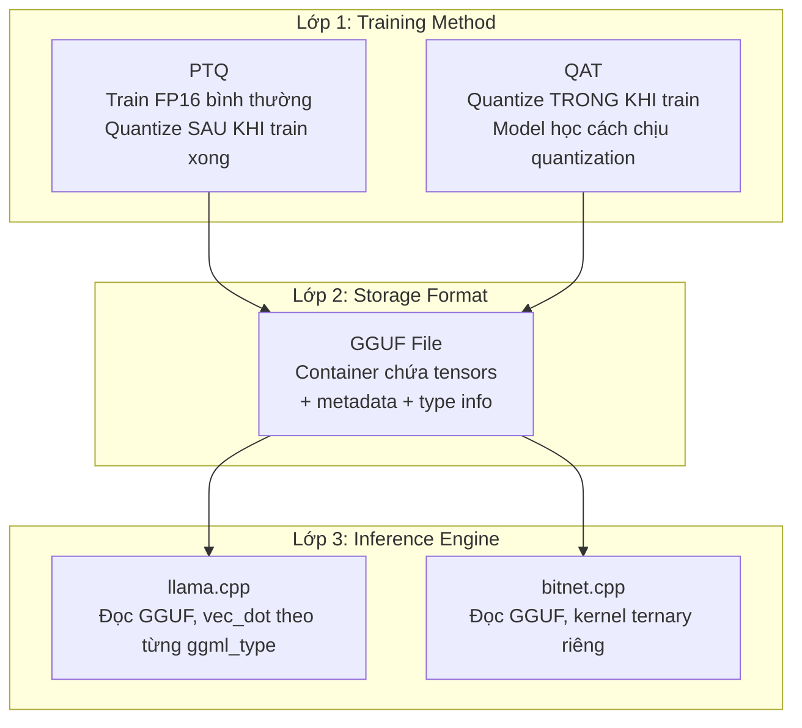
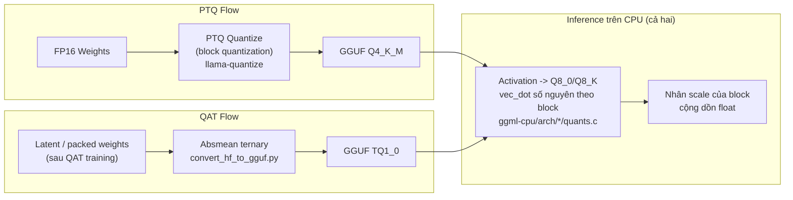

# Bài 8: Tại sao QAT Model chạy được trên PTQ Engine?

Một câu hỏi thường gặp gây nhầm lẫn: *"BitNet được train bằng QAT, llama.cpp là PTQ framework. Vậy tại sao model BitNet lại chạy được trên llama.cpp?"* Câu trả lời nằm ở việc phân biệt rõ ràng giữa ba khái niệm: **phương pháp training**, **định dạng lưu trữ**, và **engine inference**. Bài này phân tích vấn đề dựa trên mã nguồn thực tế của llama.cpp.

---

## Phần 1. Ba lớp khái niệm thường bị nhầm lẫn



**Điểm mấu chốt**: GGUF là **container format**: nó chứa tensor dưới dạng bytes cùng `ggml_type` của mỗi tensor và metadata. Nó không biết và không quan tâm weights đến từ PTQ hay QAT. Engine đọc bytes, tra `ggml_type`, và gọi kernel tương ứng. Điều kiện duy nhất là engine phải **biết** `ggml_type` đó: một file chứa `I2_S` (kiểu riêng của bitnet.cpp) sẽ không nạp được bằng upstream llama.cpp, dù cả hai đều là "GGUF".

---

## Phần 2. Pipeline cụ thể: BitNet QAT -> GGUF -> llama.cpp

### 2.1. Bước 1: Sau QAT Training

Trên Hugging Face, một checkpoint BitNet có thể ở một trong hai dạng:
- **Latent/master weights** (FP32/BF16), ví dụ `1bitLLM/bitnet_b1_58-large` hay `microsoft/bitnet-b1.58-2B-4T-bf16`: chứa trọng số đầy đủ mà optimizer đã cập nhật. Ternary hóa xảy ra khi convert.
- **Packed ternary weights**, ví dụ `microsoft/BitNet-b1.58-2B-4T`: `config.json` có `"quantization_config": {"quant_method": "bitnet", ...}`, weight được đóng gói 4 trit mỗi byte cùng tensor `weight_scale`.

Architecture được nhận diện qua trường `architectures` trong `config.json` (`BitnetForCausalLM` hoặc `BitNetForCausalLM`).

### 2.2. Bước 2: Convert HuggingFace -> GGUF

llama.cpp có converter riêng cho BitNet trong `conversion/bitnet.py`:

```python
@ModelBase.register("BitnetForCausalLM", "BitNetForCausalLM")
@ModelBase.example("microsoft/bitnet-b1.58-2B-4T")
class BitnetModel(TextModel):
    model_arch = gguf.MODEL_ARCH.BITNET
```

Với checkpoint latent, `BitnetModel.weight_quant()` áp dụng **đúng công thức absmean** mà model dùng trong forward pass lúc train, cho các tensor Q/K/V/O/gate/up/down:

```python
scale = weight.abs().mean().clamp(min=1e-5)
iscale = 1 / scale
result = (weight * iscale).round().clamp(-1, 1) / iscale   # vẫn ở dạng float: {-s, 0, +s}
```

Với checkpoint đã đóng gói, `ModelBase.dequant_model()` trong `conversion/base.py` (khi `quant_method == "bitnet"`) dùng hàm lồng `dequant_bitnet()` để giải nén:

```python
def dequant_bitnet(weight: Tensor, scale: Tensor) -> Tensor:
    weight = weight.view(torch.uint8)
    # ... tách 4 trit mỗi byte, (data - 1) để về {-1, 0, +1} ...
    return data / scale.float()   # "The scale is inverted"
```

Sau đó, khi chạy `convert_hf_to_gguf.py --outtype tq1_0` (hoặc `tq2_0`), converter:
1. Đọc weight và đưa về dạng float $\{-s, 0, +s\}$ như trên.
2. Đóng gói vào block `TQ1_0`/`TQ2_0`: mỗi block 256 phần tử lấy amax làm scale `d` (FP16), nên các trit được biểu diễn chính xác và chỉ còn sai số làm tròn FP16 của $s$.
3. Ghi GGUF với `general.file_type = MOSTLY_TQ1_0` (hoặc `MOSTLY_TQ2_0`).

Cũng có thể convert sang `f16`/`f32` trước rồi dùng `llama-quantize ... TQ1_0`, kết quả tương đương cho model vốn ternary.

### 2.3. Bước 3: llama.cpp đọc GGUF và inference

llama.cpp nạp tensor có `ggml_type = GGML_TYPE_TQ1_0`. Bảng `type_traits_cpu` trong `ggml/src/ggml-cpu/ggml-cpu.c` khai báo cho kiểu này:

```c
[GGML_TYPE_TQ1_0] = {
    .from_float   = quantize_row_tq1_0,
    .vec_dot      = ggml_vec_dot_tq1_0_q8_K,
    .vec_dot_type = GGML_TYPE_Q8_K,
    .nrows        = 1,
},
```

Nghĩa là: trong phép `mul_mat`, activation được lượng tử sang `Q8_K` (int8, một scale float cho mỗi 256 phần tử), rồi `ggml_vec_dot_tq1_0_q8_K` tính tích vô hướng **số nguyên trực tiếp trên trits** và chỉ nhân scale ở cuối mỗi block. Hàm `dequantize_row_tq1_0()` (file `ggml/src/ggml-quants.c`) có tồn tại nhưng không nằm trên đường matmul chính của CPU.

---

## Phần 3. Câu trả lời cho câu hỏi gốc

### 3.1. Tại sao QAT model chạy được trên PTQ engine?

**Vì cả QAT và PTQ đều tạo ra cùng một loại output: một GGUF chứa tensor ở các `ggml_type` mà engine hiểu.**

| Stage | PTQ Model | QAT Model (BitNet) |
|:---|:---|:---|
| Training | Train FP16 bình thường | Train với ràng buộc ternary trong forward pass |
| Weights sau training | FP16/BF16 | Latent FP32/BF16 hoặc ternary đã đóng gói |
| Convert step | `convert_hf_to_gguf.py` ra F16, rồi `llama-quantize` áp block quantization | `convert_hf_to_gguf.py --outtype tq1_0` (absmean, đóng gói ternary) |
| Output GGUF | Q4_K_M / Q8_0 / IQ4_XS... | TQ1_0 / TQ2_0 |
| llama.cpp inference | `ggml_vec_dot_q4_K_q8_K`... | `ggml_vec_dot_tq1_0_q8_K`, `ggml_vec_dot_tq2_0_q8_K` |

**llama.cpp không phân biệt**: nó chỉ thấy "một GGUF với tensor ở type X" và xử lý theo đúng protocol của type đó.

### 3.2. Quantize và tính toán: hai chiều khác nhau



Điểm tinh tế:
- **PTQ quantize** áp block quantization lên model đã train xong, chấp nhận sai số.
- **QAT quantize** áp absmean ternary lên latent weights: đây là **cùng một công thức** mà model đã dùng trong forward pass lúc train, nên về phía weight gần như không mất thông tin.
- **Inference**: cả hai đều đi qua `vec_dot` của kiểu tương ứng, trong đó activation bị lượng tử theo block (`Q8_0` cho kiểu 32 phần tử, `Q8_K` cho kiểu 256 phần tử).

### 3.3. "llama.cpp dùng PTQ": phát biểu chính xác hơn

llama.cpp **cung cấp** công cụ PTQ (`llama-quantize`, `llama-imatrix`). Nhưng llama.cpp cũng **đọc được** bất kỳ GGUF nào có kiểu nó hỗ trợ, kể cả file chứa weights đã được QAT-quantize.

Nói chính xác:
- `llama-quantize`: công cụ PTQ (áp quantization lên model F16/BF16/F32).
- `convert_hf_to_gguf.py --outtype tq1_0|tq2_0`: converter biết cấu trúc ternary (với `BitnetModel`, áp đúng absmean như lúc train).
- `llama-cli` / `llama-completion` / `llama-server`: inference engine (đọc GGUF, không quantize weight).

---

## Phần 4. Accuracy Gap: con số 1.4% đo cái gì?

Bảng 7 của arXiv:2410.16144 so sánh:

| Engine / kernel | Cách tính | Tỷ lệ mẫu trùng khớp tuyệt đối với FP32 reference |
|:---|:---|:---|
| llama.cpp TQ1_0 | Weight ternary (scale FP16/256) × activation `Q8_K` (scale/256) | 1.4% |
| llama.cpp TQ2_0 | Như trên, đóng gói 2 bit/trit | 1.4% |
| bitnet.cpp I2_S/TL1/TL2 | Tái hiện sơ đồ W1.58A8 của lúc train | 100% |

### 4.1. Định nghĩa metric

1,000 prompt ngẫu nhiên từ WildChat, model `bitnet_b1_58-large` (700M), sinh tối đa 100 token; một mẫu được tính là lossless chỉ khi **mọi token** trùng với output của FP32 kernel. Đây là metric **tái lập bit-exact của cả chuỗi**, không phải accuracy trên một benchmark tác vụ.

### 4.2. Nguyên nhân: sơ đồ lượng tử hóa khác, không phải "float không chính xác"

Một cách giải thích phổ biến (và sai) là "llama.cpp dequantize ternary về float, và float không biểu diễn chính xác được scale nên sai số tích lũy". Phân tích mã nguồn cho thấy:

1. **Tích trit × activation là số nguyên chính xác** trong cả hai engine. `ggml_vec_dot_tq2_0_q8_K` lưu trit dạng $\{0, 1, 2\}$, dùng `_mm256_maddubs_epi16` rồi trừ `bsums`; không có bước dequantize nào.
2. **Khác biệt nằm ở granularity của scale**:
   - Activation: llama.cpp dùng `Q8_K` với $\eta$ tính trên **mỗi block 256 phần tử**; BitNet được train với $\eta$ tính trên **cả vector của token** (per-token absmax). Hai cách làm tròn cho ra các giá trị int8 khác nhau.
   - Weight scale: llama.cpp lưu FP16 cho mỗi block (làm tròn $s$ về FP16); bitnet.cpp I2_S lưu một FP32 cho cả tensor.
3. **Khuếch đại bởi greedy decoding**: sai khác nhỏ ở logits đôi khi làm đổi token argmax; một token khác ở bất kỳ vị trí nào trong 100 token đã làm chuỗi tách nhánh và mẫu bị tính là "không lossless".

Vì vậy, kết luận đúng là: TQ1_0/TQ2_0 cho kết quả **xấp xỉ rất sát** nhưng không bit-exact so với reference; bitnet.cpp bit-exact vì tái hiện đúng phép lượng tử activation của lúc train. Nếu đo bằng perplexity, khoảng cách giữa hai engine nhỏ hơn rất nhiều so với khoảng cách "1.4% so với 100%" gợi ý.

### 4.3. Analogy

Hãy hình dung hai kế toán cùng cộng một cột số, cả hai đều cộng chính xác tuyệt đối. Nhưng một người làm tròn mỗi khoản đến nghìn đồng trước khi cộng (scale theo từng nhóm 256 khoản), người kia làm tròn theo quy tắc mà công ty đã dùng khi lập sổ (scale theo cả cột). Tổng của họ chênh nhau rất ít, nhưng chỉ người thứ hai khớp từng đồng với sổ gốc. Khác biệt nằm ở **quy tắc làm tròn đầu vào**, không nằm ở phép cộng.

---

## Phần 5. Convert Pipeline cho các QAT Framework khác

### 5.1. Tổng quát

Mọi QAT framework đều theo pattern tương tự:

```
QAT Training -> Export HuggingFace/safetensors
     -> Converter đọc weights, áp đúng công thức lượng tử của lúc train
     -> Ghi GGUF với ggml_type phù hợp
     -> llama.cpp nạp GGUF và gọi vec_dot của type đó
```

### 5.2. Ví dụ đã có thật trong upstream

Giả định "một model 1-bit hoặc ternary mới xuất hiện thì cần gì" không còn là giả thuyết. Năm 2026, PrismML phát hành họ model Bonsai (1-bit và ternary, xây từ các model Qwen đã pretrain) và đóng góp vào upstream hai kiểu mới trong `enum ggml_type`:
- `GGML_TYPE_Q1_0 = 41`: weight nhị phân $\{-d, +d\}$, nhóm 128, `block_q1_0` = FP16 scale + 16 byte bit dấu, tức 1.125 bpw (`quantize_row_q1_0_ref` lấy $d$ = trung bình trị tuyệt đối của nhóm).
- `GGML_TYPE_Q2_0 = 42`: 2 bit/weight với các mức $\{-1, 0, 1, 2\} \cdot d$, nhóm 64, `block_q2_0` = FP16 scale + 16 byte, tức 2.25 bpw; ternary là tập con của nó.

Cả hai dùng `vec_dot_type = GGML_TYPE_Q8_0` và có kernel cho CPU, CUDA, Metal, Vulkan, SYCL. Quy trình đúng như mô tả ở 5.1: thêm type vào `ggml.h`, thêm block struct vào `ggml-common.h`, thêm quantize/vec_dot, thêm ftype vào `llama-quantize`. Chi tiết về Bonsai được trình bày ở [Bài 11](../lesson_11_bonsai_model_family).

### 5.3. Điều kiện cần để QAT model chạy trên llama.cpp

| Yêu cầu | Với BitNet | Lý do |
|:---|:---|:---|
| Architecture support | `MODEL_ARCH.BITNET` trong `gguf-py/gguf/constants.py`, `LLM_ARCH_BITNET` và `src/models/bitnet.cpp` | llama.cpp biết cách dựng compute graph |
| Weight mapping | `gguf-py/gguf/tensor_mapping.py` có `self_attn.inner_attn_ln` -> `ATTN_SUB_NORM`, `mlp.ffn_layernorm` -> `FFN_SUB_NORM` | Converter biết đổi tên tensor |
| Quant type support | `GGML_TYPE_TQ1_0 = 34`, `GGML_TYPE_TQ2_0 = 35` trong `enum ggml_type` | GGML biết layout block |
| Converter class | `BitnetModel` trong `conversion/bitnet.py` | Áp đúng absmean |
| Kernel support | `quantize_row_tq1_0`, `ggml_vec_dot_tq1_0_q8_K`, `ggml_vec_dot_tq2_0_q8_K` | CPU kernel cho TQ blocks |

Lưu ý: mọi yêu cầu phải khớp **đúng biến thể kiến trúc**. Đồ thị BitNet hiện tại của upstream dựng FFN bằng `LLM_FFN_SILU` và mapping chỉ chứa tên sub-norm của checkpoint 1bitLLM; một biến thể dùng squared ReLU và tên tensor khác (như BitNet-b1.58-2B-4T) cần thêm thay đổi ở cả converter lẫn graph trước khi cho kết quả đúng.

---

## Phần 6. Khi nào KHÔNG convert được?

### 6.1. QAT với Custom Quantization Scheme

Nếu một QAT framework dùng sơ đồ lượng tử mà llama.cpp **chưa hỗ trợ** (ví dụ mixed-precision per-neuron, block size không khớp kiểu nào có sẵn, hay phép xoay Hadamard phía activation), thì không thể biểu diễn trung thực trong GGUF cho đến khi:
- Có người thêm quant type mới vào `enum ggml_type` (`ggml/include/ggml.h`) và block struct vào `ggml/src/ggml-common.h`.
- Cài đặt quantize/dequantize trong `ggml/src/ggml-quants.c` và `vec_dot` trong `ggml/src/ggml-cpu/` (cùng các backend GPU nếu cần).
- Thêm converter class trong `conversion/` và, nếu cần, ftype trong `tools/quantize/quantize.cpp`.

### 6.2. QAT với Architecture khác

Nếu QAT model dùng kiến trúc mà llama.cpp chưa biết (không có `MODEL_ARCH` entry và file graph trong `src/models/`), converter sẽ dừng với lỗi kiểu "Model ... is not supported" hoặc "Can not map tensor".

---

## Phần 7. Tóm tắt

| Câu hỏi | Câu trả lời |
|:---|:---|
| QAT model có convert sang GGUF được không? | **Có**, nếu llama.cpp hỗ trợ architecture + quant type |
| Tại sao? | GGUF là container format, không phân biệt PTQ vs QAT |
| `llama-quantize` có dùng được với QAT model không? | Được nếu đích là kiểu khớp với sơ đồ của model (TQ1_0/TQ2_0 cho ternary); lượng tử sang kiểu khác (Q4_K...) là PTQ chồng lên và mất lợi thế QAT |
| Cách đúng để convert BitNet? | `convert_hf_to_gguf.py --outtype tq1_0` hoặc `tq2_0` |
| llama.cpp inference BitNet có chính xác không? | Tích số nguyên chính xác, nhưng scale theo block (`Q8_K`, FP16/256) khác sơ đồ lúc train nên **không bit-exact** (1.4% chuỗi trùng khớp) |
| bitnet.cpp inference BitNet có chính xác không? | **Bit-exact** so với reference trong thí nghiệm của paper (100%) |

**Insight cốt lõi**: PTQ và QAT không phải hai framework cạnh tranh nhau. Chúng là hai **phương pháp tạo weights** khác nhau, nhưng output đều nằm trong cùng một format (GGUF). Inference engine chỉ cần biết cách đọc `ggml_type` đó, và muốn bit-exact thì phải tái hiện đúng cả sơ đồ lượng tử của activation.

---

## Tham khảo mã nguồn

- `conversion/bitnet.py`: `BitnetModel`, `@ModelBase.register("BitnetForCausalLM", "BitNetForCausalLM")`, `weight_quant()`.
- `conversion/base.py`: `ModelBase.dequant_model()` với hàm lồng `dequant_bitnet()` cho checkpoint `quant_method == "bitnet"`.
- `convert_hf_to_gguf.py`: `--outtype` nhận `f32, f16, bf16, q8_0, tq1_0, tq2_0, auto`.
- `ggml/src/ggml-common.h`: `block_tq1_0` (1.6875 bpw), `block_tq2_0` (2.0625 bpw), `block_q1_0`, `block_q2_0`.
- `ggml/src/ggml-quants.c`: `quantize_row_tq1_0_ref()`, `dequantize_row_tq1_0()`.
- `ggml/src/ggml-cpu/ggml-cpu.c`: `type_traits_cpu` (`vec_dot_type = GGML_TYPE_Q8_K` cho TQ1_0/TQ2_0).
- `ggml/src/ggml-cpu/arch/x86/quants.c`, `arch/arm/quants.c`: `ggml_vec_dot_tq1_0_q8_K`, `ggml_vec_dot_tq2_0_q8_K`.
- `gguf-py/gguf/constants.py`: `MODEL_ARCH.BITNET`, `GGMLQuantizationType.TQ1_0 = 34`, `TQ2_0 = 35`.
- `gguf-py/gguf/tensor_mapping.py`: BitNet tensor name mappings (`inner_attn_ln`, `ffn_layernorm`).
- `src/models/bitnet.cpp`, `src/llama-graph.cpp` (`build_lora_mm` áp scale `*_s`).
