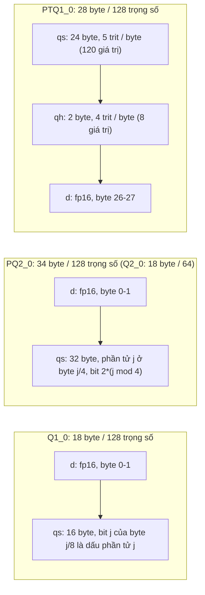

# Bài 9: Toán học và bố cục bit của các định dạng GGUF dùng cho Bonsai

Bài này mổ xẻ bốn định dạng mà họ mô hình Bonsai sử dụng: `Q1_0`, `Q2_0` (hai kiểu đã có trong mainline llama.cpp), `PQ2_0` và `PTQ1_0` (hai kiểu riêng của fork PrismML), đặt cạnh hai kiểu ternary có sẵn từ trước là `TQ1_0` và `TQ2_0`. Với mỗi định dạng, chúng ta trả lời bốn câu hỏi: bố cục byte chính xác là gì, bộ lượng tử tham chiếu làm gì, khi nào định dạng là không mất mát (lossless), và kernel tích vô hướng khai thác cấu trúc của nó như thế nào.

:::note Kiểm chứng
Mọi bố cục và thuật toán dưới đây được đọc từ `ggml/src/ggml-common.h`, `ggml/src/ggml-quants.c`, `ggml/src/ggml-cpu/quants.c` và `ggml/src/ggml-cuda/vecdotq.cuh` của fork `PrismML-Eng/llama.cpp` (nhánh `prism`). Bản cài đặt numpy trong [Lab 6](../experiments_deep_dive/exp_6_prism_codecs_lab) được so sánh byte-by-byte với thư viện `libggml-base` biên dịch từ fork và cho kết quả trùng khớp hoàn toàn với cả năm kiểu `Q1_0`, `Q2_0`, `PQ2_0`, `PTQ1_0`, `TQ1_0`.
:::

---

## Phần 1: Giới hạn thông tin và chi phí scale

Một nhóm $G$ trọng số chia chung một scale FP16. Nếu mỗi trọng số nhận một trong $L$ mức, số bit tối thiểu theo lý thuyết thông tin là:

$$b_{\min} = \log_2 L + \frac{16}{G}$$

Số hạng đầu là entropy cực đại của mã (khi các mức đồng xác suất), số hạng thứ hai là chi phí khấu hao của scale. Với Bonsai, $G = 128$ nên chi phí scale là $0.125$ bpw.

| Định dạng | $L$ | $G$ | Byte / block | bpw thực | $b_{\min}$ tương ứng | Hiệu suất đóng gói mã |
|:---|:---:|:---:|:---:|:---:|:---:|:---:|
| `Q1_0` | 2 | 128 | 18 | 1.125 | 1.125 | 100% |
| `PTQ1_0` | 3 | 128 | 28 | 1.750 | 1.710 | 97.5% |
| `PQ2_0` | 3 (dùng 3 trên 4 mã) | 128 | 34 | 2.125 | 1.710 | 79.2% |
| `Q2_0` | 3 (dùng 3 trên 4 mã) | 64 | 18 | 2.250 | 1.835 | 79.2% |
| `TQ1_0` | 3 | 256 | 54 | 1.6875 | 1.648 | 97.5% |
| `TQ2_0` | 3 | 256 | 66 | 2.0625 | 1.648 | 79.2% |

Hiệu suất đóng gói mã được tính bằng $\log_2 L$ chia cho số bit thực sự dùng cho mã trên mỗi trọng số. Với `PTQ1_0`, 120 trit được đóng 5 trit mỗi byte ($8/5 = 1.6$ bit mỗi trit) và 8 trit còn lại đóng 4 trit mỗi byte (2 bit mỗi trit), trung bình $(120 \cdot 1.6 + 8 \cdot 2)/128 = 1.625$ bit mỗi trit, nên hiệu suất là $1.585 / 1.625 \approx 97.5\%$. Cộng scale: $1.625 + 0.125 = 1.75$ bpw.

Đọc bảng theo nghĩa thực tế: `PTQ1_0` gần như chạm giới hạn thông tin; `PQ2_0` lãng phí khoảng 0.415 bit mỗi trọng số để đổi lấy việc giải mã chỉ bằng dịch bit và AND.

---

## Phần 2: Bố cục byte



Các struct tương ứng trong `ggml-common.h`:

```c
#define QK1_0 128
typedef struct { ggml_half d; uint8_t qs[QK1_0 / 8]; } block_q1_0;          // 18 B
#define QK2_0 64
typedef struct { ggml_half d; uint8_t qs[QK2_0 / 4]; } block_q2_0;          // 18 B
#define QK_PQ2_0 128
typedef struct { ggml_half d; uint8_t qs[QK_PQ2_0 / 4]; } block_pq2_0;      // 34 B
#define QK_PTQ1_0 128
typedef struct {
    uint8_t qs[(QK_PTQ1_0 - 4*QK_PTQ1_0/64)/5]; // 24 B, 5 trit mỗi byte
    uint8_t qh[QK_PTQ1_0/64];                   //  2 B, 4 trit mỗi byte
    ggml_half d;                                 //  2 B
} block_ptq1_0;                                  // 28 B
```

Ba chi tiết hay bị viết sai trong tài liệu thứ cấp:

1. Với `Q1_0`, `Q2_0`, `PQ2_0`, scale `d` nằm **ở đầu** block. Với `TQ1_0`, `TQ2_0`, `PTQ1_0`, scale nằm **ở cuối** block.
2. Mã 2 bit của `PQ2_0` được xếp **tuần tự**: phần tử $j$ nằm ở byte $\lfloor j/4 \rfloor$, các bit $2(j \bmod 4)$ và $2(j \bmod 4)+1$. Đọc 32 byte `qs` như 8 số `uint32` little-endian thì phần tử $16w + l$ nằm ở bit $2l$ của từ thứ $w$. Đây khác với `TQ2_0`, nơi bốn phần tử chung một byte cách nhau 32 vị trí.
3. Mã 2 bit $q \in \{0,1,2,3\}$ được giải thành $(q-1) \cdot d \in \{-d, 0, d, 2d\}$. Codec có bốn mức; dữ liệu ternary chỉ dùng ba mức đầu, mã `3` để dành.

---

## Phần 3: `Q1_0`: scale absmean là nghiệm bình phương tối thiểu

Bộ lượng tử tham chiếu `quantize_row_q1_0_ref` làm hai việc: đặt $d = \frac{1}{G}\sum_i |w_i|$ và lưu bit $b_i = [w_i \ge 0]$.

**Mệnh đề.** Với dấu cố định $\sigma_i = \operatorname{sign}(w_i)$, scale tối ưu theo bình phương tối thiểu là trung bình trị tuyệt đối.

**Chứng minh.** Hàm mục tiêu $\mathcal{L}(s) = \sum_i (w_i - s\sigma_i)^2$ là hàm bậc hai lồi theo $s$. Đạo hàm bằng 0:

$$\frac{d\mathcal{L}}{ds} = -2\sum_i \sigma_i (w_i - s\sigma_i) = 0 \;\Rightarrow\; s^* = \frac{\sum_i \sigma_i w_i}{\sum_i \sigma_i^2} = \frac{\sum_i |w_i|}{G}$$

vì $\sigma_i w_i = |w_i|$ và $\sigma_i^2 = 1$. $\blacksquare$

Với $w_i \sim \mathcal{N}(0, \sigma^2)$, $\mathbb{E}|w| = \sigma\sqrt{2/\pi}$, nên sai số bình phương tương đối là $1 - 2/\pi \approx 0.363$, tức sai số chuẩn tương đối $\approx 0.603$. Lab 6 đo được $0.596$ trên dữ liệu Gauss ngẫu nhiên. Ngược lại, khi đầu vào đã là $\pm s_g$ chính xác (trọng số xuất ra từ quy trình huấn luyện của Bonsai), absmean bằng đúng $s_g$ và `Q1_0` không mất mát (sai số chỉ là làm tròn FP16 của scale).

---

## Phần 4: `Q2_0` và `PQ2_0`: khi nào lossless

Bộ lượng tử tham chiếu (`quantize_row_q2_0_ref`, `quantize_row_pq2_0_ref`) dùng **absmax**: $d = \max_i |w_i|$, $q_i = \operatorname{clamp}(\operatorname{round}(w_i/d) + 1, 0, 3)$.

**Mệnh đề.** Nếu một nhóm 128 phần tử có dạng $w_i = s\, t_i$ với $t_i \in \{-1,0,1\}$ và có ít nhất một $t_i \neq 0$, thì cả `PQ2_0` (block 128) và `Q2_0` (block 64) đều tái tạo chính xác nhóm đó (bỏ qua làm tròn FP16 của $s$).

**Chứng minh.** Với `PQ2_0`, $\max|w_i| = s$, nên $w_i/d = t_i$ là số nguyên, làm tròn không đổi, giải mã cho $(t_i + 1 - 1)s = s\,t_i$. Với `Q2_0`, nhóm 128 được chia thành hai block 64. Mỗi block con hoặc có một phần tử khác 0, khi đó absmax của nó bằng $s$ và lập luận trên áp dụng; hoặc toàn 0, khi đó $d = 0$ và mọi phần tử giải mã về 0, vẫn đúng. $\blacksquare$

Hệ quả: một checkpoint ternary group 128 có thể phát hành **đồng thời** dưới dạng `PQ2_0` và `Q2_0` mà không mất thông tin; cái giá của `Q2_0` là thêm một scale mỗi 64 trọng số, tức $+0.125$ bpw, khớp với chênh lệch khoảng 6% kích thước file mà PrismML báo cáo (2.42 GB so với 2.56 GB cho bản 9B).

Ngược lại, với trọng số Gauss, absmax là lựa chọn scale rất tồi cho 3 mức: phần lớn giá trị rơi vào mức 0. Lab 6 đo sai số tương đối khoảng 0.78, so với khoảng 0.43 của bộ lượng tử ternary tối ưu. Đây là lý do định lượng cho cảnh báo của PrismML: tự lượng tử một mô hình bình thường sang `PQ2_0` hoặc `PTQ1_0` sẽ cho ra rác.

---

## Phần 5: `PTQ1_0` và `TQ1_0`: mã hóa cơ số 3 trong một byte

### 5.1. Thuật toán

Năm trit $t_0, \dots, t_4 \in \{0,1,2\}$ (đã cộng 1) được ghép thành số nguyên cơ số 3, trit đầu là chữ số có trọng số lớn nhất:

$$v = \sum_{n=0}^{4} t_n\, 3^{4-n} \in [0, 242]$$

Byte lưu trữ là:

$$q = \left\lceil \frac{256\, v}{243} \right\rceil \in [0, 255]$$

Giải mã trit thứ $n$:

$$t_n = \left\lfloor \frac{3 \cdot \left( q \cdot 3^n \bmod 256 \right)}{256} \right\rfloor$$

Trong C, phép $\bmod 256$ là tự nhiên nhờ tràn số của `uint8_t`, và phép chia cho 256 là dịch phải 8 bit:

```c
uint8_t q  = x[i].qs[j + m] * pow3[n];   // tràn uint8 = mod 256
int16_t xi = ((uint16_t) q * 3) >> 8;    // trit thứ n, trong {0, 1, 2}
```

Bản chất của thuật toán nằm ở việc: $q/256$ là một xấp xỉ của phân số cơ số 3 $0.t_0 t_1 t_2 t_3 t_4$. Nhân với $3^n$ rồi bỏ phần nguyên (tức $\bmod 256$) dịch phân số sang trái $n$ chữ số; nhân với 3 rồi lấy phần nguyên đọc ra chữ số đầu tiên còn lại.

### 5.2. Chứng minh tính chính xác

Viết $q = \frac{256 v}{243} + \varepsilon$ với $0 \le \varepsilon \lt 1$ (đây là chỗ phép làm tròn **lên** quan trọng: sai số không âm). Khi đó:

$$\frac{q\, 3^n}{256} = \frac{v\, 3^n}{243} + \delta, \qquad \delta = \frac{\varepsilon\, 3^n}{256}$$

Phần lẻ của $v\,3^n/243$ là $f_n = r / 3^{5-n}$ với $r = v \bmod 3^{5-n}$, và trit cần tìm là $t_n = \lfloor 3 f_n \rfloor$. Vì $3 f_n = r / 3^{4-n}$ là bội của $1/3^{4-n}$, khoảng cách từ $3f_n$ tới số nguyên kế tiếp phía trên ít nhất là $1/3^{4-n}$. Phép giải mã đúng khi $3\delta$ không vượt qua khoảng cách đó:

$$3 \cdot \frac{\varepsilon\, 3^n}{256} \lt \frac{1}{3^{4-n}} \iff \varepsilon \lt \frac{256}{3^5} = \frac{256}{243} \approx 1.053$$

Điều kiện luôn thỏa vì $\varepsilon \lt 1$. Đồng thời $\delta \ge 0$ nên giá trị không bao giờ rơi xuống dưới biên số nguyên phía dưới, và phần nguyên bị bỏ đi bởi $\bmod 256$ không ảnh hưởng phần lẻ. $\blacksquare$

Nếu dùng làm tròn xuống, $\varepsilon \in (-1, 0]$ và với $r = 0$ giá trị có thể tụt dưới biên, giải mã sai. Đây là lý do comment trong mã nguồn ghi "ceiling division".

Với `qh` (4 trit mỗi byte), thuật toán nhân thêm 3 trước khi mã hóa ($v \leftarrow 3v$), tức đặt trit thứ năm bằng 0, để dùng chung công thức giải mã.

### 5.3. Thứ tự phần tử: các "stage"

128 phần tử của `PTQ1_0` không được đóng gói tuần tự. Mảng `qs` 24 byte được chia thành các stage có độ rộng $c$ byte, lấy từ danh sách `{32, 16, 8}` (biến `ptq1_0_stages` trong `ggml-quants.c`), sao cho tổng vừa khít 24: ở đây là một stage 16 byte rồi một stage 8 byte. Trong một stage $c$ byte phủ $5c$ phần tử, trit thứ $n$ của byte $m$ là phần tử $n c + m$. Với `TQ1_0` (48 byte `qs`), danh sách stage rút gọn về `{32, 16}`, đúng hành vi gốc. Cách xếp xen kẽ này giúp kernel SIMD: một phép nhân vector với $3^n$ trên $c$ byte liền nhau trích ra $c$ phần tử liên tiếp.

### 5.4. Vì sao `TQ1_0` không dùng được cho Bonsai

`TQ1_0` dùng block 256 với **một** scale. Một block 256 phủ hai nhóm 128 có scale $s_1 \le s_2$. Absmax cho $d = s_2$; mọi trit được giữ đúng, nhưng nhóm thứ nhất được tái tạo với biên độ $s_2$ thay vì $s_1$. Gọi $k_1, k_2$ là số phần tử khác 0 trong hai nhóm, sai số tương đối của block là:

$$e_{\text{rel}} = \sqrt{\frac{k_1 (s_2 - s_1)^2}{k_1 s_1^2 + k_2 s_2^2}}$$

Sai số này không phải nhiễu ngẫu nhiên mà là một **sai lệch nhân tính có hệ thống** trên trọng số, truyền nguyên vẹn sang activation. Thông điệp commit #148 của fork báo cáo $6.43\%$ trên một checkpoint ternary thật (các scale liền kề khá gần nhau); Lab 6 với scale ngẫu nhiên đều trong $[0.01, 0.05]$ đo được khoảng $26\%$. `PTQ1_0` giữ nguyên kỹ thuật đóng gói của `TQ1_0` nhưng với block 128, nên lossless với checkpoint ternary group 128.

---

## Phần 6: Kernel tích vô hướng: gộp độ lệch $-1$ vào tổng activation

Trong llama.cpp, phép nhân ma trận lượng tử trên CPU thực hiện $\text{dot}(w, x)$ với $x$ đã được lượng tử về một kiểu 8 bit (`vec_dot_type` trong bảng `type_traits_cpu`):

| Kiểu trọng số | `vec_dot` trên CPU | `vec_dot_type` |
|:---|:---|:---|
| `Q1_0` | `ggml_vec_dot_q1_0_q8_0` | `Q8_0` |
| `Q2_0` | `ggml_vec_dot_q2_0_q8_0` | `Q8_0` |
| `PQ2_0` | `ggml_vec_dot_pq2_0_q8_K` | `Q8_K` |
| `PTQ1_0` | `ggml_vec_dot_ptq1_0_q8_0` | `Q8_0` |
| `TQ1_0`, `TQ2_0` | `ggml_vec_dot_tq*_q8_K` | `Q8_K` |

Với mã lưu không dấu $c_i = t_i + 1$, tích vô hướng của một block là:

$$\sum_i (c_i - 1)\, d_w \cdot a_i\, d_x = d_w d_x \left( \sum_i c_i a_i - \sum_i a_i \right)$$

với $a_i$ là activation INT8 và $d_x$ là scale của block activation. Số hạng $\sum_i a_i$ không phụ thuộc trọng số. Các định dạng activation của ggml đã tính sẵn nó: `block_q8_1` lưu $s = d_x \sum a_i$ cho mỗi 32 phần tử, `block_q8_K` lưu `bsums` cho mỗi 16 phần tử. Nhờ đó vòng lặp trong chỉ cần nhân các mã **không dấu** $c_i \in \{0,1,2\}$ với $a_i$, phù hợp với lệnh `dp4a` (CUDA), `vpdpbusd` (AVX-VNNI, toán hạng đầu không dấu) hay `sdot`/`udot` (ARM).

**`PQ2_0` trên CPU dùng `Q8_K`.** Một block `Q8_K` có 256 phần tử, phủ đúng hai block `PQ2_0`, nên hàm generic tính `y[i >> 1]` và lệch `128 * (i & 1)`. Hệ quả: hàng có độ dài không chia hết cho 256 phải đi đường `Q8_0` (commit "keep PQ2_0 rows that are not multiples of 256 on the Q8_0 activation path").

**`PTQ1_0` trên CUDA.** Kernel `vec_dot_ptq1_0_q8_1_multi` (`ggml-cuda/vecdotq.cuh`) dùng một mẹo song song hóa phép trích trit: bốn byte được tách vào phần thấp của các làn 16 bit (`__byte_perm(packed, 0, 0x4140)` và `0x4342`), rồi **một** phép nhân 32 bit với 3 bước đồng thời bốn luồng trit. Vì $3 \cdot 255 \lt 2^{16}$, không có carry tràn sang làn bên cạnh. Byte cao của mỗi làn là trit vừa trích, ghép lại bằng `__byte_perm(w_lo, w_hi, 0x7531)` thành một từ 4 byte đưa thẳng vào `dp4a`. Độ lệch $-1$ được gộp vào tổng activation như công thức trên.

**`Q1_0`.** Với $w_i = d(2b_i - 1)$: $\sum_i (2b_i - 1) a_i = 2\sum_{b_i = 1} a_i - \sum_i a_i$. Hàm generic `ggml_vec_dot_q1_0_q8_0_generic` chọn $\pm a_i$ theo từng bit. Bản AVX2 (`ggml_vec_dot_q1_0_q8_0` trong `ggml-cpu/arch/x86/quants.c`) làm điều đó cho 32 phần tử một lúc mà không rẽ nhánh: phát (broadcast) 32 bit dấu ra cả thanh ghi, `_mm256_shuffle_epi8` đưa byte thứ $k$ của từ vào 8 làn, `AND` với mặt nạ `1, 2, 4, ..., 128` rồi `_mm256_cmpeq_epi8` với 0 để có mặt nạ $m_i = -1$ ở các vị trí bit bằng 0. Phép đổi dấu có điều kiện được viết bằng đồng nhất thức bù hai $(a \oplus m) - m = -a$ khi $m = -1$ và $= a$ khi $m = 0$. Cuối cùng `_mm256_maddubs_epi16` với vector toàn 1 và `_mm256_madd_epi16` cộng dồn về INT32.

---

## Phần 7: Bài tập

1. Tính bpw của một định dạng giả định đóng 3 trit vào 5 bit ($3^3 = 27 \le 32$). So sánh hiệu suất đóng gói với 5 trit mỗi byte và 2 bit mỗi trit.
2. Chứng minh rằng với $q = \lfloor 256 v / 243 \rfloor$ (làm tròn xuống), tồn tại ít nhất một $v \in [0, 242]$ bị giải mã sai. Gợi ý: xét $v$ chia hết cho $3^4$.
3. Với một checkpoint ternary group 128, giả sử tỷ số $s_2/s_1$ của hai nhóm liền kề phân phối đều trên $[1, 1.2]$ và hai nhóm có cùng số phần tử khác 0. Ước lượng sai số tương đối trung bình nếu đóng gói bằng `TQ1_0`.
4. Viết lại công thức tích vô hướng của `PQ2_0` khi activation là `Q8_K`, chỉ rõ cách dùng `bsums`.
